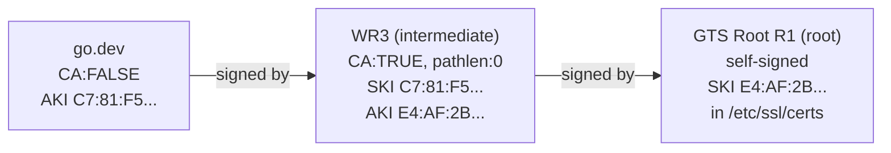
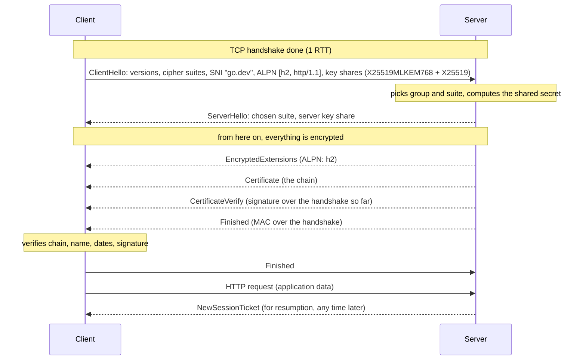

# TLS and certificates

## Why care?

Five messages from the same team chat:

- "`x509: certificate signed by unknown authority`. Works on my laptop. Fails in the container."
- "`x509: certificate is valid for orders.internal, not orders`. It's the same server!"
- "All calls to the payment provider fail since midnight. Nobody deployed anything." (The certificate expired at midnight.)
- "One VM gets `certificate has expired or is not yet valid` for a cert issued five minutes ago." (Its clock is wrong.)
- "We turned on mTLS, and now the server logs `tls: client didn't provide a certificate`, but the client says it does."

TLS errors are precise. Each one names exactly what failed. But they only make sense once you know what a certificate is, who checks what, and in which order. This page builds that up, then breaks it on purpose, one error at a time, with a private CA of our own.

## The idea: a padlock, a signature and a password

Three tools, each with one job.

- **Symmetric encryption** is a **shared password**. The same key locks and unlocks. It is fast (AES does gigabytes per second per core) but has one problem: how do two strangers on an open line agree on a password without anyone overhearing?
- **Key exchange** solves that. Each side makes a key pair, sends the **public** half, and combines its own **private** half with the other's public half. Both get the **same secret**; a listener who saw only the public halves can't compute it. It's like mixing paint: easy to mix, impossible to un-mix.
- **Signatures** prove **who** you are talking to. A private key signs; anyone with the public key can check the signature, nobody else can make one. A key exchange with a stranger is worthless if the stranger is an attacker in the middle. So the server **signs** the handshake with its private key, and the client checks that signature with the public key in the server's **certificate**.

And a **certificate** is a signed note from someone you trust: "this public key belongs to `go.dev`, until 26 December. Signed, Google Trust Services." Your machine trusts a short list of such signers. That list is the **trust store**.

Here are the first two tools in Go, including the post-quantum one that TLS uses today:

```go
// Command keyx shows how two sides agree on a secret over an open line,
// with classic X25519 and with post-quantum ML-KEM-768.
package main

import (
	"bytes"
	"crypto/aes"
	"crypto/cipher"
	"crypto/ecdh"
	"crypto/mlkem"
	"crypto/rand"
	"fmt"
)

func main() {
	// X25519: both sides make a key pair and swap public keys.
	client, _ := ecdh.X25519().GenerateKey(rand.Reader)
	server, _ := ecdh.X25519().GenerateKey(rand.Reader)
	s1, _ := client.ECDH(server.PublicKey()) // client: my private + your public
	s2, _ := server.ECDH(client.PublicKey()) // server: my private + your public
	fmt.Printf("X25519 public key: %d bytes, same secret on both sides: %t\n",
		len(client.PublicKey().Bytes()), bytes.Equal(s1, s2))

	// ML-KEM: the client sends a public "encapsulation key"; the server
	// uses it to wrap a fresh secret and sends back the ciphertext.
	dk, _ := mlkem.GenerateKey768()
	ek := dk.EncapsulationKey()
	serverSecret, ciphertext := ek.Encapsulate()
	clientSecret, _ := dk.Decapsulate(ciphertext)
	fmt.Printf("ML-KEM-768 encapsulation key: %d bytes, ciphertext: %d bytes, same secret: %t\n",
		len(ek.Bytes()), len(ciphertext), bytes.Equal(serverSecret, clientSecret))

	// From here on it is symmetric: one shared key, fast encryption.
	// (Real TLS first runs the secrets through HKDF and never reuses a nonce.)
	block, _ := aes.NewCipher(s1)
	aead, _ := cipher.NewGCM(block)
	nonce := make([]byte, aead.NonceSize())
	sealed := aead.Seal(nil, nonce, []byte("GET /v1/orders"), nil)
	fmt.Printf("AES-256-GCM: 14 bytes of plaintext -> %d bytes on the wire\n", len(sealed))
}
```

```console
$ go run .
X25519 public key: 32 bytes, same secret on both sides: true
ML-KEM-768 encapsulation key: 1184 bytes, ciphertext: 1088 bytes, same secret: true
AES-256-GCM: 14 bytes of plaintext -> 30 bytes on the wire
```

AES-GCM adds a 16-byte tag that proves nobody changed the bytes (14 + 16 = 30). Remember the other sizes: **32**, **1184** and **1088** bytes. They show up in the handshake below. (ML-KEM is a "key encapsulation mechanism": not a symmetric exchange like X25519, but the result is the same, a shared secret. It is believed to resist future quantum computers, which could break X25519.)

## Under the hood: reading a real certificate

Ask `go.dev` for its certificates:

```console
$ openssl s_client -connect go.dev:443 -servername go.dev -showcerts </dev/null 2>&1 | sed '/BEGIN CERT/,/END CERT/d'
Connecting to 216.239.36.21
depth=2 C=US, O=Google Trust Services LLC, CN=GTS Root R1
verify return:1
depth=1 C=US, O=Google Trust Services, CN=WR3
verify return:1
depth=0 CN=go.dev
verify return:1
CONNECTED(00000003)
---
Certificate chain
 0 s:CN=go.dev
   i:C=US, O=Google Trust Services, CN=WR3
   a:PKEY: RSA, 2048 (bit); sigalg: sha256WithRSAEncryption
   v:NotBefore: Nov 11 22:57:52 2026 GMT; NotAfter: Dec 26 23:47:23 2026 GMT
 1 s:C=US, O=Google Trust Services, CN=WR3
   i:C=US, O=Google Trust Services LLC, CN=GTS Root R1
   a:PKEY: RSA, 2048 (bit); sigalg: sha256WithRSAEncryption
   v:NotBefore: Dec 13 09:00:00 2023 GMT; NotAfter: Feb 20 14:00:00 2029 GMT
 2 s:C=US, O=Google Trust Services LLC, CN=GTS Root R1
   i:C=BE, O=GlobalSign nv-sa, OU=Root CA, CN=GlobalSign Root CA
   a:PKEY: RSA, 4096 (bit); sigalg: sha256WithRSAEncryption
   v:NotBefore: Jun 19 00:00:42 2020 GMT; NotAfter: Jan 28 00:00:42 2028 GMT
---
Server certificate
subject=CN=go.dev
issuer=C=US, O=Google Trust Services, CN=WR3
---
No client certificate CA names sent
Peer signing digest: SHA256
Peer signature type: rsa_pss_rsae_sha256
Negotiated TLS1.3 group: X25519MLKEM768
---
SSL handshake has read 5538 bytes and written 1649 bytes
Verification: OK
---
New, TLSv1.3, Cipher is TLS_AES_256_GCM_SHA384
Protocol: TLSv1.3
Server public key is 2048 bit
This TLS version forbids renegotiation.
Compression: NONE
Expansion: NONE
No ALPN negotiated
Early data was not sent
Verify return code: 0 (ok)
---
ECH: NOT CONFIGURED: -103
---
DONE
```

(`sed` drops the base64 blocks.) Always pass `-servername`: it sets **SNI**, explained below. Without it, many servers send a default certificate for some other name.

The server sent **three** certificates: `s:` is the subject (who this is about), `i:` the issuer (who signed it). Each one is signed by the next. Save the first block as `leaf.pem` and decode it (`no_pubkey,no_sigdump` hides the long key and signature bytes; the "SCT" part at the end is cut here):

```console
$ openssl x509 -in leaf.pem -noout -text -certopt no_pubkey,no_sigdump
Certificate:
    Data:
        Version: 3 (0x2)
        Serial Number:
            9e:0f:1c:98:cf:08:83:84:10:4c:d0:45:10:35:79:26
        Signature Algorithm: sha256WithRSAEncryption
        Issuer: C=US, O=Google Trust Services, CN=WR3
        Validity
            Not Before: Nov 11 22:57:52 2026 GMT
            Not After : Dec 26 23:47:23 2026 GMT
        Subject: CN=go.dev
        X509v3 extensions:
            X509v3 Key Usage: critical
                Digital Signature, Key Encipherment
            X509v3 Extended Key Usage:
                TLS Web Server Authentication
            X509v3 Basic Constraints: critical
                CA:FALSE
            X509v3 Subject Key Identifier:
                C2:8E:36:DB:75:F4:C7:6E:84:38:9C:50:D2:C6:01:7B:2F:6B:D7:71
            X509v3 Authority Key Identifier:
                C7:81:F5:FD:8E:88:D9:00:3C:4D:63:A2:50:31:24:A0:CE:23:FE:23
            Authority Information Access:
                CA Issuers - URI:http://i.pki.goog/wr3.crt
            X509v3 Subject Alternative Name:
                DNS:go.dev
            X509v3 Certificate Policies:
                Policy: 2.23.140.1.2.1
            X509v3 CRL Distribution Points:
                Full Name:
                  URI:http://c.pki.goog/wr3/d2ZFk07UT-s.crl
```

| Field                                  | Meaning                                                                                                                                                     |
| -------------------------------------- | ----------------------------------------------------------------------------------------------------------------------------------------------------------- |
| **Serial Number**                      | Unique per issuer. What a revocation list names.                                                                                                            |
| **Issuer / Subject**                   | Who signed / who this is about. For a server, the **Subject CN is ignored** by modern clients: only the SAN counts.                                         |
| **Validity**                           | `Not Before` / `Not After`, in UTC. This one lives about **45 days**. Public certificates are getting shorter-lived every year, so automate renewal (ACME). |
| **Key Usage**, **Extended Key Usage**  | What the key may do. `TLS Web Server Authentication` = may act as a server. A client certificate needs `TLS Web Client Authentication`.                     |
| **Basic Constraints** `CA:FALSE`       | This key may **not** sign other certificates. Without that rule, any website could issue a certificate for your bank.                                       |
| **Subject / Authority Key Identifier** | A fingerprint of this cert's key, and of the **issuer's** key. That's how a verifier finds the parent.                                                      |
| **Authority Information Access**       | Where to download the issuer's certificate. Browsers use it to fix incomplete chains; **Go (on Linux) and OpenSSL don't**.                                  |
| **Subject Alternative Name** (SAN)     | **The names this certificate is valid for.** DNS names and IP addresses. The hostname check looks only here.                                                |
| **CRL Distribution Points**, **SCTs**  | Revocation list URL; proof that the certificate was logged in public Certificate Transparency logs (browsers require it).                                   |

## Under the hood: the chain of trust



Check the links yourself. The leaf's Authority Key Identifier is the intermediate's Subject Key Identifier, and so on up:

```console
$ openssl x509 -in wr3.pem -noout -subject -ext subjectKeyIdentifier,authorityKeyIdentifier,basicConstraints,keyUsage
subject=C=US, O=Google Trust Services, CN=WR3
X509v3 Key Usage: critical
    Digital Signature, Certificate Sign, CRL Sign
X509v3 Basic Constraints: critical
    CA:TRUE, pathlen:0
X509v3 Subject Key Identifier:
    C7:81:F5:FD:8E:88:D9:00:3C:4D:63:A2:50:31:24:A0:CE:23:FE:23
X509v3 Authority Key Identifier:
    E4:AF:2B:26:71:1A:2B:48:27:85:2F:52:66:2C:EF:F0:89:13:71:3E
$ openssl x509 -in /etc/ssl/certs/GTS_Root_R1.pem -noout -subject -issuer -dates -ext subjectKeyIdentifier
subject=C=US, O=Google Trust Services LLC, CN=GTS Root R1
issuer=C=US, O=Google Trust Services LLC, CN=GTS Root R1
notBefore=Jun 22 00:00:00 2016 GMT
notAfter=Jun 22 00:00:00 2036 GMT
X509v3 Subject Key Identifier:
    E4:AF:2B:26:71:1A:2B:48:27:85:2F:52:66:2C:EF:F0:89:13:71:3E
```

The **root** signs itself (subject = issuer) and lives 20 years. It is trusted not because of a signature, but because it is **in the trust store**: a file your OS ships. `pathlen:0` on WR3 says "may sign leaves, but not more CAs".

The server sent a third certificate, "GTS Root R1 signed by GlobalSign": a **cross-sign**, for old clients that only trust GlobalSign. A modern verifier stops at the GTS Root R1 in its own store; the extra certificate is ignored. Verification builds the shortest path to **any** trusted root:

```console
$ openssl verify leaf.pem
CN=go.dev
error 20 at 0 depth lookup: unable to get local issuer certificate
error leaf.pem: verification failed
$ openssl verify -show_chain -untrusted wr3.pem leaf.pem
leaf.pem: OK
Chain:
depth=0: CN=go.dev (untrusted)
depth=1: C=US, O=Google Trust Services, CN=WR3 (untrusted)
depth=2: C=US, O=Google Trust Services LLC, CN=GTS Root R1
```

The first run is the classic **missing intermediate**: the leaf alone can't be linked to a root. When a server forgets to send its intermediate, browsers often still work (they cache intermediates or fetch them via AIA), while Go, curl and Java fail. Go says it like this:

```go
// Command verify checks a leaf certificate against the system trust store,
// with and without the intermediate.
package main

import (
	"crypto/x509"
	"encoding/pem"
	"fmt"
	"os"
)

func load(path string) *x509.Certificate {
	b, _ := os.ReadFile(path)
	block, _ := pem.Decode(b)
	c, err := x509.ParseCertificate(block.Bytes)
	if err != nil {
		panic(err)
	}
	return c
}

func main() {
	leaf, wr3 := load("leaf.pem"), load("wr3.pem")
	_, err := leaf.Verify(x509.VerifyOptions{DNSName: "go.dev"})
	fmt.Println("leaf only:", err)

	inter := x509.NewCertPool()
	inter.AddCert(wr3)
	chains, err := leaf.Verify(x509.VerifyOptions{DNSName: "go.dev", Intermediates: inter})
	fmt.Println("with intermediate:", err)
	for _, c := range chains[0] {
		fmt.Println("  ", c.Subject)
	}
}
```

```console
$ go run .
leaf only: x509: certificate signed by unknown authority
with intermediate: <nil>
   CN=go.dev
   CN=WR3,O=Google Trust Services,C=US
   CN=GTS Root R1,O=Google Trust Services LLC,C=US
```

`unknown authority` means "I could not build a chain to a root I trust". The cause is one of three: the root isn't in **your** trust store, the server didn't send its intermediate, or someone in the middle (a corporate proxy) replaced the certificate.

### The trust store is a file

On Debian and Ubuntu it is `/etc/ssl/certs/ca-certificates.crt`, built by `update-ca-certificates` from `/usr/share/ca-certificates` and `/usr/local/share/ca-certificates`:

```console
$ ls -l /etc/ssl/certs/ca-certificates.crt
-rw-r--r-- 1 root root 180744 Nov  8 18:49 /etc/ssl/certs/ca-certificates.crt
$ grep -c 'BEGIN CERTIFICATE' /etc/ssl/certs/ca-certificates.crt
120
```

Go's `crypto/x509` on Linux tries a list of well-known paths (`root_linux.go`):

```go
var certFiles = []string{
	"/etc/ssl/certs/ca-certificates.crt",                // Debian/Ubuntu/Gentoo etc.
	"/etc/pki/tls/certs/ca-bundle.crt",                  // Fedora/RHEL 6
	"/etc/ssl/ca-bundle.pem",                            // OpenSUSE
	"/etc/pki/tls/cacert.pem",                           // OpenELEC
	"/etc/pki/ca-trust/extracted/pem/tls-ca-bundle.pem", // CentOS/RHEL 7
	"/etc/ssl/cert.pem",                                 // Alpine Linux
}
```

and the environment variables `SSL_CERT_FILE` and `SSL_CERT_DIR` replace them. That makes the trust store easy to swap. With only our private CA (built in the next section) as the "system" store, our own server is trusted and `go.dev` is not:

```console
$ SSL_CERT_FILE=$PWD/ca.pem SSL_CERT_DIR=/nonexistent ./client -ca ""
TLS 1.3 TLS_AES_128_GCM_SHA256 X25519MLKEM768 200 OK resumed=false alpn=h2 (4ms)
  hello orderctl, over HTTP/2.0
$ SSL_CERT_FILE=$PWD/ca.pem SSL_CERT_DIR=/nonexistent ./client -ca "" -cert "" -url https://go.dev/
client: Get "https://go.dev/": tls: failed to verify certificate: x509: certificate signed by unknown authority
```

That's the "works on my laptop, fails in the container" ticket. A `FROM scratch` image has **no** trust store, so every HTTPS call fails with `unknown authority`. `distroless/static` (which `ordersd`'s [Dockerfile](../go/services.md) uses) includes one. For `scratch`, copy `/etc/ssl/certs/ca-certificates.crt` in, or import `golang.org/x/crypto/x509roots/fallback`, which embeds a root bundle into the binary.

## Under the hood: the TLS 1.3 handshake

TLS 1.3 needs **one round trip** after TCP's own handshake (see [TCP](tcp.md)). TLS 1.2 needed two.



1. The client **guesses** which key exchange the server will pick and sends its key shares right away. That guess is what saves a round trip. If the server supports none of them, it answers with a `HelloRetryRequest` and it costs one more trip.
2. After the `ServerHello`, both sides have the shared secret. Everything after it, **including the certificate**, is encrypted. (In TLS 1.2, anyone on the path could read the certificate.)
3. `CertificateVerify` is the server's **signature** over everything said so far. That proves it holds the private key for the certificate, and that nobody changed the messages.
4. The client sends its `Finished` and its first request **in the same flight**.

Here is the real sequence with `go.dev`, summarised from `openssl s_client -trace` (an `awk` script prints one line per handshake message):

```console
$ openssl s_client -connect go.dev:443 -servername go.dev -alpn h2,http/1.1 -trace </dev/null > trace.txt 2>&1
$ awk '/^(Sent|Received) TLS Record/{dir=$1} /^    [A-Za-z]+, Length=/{print dir, $1, $2} /^  Content Type = ChangeCipherSpec/{print dir, "ChangeCipherSpec"}' trace.txt
Sent ClientHello, Length=1578
Received ServerHello, Length=1206
Received ChangeCipherSpec
Received EncryptedExtensions, Length=11
Received Certificate, Length=3969
Received CertificateVerify, Length=260
Received Finished, Length=48
Sent ChangeCipherSpec
Sent Finished, Length=48
$ grep -E 'ALPN protocol|Negotiated TLS1.3 group|^Protocol|Cipher is' trace.txt
Negotiated TLS1.3 group: X25519MLKEM768
New, TLSv1.3, Cipher is TLS_AES_256_GCM_SHA384
Protocol: TLSv1.3
ALPN protocol: h2
```

The `ChangeCipherSpec` messages are fakes: TLS 1.3 sends them only so that old middleboxes, which expect TLS 1.2, don't drop the connection. The `Certificate` is 3969 bytes: the three certificates from above, and the main reason a handshake is a few kilobytes.

### Inside the ClientHello Go sends

Point the Go client at `openssl s_server -trace` to see what **Go** offers (here, with the server certificate from the next section, and no client certificate):

```console
$ openssl s_server -accept 127.0.0.1:18443 -cert server.pem -key server-key.pem -trace -www > sserver.log 2>&1 &
$ ./client -url https://localhost:18443/ -cert ""
TLS 1.3 TLS_AES_128_GCM_SHA256 X25519MLKEM768 200 ok resumed=false alpn= (6ms)
  <HTML><BODY BGCOLOR="#ffffff">
$ grep -E 'ClientHello|ServerHello|extension_type=(server_name|supported_groups|application_layer|supported_versions|key_share|psk)|NamedGroup|key_exchange:' sserver.log | cut -c1-80
    ClientHello, Length=1526
        extension_type=server_name(0), length=14
        extension_type=supported_groups(10), length=16
        extension_type=application_layer_protocol_negotiation(16), length=14
        extension_type=supported_versions(43), length=5
        extension_type=key_share(51), length=1258
            NamedGroup: X25519MLKEM768 (4588)
            key_exchange:  (len=1216): A28047383579FBA4128B61AFE4966ED130C10B816
            NamedGroup: ecdh_x25519 (29)
            key_exchange:  (len=32): 0929DAF39292390425E398516DBA4C35396CABF9FE6
        extension_type=psk_key_exchange_modes(45), length=2
    ServerHello, Length=1206
        extension_type=supported_versions(43), length=2
        extension_type=key_share(51), length=1124
            NamedGroup: X25519MLKEM768 (4588)
            key_exchange:  (len=1120): 03D3BBCA4E6129A02C011678DD7CF09493A943125
$ grep -m2 -oE 'key_exchange:  \(len=[0-9]+\): [0-9A-F]+' sserver.log | awk '{print $2, "..." substr($3, length($3)-63)}'
(len=1216): ...0929DAF39292390425E398516DBA4C35396CABF9FE60D2D334C683AB72BEC641
(len=32): ...0929DAF39292390425E398516DBA4C35396CABF9FE60D2D334C683AB72BEC641
```

- **Two key shares**: the hybrid `X25519MLKEM768` (1216 = 1184 bytes of ML-KEM key + 32 bytes of X25519) and a plain X25519 (32 bytes) for servers that don't know the hybrid yet. The last 32 bytes of both are **the same** X25519 key: Go makes it once and sends it twice.
- **The server's answer**: 1120 = 1088 bytes of ML-KEM ciphertext + 32 bytes of X25519. Exactly the sizes from `keyx`.
- **The ClientHello is 1526 bytes**, bigger than what fits in one 1500-byte Ethernet packet (see [Layers and packets](layers-and-packets.md)), so on a real network it is split into two TCP segments. Old firewalls that expect the whole ClientHello in one packet break here. Without ML-KEM it would be about 300 bytes.
- `alpn=` is empty: `s_server -www` speaks only HTTP/1.0 and doesn't negotiate ALPN.

## SNI and ALPN: two labels on the envelope

Both travel in the **unencrypted** ClientHello, before any certificate.

**SNI** (Server Name Indication) is the host name the client wants. One IP address often serves hundreds of sites (a load balancer, a CDN); SNI tells it **which certificate** to send. Go sets it from the URL's host, or from `tls.Config.ServerName`. Our server logs it from `GetConfigForClient`:

```text
2026/11/26 17:54:36 ClientHello: SNI="localhost" ALPN=["h2" "http/1.1"] groups=[X25519MLKEM768 SecP256r1MLKEM768 SecP384r1MLKEM1024 X25519 CurveP256 CurveP384 CurveP521]
2026/11/26 17:54:36 ClientHello: SNI="localhost" ALPN=["h2" "http/1.1"] groups=[X25519MLKEM768 SecP256r1MLKEM768 SecP384r1MLKEM1024 X25519 CurveP256 CurveP384 CurveP521]
2026/11/26 17:54:36 ClientHello: SNI="" ALPN=["h2" "http/1.1"] groups=[X25519MLKEM768 SecP256r1MLKEM768 SecP384r1MLKEM1024 X25519 CurveP256 CurveP384 CurveP521]
```

The third line is the request to `https://127.0.0.1:8443/`: **an IP address is never sent as SNI**. A server or load balancer that picks the certificate by SNI then has to fall back to a default one, and that's often where "wrong certificate" tickets come from. And because SNI is plaintext, anyone on the path can see which site you visit. **ECH** (Encrypted Client Hello) fixes that by encrypting the inner ClientHello; Go clients support it through `tls.Config.EncryptedClientHelloConfigList`, the config coming from DNS. `go.dev` doesn't offer it (`ECH: NOT CONFIGURED` above).

**ALPN** (Application-Layer Protocol Negotiation) agrees on the protocol **inside** TLS: the client offers `["h2", "http/1.1"]`, the server picks one in `EncryptedExtensions`. That is how HTTP/2 is chosen without another round trip (see [HTTP](http.md)). In Go, `http.Transport` sends `h2` only if you leave `TLSClientConfig` nil or set `ForceAttemptHTTP2: true`; a custom TLS config otherwise turns HTTP/2 off.

## Try it: a private CA and mutual TLS

Inside a company, services often use **mTLS**: the server shows a certificate, **and so does the client**. The server then knows which service is calling, without passwords or tokens. We need a CA, a server certificate for `ordersd`, a client certificate for `orderctl` and, to break things, an expired server certificate.

```go
// Command pki makes a tiny private PKI for experiments: one CA, a server
// certificate, a client certificate, and an expired server certificate.
package main

import (
	"crypto/ecdsa"
	"crypto/elliptic"
	"crypto/rand"
	"crypto/x509"
	"crypto/x509/pkix"
	"encoding/pem"
	"math/big"
	"net"
	"os"
	"time"
)

func main() {
	now := time.Now()
	caKey, caCert := issue(nil, nil, &x509.Certificate{
		Subject:               pkix.Name{CommonName: "Orders Dev CA"},
		NotBefore:             now,
		NotAfter:              now.AddDate(1, 0, 0),
		IsCA:                  true,
		BasicConstraintsValid: true,
		MaxPathLenZero:        true, // may sign leaves, not other CAs
		KeyUsage:              x509.KeyUsageCertSign | x509.KeyUsageCRLSign,
	}, "ca")

	server := func(notBefore, notAfter time.Time) *x509.Certificate {
		return &x509.Certificate{
			Subject:     pkix.Name{CommonName: "ordersd"},
			DNSNames:    []string{"localhost", "ordersd.shop.svc.cluster.local"},
			IPAddresses: []net.IP{net.IPv4(127, 0, 0, 1)},
			NotBefore:   notBefore,
			NotAfter:    notAfter,
			KeyUsage:    x509.KeyUsageDigitalSignature,
			ExtKeyUsage: []x509.ExtKeyUsage{x509.ExtKeyUsageServerAuth},
		}
	}
	issue(caKey, caCert, server(now, now.AddDate(0, 0, 90)), "server")
	issue(caKey, caCert, server(now.AddDate(0, 0, -91), now.AddDate(0, 0, -1)), "expired")
	issue(caKey, caCert, &x509.Certificate{
		Subject:     pkix.Name{CommonName: "orderctl"},
		NotBefore:   now,
		NotAfter:    now.AddDate(0, 0, 30),
		KeyUsage:    x509.KeyUsageDigitalSignature,
		ExtKeyUsage: []x509.ExtKeyUsage{x509.ExtKeyUsageClientAuth},
	}, "client")
}

// issue makes a key pair and a certificate for tmpl, signed by parent's key.
// With a nil parent, the certificate signs itself (a root CA).
// It writes name.pem and name-key.pem.
func issue(parentKey *ecdsa.PrivateKey, parent, tmpl *x509.Certificate, name string) (*ecdsa.PrivateKey, *x509.Certificate) {
	key, err := ecdsa.GenerateKey(elliptic.P256(), rand.Reader)
	check(err)
	tmpl.SerialNumber, err = rand.Int(rand.Reader, new(big.Int).Lsh(big.NewInt(1), 128))
	check(err)
	if parent == nil {
		parent, parentKey = tmpl, key
	}
	der, err := x509.CreateCertificate(rand.Reader, tmpl, parent, &key.PublicKey, parentKey)
	check(err)
	keyDER, err := x509.MarshalPKCS8PrivateKey(key)
	check(err)
	check(os.WriteFile(name+".pem", pem.EncodeToMemory(&pem.Block{Type: "CERTIFICATE", Bytes: der}), 0o644))
	check(os.WriteFile(name+"-key.pem", pem.EncodeToMemory(&pem.Block{Type: "PRIVATE KEY", Bytes: keyDER}), 0o600))
	cert, err := x509.ParseCertificate(der)
	check(err)
	return key, cert
}

func check(err error) {
	if err != nil {
		panic(err)
	}
}
```

```console
$ ./pki
$ ls *.pem
ca-key.pem
ca.pem
client-key.pem
client.pem
expired-key.pem
expired.pem
server-key.pem
server.pem
$ openssl verify -CAfile ca.pem server.pem client.pem expired.pem
CN=ordersd
error 10 at 0 depth lookup: certificate has expired
error expired.pem: verification failed
server.pem: OK
client.pem: OK
$ openssl x509 -in ca.pem -noout -subject -issuer -ext basicConstraints,keyUsage,subjectKeyIdentifier
subject=CN=Orders Dev CA
issuer=CN=Orders Dev CA
X509v3 Key Usage: critical
    Certificate Sign, CRL Sign
X509v3 Basic Constraints: critical
    CA:TRUE, pathlen:0
X509v3 Subject Key Identifier:
    47:F8:87:D2:D0:0C:A2:70:C9:19:F9:81:88:D4:76:3D:49:70:45:0D
$ openssl x509 -in server.pem -noout -text -certopt no_pubkey,no_sigdump
Certificate:
    Data:
        Version: 3 (0x2)
        Serial Number:
            c5:e2:0e:43:70:e3:92:48:00:a3:5b:0d:5d:59:4a:41
        Signature Algorithm: ecdsa-with-SHA256
        Issuer: CN=Orders Dev CA
        Validity
            Not Before: Nov 26 16:54:35 2026 GMT
            Not After : Feb 24 16:54:35 2027 GMT
        Subject: CN=ordersd
        X509v3 extensions:
            X509v3 Key Usage: critical
                Digital Signature
            X509v3 Extended Key Usage:
                TLS Web Server Authentication
            X509v3 Authority Key Identifier:
                47:F8:87:D2:D0:0C:A2:70:C9:19:F9:81:88:D4:76:3D:49:70:45:0D
            X509v3 Subject Alternative Name:
                DNS:localhost, DNS:ordersd.shop.svc.cluster.local, IP Address:127.0.0.1
```

Things to notice:

- The private keys are written with mode `0600`. The CA key is the crown jewel: whoever has it can mint a certificate for any name your services trust. In production it lives in a vault or HSM, never next to the service.
- The SAN has the short name, the cluster name **and** the IP. The certificate is valid for exactly those, nothing else.
- `NotBefore` is "now". Real CAs usually set it a little in the past, so that clients with a slow clock don't reject a fresh certificate (we will see that error below).

The server requires and verifies a client certificate from our CA:

```go
// Command server is an HTTPS server that requires a client certificate
// signed by our CA (mutual TLS).
package main

import (
	"crypto/tls"
	"crypto/x509"
	"flag"
	"fmt"
	"log"
	"net/http"
	"os"
)

func main() {
	cert := flag.String("cert", "server", "certificate name: server or expired")
	flag.Parse()

	pair, err := tls.LoadX509KeyPair(*cert+".pem", *cert+"-key.pem")
	check(err)
	caPEM, err := os.ReadFile("ca.pem")
	check(err)
	clientCAs := x509.NewCertPool()
	clientCAs.AppendCertsFromPEM(caPEM)

	srv := &http.Server{
		Addr: "127.0.0.1:8443",
		TLSConfig: &tls.Config{
			Certificates: []tls.Certificate{pair},
			ClientCAs:    clientCAs,
			ClientAuth:   tls.RequireAndVerifyClientCert,
			// Called with every ClientHello, before the server answers.
			GetConfigForClient: func(hello *tls.ClientHelloInfo) (*tls.Config, error) {
				log.Printf("ClientHello: SNI=%q ALPN=%q groups=%v", hello.ServerName, hello.SupportedProtos, hello.SupportedCurves)
				return nil, nil // nil: keep using TLSConfig
			},
		},
		Handler: http.HandlerFunc(func(w http.ResponseWriter, r *http.Request) {
			fmt.Fprintf(w, "hello %s, over %s\n", r.TLS.PeerCertificates[0].Subject.CommonName, r.Proto)
		}),
	}
	log.Printf("listening on https://%s", srv.Addr)
	log.Fatal(srv.ListenAndServeTLS("", "")) // certificates come from TLSConfig
}

func check(err error) {
	if err != nil {
		log.Fatal(err)
	}
}
```

The client trusts our CA, sends its certificate, and prints what was negotiated. Flags let us break each part:

```go
// Command client calls the mTLS server and reports what TLS negotiated.
package main

import (
	"crypto/tls"
	"crypto/x509"
	"flag"
	"fmt"
	"io"
	"net/http"
	"os"
	"strings"
	"time"
)

func main() {
	url := flag.String("url", "https://localhost:8443/", "URL to GET")
	ca := flag.String("ca", "ca.pem", `CA file to trust; "" means the system trust store`)
	cert := flag.String("cert", "client", `client certificate name; "" sends none`)
	name := flag.String("name", "", "server name to verify (default: the URL's host)")
	skew := flag.Duration("skew", 0, "pretend our clock is off by this much")
	keylog := flag.String("keylog", "", "append TLS secrets to this file (debugging only!)")
	n := flag.Int("n", 1, "number of requests, each on a new connection")
	flag.Parse()

	cfg := &tls.Config{
		ServerName:         *name,
		Time:               func() time.Time { return time.Now().Add(*skew) },
		ClientSessionCache: tls.NewLRUClientSessionCache(0), // enables resumption
	}
	if *ca != "" {
		pem, err := os.ReadFile(*ca)
		check(err)
		cfg.RootCAs = x509.NewCertPool()
		cfg.RootCAs.AppendCertsFromPEM(pem)
	}
	if *cert != "" {
		pair, err := tls.LoadX509KeyPair(*cert+".pem", *cert+"-key.pem")
		check(err)
		cfg.Certificates = []tls.Certificate{pair}
	}
	if *keylog != "" {
		f, err := os.OpenFile(*keylog, os.O_APPEND|os.O_CREATE|os.O_WRONLY, 0o600)
		check(err)
		defer f.Close()
		cfg.KeyLogWriter = f
	}

	client := &http.Client{
		Timeout: 5 * time.Second,
		Transport: &http.Transport{
			TLSClientConfig:   cfg,
			ForceAttemptHTTP2: true, // a custom TLSClientConfig turns HTTP/2 off otherwise
			DisableKeepAlives: true, // a new TCP and TLS connection per request
		},
	}
	for range *n {
		start := time.Now()
		resp, err := client.Get(*url)
		check(err)
		body, _ := io.ReadAll(resp.Body)
		resp.Body.Close()
		line, _, _ := strings.Cut(string(body), "\n")
		s := resp.TLS
		fmt.Printf("%s %s %v %s resumed=%t alpn=%s (%v)\n  %.60s\n",
			tls.VersionName(s.Version), tls.CipherSuiteName(s.CipherSuite), s.CurveID,
			resp.Status, s.DidResume, s.NegotiatedProtocol, time.Since(start).Round(time.Millisecond), line)
	}
}

func check(err error) {
	if err != nil {
		fmt.Fprintln(os.Stderr, "client:", err)
		os.Exit(1)
	}
}
```

```console
$ ./server > server.log 2>&1 &
$ ./client -n 2
TLS 1.3 TLS_AES_128_GCM_SHA256 X25519MLKEM768 200 OK resumed=false alpn=h2 (4ms)
  hello orderctl, over HTTP/2.0
TLS 1.3 TLS_AES_128_GCM_SHA256 X25519MLKEM768 200 OK resumed=true alpn=h2 (2ms)
  hello orderctl, over HTTP/2.0
$ curl -sS --cacert ca.pem --cert client.pem --key client-key.pem https://localhost:8443/
hello orderctl, over HTTP/2.0
$ openssl s_client -connect localhost:8443 -CAfile ca.pem </dev/null 2>/dev/null | grep -A1 'Acceptable client'
Acceptable client certificate CA names
CN=Orders Dev CA
```

- **TLS 1.3, AES-128-GCM, X25519MLKEM768, h2**: Go's defaults on both sides, no tuning.
- The server knows the caller: `hello orderctl` comes from `r.TLS.PeerCertificates[0]`.
- The server tells clients which CAs it accepts. A client with several certificates uses that list to pick one.
- **`resumed=true`** on the second connection. See below.

### Session resumption

After the handshake, the server sends a **session ticket**: its own state, encrypted with a key only the server knows. The client keeps it in its `ClientSessionCache` and offers it in the next ClientHello. If the server accepts it, the client skips the certificate check, and the server sends no `Certificate` and no `CertificateVerify`: smaller and cheaper, especially for the RSA signatures many public servers still make. In TLS 1.3 a resumed handshake still does a fresh key exchange (`psk_dhe_ke` in the ClientHello above), so a stolen ticket doesn't decrypt old traffic. It is still **one** round trip.

```console
$ ./client -url https://example.com/ -ca "" -cert "" -n 2
TLS 1.3 TLS_AES_128_GCM_SHA256 X25519MLKEM768 200 OK resumed=false alpn=h2 (77ms)
  <!doctype html><html lang=en><head><meta charset=utf-8><link
TLS 1.3 TLS_AES_128_GCM_SHA256 X25519MLKEM768 200 OK resumed=true alpn=h2 (44ms)
  <!doctype html><html lang=en><head><meta charset=utf-8><link
```

Two things to know:

- **No cache, no resumption.** A Go client resumes only if `tls.Config.ClientSessionCache` is set. `http.Transport` with a nil `TLSClientConfig` sets one up for you; a custom `tls.Config` does not, unless you add it.
- **A fleet of servers must share ticket keys**, or a ticket from server A is useless at server B. Behind a load balancer, resumption often works only when you land on the same box. (`go.dev` did not resume here at all, over several tries.)

**0-RTT** ("early data", sending the request inside the first flight) exists in TLS 1.3, but it can be replayed by an attacker. Go's `crypto/tls` supports it only for QUIC, not for TLS over TCP.

## Breaking it: the real errors

Same server, same CA, one thing wrong at a time:

```console
$ ./client -ca ""
client: Get "https://localhost:8443/": tls: failed to verify certificate: x509: certificate signed by unknown authority
$ ./client -name orders.internal
client: Get "https://localhost:8443/": tls: failed to verify certificate: x509: certificate is valid for localhost, ordersd.shop.svc.cluster.local, not orders.internal
$ ./client -skew -10m
client: Get "https://localhost:8443/": tls: failed to verify certificate: x509: certificate has expired or is not yet valid: current time 2026-11-26T17:44:36+01:00 is before 2026-11-26T16:54:35Z
$ ./client -cert ""
client: Get "https://localhost:8443/": remote error: tls: certificate required
$ curl -sS --cacert ca.pem https://localhost:8443/
curl: (56) OpenSSL SSL_read: OpenSSL/4.1.0: error:0A00045C:SSL routines::tlsv13 alert certificate required, errno 0
$ pkill -x server; ./server -cert expired > server2.log 2>&1 &
$ ./client
client: Get "https://localhost:8443/": tls: failed to verify certificate: x509: certificate has expired or is not yet valid: current time 2026-11-26T17:54:37+01:00 is after 2026-11-25T16:54:35Z
```

And what the server logged, in the same order (each attempt is a `ClientHello` line and an error line; the last two lines are `curl`, which offers more groups than Go has names for):

```text
2026/11/26 17:54:36 ClientHello: SNI="localhost" ALPN=["h2" "http/1.1"] groups=[X25519MLKEM768 SecP256r1MLKEM768 SecP384r1MLKEM1024 X25519 CurveP256 CurveP384 CurveP521]
2026/11/26 17:54:36 http: TLS handshake error from 127.0.0.1:48289: remote error: tls: bad certificate
2026/11/26 17:54:36 ClientHello: SNI="orders.internal" ALPN=["h2" "http/1.1"] groups=[X25519MLKEM768 SecP256r1MLKEM768 SecP384r1MLKEM1024 X25519 CurveP256 CurveP384 CurveP521]
2026/11/26 17:54:36 http: TLS handshake error from 127.0.0.1:48305: remote error: tls: bad certificate
2026/11/26 17:54:36 ClientHello: SNI="localhost" ALPN=["h2" "http/1.1"] groups=[X25519MLKEM768 SecP256r1MLKEM768 SecP384r1MLKEM1024 X25519 CurveP256 CurveP384 CurveP521]
2026/11/26 17:54:36 http: TLS handshake error from 127.0.0.1:48313: remote error: tls: bad certificate
2026/11/26 17:54:36 ClientHello: SNI="localhost" ALPN=["h2" "http/1.1"] groups=[X25519MLKEM768 SecP256r1MLKEM768 SecP384r1MLKEM1024 X25519 CurveP256 CurveP384 CurveP521]
2026/11/26 17:54:36 http: TLS handshake error from 127.0.0.1:48321: tls: client didn't provide a certificate
2026/11/26 17:54:36 ClientHello: SNI="localhost" ALPN=["h2" "http/1.1"] groups=[X25519MLKEM768 SecP256r1MLKEM768 CurveID(4590) X25519 CurveP256 CurveID(30) CurveP384 CurveP521 CurveID(41) CurveID(256) CurveID(257)]
2026/11/26 17:54:36 http: TLS handshake error from 127.0.0.1:48335: tls: client didn't provide a certificate
```

After the restart with `expired.pem`:

```text
2026/11/26 17:54:37 ClientHello: SNI="localhost" ALPN=["h2" "http/1.1"] groups=[X25519MLKEM768 SecP256r1MLKEM768 SecP384r1MLKEM1024 X25519 CurveP256 CurveP384 CurveP521]
2026/11/26 17:54:37 http: TLS handshake error from 127.0.0.1:48367: remote error: tls: bad certificate
```

| Client error                                                   | Cause                                                                          | Server sees                                |
| -------------------------------------------------------------- | ------------------------------------------------------------------------------ | ------------------------------------------ |
| `certificate signed by unknown authority`                      | No path to a trusted root: wrong trust store, missing intermediate, MITM proxy | `remote error: tls: bad certificate`       |
| `certificate is valid for localhost, ..., not orders.internal` | The name the client asked for (URL host or `ServerName`) is not in the SAN     | `remote error: tls: bad certificate`       |
| `current time ... is before ...`                               | **Client clock behind** (or a cert with `NotBefore` in the future)             | `remote error: tls: bad certificate`       |
| `current time ... is after ...`                                | Expired certificate, or **client clock ahead**                                 | `remote error: tls: bad certificate`       |
| `remote error: tls: certificate required`                      | Server requires a client certificate, client sent none                         | `tls: client didn't provide a certificate` |

Lessons from the table:

- **The client knows why; the server doesn't.** The client sends a generic `bad_certificate` alert. To debug a verification failure, look at the **client** log.
- **The clock-skew message mixes time zones.** `17:44:36+01:00` is local time, `16:54:35Z` is UTC: the client was 10 minutes behind a certificate issued that very second. A VM or container host with a broken NTP can be far more off than that. Check `timedatectl` on both sides when only one machine fails.
- **mTLS failures show up late on the client.** In TLS 1.3, the client sends its certificate (or none) with its `Finished` and considers the handshake done. The server's rejection arrives as an alert on the **first read**: `curl` reports it as error 56, a **receive** error, not a handshake error. In Go, `http.Client` hides that; with a raw `tls.Conn`, `Handshake()` returns nil and the first `Read` fails.
- **A client certificate from the wrong CA is often not even sent.** Go's client picks from its `Certificates` only one whose issuer is in the server's "acceptable CA names" list, and otherwise sends **none**. The client code "sets a certificate", and the server still says `didn't provide a certificate`. That is the fifth ticket.
- **`InsecureSkipVerify: true` is never the fix.** It turns off the chain **and** the name check, so any attacker in the middle is accepted. If you need a private CA, put it in `RootCAs`, as `client` does. If you need custom checks, add them in `VerifyConnection`, which runs **after** normal verification.

### A nasty one: two CAs with the same name

Run `pki` again in another directory. It makes a **new** CA, with a new key but the same name, "Orders Dev CA", as happens when someone regenerates a dev CA. Copy its client certificate here as `other-client.pem` and try it:

```console
$ ./client -cert other-client
client: Get "https://localhost:8443/": remote error: tls: unknown certificate authority
```

```text
2026/11/26 17:57:46 http: TLS handshake error from 127.0.0.1:46301: tls: failed to verify certificate: x509: certificate signed by unknown authority (possibly because of "x509: ECDSA verification failure" while trying to verify candidate authority certificate "Orders Dev CA")
```

This time Go **did** send the certificate: its issuer **name** matched the server's list. Only the signature check on the server failed. The "possibly because of" hint is Go telling you that it found a CA with the right name but the wrong key. When you see it, compare key identifiers (`openssl x509 -noout -ext authorityKeyIdentifier` on the leaf, `subjectKeyIdentifier` on the CA).

## Decrypting your own traffic: `KeyLogWriter`

TLS hides everything from `tcpdump` (see [Debugging the network](debugging.md)). To read your own traffic, write the session secrets to a file in the **NSS key log format**, which Wireshark understands. In Go that's `tls.Config.KeyLogWriter`; `curl` and browsers read the `SSLKEYLOGFILE` environment variable instead.

```console
$ ./client -keylog keys.log
TLS 1.3 TLS_AES_128_GCM_SHA256 X25519MLKEM768 200 OK resumed=false alpn=h2 (4ms)
  hello orderctl, over HTTP/2.0
$ cut -c1-90 keys.log
CLIENT_HANDSHAKE_TRAFFIC_SECRET 4519f61a31c868dcfa943b5d5a1520bd07d9d730bc27a372125b8fa1bd
SERVER_HANDSHAKE_TRAFFIC_SECRET 4519f61a31c868dcfa943b5d5a1520bd07d9d730bc27a372125b8fa1bd
CLIENT_TRAFFIC_SECRET_0 4519f61a31c868dcfa943b5d5a1520bd07d9d730bc27a372125b8fa1bd5e5fdc 2
SERVER_TRAFFIC_SECRET_0 4519f61a31c868dcfa943b5d5a1520bd07d9d730bc27a372125b8fa1bd5e5fdc e
```

Four secrets per TLS 1.3 connection: one per direction for the handshake, one per direction for the data. The second field is the ClientHello's random value, so Wireshark can match each line to its connection. With this file set in Wireshark (Preferences → Protocols → TLS → "(Pre)-Master-Secret log filename"), a capture shows decrypted HTTP/2 frames.

<!-- TODO(real-output): Wireshark/tshark decrypting a capture with keys.log (tshark -o tls.keylog_file:keys.log -r capture.pcap -Y http2); neither tool is installed here. -->

The key log **is** the keys. Anyone with it and a capture reads everything, including tokens and passwords. Put it behind a flag nobody sets in production, as `client` does, and delete the file afterwards.

## Go's `crypto/tls` defaults (Go 1.27)

Checked against `go doc crypto/tls` and `crypto/tls/defaults.go` of Go 1.27.4, and the ClientHello above:

| Setting                           | Default                                                                                                                                                                                   |
| --------------------------------- | ----------------------------------------------------------------------------------------------------------------------------------------------------------------------------------------- |
| `MinVersion` / max                | TLS 1.2 / TLS 1.3                                                                                                                                                                         |
| TLS 1.3 cipher suites             | AES-128-GCM, AES-256-GCM, ChaCha20-Poly1305. **Not configurable**; the order depends on whether the CPU has AES instructions.                                                             |
| Key exchange (`CurvePreferences`) | `X25519MLKEM768`, `SecP256r1MLKEM768`, `SecP384r1MLKEM1024` (post-quantum hybrids), then X25519, P-256, P-384, P-521. The client sends two key shares: X25519MLKEM768 and X25519.         |
| Turning PQ off                    | `GODEBUG=tlsmlkem=0` (all hybrids) or `tlssecpmlkem=0` (only the P-curve ones), or set `CurvePreferences`                                                                                 |
| Signature algorithms              | Starts with ML-DSA-44/65/87 (post-quantum) for handshake signatures; in 1.27 ML-DSA is left out of `signature_algorithms_cert` to work around broken middleboxes (comment in `common.go`) |
| Removed in 1.27                   | The GODEBUG escape hatches `tlsrsakex`, `tls3des`, `tls10server`, `tlsunsafeekm` and `x509keypairleaf` (see `$GOROOT/doc/godebug.md`)                                                     |
| Session tickets                   | Server: on. Client: only with a `ClientSessionCache`. Ticket lifetime at most 7 days.                                                                                                     |
| Time                              | `Config.Time`, or `time.Now`. Used for certificate validity and ticket age.                                                                                                               |

The rule of thumb: **leave the defaults alone.** Every knob you set (`CipherSuites`, `CurvePreferences`, `MaxVersion`) freezes today's choice into your code, and you stop getting better defaults with each Go release.

## The orders service

`ordersd` speaks plain HTTP. That's normal: in most deployments TLS ends at a load balancer, an ingress or a service-mesh sidecar (see [Load balancers and proxies](load-balancers.md)), and that hop does exactly the handshake above. When `orderctl` has to talk mTLS itself, nothing in [`internal/client`](../go/services.md) changes: `client.New` accepts `https` URLs and an `*http.Client`, so you pass one whose `Transport` has the `TLSClientConfig` from our `client` program: `RootCAs` with the company CA, `Certificates` with the service's own pair, a `ClientSessionCache`, and `ForceAttemptHTTP2`.

## Traps

- **`InsecureSkipVerify: true`** "just for now". It accepts any certificate for any name. Trust the right CA instead.
- **A `scratch` image without CA certificates.** Every HTTPS call: `unknown authority`.
- **Serving only the leaf.** Browsers cope (AIA), Go and curl don't. Serve leaf + intermediates; `openssl s_client -showcerts` shows what is really sent.
- **Relying on the Subject CN.** Only the SAN counts. A certificate without SANs fails in Go.
- **Connecting by IP to a server that picks certificates by SNI.** No SNI is sent for IPs.
- **Clocks.** A host with a wrong clock rejects valid certificates (and its own client certificates get rejected). Monitor NTP.
- **Expiry by surprise.** Alert at 30 days left, or better: automate renewal and alert when it fails.
- **A custom `TLSClientConfig` without `ForceAttemptHTTP2` and `ClientSessionCache`.** You silently lose HTTP/2 and resumption.
- **Pinning cipher suites or curves.** You lose post-quantum key exchange and future improvements.
- **A key log file left on in production.** It is a complete decryption key for every session.

## Check yourself

??? question "1. A Go service fails with `x509: certificate signed by unknown authority` against a server that works in the browser. Name three possible causes and one command to tell them apart."

    The server doesn't send its intermediate (the browser fetched or cached it), the root isn't in the
    service's trust store (`scratch` image, old bundle, a private CA), or a proxy replaces the
    certificate. `openssl s_client -connect host:443 -servername host -showcerts` shows the chain
    really sent, and its issuers.

??? question "2. The certificate's SAN has `orders.shop.svc.cluster.local`. The client calls `https://orders/`. What happens, and what are two fixes?"

    The hostname check fails: `certificate is valid for orders.shop.svc.cluster.local, not orders`.
    Fix: add `orders` (and `orders.shop`) to the SAN, or call the full name. Setting
    `tls.Config.ServerName` to the full name also works, but only if the client really means that
    server.

??? question "3. How does TLS 1.3 get by with one round trip when TLS 1.2 needed two?"

    The client guesses the key-exchange group and sends its key share in the ClientHello. The server
    can compute the secret immediately and send its certificate, signature and Finished in its first
    answer. Only a wrong guess costs an extra trip (HelloRetryRequest).

??? question "4. Why is Go's ClientHello about 1.5 KB, and why can that matter?"

    The post-quantum hybrid key share `X25519MLKEM768` is 1216 bytes (1184 for the ML-KEM key plus
    32 for X25519). The ClientHello no longer fits into one 1500-byte packet, so it spans two TCP
    segments. Broken middleboxes that expect a single-packet ClientHello drop it.

??? question "5. With mTLS, the client logs `remote error: tls: certificate required`, the server logs `client didn't provide a certificate`. The client code sets `Certificates`. What do you check?"

    Whether the certificate's issuer is in the server's list of acceptable CAs (`openssl s_client`
    prints it). Go's client silently sends **no** certificate if none of its `Certificates` fits that
    list (`getClientCertificate` in `crypto/tls/handshake_client.go`). Then check that the files
    load, the key matches, and the certificate has the `clientAuth` extended key usage. With
    `GetClientCertificate`, check what it returns.

??? question "6. Only one VM out of twenty gets `certificate has expired or is not yet valid` for a fresh certificate. What do you suspect first?"

    That VM's clock. "Is before" means its clock is behind the certificate's `NotBefore`. Check
    `timedatectl`, and the hypervisor's time sync.

## Recap

- **Symmetric** keys encrypt fast; **key exchange** (X25519, ML-KEM) creates the shared key over an open line; **signatures** prove the server holds the private key of its certificate.
- A **certificate** binds a public key to names (the **SAN**) for a time window, signed by a **CA**. `CA:FALSE`, key usages and `pathlen` limit what each key may do.
- A chain goes **leaf → intermediate → root**; the root is trusted because it is in the **trust store**, a file Go finds in well-known paths or via `SSL_CERT_FILE`/`SSL_CERT_DIR`.
- **TLS 1.3 takes one round trip**: key shares in the ClientHello, everything after the ServerHello is encrypted. Go 1.27 uses **X25519MLKEM768** by default.
- **SNI** picks the certificate, **ALPN** picks the protocol. Both are visible on the wire (ECH hides SNI).
- **Resumption** skips the certificate step, if the client has a session cache and the servers share ticket keys.
- **mTLS**: the server asks for a client certificate from its `ClientCAs`. Rejections reach the client late, on the first read.
- Each failure has its own message: unknown authority, wrong name, expired / not yet valid (check clocks), certificate required. The **client** knows why.
- `KeyLogWriter` lets Wireshark decrypt your own traffic. Never in production.

Next: the encrypted pipe is ready. Now the protocol inside it. [HTTP/1.1, HTTP/2 and HTTP/3](http.md).
