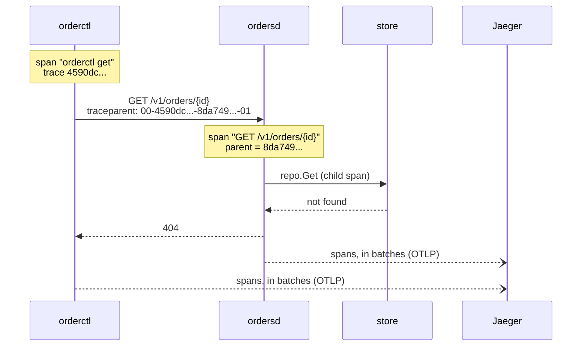
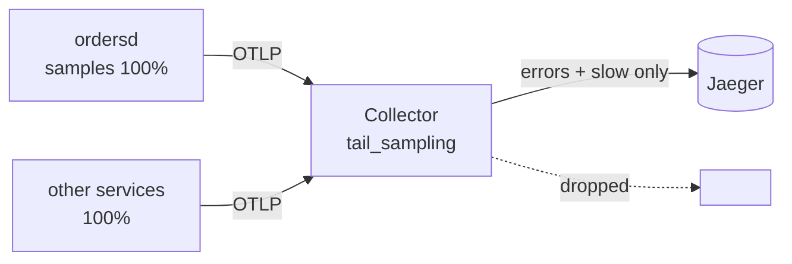

# Distributed tracing

## Why care?

Five tickets that metrics and logs alone can't close:

- "p99 of the checkout is 400 ms. The checkout calls five services. Which one is slow?"
- "The error says `request 01a21bba-f5c6-...`. The log line in `ordersd` is there. What did the caller do before and after?"
- "We added tracing, but every server span is called `GET`. All of them."
- "The traces stop at the gateway. Nothing from the services behind it."
- "We sample 10% of traces. The one failed payment we need is never in the 10%."

[Metrics](metrics.md) told you **that** p99 got worse. A **trace** shows **where the time went** for one request, across every process it touched. This page adds OpenTelemetry tracing to `ordersd` and `orderctl`, sends spans to a real Jaeger, and reads them back through Jaeger's API. Then it shows how to keep the traces you need without paying for all the others.

## The idea: the stamps in a passport

A traveller crosses five countries. At each border, the officer stamps the passport: country, time in, time out. At the end, the passport tells the whole story of the trip, even though no officer saw more than their own border.

- The **passport number** is the **trace ID**. Every stamp in this passport belongs to the same trip.
- Each **stamp** is a **span**: one piece of work, with a name, a start, an end, and some notes (attributes).
- Each stamp also says **which border sent you here**: the **parent span ID**. That's how the stamps form a tree, not just a list.
- The traveller **carries the passport across each border**. Nobody phones ahead. That's **context propagation**: the trace ID travels **inside the request**, in an HTTP header called `traceparent`.
- At the end of the day, each border office sends copies of its stamps to a central archive. That's the **exporter** sending spans to a **backend** (Jaeger, Tempo, a vendor).

If one border forgets to look at the passport and starts a new one, the story breaks into two trips. That is the fourth ticket.



## Under the hood: spans and `traceparent`

### What a span holds

| Field          | Example                                       | Meaning                                                      |
| -------------- | --------------------------------------------- | ------------------------------------------------------------ |
| Trace ID       | `4590dcc3dead66aa4bf3799fe6b6f22b`            | 16 bytes, random. The same in every span of one request      |
| Span ID        | `562718eff3a68ec6`                            | 8 bytes, random. Unique to this span                         |
| Parent span ID | `8da749a97a38836c`                            | The span that caused this one. Empty for the root            |
| Name           | `GET /v1/orders/{id}`                         | Low-cardinality: a route, not a URL                          |
| Kind           | server, client, internal, producer, consumer  | Which side of a call this is                                 |
| Start, end     | nanosecond timestamps                         | The duration is end − start                                  |
| Attributes     | `http.response.status_code=404`               | Key-value notes. High cardinality is fine here               |
| Events         | `exception` with a message                    | Timestamped things that happened during the span             |
| Status         | unset, ok, error                              | Did this piece of work fail?                                 |
| Resource       | `service.name=ordersd`, `service.version=...` | Who produced the span (the process), shared by all its spans |

Note the difference with metrics: attributes **may** carry an order ID or a customer ID. A span is one record about one request, not a time series, so a unique value costs no more than any other value.

### The `traceparent` header

The [W3C Trace Context](https://www.w3.org/TR/trace-context/) standard defines one header that every tracing system understands. Here is what `orderctl` really sends, caught with `nc -l` pretending to be the server:

```text
GET /v1/orders HTTP/1.1
Host: localhost:19099
User-Agent: orderctl/(devel)
Accept: application/json
Traceparent: 00-6e7be8ea029b01d307317eacf7a0dd67-322ebfd1631f2339-01
Accept-Encoding: gzip
```

Four fields, separated by `-`:

```text
00 - 6e7be8ea029b01d307317eacf7a0dd67 - 322ebfd1631f2339 - 01
│    │                                  │                  └─ flags: 01 = sampled (record this trace)
│    │                                  └─ parent ID: the span ID of the caller's span (the HTTP client span)
│    └─ trace ID: 16 bytes, hex
└─ version
```

The receiver reads this header, creates its own server span with the **same trace ID** and **parent = `322ebfd1631f2339`**, and puts the new span in the request's `context.Context`. Every span started from that context becomes a child. When it calls another service, it sends a new `traceparent` with the same trace ID and **its own** span ID as the parent.

A second header, `tracestate`, carries vendor-specific data alongside, and `baggage` carries your own key-value pairs (say, `tenant=acme`) to every service downstream. Baggage is sent on **every** call, to every service, including third parties: never put secrets or personal data in it.

### In Go: the span lives in `context.Context`

Go has no thread-local storage, so the current span travels in the `ctx` you already pass everywhere (see [Context](../go/context.md)). That gives one rule that explains most broken traces:

> A span is only a child if it was started **from the context** of its parent.

If a function takes `context.Background()` instead of the request's `ctx`, its spans start a **new trace**. If a goroutine outlives the request, its spans belong to a parent that already ended.

### The OpenTelemetry pieces

| Piece                | Package                                                         | Job                                                           |
| -------------------- | --------------------------------------------------------------- | ------------------------------------------------------------- |
| API                  | `go.opentelemetry.io/otel`, `.../otel/trace`                    | `tracer.Start(ctx, name)`. What libraries use                 |
| SDK                  | `go.opentelemetry.io/otel/sdk/trace`                            | Sampling, batching, resource. Only `main` configures it       |
| Exporter             | `.../exporters/otlp/otlptrace/otlptracehttp`                    | Sends spans over OTLP/HTTP (port 4318) to a collector/backend |
| Propagator           | `go.opentelemetry.io/otel/propagation`                          | Reads and writes `traceparent`, `tracestate`, `baggage`       |
| HTTP instrumentation | `go.opentelemetry.io/contrib/instrumentation/net/http/otelhttp` | Server and client spans, plus propagation, for `net/http`     |

Without an SDK installed, the API does nothing and costs almost nothing. That's why libraries can depend on the API safely: the application decides whether spans go anywhere. [Signals and how they fit](signals.md) has the bigger picture of API, SDK, exporter and Collector.

## Instrumenting `ordersd` and `orderctl`

We continue with the copy of `examples/orders` from [Metrics](metrics.md). The versions `go get` picked:

```console
$ go get go.opentelemetry.io/otel@latest go.opentelemetry.io/otel/sdk@latest \
    go.opentelemetry.io/otel/exporters/otlp/otlptrace/otlptracehttp@latest \
    go.opentelemetry.io/contrib/instrumentation/net/http/otelhttp@latest
go: added go.opentelemetry.io/contrib/instrumentation/net/http/otelhttp v0.72.0
go: added go.opentelemetry.io/otel v1.47.0
go: added go.opentelemetry.io/otel/exporters/otlp/otlptrace v1.47.0
go: added go.opentelemetry.io/otel/exporters/otlp/otlptrace/otlptracehttp v1.47.0
go: added go.opentelemetry.io/otel/sdk v1.47.0
go: added go.opentelemetry.io/otel/trace v1.47.0
...
```

### One setup function for both programs

```go title="internal/telemetry/telemetry.go"
// Package telemetry sets up OpenTelemetry tracing for a process.
package telemetry

import (
	"context"
	"fmt"

	"go.opentelemetry.io/otel"
	"go.opentelemetry.io/otel/exporters/otlp/otlptrace/otlptracehttp"
	"go.opentelemetry.io/otel/propagation"
	"go.opentelemetry.io/otel/sdk/resource"
	sdktrace "go.opentelemetry.io/otel/sdk/trace"
	semconv "go.opentelemetry.io/otel/semconv/v1.43.0"
)

// Setup installs a global TracerProvider that batches spans and sends
// them over OTLP/HTTP. The endpoint, sampler and extra resource attributes
// come from the standard OTEL_* environment variables. Call shutdown before
// the process exits, or the last spans are lost.
func Setup(ctx context.Context, service, version string) (shutdown func(context.Context) error, err error) {
	exp, err := otlptracehttp.New(ctx) // OTEL_EXPORTER_OTLP_ENDPOINT, default http://localhost:4318
	if err != nil {
		return nil, fmt.Errorf("otlp exporter: %w", err)
	}
	res, err := resource.New(ctx,
		resource.WithTelemetrySDK(),
		resource.WithAttributes(semconv.ServiceName(service), semconv.ServiceVersion(version)),
		resource.WithFromEnv(), // last, so OTEL_SERVICE_NAME and OTEL_RESOURCE_ATTRIBUTES win
	)
	if err != nil {
		return nil, fmt.Errorf("resource: %w", err)
	}
	tp := sdktrace.NewTracerProvider(
		sdktrace.WithBatcher(exp),
		sdktrace.WithResource(res),
		// No WithSampler: the SDK reads OTEL_TRACES_SAMPLER(_ARG) and
		// defaults to parentbased_always_on.
	)
	otel.SetTracerProvider(tp)
	otel.SetTextMapPropagator(propagation.NewCompositeTextMapPropagator(
		propagation.TraceContext{}, // traceparent, tracestate
		propagation.Baggage{},      // baggage
	))
	return tp.Shutdown, nil
}
```

- **`WithBatcher`** queues finished spans and exports them in the background: every 5 s, or when 512 are waiting (the SDK constants `DefaultScheduleDelay` and `DefaultMaxExportBatchSize`). The request never waits for Jaeger. If the queue (2048 spans) is full, new spans are **dropped**, not blocked on.
- **`Shutdown` flushes** the queue. A CLI like `orderctl` that exits without it loses all its spans.
- **The propagator is global and must be set.** Without `SetTextMapPropagator`, `otelhttp` creates spans but neither reads nor sends `traceparent`: every service starts its own trace (the fourth ticket).
- **The environment configures the rest**, with the standard names every OpenTelemetry SDK understands: `OTEL_EXPORTER_OTLP_ENDPOINT`, `OTEL_SERVICE_NAME`, `OTEL_RESOURCE_ATTRIBUTES`, `OTEL_TRACES_SAMPLER`. Ops can change them without a rebuild.

### The server: `otelhttp.NewHandler`

In `cmd/ordersd/main.go`, call `Setup` early and wrap the whole handler:

```go title="cmd/ordersd/main.go"
shutdownTracing, err := telemetry.Setup(ctx, "ordersd", info.Version)
if err != nil {
	return err
}
defer func() { _ = shutdownTracing(context.WithoutCancel(ctx)) }()
...
srv := &http.Server{
	Handler: otelhttp.NewHandler(httpapi.NewHandler(svc, logger, ready.Load, reg), "ordersd"),
	...
}
```

`otelhttp.NewHandler` reads `traceparent`, starts a **server span**, puts it in `r.Context()`, and at the end records the status code and sets the span status (error for `5xx`). It is outermost, so the request ID, logging and metrics middleware all run inside the span.

### A span of our own: the store

Library spans show HTTP. The interesting time is usually inside: the database, a call to a payment provider, a slow loop. Our demo store gets a span for every call:

```go title="cmd/ordersd/demo.go"
var tracer = otel.Tracer("github.com/acme/orders/cmd/ordersd")

// traced wraps a call to the store in a span.
func traced[T any](ctx context.Context, name string, f func(context.Context) (T, error)) (T, error) {
	ctx, span := tracer.Start(ctx, name, trace.WithSpanKind(trace.SpanKindClient),
		trace.WithAttributes(attribute.String("db.system.name", "memory")))
	defer span.End()
	v, err := f(ctx)
	if err != nil && !errors.Is(err, order.ErrNotFound) {
		span.RecordError(err)
		span.SetStatus(codes.Error, err.Error())
	}
	return v, err
}

func (s slowRepo) Get(ctx context.Context, id uuid.UUID) (order.Order, error) {
	return traced(ctx, "repo.Get", func(ctx context.Context) (order.Order, error) {
		if err := s.wait(ctx); err != nil {
			return order.Order{}, err
		}
		return s.Repository.Get(ctx, id)
	})
}
```

- **`tracer.Start(ctx, ...)` returns a new `ctx`.** Pass that one on, so anything below becomes a grandchild.
- **`defer span.End()`**. A span that is never ended is never exported.
- **"Not found" is not an error** for the span. It's a normal answer. Only real failures set the status to error; otherwise every 404 shows up red.
- `RecordError` adds an `exception` event with the message and the type.

### The client: `otelhttp.NewTransport`

`orderctl` gets the same `Setup`, a root span for the whole command, and a transport that creates **client spans** and **injects `traceparent`**:

```go title="cmd/orderctl/main.go"
shutdownTracing, err := telemetry.Setup(ctx, "orderctl", buildinfo.Read().Version)
if err != nil {
	return err
}
defer func() { _ = shutdownTracing(context.WithoutCancel(ctx)) }()
ctx, span := otel.Tracer("github.com/acme/orders/cmd/orderctl").Start(ctx, "orderctl "+cmd)
defer span.End()

c, err := client.New(g.server, "orderctl/"+buildinfo.Read().Version,
	&http.Client{Transport: otelhttp.NewTransport(http.DefaultTransport)})
```

The order of the `defer`s matters: `span.End()` runs first, then `shutdownTracing` flushes the finished span.

## Try it: a trace across two processes

Start Jaeger 2.23.0. Jaeger v2 is built on the OpenTelemetry Collector, and its all-in-one image accepts OTLP directly and keeps traces in memory:

```console
$ docker network create tutor-obs
$ docker run -d --name tutor-jaeger --network tutor-obs -p 19686:16686 -p 19317:4317 -p 19318:4318 \
    jaegertracing/jaeger:2.23.0
```

Run `ordersd` (with the slow demo store), and point both programs at Jaeger's OTLP/HTTP port:

```console
$ export OTEL_EXPORTER_OTLP_ENDPOINT=http://localhost:19318
$ ORDERS_DEMO_SLOW=1 ORDERS_ADMIN_ADDR=:19101 ./ordersd -addr :19081 > ordersd.log &
$ ./orderctl -server http://localhost:19081 get 019ac0de-0000-7000-8000-000000000001
orderctl: get order: orders API: 404 Not Found: order not found (request 01a21bba-f5c6-7944-8b7b-0d117a5aaeb3)
```

That's the second ticket: an error with a request ID. The request ID finds the log line, and our copy of the logging middleware also writes the **trace ID** from the span context (one extra attribute; [Structured logging](structured-logging.md) shows how to do this for every log line):

```go
slog.String("trace_id", trace.SpanContextFromContext(r.Context()).TraceID().String()),
```

```console
$ grep 01a21bba-f5c6-7944-8b7b-0d117a5aaeb3 ordersd.log
{"time":"2026-11-27T07:39:27.191130926+01:00","level":"INFO","msg":"http request","service":"ordersd","request_id":"01a21bba-f5c6-7944-8b7b-0d117a5aaeb3","trace_id":"4590dcc3dead66aa4bf3799fe6b6f22b","method":"GET","path":"/v1/orders/019ac0de-0000-7000-8000-000000000001","route":"GET /v1/orders/{id}","status":404,"bytes":135,"duration":16539872}
```

Now ask Jaeger for the whole trace. Its v3 API returns OTLP JSON; a short `jq` filter (`spans.jq`) turns it into one line per span, sorted by start time, with the offset from the first span and the duration:

```jq title="spans.jq"
[.result.resourceSpans[]
 | (.resource.attributes[] | select(.key=="service.name").value.stringValue) as $svc
 | .scopeSpans[].spans[]
 | {svc: $svc, name, spanId, parentSpanId: (.parentSpanId // ""), kind,
    start: (.startTimeUnixNano|tonumber), ms: (((.endTimeUnixNano|tonumber) - (.startTimeUnixNano|tonumber)) / 1e6 * 100 | round / 100),
    status: (.status.code // "")}]
| sort_by(.start) | (.[0].start) as $t0
| .[] | "\(.svc)  \(.name)  span=\(.spanId) parent=\(.parentSpanId) +\(((.start - $t0)/1e6*100|round/100))ms \(.ms)ms \(.status)"
```

```console
$ curl -s localhost:19686/api/v3/traces/4590dcc3dead66aa4bf3799fe6b6f22b | jq -r -f spans.jq
orderctl  orderctl get  span=69e2932634d03f2a parent= +0ms 19.55ms
orderctl  HTTP GET  span=8da749a97a38836c parent=69e2932634d03f2a +0.03ms 19.49ms 2
ordersd  GET /v1/orders/{id}  span=562718eff3a68ec6 parent=8da749a97a38836c +2.34ms 16.61ms
ordersd  repo.Get  span=3c2a29dd34bc0df8 parent=562718eff3a68ec6 +2.38ms 16.39ms
```

Two processes, one tree: `orderctl get` → `HTTP GET` (client) → `GET /v1/orders/{id}` (server) → `repo.Get`.

Read it like a profiler:

- **Almost all the time is in `repo.Get`** (16.4 of 19.5 ms). That's the answer to the first ticket, for this request.
- **The gap between the client span and the server span** (2.3 ms) is everything between them: connecting, sending, the network, and the server's queueing. Between two pods, a big gap here points at the network, a proxy, or a server that is too busy to accept.
- **The client span has status `2` (error), the server span has none.** OpenTelemetry's HTTP rules mark `4xx` as an error on the **client** (my request failed) but not on the **server** (I answered correctly). The client span also got `error.type: "404"`.

The UI at <http://localhost:19686> shows the same trace as a waterfall. `/api/v3/services` lists what Jaeger has seen:

```console
$ curl -s localhost:19686/api/v3/services
{"services":["ordersd","orderctl","ordersd-head","ordersd-tail","jaeger"]}
```

(`ordersd-head` and `ordersd-tail` come from the sampling experiments below.)

### When the span is called `GET`

Our first version of this page did not have nice span names. The server span from the first run:

```console
$ curl -s localhost:19686/api/v3/traces/4bf92f3577b34da6a3ce929d0e0e4736 | jq -c '.result.resourceSpans[].scopeSpans[].spans[] | {name, spanId, parentSpanId, kind}'
{"name":"repo.List","spanId":"511b1e22d041bbeb","parentSpanId":"cec325fdbf2d96df","kind":3}
{"name":"GET","spanId":"cec325fdbf2d96df","parentSpanId":"00f067aa0ba902b7","kind":2}
```

(`kind` 2 is server, 3 is client, as numbers in OTLP JSON.)

Every server span was just `GET` (the third ticket). `otelhttp` names the span from `r.Pattern`, which the `ServeMux` sets **on the request it receives**. But our request-ID middleware calls `r.WithContext(ctx)`, which makes a **copy**. The mux set `Pattern` on the copy; `otelhttp`, outside, still held the original, where `Pattern` is empty.

The fix is a tiny middleware **directly around the mux**, where the pattern is visible:

```go title="internal/httpapi/tracing.go"
// nameSpan gives the server span its route, like "GET /v1/orders/{id}".
// It must wrap the mux directly: the mux sets r.Pattern on the request it
// gets, and the middleware above us passed copies (r.WithContext), so
// otelhttp, further out, never sees the pattern.
func nameSpan(next http.Handler) http.Handler {
	return http.HandlerFunc(func(w http.ResponseWriter, r *http.Request) {
		next.ServeHTTP(w, r)
		if r.Pattern == "" {
			return
		}
		span := trace.SpanFromContext(r.Context())
		span.SetName(r.Pattern)
		_, path, _ := strings.Cut(r.Pattern, " ")
		span.SetAttributes(attribute.String("http.route", path))
	})
}
```

```go title="internal/httpapi/httpapi.go"
return withRequestID(logRequests(logger, metrics.measure(recoverPanic(logger, nameSpan(mux)))))
```

Don't "fix" this by naming spans after `r.URL.Path`. The span name is what backends group by, and `/v1/orders/019ac0de-...` is a new group per order: the same cardinality problem as in [Metrics](metrics.md#cardinality-the-bill-nobody-saw-coming).

### Joining a trace someone else started

Any caller can start the trace: a gateway, another team's service, or you with `curl`. Send a `traceparent` with a trace ID you choose, and look it up:

```console
$ curl -s -o /dev/null -w '%{http_code}\n' \
    -H 'traceparent: 00-4bf92f3577b34da6a3ce929d0e0e4737-00f067aa0ba902b7-01' \
    localhost:19081/v1/orders/42
400
$ curl -s localhost:19686/api/v3/traces/4bf92f3577b34da6a3ce929d0e0e4737 | jq -c '.result.resourceSpans[].scopeSpans[].spans[] | {name, spanId, parentSpanId}'
{"name":"GET /v1/orders/{id}","spanId":"4d671d9c9e55d580","parentSpanId":"00f067aa0ba902b7"}
```

The server span adopted our trace ID and our span as its parent. (Jaeger adds a warning to the span, `parent span ID=00f067aa0ba902b7 is not in the trace`, because our `curl` sent no spans of its own.) That is all a gateway does: as long as every hop passes `traceparent` on, the trace survives. If one proxy in the middle strips unknown headers, or starts a fresh trace, the story breaks there.

The flip side: **an incoming `traceparent` is input from outside**. A public client can force sampling (flag `01`) on every request, or pick trace IDs. At the edge of your system (the public gateway), start a new trace, or keep the incoming one only as a _link_. Inside, trust it.

## Sampling: you can't keep everything

At 1,000 requests per second with 10 spans each, you produce 864 million spans a day. Most of them say "fast, fine". **Sampling** decides which traces to keep. There are two places to decide.

### Head sampling: decide at the start

The **first** service decides, when the root span starts, usually by trace ID (`TraceIDRatioBased(0.1)` compares the trace ID, read as a number, with a threshold that lets 10% of IDs through). It writes the decision into the `traceparent` flags (`01` sampled, `00` not), and every service downstream follows it. That's what **parent-based** means, and it's the SDK default: `parentbased_always_on`, "follow the parent; if there is none, sample".

A `traceparent` with flag `00`:

```console
$ curl -s -o /dev/null -w '%{http_code}\n' \
    -H 'traceparent: 00-4bf92f3577b34da6a3ce929d0e0e4738-00f067aa0ba902b7-00' localhost:19081/v1/orders
200
$ grep 4738 ordersd.log | jq -c '{trace_id, status}'
{"trace_id":"4bf92f3577b34da6a3ce929d0e0e4738","status":200}
$ curl -s localhost:19686/api/v3/traces/4bf92f3577b34da6a3ce929d0e0e4738   # 8 s later
{"error":{"httpCode":404,"message":"No traces found"}}
```

The trace ID is still in the context (and the log line), but no span was recorded or exported. Downstream services would also skip it. Everyone agrees, so you never get half a trace.

Now a 10% ratio, configured only by environment variables, with 200 requests from the load generator:

```console
$ OTEL_SERVICE_NAME=ordersd-head OTEL_TRACES_SAMPLER=parentbased_traceidratio OTEL_TRACES_SAMPLER_ARG=0.1 \
    ORDERS_DEMO_SLOW=1 ORDERS_ADMIN_ADDR=:19101 ./ordersd -addr :19081 > head.log &
$ ./loadgen -base http://localhost:19081 -rps 20 -d 10s
$ grep -c '"http request"' head.log
200
```

Count the traces Jaeger received. The search needs a time range in RFC 3339, and `search_depth` is the maximum number of results:

```console
$ min=$(date -u -d '-30 min' +%Y-%m-%dT%H:%M:%SZ); max=$(date -u -d '+1 min' +%Y-%m-%dT%H:%M:%SZ)
$ curl -s "localhost:19686/api/v3/traces?query.service_name=ordersd-head&query.start_time_min=$min&query.start_time_max=$max&query.search_depth=1000" \
    | jq '[.result.resourceSpans[].scopeSpans[].spans[].traceId] | unique | length'
26
```

26 of 200, 13%: the decision is random per trace ID, so you get **about** 10%. Head sampling is cheap (unsampled requests create no spans at all) and simple. Its weakness is the fifth ticket: it decides **before** anything happened, so it keeps 10% of the errors and 10% of the slow requests too. With 1% errors, you keep 1 error trace in 1,000 requests.

### Tail sampling: decide at the end

**Tail sampling** keeps all spans for a while, waits until the trace is complete, then decides with the whole trace in view: "keep it if any span failed, or if it took longer than 300 ms". Services can't do that alone (each sees only its own spans), so it happens in an **OpenTelemetry Collector** in the middle:



The Collector config (OpenTelemetry Collector Contrib 0.166.0; the `tail_sampling` processor is only in the _contrib_ build):

```yaml title="otelcol.yaml"
receivers:
  otlp:
    protocols:
      http:
        endpoint: 0.0.0.0:4318

processors:
  tail_sampling:
    decision_wait: 5s # wait this long after a trace's first span, then decide
    policies:
      - name: keep-errors
        type: status_code
        status_code: { status_codes: [ERROR] }
      - name: keep-slow
        type: latency
        latency: { threshold_ms: 300 }

exporters:
  otlp:
    endpoint: tutor-jaeger:4317
    tls: { insecure: true }

service:
  pipelines:
    traces:
      receivers: [otlp]
      processors: [tail_sampling]
      exporters: [otlp]
```

A trace is kept if **any** policy says yes. The Collector runs on a Docker network with Jaeger, so it can reach it by name:

```console
$ docker run --rm -v "$PWD/otelcol.yaml:/etc/otelcol-contrib/config.yaml:ro" \
    otel/opentelemetry-collector-contrib:0.166.0 validate --config=/etc/otelcol-contrib/config.yaml
$ echo $?
0
$ docker run -d --name tutor-otelcol --network tutor-obs -p 19418:4318 \
    -v "$PWD/otelcol.yaml:/etc/otelcol-contrib/config.yaml:ro" otel/opentelemetry-collector-contrib:0.166.0
```

Now `ordersd` samples everything (the default) and sends to the Collector instead of Jaeger. 600 requests:

```console
$ OTEL_SERVICE_NAME=ordersd-tail OTEL_EXPORTER_OTLP_ENDPOINT=http://localhost:19418 \
    ORDERS_DEMO_SLOW=1 ORDERS_ADMIN_ADDR=:19101 ./ordersd -addr :19081 > tail.log &
$ ./loadgen -base http://localhost:19081 -rps 20 -d 30s
$ jq -s '[.[] | select(.msg=="http request")] | {total: length, s500: map(select(.status==500))|length, slow: map(select(.duration>300000000))|length}' tail.log
{
  "total": 600,
  "s500": 7,
  "slow": 13
}
```

The log says 7 failures and 13 slow requests. What did Jaeger get? One line per kept trace's root span, grouped by status code:

```console
$ curl -s "localhost:19686/api/v3/traces?query.service_name=ordersd-tail&query.start_time_min=$min&query.start_time_max=$max&query.search_depth=1000" \
    | jq '[.result.resourceSpans[].scopeSpans[].spans[] | select(.parentSpanId == null or .parentSpanId == "")
           | {ms: (((.endTimeUnixNano|tonumber)-(.startTimeUnixNano|tonumber))/1e6|round),
              code: ([.attributes[]|select(.key=="http.response.status_code").value.intValue][0])}]
          | group_by(.code) | map({code: .[0].code, traces: length, slow: map(select(.ms>300))|length})'
[
  { "code": "200", "traces": 8, "slow": 8 },
  { "code": "404", "traces": 5, "slow": 5 },
  { "code": "500", "traces": 7, "slow": 0 }
]
```

**20 traces of 600, and exactly the 20 we wanted**: every error, every slow request, and none of the 580 boring ones. One of the kept error traces:

```console
$ curl -s localhost:19686/api/v3/traces/0affde84a911228155a8200ffeec40a3 | jq -r -f spans.jq
ordersd-tail  GET /v1/orders  span=eb9c11f96b3c2148 parent= +0ms 5.45ms 2
ordersd-tail  repo.List  span=af9fabf76f7785fd parent=eb9c11f96b3c2148 +0.04ms 5.25ms 2
$ curl -s localhost:19686/api/v3/traces/0affde84a911228155a8200ffeec40a3 \
    | jq -c '.result.resourceSpans[].scopeSpans[].spans[] | select(.name=="repo.List") | {name, status, events: [.events[] | {name, attrs: [.attributes[] | {(.key): .value.stringValue}] | add}]}'
{"name":"repo.List","status":{"message":"database: connection reset","code":2},"events":[{"name":"exception","attrs":{"exception.message":"database: connection reset","exception.type":"*errors.errorString"}}]}
```

The error, its message, and where it happened, without reading a single log line.

Tail sampling has a price:

- **Every span still leaves every service**, so the network and Collector CPU cost is the same as 100% sampling. Only storage shrinks.
- **The Collector holds traces in memory** for `decision_wait`. More traffic, more memory. A span that arrives after the decision is decided alone.
- **All spans of one trace must reach the same Collector.** With several Collector replicas, put a first layer in front that routes by trace ID (the `loadbalancing` exporter in the contrib build).

A common setup combines both: head-sample at a generous rate (say 25%) to cap the volume, and tail-sample on top to keep errors and slow traces.

## Traces, metrics and logs together

You now have three ways into the same request:

- **Metrics → trace.** The dashboard says p99 went up on `GET /v1/orders`. Search the tracing backend for that route, slower than 300 ms, in that time range. Prometheus can also store **exemplars**: a trace ID attached to a histogram sample, so a dot on the latency graph links straight to one slow trace (`prometheus.ExemplarObserver` in the Go client, and `--enable-feature=exemplar-storage` in Prometheus).
- **Log → trace.** Every log line carries `trace_id` (see [Structured logging](structured-logging.md)).
- **Trace → log.** The span has the trace ID; search the logs for it to see everything the service wrote during that request.

Retries are where traces shine. With `otelhttp.NewTransport`, **every attempt is its own client span** under the same parent, so a trace shows "three attempts, 2 s backoff, the third one worked" at a glance. That's also how you spot retry storms (see [Retries and idempotency](../distributed-systems/retries-and-idempotency.md)).

## Traps

- **No propagator set.** Spans are created but `traceparent` is neither read nor sent. Every service has its own one-span traces.
- **`context.Background()` in the middle.** Spans started from it begin a new trace. Pass the request's `ctx` all the way down.
- **Forgetting `span.End()`** (or `Shutdown` in a CLI). Spans that never end, or are still in the batch queue at exit, are never exported.
- **Span names from URLs.** `GET /v1/orders/019ac0de-...` makes one group per order. Use the route.
- **Middleware hiding `r.Pattern`.** A request copy (`r.WithContext`) between `otelhttp` and the mux leaves every span called `GET`. Set the name next to the mux.
- **Marking every 404 as an error** on your own spans. Errors should mean "something is broken", or tail sampling keeps everything.
- **Head sampling for rare events.** 10% sampling keeps 10% of your failures. Use tail sampling for errors and slow traces.
- **Trusting `traceparent` from the internet.** Anyone can force sampling. Restart the trace at the public edge.
- **Secrets or personal data in attributes or baggage.** Traces are stored, searched, and shared; baggage is sent to every downstream service.
- **Goroutines that outlive the request.** Their spans hang off a parent that already ended. For background work, start a new trace with a _link_ to the request's span.

## Check yourself

??? question "1. A `traceparent` is `00-0af7651916cd43dd8448eb211c80319c-b7ad6b7169203331-01`. What do you know about the caller, and what does your server span look like?"

    The trace ID is `0af7...319c`, the caller's current span is `b7ad6b7169203331`, and the
    caller sampled it (`01`). Your server span gets the same trace ID, a new random span ID, and
    parent `b7ad6b7169203331`. With a parent-based sampler, you record it too.

??? question "2. Service A calls B, B calls C. In Jaeger, A and B are in one trace, C is in a separate trace with a single span. Name two likely causes."

    B does not inject `traceparent` into its call to C: its HTTP client has no `otelhttp`
    transport, or the global propagator was never set. Or B calls C with
    `context.Background()` (or a context from before the server span started), so there is no
    parent span to propagate.

??? question "3. Your server span says 15 ms, the client span for the same call says 180 ms. Where did the other 165 ms go?"

    Outside the handler: connecting (DNS, TCP, TLS), waiting for a free connection in the
    client pool, the network, a proxy or load balancer in between, or the server's accept
    queue. Check the client's connection reuse (see [TCP](../networking/tcp.md)) and whether the
    server is saturated.

??? question "4. You sample 5% at the head. The on-call engineer needs the trace of one failed payment from 10 minutes ago. Why is it probably missing, and what would you change?"

    The decision was made at the start, by trace ID, before the payment failed: 95% of failures
    were never recorded. Send 100% (or a higher head rate) to a Collector with tail sampling
    that keeps every trace with an error status, and samples the rest.

??? question "5. Why is `order_id` fine as a span attribute but not as a metric label?"

    A span is one record per request; one more unique value costs nothing extra. A metric
    label creates a new time series per value, kept in memory and billed per series, forever
    growing. Put the ID on spans and logs, and keep metric labels to small fixed sets.

??? question "6. What does `otelhttp` mark as an error on the client span, and on the server span, for a `404`? Why the difference?"

    The client span gets status error (and `error.type: "404"`): from the caller's side, the
    request did not succeed. The server span gets no error status: the server answered
    correctly. Only `5xx` is a server error.

## Recap

- A **trace** is a tree of **spans** with one **trace ID**. Each span has a parent ID, a name, start and end, attributes, events and a status.
- **`traceparent`** (`version-traceid-parentid-flags`) carries the trace across processes. In Go, the current span lives in **`context.Context`**: pass it everywhere.
- Setup once in `main`: **exporter** (OTLP), **resource** (`service.name`), **batcher**, **propagator**, and **`Shutdown`** before exit. Configure with `OTEL_*` variables.
- **`otelhttp.NewHandler`** for servers, **`otelhttp.NewTransport`** for clients; add your own spans around the slow parts. Name spans by route; a copied request hides `r.Pattern`.
- **Head sampling** decides at the start and is cheap, but keeps errors at the same rate as everything else. **Tail sampling** in a Collector keeps exactly the errors and slow traces (20 of 600 here), at the cost of shipping every span.
- Connect the signals: `trace_id` in logs, exemplars on histograms, one span per retry attempt.

Next: you can now see what users feel. Decide how much of it is acceptable, and when to wake someone up. [SLOs and alerting](slos-and-alerting.md).
