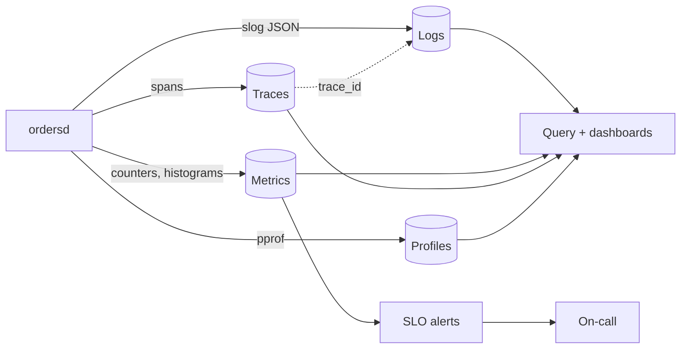

# Observability

How to ask a running system questions you did not think of when you wrote it.

## Why go deeper?

At 3 a.m. the alert says "error rate high". Now what?

- The logs have 40,000 lines per minute, and none say which customer is affected.
- The dashboard shows average latency is fine, while 1% of users wait 10 seconds.
- A request goes through five services, and you cannot see where the time goes.
- The metrics bill doubled after someone added `user_id` as a label.
- Everyone is paged for every blip, so everyone ignores the pager.

Good observability is not "more data". It is the **right signals**, connected to each other, and **alerts based on what users feel**. This chapter shows how, using open standards (OpenTelemetry, Prometheus) so the ideas work with any vendor.

## The big picture

1. **Logs** tell you _what happened_ in one place.
2. **Metrics** tell you _how much and how often_, cheaply, over time.
3. **Traces** tell you _where the time went_, across services.
4. **Profiles** tell you _which code_ used the CPU or memory.
5. A shared **trace ID** connects them, so you can jump from an alert to the exact slow request.

## Reading order

!!! note "Planned chapter"

    This section is a roadmap. The pages below are written in later sessions and linked here when they land.

| #   | Page                     | You will learn                                                                       |
| --- | ------------------------ | ------------------------------------------------------------------------------------ |
| 1   | Signals and how they fit | Logs, metrics, traces, profiles, events; cost and cardinality; OpenTelemetry's model |
| 2   | Structured logging       | `slog` in depth, log levels that mean something, correlation IDs, what never to log  |
| 3   | Metrics                  | Counters, gauges, histograms, RED and USE, Prometheus scraping, PromQL, cardinality  |
| 4   | Distributed tracing      | Spans, context propagation (W3C `traceparent`), sampling, instrumenting Go with OTel |
| 5   | SLOs and alerting        | SLIs, SLOs, error budgets, burn-rate alerts, on-call and runbooks                    |
| 6   | Profiling in production  | Continuous profiling, `pprof` endpoints safely, finding a leak in a live service     |

## How each page works

The same shape as the [Fundamentals](../fundamentals/index.md): **Why care?**, **The idea**, **Under the hood**, **Try it**, **Traps** and **Check yourself**. We instrument the `ordersd` service from the [Go chapter](../go/index.md) and run a local stack (OpenTelemetry Collector, Prometheus, Grafana) in containers.
