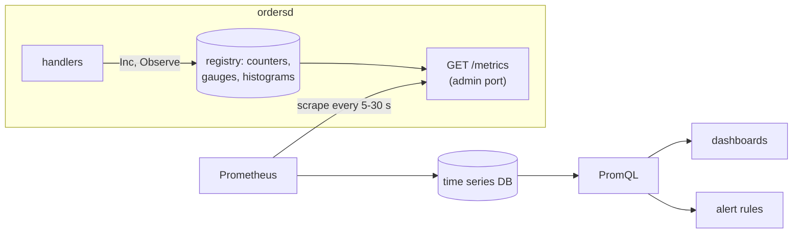

# Metrics

## Why care?

Five messages from the team chat:

- "The dashboard says average latency is 18 ms. Support says customers wait half a second. Who is lying?"
- "Error rate jumped to 40% for one minute after the deploy, then went back. Was it real?"
- "Our metrics bill tripled. Someone added a label."
- "`histogram_quantile` returns nothing. The metric is there, I can see it."
- "p99.9 says 490 ms. The database call it waits for never takes more than 450 ms."

None of these is a bug in Prometheus. Each one is a misunderstanding of what a metric **is**: a number per time series, sampled every few seconds, with all detail about single requests thrown away on purpose. That is why metrics are cheap enough to keep for months and fast enough to alert on. It is also why they can mislead you if you don't know what was thrown away.

This page instruments `ordersd` with the Prometheus Go client, scrapes it with a real Prometheus, and answers each message above with a real query. [Signals and how they fit](signals.md) explained where metrics sit next to logs and traces; here we go deep.

## The idea: the dashboard of a car

Look at the dashboard of a car:

- The **odometer** only goes up. It says nothing useful by itself ("123,456 km"). But read it twice, an hour apart, and you get your average speed. That's a **counter**, and "read it twice and divide" is `rate()`.
- The **fuel gauge** goes up and down. Its current value is the interesting thing. That's a **gauge**.
- Now imagine a box of coin jars at a toll gate, labelled "under 1 minute", "under 2 minutes", "under 5 minutes". Each car drops a coin in **every jar its waiting time fits in**. You never know any single car's time, but you can say "95% of cars waited under 2 minutes". That's a **histogram**.

The car doesn't film the trip (that would be a trace). It shows a few numbers, all the time, at almost no cost.



Two things to notice. First, the service **does not send** anything: it keeps a few numbers in memory, and Prometheus comes and **pulls** them (a _scrape_). Second, the service never stores history. A counter is just one `float64` in memory; the history lives in Prometheus.

## Under the hood: a time series is a name plus labels

Here is what `ordersd` exposes after some traffic, from `curl localhost:19100/metrics`:

```text
# HELP http_server_requests_total HTTP requests handled, by route and status code.
# TYPE http_server_requests_total counter
http_server_requests_total{code="200",method="GET",route="GET /healthz"} 1
http_server_requests_total{code="200",method="GET",route="GET /v1/orders"} 2778
http_server_requests_total{code="400",method="GET",route="GET /v1/orders/{id}"} 205
http_server_requests_total{code="404",method="GET",route="GET /v1/orders/{id}"} 979
http_server_requests_total{code="500",method="GET",route="GET /v1/orders"} 27
http_server_requests_total{code="500",method="GET",route="GET /v1/orders/{id}"} 11
```

This is the Prometheus **text exposition format**. Each line is one **time series**: a metric name, a set of **labels** (key-value pairs), and the current value. `http_server_requests_total{code="404",...}` and `http_server_requests_total{code="200",...}` are **different series**. Prometheus stores each series separately, as a list of `(timestamp, value)` samples.

That one fact explains most of this page:

- **Every distinct label combination is a new series**, with its own memory, disk and index cost.
- A query works on **series**, not on requests. There is no "request" in a metric.
- To answer a new question ("errors per customer?"), you need a label for it **before** the problem happens. And that label must have few values (more in [Cardinality](#cardinality-the-bill-nobody-saw-coming)).

When Prometheus stores a scrape, it adds two labels of its own: `job` (which scrape config) and `instance` (which target). Our config also adds `env="laptop"`:

```json
{
  "__name__": "http_server_requests_total",
  "code": "200",
  "env": "laptop",
  "instance": "host.docker.internal:19100",
  "job": "ordersd",
  "method": "GET",
  "route": "GET /v1/orders"
}
```

The name itself is just a label called `__name__`.

### The four metric types

| Type      | Goes                              | You ask                                              | Example                                           |
| --------- | --------------------------------- | ---------------------------------------------------- | ------------------------------------------------- |
| Counter   | Only up (or to 0 on restart)      | "How many per second?" with `rate()`                 | `http_server_requests_total`                      |
| Gauge     | Up and down                       | "What is it now?" / `avg_over_time`, `max_over_time` | `http_server_requests_in_flight`, `go_goroutines` |
| Histogram | Counts per bucket                 | "What fraction was under X?", "What's p99?"          | `http_server_request_duration_seconds`            |
| Summary   | Quantiles computed in the process | "p99 of this one instance"                           | Avoid for services (see below)                    |

### Counters: always ask for the rate

A counter alone is useless. Here is `GET /v1/orders` with `200`, every 5 seconds (one scrape each), during load:

```text
[1795761444.735,"2020"]
[1795761449.735,"2157"]
[1795761454.735,"2291"]
[1795761459.735,"2436"]
[1795761464.735,"2575"]
[1795761469.735,"2703"]
```

That's 683 requests in 25 seconds, about 27 per second. `rate(counter[1m])` does exactly this: it takes the samples in the last minute, computes the increase, and divides by the time. `increase(counter[1m])` is the same thing times 60.

Why not just export "requests per second" as a gauge? Because then a scrape every 15 s would only see the value at that instant, and miss everything between. A counter **remembers everything** between scrapes. You can even lose a scrape and nothing is lost: the next sample still contains all requests.

**Counter resets.** When the process restarts, the counter starts from 0. Here we restarted `ordersd` in the middle of the load:

```text
[1795761734.735,"10010"]
[1795761739.735,"10010"]
[1795761744.735,"10010"]
[1795761749.735,"50"]
[1795761754.735,"182"]
[1795761759.735,"320"]
```

`rate`, `increase` and `resets` know about this: any drop means "it restarted, count from 0". At `time=1795761780`, over the minute across the restart:

| Query               | Result    | Why                                                     |
| ------------------- | --------- | ------------------------------------------------------- |
| `rate(...[1m])`     | `19.53`   | Correct: handles the reset (lower because of the pause) |
| `increase(...[1m])` | `1171.6`  | Correct: the same, times 60                             |
| `delta(...[1m])`    | `-9748.4` | Nonsense: `delta` is for gauges, it just subtracts      |
| `resets(...[5m])`   | `1`       | One restart in the window                               |

The `rate()` result has decimals even for whole requests. Prometheus **extrapolates** to the edges of the window, because samples rarely sit exactly on them. Don't expect `increase` to give you an exact integer; it's an estimate.

### Gauges: the value now

A gauge is the current value of something: requests in flight, queue length, goroutines, memory in use, the number of connections in a pool. You query it as it is, or with `*_over_time` functions:

```text
go_goroutines                    → "11"
go_memstats_heap_inuse_bytes     → "6733824"
http_server_requests_in_flight   → "1"
```

Gauges have one weakness: they are sampled. If the queue fills up and drains between two scrapes, you never see it. When peaks matter, count events instead (a counter of rejected jobs), or keep a "high-water mark" in the process.

And never `rate()` a gauge. Prometheus will even warn you:

```json
[
  "PromQL info: metric might not be a counter, name does not end in _total/_sum/_count/_bucket: \"go_goroutines\" (1:6)"
]
```

That's one reason for the naming rule: **counters end in `_total`**, and every metric with a unit has the **base unit** in its name: `_seconds`, `_bytes`, never `_ms` or `_kb`.

### Histograms: coins in jars

A **classic histogram** is a set of counters, one per bucket, plus a sum and a count. Each bucket has an upper bound `le` ("less or equal"), and is **cumulative**: a 7 ms request counts in `le="0.01"`, `le="0.025"`, ... and `le="+Inf"`:

```text
http_server_request_duration_seconds_bucket{method="GET",route="GET /v1/orders",le="0.005"} 1
http_server_request_duration_seconds_bucket{method="GET",route="GET /v1/orders",le="0.01"} 2
http_server_request_duration_seconds_bucket{method="GET",route="GET /v1/orders",le="0.025"} 8
http_server_request_duration_seconds_bucket{method="GET",route="GET /v1/orders",le="0.05"} 8
...
http_server_request_duration_seconds_bucket{method="GET",route="GET /v1/orders",le="+Inf"} 8
http_server_request_duration_seconds_sum{method="GET",route="GET /v1/orders"} 0.09000219599999999
http_server_request_duration_seconds_count{method="GET",route="GET /v1/orders"} 8
```

Because every bucket is a counter, you `rate()` them like counters, and you can **add them up across instances**. Ten pods, each with its own buckets, sum to one histogram for the whole service. That's the big advantage over a summary.

`histogram_quantile(0.99, ...)` then answers "under what latency are 99% of requests?". It finds the bucket where the 99th percentile falls, and **assumes the requests are spread evenly inside that bucket** (linear interpolation). So the answer is only as good as your bucket bounds.

#### Classic vs native

**Native histograms** fix the bucket problem. Prometheus 3 ingests them when the scrape config says `scrape_native_histograms: true`; the Go client documentation still calls them experimental. You don't choose bounds. You choose a maximum **growth factor**, and the client creates exponential buckets as values arrive. `NativeHistogramBucketFactor: 1.1` means each bucket is at most 10% wider than the previous one. The client picked a factor of 2^(1/8) ≈ 1.0905 (Prometheus calls it _schema 3_); you can see it in the raw buckets Prometheus returns:

```json
{
  "count": "3014",
  "sum": "54.47846714299998",
  "nbuckets": 32,
  "first": [
    [0, "0.0021298979153618314", "0.0023226701464896895", "129"],
    [0, "0.0023226701464896895", "0.002532889755177753", "31"],
    [0, "0.002762135864009951", "0.0030121305183748843", "1"]
  ],
  "last": [
    [0, "0.3855527063519852", "0.4204482076268572", "18"],
    [0, "0.4204482076268572", "0.45850202160233555", "16"]
  ]
}
```

Each entry is `[boundary rule, lower, upper, count]`. Only the 32 buckets that have data exist, and the whole histogram is **one series** (not one per bucket). 0.00232 / 0.00213 = 1.0905.

How much does it matter? Our demo store is slow on purpose: most calls take 2–20 ms, 2% take 350–450 ms. So the true p95 is just under 20 ms, and nothing can be slower than about 450 ms. Here is the same 5-minute window, both ways, for `GET /v1/orders`:

| Quantile | Classic (our 9 buckets) | Native (factor 1.1) |
| -------- | ----------------------- | ------------------- |
| p50      | 0.0118                  | 0.0112              |
| p95      | **0.0242**              | 0.0194              |
| p99      | 0.4003                  | 0.3988              |
| p99.9    | **0.4900**              | 0.4516              |

The classic p95 is 25% too high: it falls in the 10–25 ms bucket and is interpolated. The classic p99.9 says 490 ms, slower than any request we served: it falls in the 300–500 ms bucket, and interpolation puts it near the top. Our fake database never sleeps longer than 449 ms. That was the fifth chat message. The native one is within a few percent everywhere.

Still, classic buckets do one thing perfectly: **"what fraction was under exactly 300 ms?"**, if 300 ms is a bucket bound. Both give the same answer here:

```text
histogram_fraction(0, 0.3, sum(rate(http_server_request_duration_seconds[5m])))      → 0.9802660175606362
sum(rate(..._bucket{le="0.3"}[5m])) / sum(rate(..._count[5m]))                       → 0.9802660175606362
```

That is the query an SLO uses ("98% of requests under 300 ms"), so if you stay with classic buckets, **put a bound at your SLO threshold**. More in [SLOs and alerting](slos-and-alerting.md).

Our handler exposes both kinds from one `Histogram`, and Prometheus keeps both (config below). That's a good migration path: switch dashboards to native, then drop the classic buckets.

#### And the average?

```text
sum by (route) (rate(..._sum[5m])) / sum by (route) (rate(..._count[5m]))
{"route":"GET /v1/orders","avg":"0.01863855284125809"}
```

18.6 ms. True, and useless for users: 2% of them wait 20 times longer. That was the first chat message. Show percentiles (or "fraction under X"), not averages.

### Summaries: quantiles you can't add

A **summary** computes quantiles (say p99) **inside the process** and exports the result. It's precise for that one process, but you cannot combine it: the average of ten pods' p99 is **not** the p99 of the service. And you must choose the quantiles in code, in advance. For services that run more than one instance, use histograms.

## RED and USE: what to measure

You can measure thousands of things. Two short checklists cover most of what matters:

**RED**, for every service that handles requests (from the user's side):

- **Rate**: requests per second.
- **Errors**: failed requests per second (or as a ratio).
- **Duration**: how long they take, as a histogram.

**USE**, for every resource (CPU, memory, disk, a connection pool, a worker queue):

- **Utilisation**: how busy is it? (pool: connections in use / max)
- **Saturation**: how much work is waiting? (goroutines waiting for a connection, queue length)
- **Errors**: how often does it fail? (timeouts getting a connection)

RED tells you **that** users suffer. USE tells you **which resource** is the reason. Our `ordersd` gets RED from one middleware, below. For a database pool, `database/sql` already counts most of USE: `collectors.NewDBStatsCollector(db, "orders")` exports `DB.Stats()` (open, in use, idle, wait count, wait duration).

Watch out with retries: a client that retries three times turns one user request into three server requests, and three errors. RED on the server then looks worse (or better) than what users feel. Measure on both sides, and see [Retries and idempotency](../distributed-systems/retries-and-idempotency.md) for retry budgets.

## Instrumenting `ordersd`

We work on a copy of `examples/orders` (the service from [Building a service](../go/services.md)). Add the client library:

```console
$ go get github.com/prometheus/client_golang/prometheus@latest
$ grep client_golang go.mod
	github.com/prometheus/client_golang v1.25.0
```

### The RED middleware

```go title="internal/httpapi/metrics.go"
package httpapi

import (
	"net/http"
	"strconv"
	"time"

	"github.com/prometheus/client_golang/prometheus"
)

// httpMetrics are the RED metrics of the service: Rate, Errors, Duration.
type httpMetrics struct {
	requests *prometheus.CounterVec
	duration *prometheus.HistogramVec
	inFlight prometheus.Gauge
}

func newHTTPMetrics(reg prometheus.Registerer) *httpMetrics {
	m := &httpMetrics{
		requests: prometheus.NewCounterVec(prometheus.CounterOpts{
			Name: "http_server_requests_total",
			Help: "HTTP requests handled, by route and status code.",
		}, []string{"method", "route", "code"}),
		duration: prometheus.NewHistogramVec(prometheus.HistogramOpts{
			Name: "http_server_request_duration_seconds",
			Help: "Time to handle an HTTP request.",
			// Classic buckets: upper bounds in seconds, chosen around our SLO (300 ms).
			Buckets: []float64{0.005, 0.01, 0.025, 0.05, 0.1, 0.3, 0.5, 1, 2.5},
			// Native histogram: buckets at most 10% wide, chosen automatically.
			NativeHistogramBucketFactor:    1.1,
			NativeHistogramMaxBucketNumber: 100,
		}, []string{"method", "route"}),
		inFlight: prometheus.NewGauge(prometheus.GaugeOpts{
			Name: "http_server_requests_in_flight",
			Help: "HTTP requests being handled right now.",
		}),
	}
	reg.MustRegister(m.requests, m.duration, m.inFlight)
	return m
}

// measure records one request. It must sit inside the mux's caller, so
// r.Pattern is set when next returns.
func (m *httpMetrics) measure(next http.Handler) http.Handler {
	return http.HandlerFunc(func(w http.ResponseWriter, r *http.Request) {
		m.inFlight.Inc()
		defer m.inFlight.Dec()
		start := time.Now()
		rec := &statusRecorder{ResponseWriter: w}
		next.ServeHTTP(rec, r)

		route := r.Pattern // "GET /v1/orders/{id}", never the raw path
		if route == "" {
			route = "unmatched"
		}
		m.requests.WithLabelValues(r.Method, route, strconv.Itoa(rec.status)).Inc()
		m.duration.WithLabelValues(r.Method, route).Observe(time.Since(start).Seconds())
	})
}
```

The important decisions:

1. **`route`, not the path.** `r.Pattern` is the pattern the `ServeMux` matched, like `GET /v1/orders/{id}`. The path `/v1/orders/019ac0de-...` has one value per order: a new series for every order. Requests that match no route (scanners trying `/wp-login.php`) all share `"unmatched"`.
2. **`code` on the counter, not on the histogram.** Each label multiplies the series count. 9 classic buckets + sum + count = 11 series per label combination; adding `code` would multiply that by every status code. The counter already tells you about errors.
3. **The status code comes from `statusRecorder`**, the wrapper that the logging middleware already uses (see [Access logs](../go/services.md#access-logs)).
4. **Names follow the OpenTelemetry HTTP conventions**, translated to Prometheus style: `http.server.request.duration` in seconds becomes `http_server_request_duration_seconds`. Dashboards built for those names then work for us too.

Wire it in `NewHandler`, inside the logging and outside the panic recovery, so a panic still counts as a `500`:

```go title="internal/httpapi/httpapi.go"
metrics := newHTTPMetrics(reg)
return withRequestID(logRequests(logger, metrics.measure(recoverPanic(logger, mux))))
```

### A registry, and a separate port

```go title="cmd/ordersd/main.go"
// One registry per process, passed down. Not the global default one.
reg := prometheus.NewRegistry()
reg.MustRegister(collectors.NewGoCollector(), collectors.NewProcessCollector(collectors.ProcessCollectorOpts{}))

// Metrics on a separate admin port: scraped from inside the cluster,
// never exposed through the public load balancer.
adminMux := http.NewServeMux()
adminMux.Handle("GET /metrics", promhttp.HandlerFor(reg, promhttp.HandlerOpts{}))
var lc net.ListenConfig
adminLn, err := lc.Listen(ctx, "tcp", cmp.Or(getenv("ORDERS_ADMIN_ADDR"), ":9464"))
if err != nil {
	return fmt.Errorf("admin listen: %w", err)
}
admin := &http.Server{Handler: adminMux, ReadHeaderTimeout: readHeaderTimeout}
go func() { _ = admin.Serve(adminLn) }()
defer admin.Close()
```

- **Your own registry**, not `prometheus.DefaultRegisterer`. With the global one, any imported package can register metrics into your output, and tests that build two handlers panic with "duplicate metrics collector registration". With a registry passed in, each test gets a fresh one.
- **`GoCollector` and `ProcessCollector`** give you `go_goroutines`, GC pauses, heap, `process_cpu_seconds_total`, open file descriptors: USE for the process, for free.
- **A separate port.** `/metrics` shows route names, versions and internal counts. It belongs on the network the scraper uses, not on the internet. The same port is the place for `pprof` later (see [Profiling in production](profiling.md)).

### Testing a metric

Metrics are part of your contract with dashboards and alerts. If someone renames a label, an alert silently stops firing. Test them like any other output, with `testutil`:

```go title="internal/httpapi/metrics_test.go"
func TestRequestMetrics(t *testing.T) {
	reg := prometheus.NewRegistry()
	h := NewHandler(order.NewService(memory.New()), slog.New(slog.DiscardHandler), func() bool { return true }, reg)

	do(t, h, http.MethodGet, "/v1/orders/019ac0de-0000-7000-8000-000000000001", "")
	do(t, h, http.MethodGet, "/v1/orders/019ac0de-0000-7000-8000-000000000002", "")
	do(t, h, http.MethodGet, "/no/such/path", "")

	want := `
# HELP http_server_requests_total HTTP requests handled, by route and status code.
# TYPE http_server_requests_total counter
http_server_requests_total{code="404",method="GET",route="GET /v1/orders/{id}"} 2
http_server_requests_total{code="404",method="GET",route="unmatched"} 1
`
	if err := testutil.GatherAndCompare(reg, strings.NewReader(want), "http_server_requests_total"); err != nil {
		t.Error(err)
	}
}
```

```console
$ go test -run TestRequestMetrics -v ./internal/httpapi/
=== RUN   TestRequestMetrics
--- PASS: TestRequestMetrics (0.00s)
PASS
ok  	github.com/acme/orders/internal/httpapi	0.005s
```

Two different order IDs, one series. That's the route label doing its job.

## Try it: Prometheus scrapes `ordersd`

To make the numbers interesting, our copy has a demo-only switch `ORDERS_DEMO_SLOW=1` that wraps the in-memory store in a fake "database": 2–20 ms per call, 2% of calls 350–450 ms, 1% fail with `database: connection reset` (a `500`). A small load generator sends 40 GET requests per second: 70% list orders, 25% get an unknown ID (`404`), 5% get the ID `42` (`400`).

Start the service, on port 19080 with metrics on 19100:

```sh
ORDERS_DEMO_SLOW=1 ORDERS_ADMIN_ADDR=:19100 ./ordersd -addr :19080 -log-level warn &
./loadgen -base http://localhost:19080 -rps 40 -d 6m &
```

The Prometheus config. A `scrape_interval` of 5 s keeps the demo short; 15–30 s is normal in production:

```yaml title="prometheus.yml"
global:
  scrape_interval: 5s # 15s or 30s in production; 5s so the demo is quick

scrape_configs:
  - job_name: ordersd
    scrape_native_histograms: true # also ingest the native version
    always_scrape_classic_histograms: true # and keep the classic buckets
    static_configs:
      - targets: ["host.docker.internal:19100"]
        labels:
          env: laptop
```

Run Prometheus 3.16.0 in a container. `--add-host=host.docker.internal:host-gateway` lets the container reach the service on the host:

```console
$ docker run -d --name tutor-prometheus --add-host=host.docker.internal:host-gateway \
    -p 19090:9090 -v "$PWD/prometheus.yml:/etc/prometheus/prometheus.yml:ro" \
    prom/prometheus:v3.16.0
```

Is the target healthy?

```console
$ curl -s localhost:19090/api/v1/targets | jq '.data.activeTargets[] | {scrapeUrl, health, lastError, lastScrapeDuration, scrapeInterval}'
{
  "scrapeUrl": "http://host.docker.internal:19100/metrics",
  "health": "up",
  "lastError": "",
  "lastScrapeDuration": 0.002157643,
  "scrapeInterval": "5s"
}
```

Every scrape also writes a series `up`, `1` if the scrape worked and `0` if not. `up == 0` is the first alert every service needs.

We'll query the HTTP API with a tiny shell function; the Prometheus UI at <http://localhost:19090> runs the same queries:

```sh
promq() { curl -s "localhost:19090/api/v1/query?query=$(jq -rn --arg q "$1" '$q|@uri')"; }
```

### PromQL you will use every day

**Rate** per route and code, after five minutes of load:

```console
$ promq 'sum by (route, code) (rate(http_server_requests_total[5m]))' \
    | jq -c '.data.result[] | {route: .metric.route, code: .metric.code, rps: .value[1]}'
{"route":"GET /v1/orders","code":"200","rps":"27.084745762711865"}
{"route":"GET /v1/orders/{id}","code":"400","rps":"1.9118644067796609"}
{"route":"GET /v1/orders/{id}","code":"404","rps":"9.6"}
{"route":"GET /v1/orders","code":"500","rps":"0.29152542372881357"}
{"route":"GET /v1/orders/{id}","code":"500","rps":"0.10508474576271186"}
```

Read it inside out: `rate(...[5m])` turns each counter series into "per second, averaged over 5 minutes". `sum by (route, code)` adds up series that differ only in other labels (`method`, `instance`: with ten pods, this sums all ten). **Always `rate` first, then `sum`**: `rate` needs the raw counters to detect resets.

**Errors** as a ratio of all requests:

```console
$ promq 'sum(rate(http_server_requests_total{code=~"5.."}[5m])) / sum(rate(http_server_requests_total[5m]))' | jq -c '.data.result'
[{"metric":{},"value":[1795761739.770,"0.010171259671390072"]}]
```

1%, exactly what the fake database does. Note that `4xx` is not in it: a `404` for an unknown order is the client's problem, not an outage.

**Duration**, p99 per route, from the classic buckets:

```console
$ promq 'histogram_quantile(0.99, sum by (le, route) (rate(http_server_request_duration_seconds_bucket[5m])))' \
    | jq -c '.data.result[] | {route: .metric.route, p99: .value[1]}'
{"route":"GET /v1/orders","p99":"0.40029629629629665"}
{"route":"GET /v1/orders/{id}","p99":"0.3945538461538459"}
```

And from the native histogram. There's no `_bucket` suffix and no `le`: the buckets are inside the one series:

```console
$ promq 'histogram_quantile(0.99, sum by (route) (rate(http_server_request_duration_seconds[5m])))' \
    | jq -c '.data.result[] | {route: .metric.route, p99: .value[1]}'
{"route":"GET /v1/orders","p99":"0.39880956863201994"}
{"route":"GET /v1/orders/{id}","p99":"0.3918334587384368"}
```

**The window.** `[5m]` is smoothing: wider is calmer, narrower reacts faster. `rate` needs at least two samples in the window, so keep it at least **4× the scrape interval** (`[1m]` with 15 s scrapes). A one-minute spike to 40% errors (the second chat message) is real, but a `[1m]` rate during a deploy with few requests can swing wildly. For alerts, look at the rate over several windows (that's what burn-rate alerts do in [SLOs and alerting](slos-and-alerting.md)).

## Cardinality: the bill nobody saw coming

**Cardinality** is the number of series. For one metric, it's the **product** of the number of values of each label:

```text
http_server_request_duration_seconds (classic):
  2 methods × 3 routes × (9 buckets + +Inf + sum + count) = 72 series
add code (6 values):                                      = 432 series
add instance (20 pods):                                   = 8,640 series
add customer_id (50,000 customers):                       = 432,000,000 series
```

Prometheus keeps every active series in memory (a few kilobytes each, with its index), and hosted metric vendors bill per series. Our whole `ordersd` today:

```console
$ promq 'count({job="ordersd"})' | jq -c '.data.result[].value[1]'
"81"
$ promq 'topk(3, count by (__name__) ({job="ordersd"}))' | jq -c '.data.result[] | {name: .metric.__name__, series: .value[1]}'
{"name":"http_server_request_duration_seconds_bucket","series":"20"}
{"name":"http_server_requests_total","series":"5"}
{"name":"go_gc_duration_seconds","series":"5"}
```

The histogram buckets are the biggest item already. `curl localhost:19090/api/v1/status/tsdb` shows the same per metric for the whole server; it's the first place to look when the bill grows.

Now the classic mistake: label by path instead of route. A quick test that sends 10,000 requests for different orders:

```go
byPath := prometheus.NewCounterVec(prometheus.CounterOpts{Name: "bad_requests_total"}, []string{"path"})
byRoute := prometheus.NewCounterVec(prometheus.CounterOpts{Name: "good_requests_total"}, []string{"route"})
for range 10_000 {
	r, _ := http.NewRequest(http.MethodGet, "/v1/orders/"+uuid.NewV7().String(), nil)
	byPath.WithLabelValues(r.URL.Path).Inc()
	byRoute.WithLabelValues("GET /v1/orders/{id}").Inc()
}
t.Logf("series with path label:  %d", testutil.CollectAndCount(byPath))
t.Logf("series with route label: %d", testutil.CollectAndCount(byRoute))
```

```text
cardinality_test.go:20: series with path label:  10000
cardinality_test.go:21: series with route label: 1
```

10,000 series, and they never go away while the process runs: the client keeps every label combination it has ever seen. Our load generator asks for 10 unknown IDs per second, so a path label would add 36,000 series an hour, per pod.

The rules:

- **A label value must come from a small, fixed set** you could write down: route, method, status code, region, queue name. Not user IDs, order IDs, emails, full URLs, error messages, or SQL text.
- **Bound everything that comes from outside.** The path is attacker-controlled, and so is `r.Method`. A request `FOOBAR /v1/orders` gets a `405` and route `unmatched`, but our method label still says `FOOBAR`. Our middleware keeps it short; in production, map anything outside the standard methods to `"other"` (`otelhttp` does the same for span names: it uses `HTTP`).
- **"Which customer?" is a question for logs and traces**, not metrics. Metrics say "p99 got worse at 14:02"; a trace or log with `customer_id` says who. [Distributed tracing](distributed-tracing.md) shows how to jump from one to the other.
- **Use the histogram sparingly.** Fewer labels on the histogram than on the counter. Native histograms help: one series instead of one per bucket.

## Traps

- **Averages for latency.** 18.6 ms average, 400 ms p99. Show percentiles or "fraction under X".
- **`sum` before `rate`.** `rate(sum(...))` can't see counter resets; a pod restart looks like a huge negative spike. Always `sum(rate(...))`.
- **`histogram_quantile` without `le`.** `histogram_quantile(0.99, sum(rate(..._bucket[5m])))` sums the buckets together and returns nothing, with a warning you only see in the API response: `bucket label "le" is missing or has a malformed value of ""`. That was the fourth chat message. Keep `le` in the `by (...)`.
- **Averaging percentiles.** `avg(p99 per pod)` is not the service p99. Sum the buckets, then compute the quantile once.
- **Buckets that don't fit.** If your SLO is 300 ms and your buckets are 250 ms and 500 ms, every answer near the SLO is a guess. Put a bound at the threshold, or use native histograms.
- **Unbounded labels.** User IDs, raw paths, error strings. One deploy and the metrics bill triples (the third chat message).
- **`rate` on a gauge, `delta` on a counter.** Wrong function, plausible-looking number.
- **A window shorter than 2 scrapes.** `rate(x[10s])` with a 15 s scrape returns nothing most of the time.
- **Metrics on the public port.** `/metrics` leaks internals. Serve it on an admin port.
- **The global registry.** Tests panic with duplicate registration, and libraries add metrics you didn't ask for.
- **Counting retries as users.** A retrying client multiplies server requests and errors. Measure client-side too.

## Check yourself

??? question "1. A counter shows 1000, then 1200, then 30, then 230, one scrape every 15 s. What does `increase` say over the whole minute, roughly, and why not -770?"

    About 430 between the first and last sample (200 + 30 + 200), and a bit more after
    `increase` extrapolates to the edges of the window. The drop from 1200
    to 30 is a **counter reset** (the process restarted), so `rate`/`increase` count from 0
    after it. `delta` would say -770, which is why `delta` is only for gauges.

??? question "2. You want \"requests per second for the whole service\" across 12 pods. Write the query, and say why the order of `sum` and `rate` matters."

    `sum(rate(http_server_requests_total[5m]))`. `rate` must see each raw counter series, so it
    can detect each pod's restarts. `rate(sum(...))` would see a big drop whenever any pod
    restarts and get it wrong.

??? question "3. A colleague wants to add `customer_id` as a label to `http_server_requests_total` to find which customers get errors. What do you say?"

    No: 50,000 customers multiply the series count by 50,000, the memory and the bill with it,
    and the series never disappear while the pod runs. Put `customer_id` on the trace span and
    the log line instead. The metric says when errors went up; a trace or log query says for whom.

??? question "4. Your classic buckets are 0.1, 0.5, 1. The p99 graph shows exactly 0.46 s for hours, very flat. Should you trust it?"

    Not much. The p99 falls in the 0.1–0.5 bucket, and `histogram_quantile` interpolates linearly
    inside it, so anything from just over 100 ms to 500 ms can look like that. Add buckets around
    the values you care about (especially your SLO threshold), or use a native histogram.

??? question "5. Why is a summary a bad choice for request latency in a service with 10 replicas?"

    Each replica computes its own quantiles, and quantiles can't be combined: the average of ten
    p99s is not the p99 of all requests. A histogram's buckets are counters, so you can sum them
    across replicas and compute one correct quantile.

??? question "6. During a quiet night, the `[1m]` error ratio jumps from 0% to 50% for one minute. What else do you check before waking anyone?"

    The **request rate** in the same minute. Two requests, one failed, is 50%. That's why
    alerts use longer windows and a minimum number of events, and why SLO burn-rate alerts
    look at more than one window.

## Recap

- A metric is a **time series**: name + labels → samples. Every label combination is a separate series, with its own cost.
- **Counter** (only up, `_total`, always `rate()`), **gauge** (value now), **histogram** (buckets you can sum across instances). Avoid summaries for services.
- `rate` handles **counter resets** and extrapolates. Window ≥ 4× scrape interval. `rate` first, then `sum`.
- **Classic histograms** are only as good as their buckets: our p99.9 said 490 ms when no database call could take more than 450 ms. **Native histograms** (one series, exponential buckets) were within a few percent. Put a classic bound at the SLO threshold.
- `histogram_quantile` needs `le` in the `by` for classic buckets. Don't average percentiles; don't trust averages.
- **RED** (rate, errors, duration) for services, **USE** (utilisation, saturation, errors) for resources.
- Label by **route**, never by path or ID. "Who?" belongs in traces and logs.
- Own registry, admin port, and tests for the metrics your alerts depend on.

Next: metrics told you **that** p99 is 400 ms. Now find out **where** those 400 ms went. [Distributed tracing](distributed-tracing.md).
