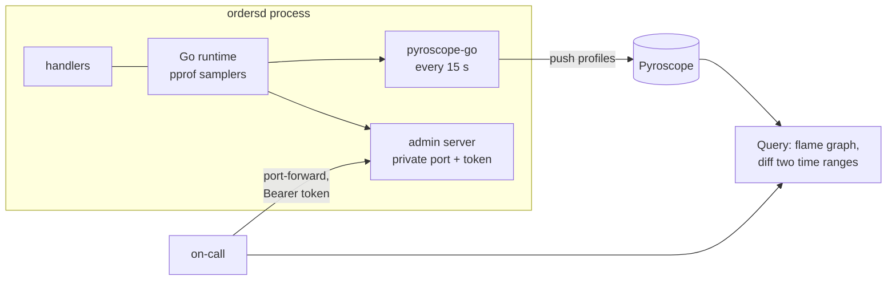

# Profiling in production

## Why care?

Your metrics and traces got you this far:

- The [burn-rate alert](slos-and-alerting.md) fired, and the trace shows the time goes into `ordersd`, in one handler. But **which line**?
- Memory of `ordersd` grows 1.6 MB per second. It is restarted by the OOM killer every few hours, so "it's fine after a restart", until the next deploy doubles the traffic.
- Latency went up 20% after Tuesday's release. Nobody can reproduce it on a laptop.
- At 14:03 yesterday p99 latency jumped for five minutes. Today everything is fine. What was the CPU doing at 14:03?
- Someone wants to "just add `import _ "net/http/pprof"`" to the public API server to debug this.

Logs, metrics and traces tell you **that** and **where in the system**. A profile tells you **where in the code**. This page shows how to collect profiles from a live service safely, keep them **all the time** with continuous profiling, and find a real memory leak in `ordersd` without restarting it.

The basics of `pprof` (benchmarks, `go tool pprof`, reading `flat` and `cum`, which profile answers which question) are in [Performance](../go/performance.md#profiling-in-production); the Linux side (`perf`, eBPF, `/proc`) is in [Debugging a Linux box](../linux/debugging.md). We build on both.

## The idea: record profiles all the time

There are two ways to profile a live service:

- **On-demand profiling**: someone notices a problem, opens a port-forward, and takes a 30-second profile. This only works **if** the problem is still happening.
- **Continuous profiling**: an agent takes a short profile every 15 seconds, all day, and sends it to a store. "What was the CPU doing at 14:03 yesterday?" becomes a query.
- Continuous profiling must be cheap. Sampling profilers cost about 1–5% CPU while they run (a guideline; measure your own service), and Go's heap profile is almost free because the runtime samples allocations anyway.



## Under the hood: profiles over HTTP, safely

`net/http/pprof` turns the runtime's profiles into HTTP endpoints. [Performance](../go/performance.md#profiling-in-production) already shows the rule: an **explicit mux on a separate, private port**, never `http.DefaultServeMux`, never the public server. The reason is what an open pprof endpoint gives an attacker:

| Endpoint                         | Risk                                                                                       |
| -------------------------------- | ------------------------------------------------------------------------------------------ |
| `/debug/pprof/goroutine?debug=2` | Every goroutine's stack: internal package names, file paths, sometimes values in arguments |
| `/debug/pprof/profile?seconds=N` | A CPU profile costs CPU while it runs; a loop of requests is a cheap slow-down attack      |
| `/debug/pprof/trace?seconds=N`   | The execution trace is much more expensive than a CPU profile                              |
| `/debug/pprof/heap`              | Function names and allocation sizes; reveals what the service holds in memory              |
| `/debug/pprof/cmdline`           | The full command line, **including any secret passed as a flag**                           |

So, three layers of protection:

1. **Network:** the admin server listens on `127.0.0.1` or an address only the cluster can reach. You get to it with `kubectl port-forward` or an SSH tunnel. In Kubernetes, a `NetworkPolicy` keeps other pods out (see the [Kubernetes chapter](../kubernetes/index.md)).
2. **Authentication:** even on a private network, require a token. Many incidents start inside the network.
3. **Minimal surface:** register only what you need. `cmdline` is left out below on purpose.

Here is the admin server of the lab copy of `ordersd`. It serves `/metrics` for Prometheus without a token (the scraper sits on the same private network), and the debug endpoints only with one:

```go
// newAdminServer serves metrics, pprof and the chaos knob on a private port.
// pprof and chaos need "Authorization: Bearer <token>"; /metrics does not.
func newAdminServer(addr, token string, reg *prometheus.Registry) *http.Server {
	debug := http.NewServeMux()
	debug.HandleFunc("GET /debug/pprof/", pprof.Index)
	debug.HandleFunc("GET /debug/pprof/profile", pprof.Profile)
	debug.HandleFunc("GET /debug/pprof/trace", pprof.Trace)
	debug.HandleFunc("GET /debug/pprof/symbol", pprof.Symbol)
	// ... plus GET /debug/chaos, the lab's fail-rate knob from SLOs and alerting

	mux := http.NewServeMux()
	mux.Handle("GET /metrics", promhttp.HandlerFor(reg, promhttp.HandlerOpts{}))
	mux.Handle("/debug/", requireToken(token, debug))
	return &http.Server{
		Addr:              addr,
		Handler:           mux,
		ReadHeaderTimeout: 5 * time.Second,
		WriteTimeout:      2 * time.Minute, // longer than the longest CPU profile
	}
}

// requireToken rejects requests without the right bearer token.
// An empty token disables the debug endpoints completely.
func requireToken(token string, next http.Handler) http.Handler {
	want := []byte("Bearer " + token)
	return http.HandlerFunc(func(w http.ResponseWriter, r *http.Request) {
		got := []byte(r.Header.Get("Authorization"))
		if token == "" || subtle.ConstantTimeCompare(got, want) != 1 {
			http.Error(w, "unauthorized", http.StatusUnauthorized)
			return
		}
		next.ServeHTTP(w, r)
	})
}
```

Details that matter:

- `pprof.Index` also serves the named profiles (`heap`, `goroutine`, `allocs`, `block`, `mutex`, `threadcreate`) under `/debug/pprof/<name>`, so you don't register them one by one.
- **`WriteTimeout`** must be longer than the longest profile you allow. With the public server's 15 s, a `?seconds=30` CPU profile would be cut off. That is one more reason for a separate server.
- **`subtle.ConstantTimeCompare`**, not `==`: a normal comparison stops at the first different byte, and the response time leaks how much of the token was right.
- **The token is an environment variable** (`ORDERS_ADMIN_TOKEN`), from a Secret, not a flag: flags show up in `ps` and in `/debug/pprof/cmdline`.
- **No token configured means locked**, not open. Fail closed.

### Continuous profiling with Pyroscope

[Grafana Pyroscope](https://grafana.com/oss/pyroscope/) is an open-source profile store. Two ways to get profiles into it:

- **Push:** the `pyroscope-go` SDK inside the process collects profiles and sends them. Used below.
- **Pull:** an agent (Grafana Alloy) scrapes the `/debug/pprof/*` endpoints, like Prometheus scrapes `/metrics`. No code change, but then the agent needs network access and the token.

On the Linux side, eBPF-based profilers sample every process on a node without any code change, but they see only CPU, not Go's heap or goroutines.

The SDK, started from `run` in `cmd/ordersd`:

```go
// startProfiling pushes profiles to Pyroscope every 15 seconds.
func startProfiling(serverURL, version string) (*pyroscope.Profiler, error) {
	runtime.SetMutexProfileFraction(5)
	runtime.SetBlockProfileRate(5)
	return pyroscope.Start(pyroscope.Config{
		ApplicationName: "ordersd",
		ServerAddress:   serverURL,
		Tags:            map[string]string{"version": version},
		ProfileTypes: []pyroscope.ProfileType{
			pyroscope.ProfileCPU,
			pyroscope.ProfileInuseSpace,
			pyroscope.ProfileAllocSpace,
			pyroscope.ProfileGoroutines,
			pyroscope.ProfileMutexDuration,
			pyroscope.ProfileBlockDuration,
		},
	})
}
```

```go
	if url := getenv("ORDERS_PYROSCOPE_URL"); url != "" {
		p, err := startProfiling(url, info.Version)
		if err != nil {
			return fmt.Errorf("profiling: %w", err)
		}
		defer p.Stop()
	}
```

We used `github.com/grafana/pyroscope-go v1.5.0`. The default `UploadRate` is 15 s. `ApplicationName` becomes the `service_name` label. The **`version` tag** is what makes "it got slower after Tuesday's release" a query: compare the profile of version A with version B.

`SetMutexProfileFraction` and `SetBlockProfileRate` are **off** by default in Go. Without them, the mutex and block profiles stay empty. Small values (here: 1 in 5 events) keep the cost low.

## Try it: find a leak in a live `ordersd`

A teammate added a "response log" so support can look up what the service sent to a customer:

```go
// WithResponseLog keeps a copy of every response, by request ID, so support
// can look up "what did we send this customer?". (It has a bug.)
func (l *responseLog) middleware(next http.Handler) http.Handler {
	return http.HandlerFunc(func(w http.ResponseWriter, r *http.Request) {
		tw := &teeWriter{ResponseWriter: w, buf: make([]byte, 0, 16<<10)}
		next.ServeHTTP(tw, r)
		l.mu.Lock()
		l.byID[requestIDFrom(r.Context())] = tw.buf // never deleted
		l.mu.Unlock()
	})
}
```

`teeWriter` copies everything written into `buf`. The bug is easy to see here because we know where it is. In a real code base it is one of 200 middlewares and caches. Now find it the way you would in production, from the outside.

### 1. Start the stack

```sh
docker run -d --name tutor-obs-c-pyroscope -p 127.0.0.1:20040:4040 \
  grafana/pyroscope:2.4.3 -segment-writer.min-ready-duration=0
until curl -sf localhost:20040/ready >/dev/null; do sleep 2; done

ORDERS_RESPONSE_LOG=1 ORDERS_PYROSCOPE_URL=http://127.0.0.1:20040 \
ORDERS_ADMIN_ADDR=127.0.0.1:20062 ORDERS_ADMIN_TOKEN=s3cret-lab-token \
  ./bin/ordersd -addr 127.0.0.1:20081 -log-level warn &
./bin/loadgen -url http://127.0.0.1:20081 -rps 100 &
```

`-segment-writer.min-ready-duration=0` stops Pyroscope 2.x from waiting 30 s before `/ready` turns green; its own log says this is safe for a single local instance. `loadgen` is the GET load generator from [SLOs and alerting](slos-and-alerting.md#4-run-the-alert-rules).

The token works:

```console
$ curl -s -o /dev/null -w 'no token: %{http_code}\n' http://127.0.0.1:20062/debug/pprof/heap
no token: 401
$ curl -s -o /dev/null -w 'with token: %{http_code}\n' -H "Authorization: Bearer s3cret-lab-token" http://127.0.0.1:20062/debug/pprof/heap
with token: 200
```

### 2. The symptom: a metric that only goes up

The Go collector of `client_golang` already exports the runtime's memory numbers. After 30 seconds and after 150 seconds of load:

```console
$ curl -s http://127.0.0.1:20062/metrics | grep -E '^(go_memstats_heap_inuse_bytes|go_goroutines|process_resident_memory_bytes) '
go_goroutines 24
go_memstats_heap_inuse_bytes 5.890048e+07
process_resident_memory_bytes 7.7049856e+07
$ # two minutes later
$ curl -s http://127.0.0.1:20062/metrics | grep -E '^(go_memstats_heap_inuse_bytes|go_goroutines|process_resident_memory_bytes) '
go_goroutines 24
go_memstats_heap_inuse_bytes 2.5575424e+08
process_resident_memory_bytes 2.84340224e+08
```

The heap went from 59 MB to 256 MB in 120 s: about **1.6 MB per second**, at 100 requests per second, so about 16 KB per request. Goroutines are flat at 24, so it is not a goroutine leak (that would be the `goroutine` and `goroutineleak` profiles, see [Performance](../go/performance.md#which-profile-for-which-question)). We stopped the load, waited 20 seconds, and looked again:

```console
$ curl -s http://127.0.0.1:20062/metrics | grep '^go_memstats_heap_inuse_bytes '
go_memstats_heap_inuse_bytes 3.04766976e+08
```

No traffic, and the memory is **not** given back. Garbage would have been collected by now. Something still **references** it. That is a leak.

For comparison, the same load for the same time **without** `ORDERS_RESPONSE_LOG`:

```console
$ curl -s http://127.0.0.1:20062/metrics | grep '^go_memstats_heap_inuse_bytes '   # at 30 s
go_memstats_heap_inuse_bytes 3.801088e+06
$ curl -s http://127.0.0.1:20062/metrics | grep '^go_memstats_heap_inuse_bytes '   # at 150 s
go_memstats_heap_inuse_bytes 2.727936e+06
```

Flat at 3–4 MB. (That run also had no `ORDERS_ADMIN_TOKEN`, and the debug endpoints stayed locked: `curl` got `401` for `/debug/pprof/heap`. Fail closed works.)

### 3. Continuous profiling: when did it start, and where?

Pyroscope already has the data; nobody had to be watching when the leak started. The UI is at `http://localhost:20040`. The same data comes from its HTTP API: `/pyroscope/render` returns a flame graph as JSON, for a **profile type** and a label selector. The in-use heap of `ordersd` over the four minutes of the run:

```console
$ Q=$(jq -rn '"memory:inuse_space:bytes:space:bytes{service_name=\"ordersd\"}"|@uri')
$ curl -s "localhost:20040/pyroscope/render?query=$Q&from=1795776150&until=1795776390&format=json" > mem.json
$ jq '{metadata, timeline: {startTime: .timeline.startTime, durationDelta: .timeline.durationDelta, samples: .timeline.samples}}' mem.json
{
  "metadata": {
    "format": "single",
    "spyName": "",
    "sampleRate": 100,
    "units": "bytes",
    "name": "inuse_space"
  },
  "timeline": {
    "startTime": 1795776150,
    "durationDelta": 15,
    "samples": [
      0,
      0,
      0,
      14475777,
      36234754,
      81515710,
      102660647,
      130934523,
      151825775,
      169939604,
      194489491,
      222727696,
      252472212,
      283876545,
      301840849,
      302905895
    ]
  }
}
```

One number per 15-second upload: the in-use heap that the profiles saw. It rises steadily while the load runs, and stays at 302 MB at the end, after the load stopped. The same shape as the metric, but now each point has **stacks** behind it.

The flame graph comes as `names` plus `levels`: each level is a flat list of 4 numbers per node (offset, total, self, index into `names`). A 10-line Python script (`fbtop.py`, in the lab directory) sums `self` per function:

```console
$ python3 fbtop.py MiB 4 < mem.json
 95.4%      2043.6 MiB  github.com/acme/orders/internal/httpapi.(*responseLog).middleware.func1
  1.2%        26.0 MiB  runtime.mallocgc
  1.0%        20.7 MiB  internal/runtime/maps.newarray
  1.0%        15.4 MiB  github.com/klauspost/compress/flate.NewWriter
```

The MiB column is the **sum** of all 16 snapshots in the range, so read the percentages, not the absolute number: 95% of the in-use heap was allocated in the response-log middleware.

The question for a leak is not "what is big?" but "**what grew?**". Pyroscope compares two time ranges with `/pyroscope/render-diff`: here, 30 seconds near the start (10:43:00–10:43:30) against 30 seconds near the end (10:45:30–10:46:00). The result has 7 numbers per node, left and right. `fbdiff.py` prints the functions whose `self` grew most:

```console
$ curl -s "localhost:20040/pyroscope/render-diff?leftQuery=$Q&leftFrom=1795776180&leftUntil=1795776210&rightQuery=$Q&rightFrom=1795776330&rightUntil=1795776360&format=json" | python3 fbdiff.py
    before      after     growth  function
   36.1MiB   543.9MiB  +507.9MiB  github.com/acme/orders/internal/httpapi.(*responseLog).middleware.func1
    1.5MiB     3.1MiB    +1.6MiB  internal/runtime/maps.newarray
    1.3MiB     2.6MiB    +1.3MiB  github.com/klauspost/compress/flate.NewWriter
    0.7MiB     1.3MiB    +0.7MiB  github.com/klauspost/compress/flate.(*fastGen).addBlock
```

(Again the sum of two snapshots per range.) One function, and nothing else, grew. In the UI this is the **diff view**: red for frames that grew, green for frames that shrank. Add `{service_name="ordersd", version="v1.8.0"}` to the selector to compare two releases the same way.

### 4. Confirm on the live process with `pprof`

Continuous profiling shows the function. To see the **line**, take two heap profiles from the admin port. `go tool pprof` cannot send a header, so download with `curl` first:

```sh
T='Authorization: Bearer s3cret-lab-token'
curl -s -H "$T" -o heap1.pb.gz http://127.0.0.1:20062/debug/pprof/heap   # at 30 s
curl -s -H "$T" -o heap2.pb.gz http://127.0.0.1:20062/debug/pprof/heap   # at 150 s
```

`-diff_base` subtracts the first profile from the second, so only what **grew** is left:

```console
$ go tool pprof -top -nodecount=5 -sample_index=inuse_space -diff_base=heap1.pb.gz heap2.pb.gz
File: ordersd
Build ID: 18770c07d2a144ccb07b38d4f6636767fcd70ad0
Type: inuse_space
Time: 2026-11-27 11:43:19 CET
Showing nodes accounting for 206.20MB, 596.72% of 34.56MB total
Dropped 11 nodes (cum <= 0.17MB)
Showing top 5 nodes out of 8
      flat  flat%   sum%        cum   cum%
  206.20MB 596.72% 596.72%   206.20MB 596.72%  github.com/acme/orders/internal/httpapi.(*responseLog).middleware.func1
         0     0% 596.72%   206.20MB 596.72%  github.com/acme/orders/internal/httpapi.instrument.func1
         0     0% 596.72%   206.20MB 596.72%  github.com/acme/orders/internal/httpapi.logRequests.func1
         0     0% 596.72%   206.20MB 596.72%  github.com/acme/orders/internal/httpapi.recoverPanic.func1
```

206 MB of growth in two minutes, all in one function. The percentages above 100% are normal for a diff: they are relative to the **base** profile (34.56 MB). `-list` shows the lines:

```console
$ go tool pprof -list 'responseLog..middleware.func1' -sample_index=inuse_space heap2.pb.gz
Total: 240.78MB
ROUTINE ======================== github.com/acme/orders/internal/httpapi.(*responseLog).middleware.func1 in /home/you/orders-lab/internal/httpapi/debuglog.go
  233.64MB   233.64MB (flat, cum) 97.04% of Total
         .          .     30:	return http.HandlerFunc(func(w http.ResponseWriter, r *http.Request) {
  232.60MB   232.60MB     31:		tw := &teeWriter{ResponseWriter: w, buf: make([]byte, 0, 16<<10)}
         .          .     32:		next.ServeHTTP(tw, r)
         .          .     33:		l.mu.Lock()
    1.05MB     1.05MB     34:		l.byID[requestIDFrom(r.Context())] = tw.buf // never deleted
         .          .     35:		l.mu.Unlock()
         .          .     36:	})
         .          .     37:}
```

(The lab directory path is replaced with `/home/you/orders-lab`.) Read this carefully, because it is the most common confusion with heap profiles:

- The heap profile shows **where memory was allocated**, not **who keeps it alive**. Line 31 allocates a 16 KiB buffer per request, "to avoid reallocations". Our responses are under 150 bytes, so 99% of each buffer is empty, and it is **kept** because line 34 stores the slice (which points to the whole 16 KiB array) in a map that is never cleaned.
- Two bugs, then: an unbounded map (the leak), and a buffer far bigger than the data (which makes the leak 100 times worse). 16 KiB × 100 requests/s = 1.6 MB/s, exactly what the metric showed.
- The fix: a **bounded** structure (a ring buffer of the last N responses, or an LRU with a size limit and a TTL), and copy only the bytes you keep (`bytes.Clone(tw.buf)`). Better still, ask whether the service should keep this at all: response bodies may hold personal data, and a log store with retention rules is the right place (see [Structured logging](structured-logging.md)).

The process was never restarted. The leak was found from the outside, with traffic running, in a few minutes.

Clean up: stop `loadgen` and `ordersd`, then `docker rm -f tutor-obs-c-pyroscope`.

## Traps

- **`import _ "net/http/pprof"` with the default mux on the public server.** Anyone can read your stacks and start CPU profiles. Use an explicit mux on a private port, with a token.
- **Secrets in flags.** `/debug/pprof/cmdline` and `ps` show them. Use environment variables or files, and don't register `cmdline`.
- **A `WriteTimeout` shorter than the profile.** `?seconds=30` on a server with `WriteTimeout: 15s` returns a broken profile. Another reason for a separate admin server.
- **Reading allocation site as owner.** The heap profile tells you where memory was allocated. Who keeps it alive is a question for the code (maps, caches, globals, goroutines that never end).
- **Looking at one heap profile for a leak.** A big cache is not a leak. Compare two points in time (`-diff_base`, or Pyroscope's diff view) and look for what grows.
- **`alloc_space` vs `inuse_space`.** `alloc_space` (everything ever allocated) finds GC pressure; `inuse_space` (still live) finds leaks. The `heap` endpoint has both; choose with `-sample_index`.
- **Expecting mutex and block profiles without enabling them.** They are off until you call `runtime.SetMutexProfileFraction` and `runtime.SetBlockProfileRate`.
- **Forgetting the side effects of the profiler.** `pyroscope-go` forces a `runtime.GC()` before a heap snapshot if no GC ran since the last one (see `DisableGCRuns`). Usually harmless, but it is a GC you didn't ask for.
- **High-cardinality profile tags.** Tagging profiles with `user_id` or `request_id` has the same cost problem as metric labels. Tag with version, region, endpoint.
- **"We'll add profiling when we need it."** The minute you need to see is always in the past. Run continuous profiling before the incident.

## Check yourself

??? question "1. A colleague wants to add `import _ \"net/http/pprof\"` to `ordersd` \"just for today\". The public server uses its own `ServeMux`, not the default one. Is it safe?"

    The import only registers on `http.DefaultServeMux`, so the public server does not serve
    the routes, as long as nothing serves the default mux. But it is a risk: any later `http.ListenAndServe(addr, nil)` (a quick metrics server, a test
    helper) exposes everything. Register the handlers explicitly on the admin mux, behind a
    token, on a private port.

??? question "2. The heap of a service grows from 200 MB to 1.2 GB during the day and drops back to 200 MB at night. Is it a leak?"

    Probably not. Memory that comes back when traffic goes down is live data that scales
    with load (caches, buffers, in-flight requests) or garbage the GC hasn't collected yet.
    A leak keeps growing with **total** requests served, and does not come back when traffic
    stops, like `ordersd` in the lab (305 MB with no traffic). Check that the growth is
    expected (for example, a cache with a size limit) and that `GOMEMLIMIT` and the container
    limit leave room.

??? question "3. Why did the heap profile point at line 31 (`make([]byte, 0, 16<<10)`) and not at line 34, where the slice is stored in the map?"

    A heap profile records the **stack at allocation time** for sampled allocations, and
    reports the samples that are still live. Line 31 allocated the 16 KiB arrays. Line 34
    only stores a slice header that points to them; the map's own growth (1.05 MB) is the
    only allocation there. To find who keeps memory alive, follow the allocation site to
    where its result is stored.

??? question "4. p99 latency doubled after Tuesday's release, CPU usage didn't change, and the CPU flame graph looks the same as before. Which profiles do you look at next?"

    High latency with unchanged CPU means requests **wait**. Compare the **mutex** and
    **block** profiles (contention on a lock, a full channel) between the two versions, and
    the **goroutine** profile (how many are stuck, and where). If none explain it, the
    execution trace shows scheduling delays and GC pauses (see
    [Performance](../go/performance.md#the-execution-trace-what-happened-and-when)). With
    continuous profiling and a `version` tag, the comparison is a diff query.

??? question "5. Pull (an agent scrapes `/debug/pprof`) or push (the SDK sends profiles)? Name one advantage of each."

    Pull: no code or dependency in the service, and the agent controls the schedule and the
    cost, like Prometheus scraping metrics. Push: works where nobody can reach the process
    (short jobs, strict networks), and the token for the debug endpoints never leaves the
    pod. In both cases, the profile store is a sensitive system: it contains your code's
    structure.

## Recap

- A profile answers **which code**: the step after metrics (**that**) and traces (**where in the system**).
- Serve `net/http/pprof` on a **separate admin server**: private address, bearer token compared in constant time, fail closed without a token, no `cmdline`, a `WriteTimeout` longer than any profile.
- **Continuous profiling** (Pyroscope with `pyroscope-go`, pushing every 15 s) keeps profiles for every minute, labelled with `service_name` and `version`, so you can look at the past and diff releases.
- Enable mutex and block profiles explicitly. Keep profile tags low-cardinality.
- To find a **leak**: a memory metric that only goes up and doesn't come back without traffic; then a **diff** of two points in time (`-diff_base` or Pyroscope's diff view); then `-list` for the line. The heap profile shows the allocation site; you find the owner in the code.

## You finished Observability

You can now make `ordersd` answer questions you didn't plan for: structured logs with request and trace IDs, metrics you can aggregate cheaply, traces that cross services, SLOs that turn "is it bad?" into a number with an error budget, alerts that page only when users are affected, and profiles that point to the line of code, even for a problem that happened yesterday.

Next, [CI/CD and delivery](../delivery/index.md): how a commit becomes running code, and how the SLOs and burn rates from this chapter decide automatically whether a canary is promoted or rolled back.
