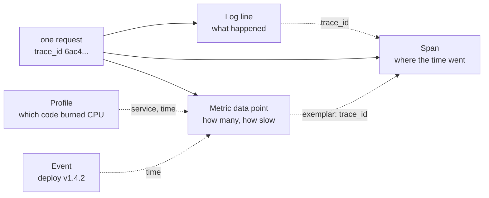
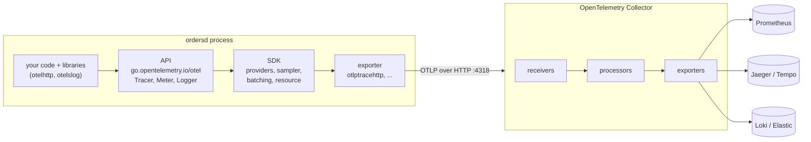

# Signals and how they fit

## Why care?

Three messages from a real on-call week:

- "Error rate is 4%. Which customers? The dashboard can't say."
- "The logs show the request took 9 seconds, but every service says _it_ was fast."
- "The metrics bill tripled this month. Nobody changed anything." (Somebody added one label.)

Each of these has the same root cause. The team collected data, but the **wrong kind** of data for the question, or the right kind at the wrong cost. Logs, metrics, traces and profiles are not four names for "monitoring". They are four different tools with four different shapes, prices and limits.

On this page you learn what each signal is good at, what it costs, and how OpenTelemetry connects them. At the end you send one request to `ordersd` and find it again in all three: a log line, a span and a metric, joined by one trace ID.

## The idea: a hospital ward

Think of a patient in a hospital.

- The **heart monitor** beeps every second: pulse, blood pressure, oxygen. It is cheap, always on, and it shows trends. It cannot tell you _why_ the pulse went up. That is a **metric**.
- The **nurse's notes** say "14:02, patient complained of chest pain, gave aspirin". Rich detail about one moment. Nobody reads all of them, you search them when something happened. Those are **logs**.
- The **patient's route** through the hospital: emergency room 12 minutes, waiting 2 hours, X-ray 5 minutes, ward. It shows _where the time went_ across departments. That is a **trace**.
- The **MRI scan** looks inside, at which organ does the work. Expensive, so you do it when you need it, or a quick low-dose version all the time. That is a **profile**.
- The **ward diary** says "15:00 new medicine started". It explains why the chart changes after 15:00. Those are **events**.

A good doctor uses all of them, and the patient ID on every sheet connects them. In software that patient ID is the **trace ID**.



## Under the hood: the five signals

### Logs: one record per thing that happened

A log record is a timestamp, a level, a message and some attributes. `ordersd` already writes one per request (see [Building a service](../go/services.md#access-logs)):

```text
{"time":"2026-11-27T07:42:46.117675733+01:00","level":"INFO","msg":"http request","service":"ordersd","request_id":"01a21bbd-fee5-7893-8ca8-c86a0d9c6435","method":"GET","path":"/v1/orders/01a216c6-d393-716c-832e-f6ca26fc5788","route":"GET /v1/orders/{id}","status":404,"bytes":135,"duration":120269,"trace_id":"6ac40a1b6d95a4730429c3af671a2d75","span_id":"fd0e62c60a9bc21d"}
```

- **Good for:** the details of one event. Which order ID, which error message, which customer.
- **Bad for:** "how many per second?" and "what is p99?". You can compute them from logs, but you scan gigabytes to draw one line.
- **Cost grows with traffic.** One request, one line. Twice the traffic, twice the bill.

How much? We sent 1,000 requests to `ordersd` and measured the access log:

```console
$ for i in $(seq 1000); do curl -s -o /dev/null http://127.0.0.1:18080/v1/orders; done
$ tail -n 1000 ordersd.log | wc -c
330846
```

About **330 bytes per request**, for the shortest possible route. At a modest 500 requests per second that is 330 × 500 × 86,400 ≈ **14 GB per day**, for access logs alone, before the log platform indexes and replicates it. Logs are the most expensive signal per bit of information. The next page, [Structured logging](structured-logging.md), is about getting more value from each line.

### Metrics: numbers, pre-aggregated

A metric is a **number that the process sums up for you** before it leaves. `ordersd` does not send "request 1 took 0.25 ms, request 2 took 0.31 ms...". It keeps a counter and a histogram in memory, and every few seconds it sends the current totals.

A metric has a name and **labels** (OpenTelemetry calls them attributes). Each unique combination of label values is one **time series**:

```text
http_requests_total{route="GET /v1/orders", status="200"}      1042
http_requests_total{route="GET /v1/orders/{id}", status="404"}    17
```

- **Good for:** trends, rates, percentiles, alerts. "Error rate over the last 5 minutes" is one cheap query.
- **Bad for:** the details. A metric knows that 17 requests got a 404. It does not know which order IDs.
- **Cost grows with the number of series, not with traffic.** A counter that is incremented a million times is still one number.

In the same 1,000-request run, the OpenTelemetry Collector counted what it received from `ordersd`:

```console
$ docker logs tutor-obs-a-collector 2>&1 \
    | grep -oE '"(log records|spans|data points)": [0-9]+' \
    | awk -F'": ' '{gsub(/"/,"",$1); n[$1]+=$2; c[$1]++} END {for (k in n) printf "%-12s total=%-5d exports=%d\n", k, n[k], c[k]}' \
    | sort
data points  total=30    exports=5
log records  total=1004  exports=10
spans        total=1002  exports=4
```

1,004 log records (one per request, plus startup lines), 1,002 spans (one per request, plus two earlier test requests), and **6 metric data points per export**, every 10 seconds, no matter how many requests came in. That is the whole point of metrics.

### Cardinality: the one way metrics get expensive

**Cardinality** is the number of distinct values a label can take. The number of series is the **product** of the cardinalities of all labels. That multiplication is what surprises people.

Here is a small program with the real Prometheus client library (`github.com/prometheus/client_golang` v1.25.0). It creates the same counter three times: once with `route` and `status`, then with a `customer_id` label added, for 1,000 and for 100,000 customers:

```go
// Command cardinality shows how one extra label multiplies time series.
package main

import (
	"fmt"
	"runtime"

	"github.com/prometheus/client_golang/prometheus"
)

func main() {
	routes := []string{"GET /v1/orders", "GET /v1/orders/{id}", "POST /v1/orders"}
	statuses := []string{"200", "201", "400", "404", "500"}

	for _, customers := range []int{0, 1_000, 100_000} {
		reg := prometheus.NewRegistry()
		labels := []string{"route", "status"}
		if customers > 0 {
			labels = append(labels, "customer_id")
		}
		reqs := prometheus.NewCounterVec(prometheus.CounterOpts{
			Name: "orders_http_requests_total",
			Help: "HTTP requests.",
		}, labels)
		reg.MustRegister(reqs)

		var before, after runtime.MemStats
		runtime.GC()
		runtime.ReadMemStats(&before)
		for _, r := range routes {
			for _, s := range statuses {
				if customers == 0 {
					reqs.WithLabelValues(r, s).Inc()
					continue
				}
				for c := range customers {
					reqs.WithLabelValues(r, s, fmt.Sprintf("cus-%d", c)).Inc()
				}
			}
		}
		runtime.GC()
		runtime.ReadMemStats(&after)

		mfs, _ := reg.Gather()
		series := len(mfs[0].GetMetric())
		fmt.Printf("customer_id values=%-7d series=%-9d heap=%7d KiB\n",
			customers, series, max(0, int64(after.HeapAlloc)-int64(before.HeapAlloc))>>10)
	}
}
```

```console
$ go run ./cmd/cardinality
customer_id values=0       series=15        heap=      0 KiB
customer_id values=1000    series=15000     heap=   9741 KiB
customer_id values=100000  series=1500000   heap= 937473 KiB
```

3 routes × 5 statuses = 15 series. Add 100,000 customers and it is 1.5 million series and **almost 1 GB of heap inside `ordersd`**, before a single byte reaches Prometheus. Every Prometheus server that scrapes it pays again, in memory and disk, and every dashboard query gets slower.

The rule: **a label must have a small, bounded set of values.** Route, method, status class, region: yes. User ID, order ID, email, full URL path, error message text: never. Those belong in logs and spans, which are priced per event, not per combination. [Metrics](metrics.md) goes deeper.

### Traces: where the time went

A **trace** is the story of one request through the system. It is a tree of **spans**. Each span is one unit of work (an HTTP request handled, a database query, a call to another service) with a start time, an end time, attributes, and the ID of its parent span. All spans of one request share one **trace ID**.

```mermaid
gantt
    dateFormat x
    axisFormat %L ms
    title An example trace (illustration)
    section ordersd
    GET /v1/orders/{id}   :0, 120
    section payments
    POST /charge          :15, 95
    section postgres
    SELECT orders         :5, 12
```



- **Good for:** latency across services. "The 9-second request spent 8.7 seconds waiting for `payments`."
- **Bad for:** counting. Most systems keep only a **sample** of traces, so a trace store cannot tell you the exact error rate.
- **Cost grows with traffic × spans per request.** A request that touches 30 services makes 30+ spans. That is why tracing almost always uses **sampling**: keep 1 in 100, or keep all slow and failed ones. [Distributed tracing](distributed-tracing.md) explains how.

### Profiles: which code

A **profile** samples the call stacks of a running process: which functions use the CPU, which allocate memory, where goroutines block. You already know them from [Performance](../go/performance.md#profiling-in-production). **Continuous profiling** collects a low-rate profile all the time, so you can compare "this morning" with "after the deploy" without reproducing anything.

- **Good for:** "the service is slow and the trace says the time is _inside_ `ordersd`. Which function?"
- **Cost:** a few percent of CPU while sampling, and storage that grows with the number of processes, not with traffic.

OpenTelemetry is adding profiles as a new signal, but it is young. The OTLP receiver in Collector 0.166.0 lists only three signals:

```console
$ docker run --rm otel/opentelemetry-collector-contrib:0.166.0 components 2>&1 | grep -A5 'name: otlp$'
    - name: otlp
      module: go.opentelemetry.io/collector/receiver/otlpreceiver v0.166.0
      stability:
        logs: Stable
        metrics: Stable
        traces: Stable
```

So for now profiles travel their own way, with `pprof` and a tool like Pyroscope. [Profiling in production](profiling.md) sets that up.

### Events: what changed

The fifth signal is not a separate pipeline, it is a habit: **record changes**. A deploy, a config change, a feature flag flip, a node drained, a Kubernetes `OOMKilled` event. Most incidents start right after a change, and a graph with a vertical line "v1.4.2 deployed" saves the first 20 minutes of every investigation.

Events can live in many places: a log line with `msg="deployed"`, an annotation in Grafana, a **span event** (a timestamped note inside a span, like "retry 2 of 3"), or the event stream of [Kubernetes](../kubernetes/index.md). The important part is that they exist, and that they carry a time and the service name.

### The signals side by side

| Signal  | Question it answers       | Unit of cost             | Grows with             | Typical retention |
| ------- | ------------------------- | ------------------------ | ---------------------- | ----------------- |
| Metrics | How many? How slow? Trend | One time series          | Label combinations     | Months to years   |
| Logs    | What exactly happened?    | One record (bytes)       | Traffic × log lines    | Days to weeks     |
| Traces  | Where did the time go?    | One span                 | Traffic × spans × rate | Days              |
| Profile | Which code used it?       | One profile per interval | Number of processes    | Days to weeks     |
| Events  | What changed?             | One record               | Number of changes      | As long as logs   |

The usual flow during an incident: an **alert** fires on a metric. A **graph** shows when it started, and an event shows a deploy at that time. An **exemplar** on the graph links to a slow **trace**. The trace shows the slow span, and its trace ID finds the **log lines** with the error. If the slow span is pure CPU, the **profile** shows the function. Each signal hands you to the next one.

## Under the hood: OpenTelemetry

Every vendor used to have its own agent, its own library and its own wire format. Switching vendors meant re-instrumenting every service. **OpenTelemetry** (OTel) is the open standard that fixes this. You instrument once, with OTel, and send the data to whatever backend you like.

OTel has four parts. Keep them apart in your head, because the docs and the Go modules follow this split exactly.



**1. The API.** Interfaces and a no-op default: `otel.Tracer("...")`, `otel.Meter("...")`. Libraries depend **only on the API**. If the application never installs an SDK, every call is a cheap no-op. That is why a library like `otelhttp` can be instrumented "for free": it costs nothing until `main` turns it on.

**2. The SDK.** The real implementation, installed once in `main`. It holds the **providers** (`TracerProvider`, `MeterProvider`, `LoggerProvider`), decides what to sample, batches data in memory, and attaches the **resource**.

**3. Exporters.** Plugins that turn batches into bytes on the wire. You almost always want the **OTLP** exporters. OTLP (the OpenTelemetry Protocol) is protobuf over gRPC (port 4317) or HTTP (port 4318).

**4. The Collector.** A separate process (often a sidecar or a DaemonSet in Kubernetes) that receives OTLP, processes it (batching, sampling, dropping attributes, adding `k8s.pod.name`), and exports to one or more backends. The application only ever knows "send OTLP to the Collector". Changing backends is a Collector config change, not a code change.

### The resource: who is talking

Every batch carries a **resource**: attributes that describe the _source_ of the data, not the event. `service.name`, `service.version`, `deployment.environment.name`, `host.name`, `k8s.pod.name`. They are sent once per batch, not once per span, so they are cheap. They are also how a backend knows that a span, a metric and a log line came from the same process.

Here is how our copy of `ordersd` builds it (semantic conventions `semconv/v1.43.0`, the newest in `go.opentelemetry.io/otel` v1.47.0):

```go
// Later options win: code gives defaults, OTEL_SERVICE_NAME and
// OTEL_RESOURCE_ATTRIBUTES from the environment override them.
res, err := resource.New(ctx,
	resource.WithSchemaURL(semconv.SchemaURL),
	resource.WithAttributes(semconv.ServiceName("ordersd"), semconv.ServiceVersion(version)),
	resource.WithFromEnv(),
	resource.WithTelemetrySDK(),
	resource.WithHost(),
	resource.WithProcessPID(),
)
```

Run it with two standard environment variables, and the Collector shows the result:

```sh
OTEL_SERVICE_NAME=orders-api \
  OTEL_RESOURCE_ATTRIBUTES=deployment.environment.name=dev,service.namespace=shop \
  OTEL_EXPORTER_OTLP_ENDPOINT=http://127.0.0.1:18318 ./ordersd -addr 127.0.0.1:18080
```

```text
Resource attributes:
     -> deployment.environment.name: Str(dev)
     -> host.name: Str(laptop)
     -> process.pid: Int(1037055)
     -> service.name: Str(orders-api)
     -> service.namespace: Str(shop)
     -> service.version: Str((devel))
     -> telemetry.sdk.language: Str(go)
     -> telemetry.sdk.name: Str(opentelemetry)
     -> telemetry.sdk.version: Str(1.47.0)
```

`service.version` is `(devel)` because this scratch copy is not built from a Git checkout; `buildinfo` reads the version from the VCS stamp (see [Building a service](../go/services.md)).

!!! warning "Trap: hard-coded `service.name` silently beats the environment"

    Our first version used `resource.Merge(resource.Default(), resource.NewWithAttributes(...ServiceName("ordersd")...))`.
    In `Merge`, the second resource wins. With the same `OTEL_SERVICE_NAME=orders-api`, the Collector received
    `service.name: Str(ordersd)`: the operator's setting was ignored, and nobody got an error. Use `resource.New`
    with `WithFromEnv()` **after** your defaults, as above.

### Instrumentation in `ordersd`

The [Go chapter](../go/services.md) kept `ordersd` dependency-free. For this chapter we instrument a **copy** of `examples/orders`. These are the direct dependencies it needs (versions from `go.mod` after `go get ...@latest`):

```text
	go.opentelemetry.io/contrib/bridges/otelslog v0.21.0
	go.opentelemetry.io/contrib/instrumentation/net/http/otelhttp v0.72.0
	go.opentelemetry.io/otel v1.47.0
	go.opentelemetry.io/otel/exporters/otlp/otlplog/otlploghttp v0.23.0
	go.opentelemetry.io/otel/exporters/otlp/otlpmetric/otlpmetrichttp v1.47.0
	go.opentelemetry.io/otel/exporters/otlp/otlptrace/otlptracehttp v1.47.0
	go.opentelemetry.io/otel/sdk v1.47.0
	go.opentelemetry.io/otel/sdk/log v1.47.0
	go.opentelemetry.io/otel/sdk/metric v1.47.0
```

Look at the version numbers. Traces and metrics are `v1`: stable, with the usual compatibility promise. The OTLP **log exporter** is still `v0.23.0`. Pin versions, and read the release notes when you upgrade a `v0` module.

A new package, `internal/telemetry`, sets up one provider per signal. All three share the resource, and all three export OTLP over HTTP:

```go
// Package telemetry sets up the OpenTelemetry SDK: one provider per signal,
// all sharing one resource, all exporting OTLP over HTTP.
package telemetry

// Setup installs global providers. The OTLP endpoint comes from the
// standard OTEL_EXPORTER_OTLP_ENDPOINT variable. Call shutdown before exit:
// it flushes what is still buffered.
func Setup(ctx context.Context, version string) (shutdown func(context.Context) error, err error) {
	res, err := resource.New(ctx /* ... as above ... */)
	if err != nil {
		return nil, err
	}

	traceExp, err := otlptracehttp.New(ctx)
	if err != nil {
		return nil, err
	}
	tp := sdktrace.NewTracerProvider(sdktrace.WithResource(res), sdktrace.WithBatcher(traceExp))

	metricExp, err := otlpmetrichttp.New(ctx)
	if err != nil {
		return nil, err
	}
	mp := sdkmetric.NewMeterProvider(sdkmetric.WithResource(res),
		sdkmetric.WithReader(sdkmetric.NewPeriodicReader(metricExp, sdkmetric.WithInterval(10*time.Second))))

	logExp, err := otlploghttp.New(ctx)
	if err != nil {
		return nil, err
	}
	lp := sdklog.NewLoggerProvider(sdklog.WithResource(res), sdklog.WithProcessor(sdklog.NewBatchProcessor(logExp)))

	otel.SetTracerProvider(tp)
	otel.SetMeterProvider(mp)
	global.SetLoggerProvider(lp)
	otel.SetTextMapPropagator(propagation.NewCompositeTextMapPropagator(propagation.TraceContext{}, propagation.Baggage{}))

	return func(ctx context.Context) error {
		return errors.Join(tp.Shutdown(ctx), mp.Shutdown(ctx), lp.Shutdown(ctx))
	}, nil
}
```

Three things in `main` turn it on:

1. Call `telemetry.Setup` when `OTEL_EXPORTER_OTLP_ENDPOINT` is set, and `defer` the shutdown, so the last batches are flushed during [graceful shutdown](../go/services.md#graceful-shutdown).
2. Wrap the root handler: `otelhttp.NewHandler(httpapi.NewHandler(svc, logger, ready.Load), "ordersd")`. This one line creates a span **and** records the standard HTTP metrics for every request.
3. Send `slog` records to OTel too, with `slog.NewMultiHandler(stdoutHandler, otelslog.NewHandler(...))`. [Structured logging](structured-logging.md) shows the details, and one trap.

!!! note "Batching is the reason this is cheap"

    `WithBatcher` does not send one span per request. It keeps up to 2,048 spans in a queue
    (`DefaultMaxQueueSize`) and sends up to 512 at a time (`DefaultMaxExportBatchSize`), at least every 5
    seconds (`DefaultScheduleDelay`), all from `go.opentelemetry.io/otel/sdk` v1.47.0. In the 1,000-request run
    above, one export carried exactly 512 spans. When the queue is full, new spans are **dropped**, not
    blocked. Telemetry must never slow down the request.

## Try it: one request, three signals

**Step 1: a Collector that prints everything.** The `debug` exporter writes what it receives to the Collector's own log. Perfect for learning, useless for production.

```yaml
# collector.yaml
receivers:
  otlp:
    protocols:
      http:
        endpoint: 0.0.0.0:4318

processors:
  batch: {}

exporters:
  debug:
    verbosity: detailed

service:
  pipelines:
    traces:
      receivers: [otlp]
      processors: [batch]
      exporters: [debug]
    metrics:
      receivers: [otlp]
      processors: [batch]
      exporters: [debug]
    logs:
      receivers: [otlp]
      processors: [batch]
      exporters: [debug]
```

```sh
docker run -d --name tutor-obs-a-collector -p 127.0.0.1:18318:4318 \
    -v "$PWD/collector.yaml:/etc/otelcol-contrib/config.yaml:ro" \
    otel/opentelemetry-collector-contrib:0.166.0
```

Wait until `docker logs tutor-obs-a-collector` shows the line `Everything is ready. Begin running and processing data.`

**Step 2: run the instrumented `ordersd`** and send one request for an order that does not exist:

```console
$ OTEL_EXPORTER_OTLP_ENDPOINT=http://127.0.0.1:18318 ./ordersd -addr 127.0.0.1:18080 > one.log 2>&1 &
$ curl -s -o /dev/null -w '%{http_code}\n' http://127.0.0.1:18080/v1/orders/01a216c6-d393-716c-832e-f6ca26fc5788
404
$ tail -1 one.log
{"time":"2026-11-27T07:42:46.117675733+01:00","level":"INFO","msg":"http request","service":"ordersd","request_id":"01a21bbd-fee5-7893-8ca8-c86a0d9c6435","method":"GET","path":"/v1/orders/01a216c6-d393-716c-832e-f6ca26fc5788","route":"GET /v1/orders/{id}","status":404,"bytes":135,"duration":120269,"trace_id":"6ac40a1b6d95a4730429c3af671a2d75","span_id":"fd0e62c60a9bc21d"}
```

Our stdout log line has a `trace_id`. Remember `6ac40a1b...`.

**Step 3: find it three times in the Collector.** Wait about 10 seconds (the metric interval), then read `docker logs tutor-obs-a-collector`. Trimmed to the interesting parts, the first block is the **log record**, sent by the `otelslog` bridge:

```text
LogRecord #0
ObservedTimestamp: 2026-11-27 06:42:46.117722525 +0000 UTC
Timestamp: 2026-11-27 06:42:46.117675733 +0000 UTC
SeverityText: INFO
SeverityNumber: Info(9)
Body: Str(http request)
Attributes:
     -> service: Str(ordersd)
     -> request_id: Str(01a21bbd-fee5-7893-8ca8-c86a0d9c6435)
     -> method: Str(GET)
     -> path: Str(/v1/orders/01a216c6-d393-716c-832e-f6ca26fc5788)
     -> route: Str(GET /v1/orders/{id})
     -> status: Int(404)
     -> bytes: Int(135)
     -> duration: Int(120269)
Trace ID: 6ac40a1b6d95a4730429c3af671a2d75
Span ID: fd0e62c60a9bc21d
Flags: 1
```

The trace ID is not an attribute here. It is a first-class field of the OTel log record, filled in from the `context.Context` that `logRequests` passed to `LogAttrs`. Next, the **span** from `otelhttp`:

```text
InstrumentationScope go.opentelemetry.io/contrib/instrumentation/net/http/otelhttp 0.72.0
Span #0
    Trace ID       : 6ac40a1b6d95a4730429c3af671a2d75
    Parent ID      :
    ID             : fd0e62c60a9bc21d
    Name           : GET
    Kind           : Server
    Start time     : 2026-11-27 06:42:46.117513147 +0000 UTC
    End time       : 2026-11-27 06:42:46.120120475 +0000 UTC
    Status code    : Unset
Attributes:
     -> server.address: Str(127.0.0.1)
     -> http.request.method: Str(GET)
     -> url.scheme: Str(http)
     -> server.port: Int(18080)
     -> user_agent.original: Str(curl/8.23.0)
     -> client.address: Str(127.0.0.1)
     -> url.path: Str(/v1/orders/01a216c6-d393-716c-832e-f6ca26fc5788)
     -> network.protocol.version: Str(1.1)
     -> http.response.body.size: Int(135)
     -> http.response.status_code: Int(404)
```

Same trace ID, and the span ID is the one in the log line. No parent: this request started here. And last, the **metric**:

```text
Descriptor:
     -> Name: http.server.request.duration
     -> Description: Duration of HTTP server requests.
     -> Unit: s
     -> DataType: Histogram
     -> AggregationTemporality: Cumulative
HistogramDataPoints #0
Data point attributes:
     -> http.request.method: Str(GET)
     -> http.response.status_code: Int(404)
     -> network.protocol.name: Str(http)
     -> network.protocol.version: Str(1.1)
     -> server.address: Str(127.0.0.1)
     -> server.port: Int(18080)
     -> url.scheme: Str(http)
Count: 1
Sum: 0.000252
Min: 0.000252
Max: 0.000252
Exemplars:
Exemplar #0
     -> Trace ID: 6ac40a1b6d95a4730429c3af671a2d75
     -> Span ID: fd0e62c60a9bc21d
     -> Timestamp: 2026-11-27 06:42:46.120118717 +0000 UTC
     -> Value: 0.000252
```

Read it carefully:

- The metric has **no** `url.path` attribute, while the span does. `otelhttp` knows that a path is high cardinality and keeps it out of metrics. Good.
- The metric also has no route. `otelhttp` wraps the whole mux, so it runs _before_ the mux has matched a pattern, and the span name is just `GET`. Our own log line has `route` because `logRequests` reads `r.Pattern` after the mux ran. [Distributed tracing](distributed-tracing.md) fixes this.
- The histogram point carries an **exemplar**: one sample value with the trace ID of a request that produced it. On a latency graph, that is the dot you click to jump from "p99 is high" to "here is one of those slow requests".
- All three blocks carry the same resource: `service.name: Str(ordersd)`, `host.name`, `process.pid`.

**Step 4: stop the Collector** and see what happens to the service:

```console
$ docker stop tutor-obs-a-collector
$ for i in 1 2 3; do curl -s -o /dev/null -w '%{http_code} %{time_total}s\n' http://127.0.0.1:18080/v1/orders; done
200 0.001270s
200 0.001097s
200 0.001044s
$ tail -n +3 one.log | grep -v '"http request"'
2026/11/27 07:43:15 failed to upload metrics: Post "http://127.0.0.1:18318/v1/metrics": dial tcp 127.0.0.1:18318: connect: connection refused
2026/11/27 07:43:16 Post "http://127.0.0.1:18318/v1/logs": dial tcp 127.0.0.1:18318: connect: connection refused
2026/11/27 07:43:20 traces export: Post "http://127.0.0.1:18318/v1/traces": dial tcp 127.0.0.1:18318: connect: connection refused
2026/11/27 07:43:25 failed to upload metrics: Post "http://127.0.0.1:18318/v1/metrics": dial tcp 127.0.0.1:18318: connect: connection refused
```

The requests are still served in about a millisecond. Export happens in the background, so a dead Collector costs you telemetry, not availability. The exporter retries with exponential back-off for up to one minute (the default `RetryConfig` of `otlptracehttp`), then drops the batch.

But look at the error lines. They are **not JSON**. The SDK reports export errors through its global error handler, and the default prints with the standard `log` package. Your log platform will not parse them, and an alert on "telemetry export failed" will never fire. The fix is one call to `otel.SetErrorHandler`, and it has a trap of its own:

```go
// Export errors go to stdout only. Through the OTel bridge, each
// failed export would log a new record that also fails to export.
local := slog.New(slog.NewJSONHandler(stdout, nil)).With(slog.String("service", "ordersd"))
otel.SetErrorHandler(otel.ErrorHandlerFunc(func(err error) {
	local.Warn("telemetry export failed", slog.Any("error", err))
}))
```

Our first version used the normal `logger`, which also feeds the `otelslog` bridge. With the Collector down, every failed log export logged a warning, which went into the next log export, which failed and logged a warning... one new line per second, forever:

```text
{"time":"2026-11-27T07:44:06.046137346+01:00","level":"WARN","msg":"telemetry export failed","service":"ordersd","error":"Post \"http://127.0.0.1:18318/v1/logs\": dial tcp 127.0.0.1:18318: connect: connection refused"}
{"time":"2026-11-27T07:44:07.043907295+01:00","level":"WARN","msg":"telemetry export failed","service":"ordersd","error":"Post \"http://127.0.0.1:18318/v1/logs\": dial tcp 127.0.0.1:18318: connect: connection refused"}
{"time":"2026-11-27T07:44:08.048913667+01:00","level":"WARN","msg":"telemetry export failed","service":"ordersd","error":"Post \"http://127.0.0.1:18318/v1/logs\": dial tcp 127.0.0.1:18318: connect: connection refused"}
{"time":"2026-11-27T07:44:09.053221825+01:00","level":"WARN","msg":"telemetry export failed","service":"ordersd","error":"Post \"http://127.0.0.1:18318/v1/logs\": dial tcp 127.0.0.1:18318: connect: connection refused"}
```

With the stdout-only logger, there is one line per failed batch and the loop is gone:

```text
{"time":"2026-11-27T07:44:32.377055177+01:00","level":"WARN","msg":"telemetry export failed","service":"ordersd","error":"Post \"http://127.0.0.1:18318/v1/logs\": dial tcp 127.0.0.1:18318: connect: connection refused"}
{"time":"2026-11-27T07:44:36.378740546+01:00","level":"WARN","msg":"telemetry export failed","service":"ordersd","error":"traces export: Post \"http://127.0.0.1:18318/v1/traces\": dial tcp 127.0.0.1:18318: connect: connection refused"}
{"time":"2026-11-27T07:44:41.378762196+01:00","level":"WARN","msg":"telemetry export failed","service":"ordersd","error":"failed to upload metrics: Post \"http://127.0.0.1:18318/v1/metrics\": dial tcp 127.0.0.1:18318: connect: connection refused"}
```

**Step 5: clean up.**

```sh
kill %1
docker rm -f tutor-obs-a-collector
```

## Traps

- **Using logs as metrics.** "Count the lines with `status=500`" works until traffic grows tenfold and the query times out during the incident. Count in a metric; keep the details in the log.
- **Unbounded labels.** `user_id`, `order_id`, raw `path`, error text. One label made 1.5 million series and 900 MB of heap in our test. Put them on spans and logs.
- **Averages.** Average latency hides the slow 1%. Use histograms and percentiles ([Metrics](metrics.md)).
- **No shared ID.** Logs without a trace ID and metrics without exemplars are islands. You see the problem in one signal and cannot follow it to the next.
- **The hard-coded resource.** A `service.name` set in code that ignores `OTEL_SERVICE_NAME`. Let the environment win.
- **Telemetry about telemetry through the same pipe.** Export errors logged through the OTel bridge create a feedback loop. Log them locally.
- **Forgetting shutdown.** Without `TracerProvider.Shutdown` (and friends) the last 5 seconds of spans and the last metric interval are lost on every deploy, exactly when you want them.
- **Retries counted as traffic.** A client that retries 3 times turns one failure into 3 failed requests in your metrics and 3 spans in the trace. See [Retries and idempotency](../distributed-systems/retries-and-idempotency.md) before you set alert thresholds.
- **Vendor SDKs in application code.** Instrument with the OTel API; choose the vendor in the Collector.

## Check yourself

??? question "1. Your team wants to alert when more than 1% of `POST /v1/orders` requests fail. Which signal, and why not logs?"

    A metric: a counter of requests with `route` and `status` labels. The alert query reads a few
    series and is cheap and fast. With logs, the query scans every request line of the last minutes,
    gets slower as traffic grows, and breaks when the log pipeline is late or sampled.

??? question "2. A developer adds `order_id` as a label to `http_requests_total`. What happens over the next weeks?"

    Every new order creates a new time series that is never reused. The number of series grows
    without limit: memory in `ordersd` grows (we measured about 900 MiB for 1.5 million series), and
    Prometheus memory, disk and query time grow too. Put `order_id` on the span or in the log line.

??? question "3. Why can a library like `otelhttp` depend on OpenTelemetry without making every user pay for it?"

    It depends only on the OTel **API**. Until the application installs an SDK, the global providers
    are no-ops, so every call to start a span or record a metric does almost nothing. The application
    decides in `main` whether to install the SDK and where to export.

??? question "4. What is the resource, and why is it not just more attributes on every span?"

    The resource describes the source of the data: `service.name`, `service.version`, host, pod. It
    is the same for everything a process sends, so it is sent once per batch, not once per span or
    data point. Backends use it to know that logs, metrics and traces came from the same service.

??? question "5. The Collector is down for 3 minutes. What happens to `ordersd`'s requests and to its telemetry?"

    Requests are not affected: export runs in the background. Spans queue up to 2,048 and then new
    ones are dropped. Each failed batch is retried with back-off for up to about a minute, then
    dropped. So you lose most telemetry for those minutes, but not availability.

??? question "6. On a latency graph you see the p99 jump at 14:05. How do you get from there to the log line with the error?"

    Look for an event at 14:05 (a deploy?). Click an **exemplar** on the histogram near the jump: it
    has a trace ID. Open the trace, find the slow or failed span. Search the logs for that
    `trace_id` to read the details of that exact request.

## Recap

- **Metrics** count and measure, cheaply. Cost grows with **label combinations**, not traffic.
- **Logs** record details of single events. Cost grows with **traffic**, about 330 bytes per request for our shortest access log line.
- **Traces** show where time goes across services. Cost grows with traffic × spans, so they are **sampled**.
- **Profiles** show which code uses CPU and memory. **Events** record what changed.
- **Cardinality** multiplies: 15 series became 1.5 million with one `customer_id` label.
- **OpenTelemetry** = API (for libraries) + SDK (in `main`) + exporters (OTLP) + Collector (routing and processing).
- The **resource** says who sent the data; the **trace ID** connects one request across logs, spans and metric exemplars.
- Telemetry must fail quietly: batched, bounded, retried, then dropped, and its errors logged outside its own pipeline.

Next: make every log line worth its 330 bytes, in [Structured logging](structured-logging.md).
