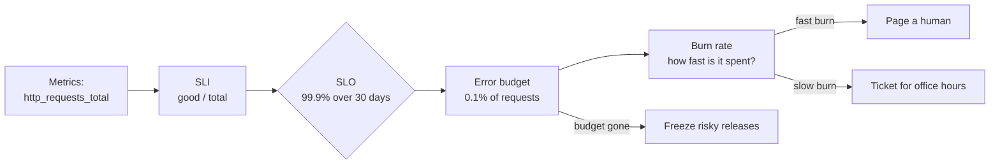
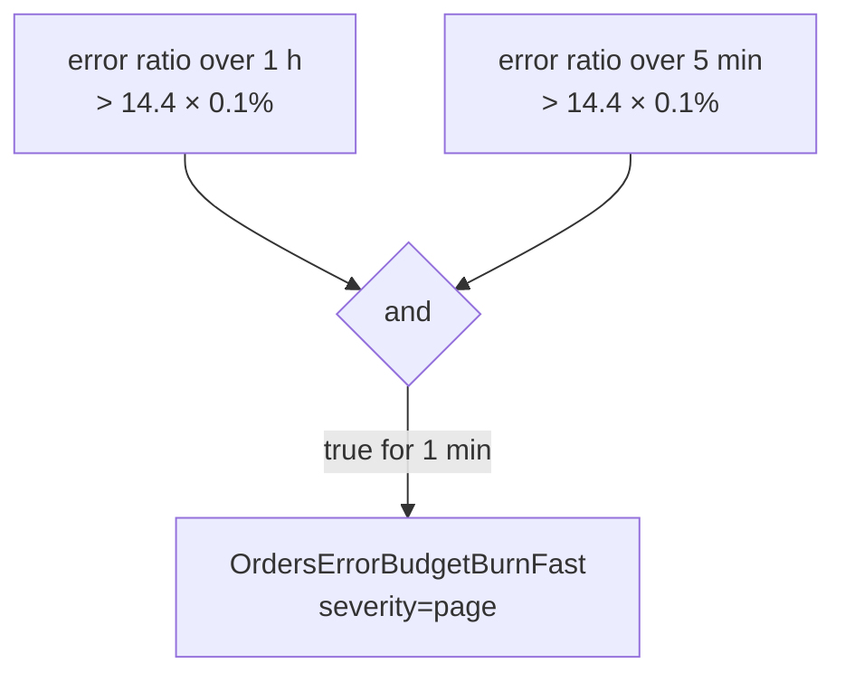

# SLOs and alerting

## Why care?

Five pagers, five bad nights:

- "CPU above 80% on `orders-7`." You wake up, look, and nothing is wrong for users. It was a batch job.
- "Error rate above 1%." It fires at 04:00 because 2 of 150 requests failed. Then it fires again at 04:05.
- "p99 latency above 500 ms" has been red for three weeks. Nobody looks at it anymore.
- A real outage: 0.4% of all orders fail for two days. No alert fires, because 0.4% is below every threshold.
- The product manager asks: "Can we ship the risky migration this week?" Nobody can answer with numbers.

All five come from the same mistake: alerting on **causes** (CPU, single error spikes) and fixed thresholds, instead of on **what users feel**, measured against a **target** you agreed on. This page shows the fix: SLIs, SLOs, error budgets and **multi-window burn-rate alerts**, with real Prometheus rules that fire (and stop firing) on a real `ordersd`.

## The idea: a monthly allowance

Think of reliability as pocket money.

- You agree with your parents that you may spend **€10 a month** on sweets. That's the **error budget**: the amount of failure that is fine.
- What you measure is "money spent on sweets". That's the **SLI** (service level indicator): a number that says how users experience the service, for example "the share of requests that did not fail".
- "At most €10 a month" is the **SLO** (service level objective): a target for the SLI over a time window, for example "99.9% of requests succeed, over 30 days".
- If you spend €3 on the first day, nobody panics. If you spend €3 **per hour**, someone must stop you **now**, or the month's money is gone by lunch. How fast you spend is the **burn rate**.
- If the money is gone, you stop buying sweets until next month. For a team, that means: freeze risky releases, spend the time on reliability.

You never alert on "€1 spent". You alert on "at this speed, the money is gone too early".



An **SLA** (service level agreement) is different: it is a **contract** with a customer, with money attached when you miss it. Your internal SLO must be stricter than any SLA, so you notice trouble before it costs money.

## Under the hood: SLIs that users feel

A good SLI is a ratio of **good events to valid events**, measured as close to the user as you can:

| Kind of service       | SLI                                                            | "Good" means             |
| --------------------- | -------------------------------------------------------------- | ------------------------ |
| Request/response API  | **Availability**: share of requests that did not fail          | status is not 5xx        |
| Request/response API  | **Latency**: share of requests faster than a threshold         | duration below 250 ms    |
| Queue consumer, batch | **Freshness**: share of time the newest data is younger than X | lag below 5 minutes      |
| Data pipeline         | **Correctness**: share of records that passed validation       | output matches a checker |

Some decisions hide in "valid" and "good":

- **4xx are good.** A `404` for an order that does not exist, or a `400` for a broken request, means the service worked correctly. Only 5xx (and timeouts) are the service's fault.
- **Health probes are not valid events.** `GET /healthz` runs every few seconds and almost never fails. It would make your SLI look better than users see it.
- **Latency SLIs use thresholds, not averages.** "99% of requests under 250 ms" is a ratio you can budget. "p99 below 250 ms" is a percentile, and you cannot add or average percentiles. With a histogram bucket exactly at the threshold (`le="0.25"`), `rate(http_request_duration_seconds_bucket{le="0.25"}[5m]) / rate(http_request_duration_seconds_count[5m])` is the good ratio directly (see [Metrics](metrics.md)).
- **Retries hide or multiply failures.** If the client retries a failed call and the retry works, the server counted one failure but the user saw success. If clients retry hard during an outage, the server sees three times the requests, and three times the failures. Measure where the user is (the gateway, the load balancer, the client) when you can, and read [Retries and idempotency](../distributed-systems/retries-and-idempotency.md) for why retries need budgets of their own.

### Error budget, in numbers

An SLO of 99.9% leaves a budget of 0.1%. Over 30 days that is:

| SLO    | Budget | Full downtime allowed in 30 days | Failed requests allowed at 50 req/s |
| ------ | ------ | -------------------------------- | ----------------------------------- |
| 99%    | 1%     | 7 h 12 min                       | 1,296,000                           |
| 99.9%  | 0.1%   | 43 min                           | 129,600                             |
| 99.95% | 0.05%  | 21.6 min                         | 64,800                              |
| 99.99% | 0.01%  | 4.3 min                          | 12,960                              |

Each extra nine costs about ten times more work: redundancy, faster rollbacks, on-call that answers in minutes. Choose the SLO from what users need and what the business will pay for, not "as high as possible". A target of 100% leaves no budget, so every deploy is a risk and nobody may change anything.

### Burn rate

**Burn rate** = observed error ratio / budget ratio. A burn rate of 1 spends exactly the budget in 30 days. A burn rate of 14.4 spends it in 30 days / 14.4 = 50 hours.

How much of the 30-day budget a burn spends in a window: `burn rate × window / 30 days`.

| Alert  | Long window | Short window | Burn rate | Budget spent before it fires | Action |
| ------ | ----------- | ------------ | --------- | ---------------------------- | ------ |
| Fast   | 1 h         | 5 min        | 14.4      | 14.4 × 1 h / 720 h = 2%      | page   |
| Medium | 6 h         | 30 min       | 6         | 6 × 6 h / 720 h = 5%         | page   |
| Slow   | 3 days      | 6 h          | 1         | 1 × 72 h / 720 h = 10%       | ticket |

These are the numbers from Google's _Site Reliability Workbook_ (chapter "Alerting on SLOs"). Why two windows per alert?

- The **long window** makes the alert **significant**: one bad minute does not page anyone, because it barely moves a 1-hour average.
- The **short window** makes the alert **reset fast**: after you fix the problem, the 5-minute ratio drops within minutes, so the alert stops, even though the 1-hour ratio is still high. Without it, the page would stay red for an hour after the fix.



### Prometheus rules

Two kinds of rules, both evaluated by Prometheus every `evaluation_interval`:

- A **recording rule** computes a PromQL expression and stores the result as a new time series. Here, one series per window: `slo:sli_error:ratio_rate5m`, `..._rate30m`, `..._rate1h`, `..._rate6h`, `..._rate3d`. The name follows the `level:metric:operations` convention. Recording rules make alerts cheap to evaluate, and dashboards can use the same series.
- An **alerting rule** has an expression; every series it returns is an alert. It starts as `pending`, becomes `firing` after it stayed true for `for`, and is sent to Alertmanager. When the expression returns nothing, the alert is resolved.

## Try it: burn the budget of `ordersd`

We instrument a copy of `ordersd` (see [Building a service](../go/services.md) for its structure), make it fail on purpose, and watch the three alerts in a real Prometheus.

### 1. Count requests by route and status

Add a middleware to `internal/httpapi`. It must know the **route pattern** (`GET /v1/orders/{id}`), never the raw path, or every order ID would become its own time series (see [Metrics](metrics.md) on cardinality):

```go
// instrument counts requests by route and status code, and observes latency.
// It asks mux for the route pattern up front, so requests that a middleware
// answers before the mux runs still get the right route label.
func instrument(reg prometheus.Registerer, mux *http.ServeMux, next http.Handler) http.Handler {
	requests := prometheus.NewCounterVec(prometheus.CounterOpts{
		Name: "http_requests_total",
		Help: "HTTP requests by route and status code.",
	}, []string{"route", "code"})
	duration := prometheus.NewHistogramVec(prometheus.HistogramOpts{
		Name:    "http_request_duration_seconds",
		Help:    "HTTP request latency by route.",
		Buckets: []float64{.005, .01, .025, .05, .1, .25, .5, 1, 2.5},
	}, []string{"route"})
	reg.MustRegister(requests, duration)

	return http.HandlerFunc(func(w http.ResponseWriter, r *http.Request) {
		start := time.Now()
		_, route := mux.Handler(r)
		if route == "" {
			route = "unmatched" // never the raw path: unbounded cardinality
		}
		rec := &statusRecorder{ResponseWriter: w}
		next.ServeHTTP(rec, r)
		requests.WithLabelValues(route, strconv.Itoa(rec.status)).Inc()
		duration.WithLabelValues(route).Observe(time.Since(start).Seconds())
	})
}
```

`statusRecorder` is the one the logging middleware already uses. The lab copy also has a **chaos** middleware that answers a configurable share of API requests with `500`, and an admin server on a separate port with `/metrics` and a token-protected `GET /debug/chaos?fail_rate=0.05` knob. (A GET that changes state is fine for a lab knob on a private port, nowhere else.) [Profiling in production](profiling.md) shows that admin server.

We used `github.com/prometheus/client_golang v1.25.0`.

### 2. The rules

`slo-rules.yml`. The five recording rules differ only in the window, so only two are shown:

```yaml
# SLO: 99.9% of ordersd API requests succeed (are not 5xx), over 30 days.
# Error budget: 0.1% of requests.
groups:
  - name: ordersd-slo-recording
    rules:
      - record: slo:sli_error:ratio_rate5m
        expr: |
          (sum(rate(http_requests_total{job="ordersd", route!~"GET /(healthz|readyz)", code=~"5.."}[5m])) or vector(0))
          /
          sum(rate(http_requests_total{job="ordersd", route!~"GET /(healthz|readyz)"}[5m]))
      - record: slo:sli_error:ratio_rate1h
        expr: |
          (sum(rate(http_requests_total{job="ordersd", route!~"GET /(healthz|readyz)", code=~"5.."}[1h])) or vector(0))
          /
          sum(rate(http_requests_total{job="ordersd", route!~"GET /(healthz|readyz)"}[1h]))
      # ... the same for [30m], [6h] and [3d]

  - name: ordersd-slo-alerts
    rules:
      # 2% of the 30-day budget gone in 1 hour.
      - alert: OrdersErrorBudgetBurnFast
        expr: |
          slo:sli_error:ratio_rate1h > (14.4 * 0.001)
          and
          slo:sli_error:ratio_rate5m > (14.4 * 0.001)
        for: 1m
        labels:
          severity: page
        annotations:
          summary: "ordersd burns error budget 14x too fast"
          runbook_url: "https://runbooks.example.com/ordersd/error-budget-burn"
      # 5% of the budget gone in 6 hours.
      - alert: OrdersErrorBudgetBurnMedium
        expr: |
          slo:sli_error:ratio_rate6h > (6 * 0.001)
          and
          slo:sli_error:ratio_rate30m > (6 * 0.001)
        for: 1m
        labels:
          severity: page
        annotations:
          summary: "ordersd burns error budget 6x too fast"
          runbook_url: "https://runbooks.example.com/ordersd/error-budget-burn"
      # 10% of the budget gone in 3 days.
      - alert: OrdersErrorBudgetBurnSlow
        expr: |
          slo:sli_error:ratio_rate3d > (1 * 0.001)
          and
          slo:sli_error:ratio_rate6h > (1 * 0.001)
        for: 1m
        labels:
          severity: ticket
        annotations:
          summary: "ordersd will run out of error budget before the month ends"
          runbook_url: "https://runbooks.example.com/ordersd/error-budget-burn"
```

Why `or vector(0)`? Look at what happened before we added it. `ordersd` had served thousands of requests, all fine, and the SLI was **empty**, not zero:

```console
$ curl -s "localhost:20090/api/v1/query?query=slo:sli_error:ratio_rate5m" | jq -c .data.result
[]
```

No request had failed yet, so no series with `code="500"` existed, so the `sum` had no input and returned nothing, and `nothing / something` is nothing. An empty SLI makes every alert silently false, and dashboards show "No data" exactly when things are fine. `or vector(0)` fills in a zero.

### 3. Check and unit-test the rules

`promtool` ships in the Prometheus image. Check the syntax:

```console
$ docker run --rm -v "$PWD":/w:ro -w /w --entrypoint promtool prom/prometheus:v3.16.0 check rules slo-rules.yml
Checking slo-rules.yml
  SUCCESS: 8 rules found
```

Rules are code, so test them. A rule test feeds synthetic series and states which alerts must fire when. `slo-rules.test.yml`:

```yaml
rule_files:
  - slo-rules.yml
evaluation_interval: 1m

tests:
  # 1000 requests per minute; from minute 0, 50 of them fail (5%).
  - interval: 1m
    input_series:
      - series: 'http_requests_total{job="ordersd", route="GET /v1/orders", code="200"}'
        values: "0+950x120"
      - series: 'http_requests_total{job="ordersd", route="GET /v1/orders", code="500"}'
        values: "0+50x120"
    alert_rule_test:
      - eval_time: 1m
        alertname: OrdersErrorBudgetBurnFast
        exp_alerts: [] # still pending: "for: 1m" not reached
      - eval_time: 5m
        alertname: OrdersErrorBudgetBurnFast
        exp_alerts:
          - exp_labels:
              severity: page
            exp_annotations:
              summary: "ordersd burns error budget 14x too fast"
              runbook_url: "https://runbooks.example.com/ordersd/error-budget-burn"

  # A healthy service: 0.05% errors, half the budget rate. Nothing fires.
  - interval: 1m
    input_series:
      - series: 'http_requests_total{job="ordersd", route="GET /v1/orders", code="200"}'
        values: "0+19999x120"
      - series: 'http_requests_total{job="ordersd", route="GET /v1/orders", code="500"}'
        values: "0+1x120"
    alert_rule_test:
      - eval_time: 2h
        alertname: OrdersErrorBudgetBurnSlow
        exp_alerts: []
```

`0+950x120` means "start at 0, add 950 per step, 120 steps". Run it:

```console
$ docker run --rm -v "$PWD":/w:ro -w /w --entrypoint promtool prom/prometheus:v3.16.0 test rules slo-rules.test.yml
Processing test file: slo-rules.test.yml
  SUCCESS
```

Put both commands in CI next to `go test`.

### 4. Run it for real

`prometheus.yml` scrapes the admin port of `ordersd` every 5 s. The service runs on the host; the container reaches it through `host.docker.internal`:

```yaml
global:
  scrape_interval: 5s
  evaluation_interval: 5s

rule_files:
  - /etc/prometheus/slo-rules.yml

scrape_configs:
  - job_name: ordersd
    static_configs:
      - targets: ["host.docker.internal:20061"]
```

```sh
ORDERS_ADMIN_ADDR=:20061 ORDERS_ADMIN_TOKEN=s3cret-lab-token ./bin/ordersd -addr 127.0.0.1:20080 -log-level warn &
./bin/loadgen -rps 50 &     # GET /v1/orders and GET /v1/orders/<random id> (a 404)
docker run -d --name tutor-obs-c-prometheus -p 127.0.0.1:20090:9090 \
  --add-host=host.docker.internal:host-gateway \
  -v "$PWD/prom:/etc/prometheus:ro" prom/prometheus:v3.16.0 --config.file=/etc/prometheus/prometheus.yml
```

`loadgen` is a small Go program in the lab module that sends GET requests in a loop; half of them ask for an order that does not exist. (The admin port listens on all interfaces here only so the container can reach it; in production it stays on a private network.)

After two minutes of clean traffic, turn on 5% failures. The knob refuses requests without the token:

```console
$ curl -s -i 'localhost:20061/debug/chaos?fail_rate=0.05' | head -1
HTTP/1.1 401 Unauthorized
$ curl -s -i -H 'Authorization: Bearer s3cret-lab-token' 'localhost:20061/debug/chaos?fail_rate=0.05' | head -1
HTTP/1.1 200 OK
```

A small `watch.sh` prints the 5-minute, 30-minute and 1-hour error ratios and the state of every alert (from `/api/v1/alerts`) every 15 seconds. Failures started at 06:40:02:

```text
06:40:08 5m=0 30m=0 1h=0
06:40:23 5m=0.007948166020681132 30m=0.007948166020681132 1h=0.007948166020681132 OrdersErrorBudgetBurnMedium=pending OrdersErrorBudgetBurnSlow=pending
06:40:38 5m=0.01129270997005302 30m=0.011292709970053019 1h=0.011292709970053019 OrdersErrorBudgetBurnMedium=pending OrdersErrorBudgetBurnSlow=pending
06:40:53 5m=0.014231111756272723 30m=0.014231111756272721 1h=0.014231111756272721 OrdersErrorBudgetBurnMedium=pending OrdersErrorBudgetBurnSlow=pending
06:41:08 5m=0.01884038751803667 30m=0.01884038751803667 1h=0.01884038751803667 OrdersErrorBudgetBurnFast=pending OrdersErrorBudgetBurnMedium=pending OrdersErrorBudgetBurnSlow=pending
06:41:23 5m=0.020571349750729915 30m=0.020571349750729908 1h=0.020571349750729908 OrdersErrorBudgetBurnFast=pending OrdersErrorBudgetBurnMedium=firing OrdersErrorBudgetBurnSlow=firing
06:41:38 5m=0.021679506893465622 30m=0.02167950689346563 1h=0.02167950689346563 OrdersErrorBudgetBurnFast=pending OrdersErrorBudgetBurnMedium=firing OrdersErrorBudgetBurnSlow=firing
06:41:53 5m=0.023039727276476542 30m=0.02303972727647654 1h=0.02303972727647654 OrdersErrorBudgetBurnFast=pending OrdersErrorBudgetBurnMedium=firing OrdersErrorBudgetBurnSlow=firing
06:42:08 5m=0.02555021267695771 30m=0.025550212676957715 1h=0.025550212676957715 OrdersErrorBudgetBurnFast=firing OrdersErrorBudgetBurnMedium=firing OrdersErrorBudgetBurnSlow=firing
```

Read it:

- The three windows show the **same** number. Prometheus had only 4 minutes of data, so a 1-hour `rate` covers the same samples as a 5-minute one. In a long-running Prometheus, the windows differ, as you'll see in a moment.
- **Slow** (threshold 0.1%) and **Medium** (0.6%) went `pending` first, at the first evaluation above their threshold. **Fast** needs 1.44% and went `pending` at 06:41:08.
- Each became `firing` after `for: 1m`. Fast fired about 2 minutes after the failures started.

The alert as Prometheus serves it on `/api/v1/alerts` (`.data.alerts[0]`):

```console
$ curl -s localhost:20090/api/v1/alerts | jq '.data.alerts[0]'
{
  "labels": {
    "alertname": "OrdersErrorBudgetBurnFast",
    "severity": "page"
  },
  "annotations": {
    "runbook_url": "https://runbooks.example.com/ordersd/error-budget-burn",
    "summary": "ordersd burns error budget 14x too fast"
  },
  "state": "firing",
  "activeAt": "2026-11-27T06:40:56.029343833Z",
  "value": "2.5917658801963072e-02"
}
```

`activeAt` is when it became `pending`. `value` is the value of the **first** part of the `and` (the 1-hour ratio), 2.6% at that moment. The same alert from the rule's point of view, on `/api/v1/rules`:

```console
$ curl -s localhost:20090/api/v1/rules | jq '.data.groups[] | select(.name=="ordersd-slo-alerts") | .rules[0]
    | {name, state, health, duration, labels, lastEvaluation, evaluationTime, alerts: [.alerts[] | {state, activeAt, value}]}'
{
  "name": "OrdersErrorBudgetBurnFast",
  "state": "firing",
  "health": "ok",
  "duration": 60,
  "labels": {
    "severity": "page"
  },
  "lastEvaluation": "2026-11-27T06:42:11.030812326Z",
  "evaluationTime": 0.000552666,
  "alerts": [
    {
      "state": "firing",
      "activeAt": "2026-11-27T06:40:56.029343833Z",
      "value": "2.5917658801963072e-02"
    }
  ]
}
```

`duration` is the `for` in seconds. `health: "ok"` means the expression evaluated without error; a typo in a metric name would still be `ok`, just never fire. That is why the unit test matters.

Six minutes in, the burn rate over the last hour, and the traffic per route and code. `q` is a small shell function that URL-encodes the PromQL and calls `/api/v1/query`:

```console
$ q() { curl -s "localhost:20090/api/v1/query?query=$(jq -rn --arg q "$1" '$q|@uri')"; }
$ q 'slo:sli_error:ratio_rate1h / 0.001' | jq -c '.data.result[] | .value'
[1795761962.633,"38.27307876966349"]
$ q 'sum by (route, code) (rate(http_requests_total{job="ordersd"}[5m]))' \
    | jq -r '.data.result[] | "\(.metric.route)\t\(.metric.code)\t\(.value[1])"'
GET /v1/orders	200	23.752542372881354
GET /v1/orders/{id}	404	23.72542372881356
GET /v1/orders	500	1.247457627118644
GET /v1/orders/{id}	500	1.2745762711864406
```

A burn rate of 38 spends a 30-day budget in 30 × 24 / 38 ≈ 19 hours. The 404s count as good: about 2.5 of 50 requests per second fail, which is 5%.

### 5. Fix it, and watch the page stop

At 06:46:02 we set `fail_rate=0`:

```text
06:46:24 5m=0.04901694915254238 30m=0.037433306071403605 1h=0.037433306071403605 OrdersErrorBudgetBurnFast=firing OrdersErrorBudgetBurnMedium=firing OrdersErrorBudgetBurnSlow=firing
06:47:24 5m=0.03864406779661017 30m=0.033317175681021306 1h=0.033317175681021306 OrdersErrorBudgetBurnFast=firing OrdersErrorBudgetBurnMedium=firing OrdersErrorBudgetBurnSlow=firing
06:48:24 5m=0.026983050847457626 30m=0.03001967718910125 1h=0.03001967718910125 OrdersErrorBudgetBurnFast=firing OrdersErrorBudgetBurnMedium=firing OrdersErrorBudgetBurnSlow=firing
06:49:24 5m=0.01566101694915254 30m=0.027317867560038223 1h=0.027317867560038223 OrdersErrorBudgetBurnFast=firing OrdersErrorBudgetBurnMedium=firing OrdersErrorBudgetBurnSlow=firing
06:49:39 5m=0.013627118644067794 30m=0.026716932845563313 1h=0.026716932845563313 OrdersErrorBudgetBurnMedium=firing OrdersErrorBudgetBurnSlow=firing
```

(One line per minute shown, plus the last.) This is the short window doing its job. The **1-hour** ratio is still 2.7%, almost 19 times the threshold, because it remembers the bad minutes. But the **5-minute** ratio fell below 1.44% at 06:49:39, the `and` became false, and the page **resolved** 3.5 minutes after the fix. Medium and Slow keep firing until their short windows (30 min, 6 h) forget the incident; Medium is a page too, so in a real setup Alertmanager's grouping and inhibition decide whether the on-call hears it twice.

Clean up: `docker rm -f tutor-obs-c-prometheus`, and stop `ordersd` and `loadgen`.

## On-call and runbooks

An alert is a request for a human to act. Before it may page, it needs:

1. **A user-visible reason.** Burn-rate alerts on SLOs pass this test by design. "CPU high" does not: CPU belongs on a dashboard, and maybe in a ticket.
2. **A runbook**, linked from the alert (`runbook_url`). The runbook answers, in order: what this alert means for users, how to check if it's real (which dashboard, which query), the usual causes and their first fix (roll back the last deploy, scale out, fail over), who to escalate to, and how to communicate (status page, incident channel).
3. **An owner.** A team, not a person, with a rotation. Severity `page` goes to the rotation; `ticket` goes to the team's queue for office hours.

Good on-call habits:

- **Mitigate first, debug later.** Roll back, then find the cause. The error budget keeps burning while you read code.
- **Every page gets a review.** Was it actionable? If not, fix or delete the alert. Track pages per shift; more than a couple per shift burns out people.
- **Use the budget to decide.** Budget left: ship features, take risks. Budget gone: freeze risky changes and spend the time on reliability. The budget turns "dev vs ops" arguments into a number both sides agreed on beforehand. Chapter [CI/CD and delivery](../delivery/index.md) uses SLOs to stop a bad canary automatically.
- **Write a blameless postmortem** for every incident that spent a large part of the budget: timeline, impact (in budget minutes), contributing causes, action items with owners.

## Traps

- **Alerting on causes.** CPU, memory, queue length and pod restarts are for dashboards and for diagnosis. Page on symptoms users feel.
- **A single short window.** `rate(errors[5m]) > 1%` pages for every blip at night and misses a slow 0.4% leak that empties the budget in a week. Use multi-window burn rates.
- **Missing `or vector(0)`.** With no failed request yet, the SLI is empty, not zero, and alerts and dashboards silently show nothing.
- **Counting 4xx as errors.** Clients sending bad requests are not your outage. (But a sudden flood of `401` after a deploy may be: watch it on a dashboard.)
- **Counting health probes.** They inflate the "good" count and hide real failures.
- **Raw paths as labels.** `/v1/orders/0193...` per order creates millions of series. Use the route pattern.
- **SLO = SLA.** Keep the internal target stricter, so you have time to react before the contract is broken.
- **A long `for:` on burn-rate alerts.** The long window already smooths noise. `for: 30m` on top just delays the page while the budget burns.
- **Too few requests.** At 10 requests per hour, one failure is 10%. For low-traffic services, use longer windows, synthetic probes to add traffic, or count failures instead of ratios.
- **Retries that hide failures.** A server-side SLI misses requests that the client gave up on, and counts every retry as a new request. Measure at the edge too.

## Check yourself

??? question "1. Your SLO is 99.9% over 30 days. Last week a bad deploy failed 2% of requests for 3 hours. How much of the month's budget did it use?"

    The burn rate was 2% / 0.1% = 20. Budget spent = 20 × 3 h / 720 h = 0.083, so about 8%
    of the monthly budget. Painful but not fatal; the page should have fired after a few
    minutes (20 > 14.4).

??? question "2. Why does the fast-burn alert need both a 1-hour and a 5-minute window? What goes wrong with only one of them?"

    Only the 5-minute window: one bad minute at night pages someone, even though it spent
    almost no budget. Only the 1-hour window: after the fix, the alert keeps firing for up to
    an hour, because the hour still contains the bad minutes, and on-call cannot tell if the
    fix worked. Both together: significant **and** quick to reset. In the lab, the page
    resolved 3.5 minutes after the fix while the 1-hour ratio was still 2.7%.

??? question "3. A new service has served 10,000 requests, none failed, and the SLI panel says \"No data\". Why?"

    The numerator selects series with `code=~"5.."`. None exist yet, so `sum(rate(...))`
    returns an empty vector, and dividing an empty vector gives an empty vector. Add
    `or vector(0)` to the numerator (or pre-create the series in code).

??? question "4. The team wants a page when p99 latency is above 250 ms. Propose an SLO-based alternative."

    Make latency an SLI: "99% of `POST /v1/orders` requests finish in under 250 ms over 30
    days". With a histogram bucket exactly at the threshold, good events are
    `rate(http_request_duration_seconds_bucket{le="0.25"}[w])` and valid events are
    `rate(http_request_duration_seconds_count[w])`. Then use the same multi-window burn-rate rules with a 1%
    budget. It pages only when slowness eats the budget fast, and you can tell how much
    slowness is left this month.

??? question "5. Clients of `ordersd` retry failed calls up to 3 times. The server SLI shows 3% errors during an outage; users report everything failed. Explain both numbers."

    The server counts **attempts**, users count **actions**. Every user action became up to
    four attempts, and retries that landed on a healthy instance succeeded, so the server's
    ratio mixes good retries with bad first tries. Also, requests that never reached the
    server (timeouts at the load balancer, refused connections) are not counted at all.
    Measure the SLI at the edge too (gateway or client, one event per user action), and put
    a retry budget in place (see
    [Retries and idempotency](../distributed-systems/retries-and-idempotency.md)).

??? question "6. Your error budget for the month is used up on day 12. What changes for the team?"

    What the team agreed beforehand in its error budget policy. Usually: freeze risky
    releases (feature launches, big migrations) until the budget recovers, and move people
    to the reliability work the postmortems listed. Security fixes and fixes for the
    reliability problem itself still ship.

## Recap

- **SLI** = good events / valid events, measured as close to the user as possible. 4xx and health probes are not failures.
- **SLO** = a target for the SLI over a window (99.9% over 30 days). **Error budget** = 1 − SLO. An **SLA** is a contract and should be looser.
- **Burn rate** = error ratio / budget ratio. Budget spent in a window = burn rate × window / 30 days.
- Alert with **multi-window burn rates**: 14.4 over 1 h and 5 min (page), 6 over 6 h and 30 min (page), 1 over 3 days and 6 h (ticket). The long window gives significance, the short window gives a fast reset.
- Build it from **recording rules** per window plus **alerting rules**. Add `or vector(0)`. Check with `promtool check rules` and unit-test with `promtool test rules` in CI.
- Every page needs a runbook, an owner and a review. Mitigate first. Let the error budget decide between features and reliability.
- Next: when the alert says "slow" or "memory keeps growing" and the trace shows which service, [Profiling in production](profiling.md) shows which code.
