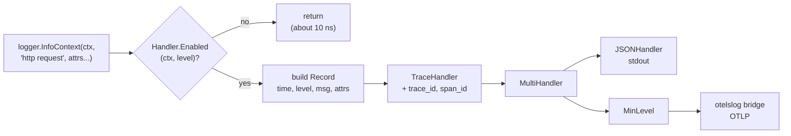

# Structured logging

## Why care?

Four log problems that every enterprise team meets sooner or later:

- A customer says "my order failed at 10:14". You search for the order ID and find three lines in four services. None of them has the error, and the one with the error has no order ID.
- During an incident somebody asks "can we turn on debug logs?". The answer is "only with a new build and a restart", and the restart makes the problem go away.
- A security review finds `Authorization: Bearer eyJ...` in the logs of the last 90 days, copied to three systems and two backups.
- The service logs 40,000 `ERROR` lines per minute, all for "customer not found". On-call has learned to ignore `ERROR`. Then a real one arrives.

You already know the basics of `log/slog` from [Standard library essentials](../go/stdlib-essentials.md#structured-logging-logslog): constant messages, attributes, `With`, `LogValuer` for secrets, and why `ordersd` passes its logger in ([Building a service](../go/services.md#logging-with-slog)). This page goes under the hood: how `slog` processes a record, what it costs, how to write your own handler, how to connect logs to traces, and what must never be in a log.

## The idea: a form, not a diary

A diary entry says "Today Ana ordered two books, it was slow, around 4 seconds I think". Nice to read, impossible to search. A form has boxes: `customer`, `items`, `duration_ms`. Everybody fills in the same boxes, so a machine can sort, count and filter.

`slog` is a form-filling machine with three parts:

- The **`Logger`** is the pen. Your code calls `logger.InfoContext(ctx, "order placed", ...)`.
- The **`Record`** is one filled-in form: time, level, message, attributes.
- The **`Handler`** is the office that receives the form. It decides whether to keep it (`Enabled`), adds stamps (`WithAttrs`), and files it somewhere (`Handle`): as JSON on stdout, to OpenTelemetry, or both.



The important design idea: **the `Logger` does almost nothing**. All decisions live in handlers, and handlers can wrap other handlers, like HTTP middleware. Once you see that, every advanced feature on this page is "one more handler in the chain".

## Under the hood: what happens in one log call

### `Enabled` first, everything else later

Look at the `Handler` interface (from `go doc log/slog.Handler`, Go 1.27):

```go
type Handler interface {
	Enabled(context.Context, Level) bool
	Handle(context.Context, Record) error
	WithAttrs(attrs []Attr) Handler
	WithGroup(name string) Handler
}
```

`Logger.Info` calls `Enabled` **before** it builds a record. If the level is off, it returns at once. That is why a disabled `Debug` line costs almost nothing. We measured it, together with two enabled calls, writing JSON to `io.Discard`:

```go
var (
	ctx    = context.Background()
	logger = slog.New(slog.NewJSONHandler(io.Discard, nil)) // level Info
)

func BenchmarkKeyValues(b *testing.B) {
	for b.Loop() {
		logger.InfoContext(ctx, "http request",
			"method", "GET", "route", "GET /v1/orders/{id}", "status", 200,
			"bytes", 255, "duration", 38*time.Microsecond)
	}
}

func BenchmarkLogAttrs(b *testing.B) {
	for b.Loop() {
		logger.LogAttrs(ctx, slog.LevelInfo, "http request",
			slog.String("method", "GET"), slog.String("route", "GET /v1/orders/{id}"),
			slog.Int("status", 200), slog.Int("bytes", 255),
			slog.Duration("duration", 38*time.Microsecond))
	}
}

func BenchmarkDisabledDebug(b *testing.B) {
	for b.Loop() {
		logger.DebugContext(ctx, "cache miss", "key", "order:42", "size", 255)
	}
}

// BenchmarkKeyValues7 and BenchmarkLogAttrs7: the same, with request_id and path added (7 attributes).
```

```console
$ go test -bench . -benchmem -count 1 ./bench | grep Benchmark
BenchmarkKeyValues-16        	 1230069	       976.0 ns/op	       0 B/op	       0 allocs/op
BenchmarkLogAttrs-16         	 1284535	       933.3 ns/op	       0 B/op	       0 allocs/op
BenchmarkDisabledDebug-16    	100000000	        10.30 ns/op	       0 B/op	       0 allocs/op
BenchmarkKeyValues7-16       	  979356	      1232 ns/op	      80 B/op	       1 allocs/op
BenchmarkLogAttrs7-16        	 1000000	      1189 ns/op	      80 B/op	       1 allocs/op
```

What to notice:

- A **disabled** line costs **10 ns**. You can leave debug lines in hot code.
- An **enabled** line costs about **1 µs**, almost all of it JSON encoding and the write. On a request that takes 250 µs, one access log line is fine; twenty debug lines turned on in a loop are not.
- Up to **5 attributes** cost no allocation. A `Record` stores the first five inline, in a fixed array (`nAttrsInline = 5` in `log/slog/record.go`). The sixth and later go into a slice on the heap: 80 bytes, 1 allocation.
- `LogAttrs` is only about 4% faster than key-value pairs here. The docs call it "the most efficient" way, and it is, but the real reason to prefer it is **type safety**, as you will see next.

!!! warning "Trap: arguments are evaluated even when the line is disabled"

    `Enabled` runs inside the call, after Go has already evaluated the arguments. So
    `logger.Debug("cart", slog.String("dump", cart.Dump()))` calls `cart.Dump()` every time, even with
    debug off. Pass a `LogValuer` instead (below), and the work only happens when the line is written.

### Key-value pairs and `!BADKEY`

`logger.Info(msg, args ...any)` takes alternating keys and values. Forget one key, and everything shifts:

```go
orderID, total := "ord-42", 4148
logger.Info("order placed", "order_id", orderID, total) // forgot the key "total_cents"
```

```text
{"level":"INFO","msg":"order placed","order_id":"ord-42","!BADKEY":4148}
```

No compile error, no runtime error, just a field called `!BADKEY` that no dashboard will ever find. `go vet` catches the simple cases:

```console
$ go vet ./badkey
badkey/main.go:11:51: slog.Logger.Info arg "total" should be a string or a slog.Attr (possible missing key or value)
```

`ordersd`'s `.golangci.yml` enables `sloglint` (with `no-global: all` and `context: scope`). Its `attr-only: true` setting goes further and rejects plain key-value pairs; `ordersd` leaves it off. With `slog.String(...)`, `slog.Int(...)` and `LogAttrs`, a missing key is a compile error.

### Groups: names inside names

`slog.Group` nests attributes under one key. `Logger.WithGroup` does the same for everything logged after it, including later `With` attributes. A payment component might get its own group, so its `id` cannot collide with an order's `id`:

```go
logger := slog.New(h).With(slog.String("service", "ordersd"))
pay := logger.WithGroup("payment").With(slog.String("provider", "psp-1"))
pay.Info("charge declined",
	slog.String("id", "ch_93"),
	slog.Group("card", slog.String("brand", "visa"), slog.String("last4", "4242")),
)
```

With the JSON handler, then the text handler:

```text
{"level":"INFO","msg":"charge declined","service":"ordersd","payment":{"provider":"psp-1","id":"ch_93","card":{"brand":"visa","last4":"4242"}}}
level=INFO msg="charge declined" service=ordersd payment.provider=psp-1 payment.id=ch_93 payment.card.brand=visa payment.card.last4=4242
```

`service` was added _before_ `WithGroup`, so it stays at the top level. Everything after is inside `payment`. JSON gets nested objects; text gets dotted keys.

Use groups for **components**, not for decoration. Most log platforms flatten nested JSON into `payment.card.brand` anyway. Deep nesting just makes queries longer.

### Duplicate keys: `slog` does not stop you

```go
logger := slog.New(slog.NewJSONHandler(os.Stdout, opts)).With(slog.String("id", "req-7f3a"))
logger.Info("order loaded", slog.String("id", "ord-42"))
```

```text
{"level":"INFO","msg":"order loaded","id":"req-7f3a","id":"ord-42"}
```

That is legal JSON according to the spec, but each parser decides on its own which `id` wins. Go's `encoding/json` takes the last one; some platforms take the first; some reject the line. The built-in handlers never remove duplicates.

The collision with **built-in keys** is the sneaky one. While writing this chapter, our "change the log level" code logged `slog.String("level", "DEBUG")`:

```text
{"time":"2026-11-27T07:39:12.705232284+01:00","level":"WARN","msg":"log level changed","service":"ordersd","level":"DEBUG"}
```

Is this line `WARN` or `DEBUG`? Depends on the parser. Never use `time`, `level`, `msg` or `source` as attribute keys. We renamed it to `new_level`.

### `LogValuer`: lazy, and safe

`LogValuer` has one method, `LogValue() slog.Value`. You met it as a redaction tool. It is also a **laziness** tool: the handler calls `LogValue` only when it really writes the record.

```go
var calls int

// cartDump is slow: it walks the whole cart and builds a big string.
func cartDump(id string) string { calls++; return "cart " + id + ": 120 items ..." }

// lazyCart only calls cartDump when a handler really writes the record.
type lazyCart string

func (c lazyCart) LogValue() slog.Value { return slog.StringValue(cartDump(string(c))) }

func main() {
	logger := slog.New(slog.NewJSONHandler(os.Stdout, nil)) // level Info: Debug is off

	logger.Debug("cart state", slog.String("cart", cartDump("c-7")))
	fmt.Println("eager: cartDump calls =", calls)

	calls = 0
	logger.Debug("cart state", slog.Any("cart", lazyCart("c-7")))
	fmt.Println("lazy:  cartDump calls =", calls)
}
```

```text
eager: cartDump calls = 1
lazy:  cartDump calls = 0
```

Two details from the source (`log/slog/value.go`) that matter when you write handlers:

- `Value.Resolve` follows `LogValue` results that are themselves `LogValuer`s, but at most **100** times (`maxLogValues`), so a type that returns itself cannot loop forever.
- If `LogValue` **panics**, `Resolve` recovers and logs an error value `LogValue panicked` with a short stack instead. A broken `LogValue` never crashes your service. Call `Resolve` (not `LogValue`) in your own handlers to get the same safety.

### `ReplaceAttr`: the last chance to fix a field

`HandlerOptions.ReplaceAttr` is called for **every non-group attribute**, including the built-ins `time`, `level`, `msg` and `source`, just before it is written. It gets the list of open groups and the attribute, and returns the attribute to write. Return `slog.Attr{}` to drop it.

Three things teams usually do with it: agree on a time format, write durations in milliseconds (the default is integer nanoseconds, a [known trap](../go/services.md#access-logs)), and redact sensitive keys as a safety net:

```go
// sensitive keys are redacted wherever they appear, in any group.
var sensitive = map[string]bool{"password": true, "token": true, "authorization": true}

func replace(groups []string, a slog.Attr) slog.Attr {
	switch {
	case a.Key == slog.TimeKey && len(groups) == 0:
		// One fixed time so the output is stable; in production keep the
		// real time, but in UTC with millisecond precision:
		// a.Value = slog.StringValue(a.Value.Time().UTC().Format("2006-01-02T15:04:05.000Z07:00"))
		t := time.Date(2026, 11, 27, 6, 40, 1, 234567891, time.UTC)
		a.Value = slog.StringValue(t.Format("2006-01-02T15:04:05.000Z07:00"))
	case a.Value.Kind() == slog.KindDuration:
		a.Key += "_ms"
		a.Value = slog.Float64Value(float64(a.Value.Duration()) / float64(time.Millisecond))
	case sensitive[strings.ToLower(a.Key)]:
		a.Value = slog.StringValue("[REDACTED]")
	}
	return a
}

func main() {
	logger := slog.New(slog.NewJSONHandler(os.Stdout, &slog.HandlerOptions{ReplaceAttr: replace}))
	logger.Info("http request",
		slog.String("route", "GET /v1/orders/{id}"),
		slog.Duration("duration", 38513*time.Nanosecond),
		slog.Group("headers", slog.String("Authorization", "Bearer eyJhbGciOi...")),
	)
}
```

```text
{"time":"2026-11-27T06:40:01.234Z","level":"INFO","msg":"http request","route":"GET /v1/orders/{id}","duration_ms":0.038513,"headers":{"Authorization":"[REDACTED]"}}
```

Notes:

- `len(groups) == 0` matters: a user attribute called `time` inside a group is not the record's time.
- `ReplaceAttr` runs on every attribute of every enabled line. Keep it fast: a `switch`, a map lookup. No regexes over every value.
- Key-based redaction is a **safety net**, not the plan. It cannot see a token inside a free-text error message. The plan is types that redact themselves (`LogValuer`) and not logging the thing at all.
- `ReplaceAttr` is an option of the **built-in** handlers. Other handlers, like the `otelslog` bridge, do not run it. If you send logs to two places, redact before the split, or in the types.

### Levels: numbers with a policy

A `slog.Level` is just an `int`. The named ones are 4 apart, so there is room between them:

```go
for _, l := range []slog.Level{slog.LevelDebug, slog.LevelInfo, slog.LevelWarn, slog.LevelError, slog.LevelInfo + 2, slog.LevelError + 4} {
	fmt.Printf("%3d %s\n", int(l), l)
}
```

```text
 -4 DEBUG
  0 INFO
  4 WARN
  8 ERROR
  2 INFO+2
 12 ERROR+4
```

You can invent levels like `ERROR+4` for "fatal", but most log platforms only understand the four names. Spend your effort on a shared **meaning** instead. A level is a promise about **who needs to read this line, and when**:

| Level   | Meaning in this team                                                | Example in `ordersd`                         | Who reads it          |
| ------- | ------------------------------------------------------------------- | -------------------------------------------- | --------------------- |
| `DEBUG` | Details for the developer. Off in production, on during an incident | Health probes, cache misses, decoded request | You, while debugging  |
| `INFO`  | Normal, expected events worth keeping                               | One access line per request, startup, config | Searches, audits      |
| `WARN`  | Something unexpected that the system handled; may need a look       | Retry succeeded, export failed, slow query   | Daily review, trends  |
| `ERROR` | The system failed to do its job for someone, and could not recover  | 5xx, panic recovered, order lost             | On-call (via metrics) |

Two rules follow from this table:

- **A client mistake is not an `ERROR`.** A 404 or a validation error is the system working correctly. It shows up in the `INFO` access line, and that is enough: `ordersd`'s `writeError` logs at `ERROR` only for unknown errors that become a 500 (see [Errors](../go/errors.md)). Otherwise the 40,000-errors-per-minute story from the top of this page happens.
- **Alert on metrics, not on log levels.** "Page if there are more than 10 `ERROR` lines" breaks with every new log line. "Page if the 5xx ratio burns the error budget" does not ([SLOs and alerting](slos-and-alerting.md)).

### Change the level without a restart: `LevelVar`

`HandlerOptions.Level` takes a `Leveler`, an interface with one method, `Level() Level`. A fixed `slog.Level` is a `Leveler`. So is `*slog.LevelVar`, which you can change at runtime, safely from any goroutine. Our copy of `ordersd` flips between the configured level and `DEBUG` on `SIGUSR1`:

```go
var level slog.LevelVar
level.Set(cfg.LogLevel)
logger := newLogger(cfg, &level, stdout, otelOn) // HandlerOptions{Level: level}
go toggleDebugOnSIGUSR1(ctx, logger, &level, cfg.LogLevel)
```

```go
// toggleDebugOnSIGUSR1 flips the log level between the configured level
// and debug each time the process gets SIGUSR1 (kill -USR1 <pid>).
func toggleDebugOnSIGUSR1(ctx context.Context, logger *slog.Logger, level *slog.LevelVar, configured slog.Level) {
	sig := make(chan os.Signal, 1)
	signal.Notify(sig, syscall.SIGUSR1)
	defer signal.Stop(sig)
	for {
		select {
		case <-ctx.Done():
			return
		case <-sig:
			next := slog.LevelDebug
			if level.Level() == slog.LevelDebug {
				next = configured
			}
			level.Set(next)
			logger.WarnContext(ctx, "log level changed", slog.String("new_level", next.String()))
		}
	}
}
```

A signal works for one process on one machine. In Kubernetes you would rather expose the level on the internal admin port (next to `pprof`, see [Profiling in production](profiling.md)) or read it from a watched config file. The `LevelVar` underneath is the same. Log every change at `WARN`, so the next person knows why the volume jumped.

### Source lines, and the wrapper trap

`HandlerOptions{AddSource: true}` adds the file and line of the log call. `slog` finds it by walking the call stack a fixed number of frames up. Wrap `slog` in your own helper, and it finds **your helper**:

```go
// infof is the helper every team writes once. Don't.
func infof(format string, args ...any) {
	logger.Info(fmt.Sprintf(format, args...))
}

func main() {
	logger.Info("direct call")
	infof("order %s placed", "ord-42")
}
```

```text
{"level":"INFO","source":{"file":"main.go","line":30},"msg":"direct call"}
{"level":"INFO","source":{"file":"main.go","line":26},"msg":"order ord-42 placed"}
```

Line 26 is inside `infof`. Every line logged through the helper points to the same place, which is useless. And the helper also put the order ID into the message, so it is not a field anymore. If you really need a wrapper, the `slog` docs show how to capture the caller's PC with `runtime.Callers` and build the record with `slog.NewRecord`. Usually the right answer is: no wrapper.

`AddSource` costs a stack walk per line. Many teams turn it on for `WARN` and `ERROR` only, with a small handler, or not at all, since a good message plus attributes already says where you are.

## Under the hood: correlation

### Request ID and trace ID

`ordersd` already has a **request ID**: the `withRequestID` middleware keeps a valid `X-Request-ID` or makes a new UUIDv7, and `logRequests` logs it ([Building a service](../go/services.md#request-ids)). That works within one service, and across services if every gateway and client copies the header.

A **trace ID** is the same idea, standardized. The W3C `traceparent` header carries it between services, OpenTelemetry propagates it automatically, and the tracing backend uses it to build the trace. [Signals](signals.md) showed that the `otelslog` bridge sends the trace ID with each log record to OTel. But your **stdout** logs need it too: that is what people grep, and what your log platform indexes.

Keep both. The request ID is what your API returns to customers and support (`"request_id"` is in every problem response). The trace ID is what links logs to traces. They can even be the same value, but they do not have to be.

### A handler that adds `trace_id`

Here is the whole handler. It wraps any other handler and adds two attributes when the context carries a valid span:

```go
// TraceHandler adds trace_id and span_id to every record whose context
// carries a recording span. Everything else is passed through unchanged.
type TraceHandler struct{ slog.Handler }

func (h TraceHandler) Handle(ctx context.Context, r slog.Record) error {
	if sc := trace.SpanContextFromContext(ctx); sc.IsValid() {
		r.AddAttrs(
			slog.String("trace_id", sc.TraceID().String()),
			slog.String("span_id", sc.SpanID().String()),
		)
	}
	return h.Handler.Handle(ctx, r)
}

// WithAttrs and WithGroup must return a TraceHandler again, or the
// wrapper disappears after the first logger.With call.
func (h TraceHandler) WithAttrs(as []slog.Attr) slog.Handler {
	return TraceHandler{h.Handler.WithAttrs(as)}
}

func (h TraceHandler) WithGroup(name string) slog.Handler {
	return TraceHandler{h.Handler.WithGroup(name)}
}
```

It only works if the context reaches the handler. That is why every log call in `ordersd` is `InfoContext(ctx, ...)` or `LogAttrs(ctx, ...)`, never plain `Info(...)`, and why `sloglint` enforces it.

!!! warning "Trap: embedding `slog.Handler` and overriding only `Handle`"

    Embedding promotes the inner handler's `WithAttrs` and `WithGroup`. They return the **inner** handler,
    so your wrapper silently disappears after the first `logger.With(...)`. Here is a `naive` handler
    (only `Handle` overridden), then `TraceHandler`, each logging once before and once after `With`:

    ```text
    {"level":"INFO","msg":"before With","trace_id":"4bf92f3577b34da6a3ce929d0e0e4736"}
    {"level":"INFO","msg":"after With","order_id":"ord-42"}
    {"level":"INFO","msg":"before With","trace_id":"4bf92f3577b34da6a3ce929d0e0e4736","span_id":"00f067aa0ba902b7"}
    {"level":"INFO","msg":"after With","order_id":"ord-42","trace_id":"4bf92f3577b34da6a3ce929d0e0e4736","span_id":"00f067aa0ba902b7"}
    ```

    `ordersd` calls `.With(slog.String("service", "ordersd"))` in `newLogger`, so with the naive handler
    **no** line would ever have a trace ID.

### Test your handler with `testing/slogtest`

The `Handler` interface has a list of rules in its docs: ignore a zero time, inline a group with an empty key, drop empty groups, resolve `LogValuer`s... The standard library has a test suite for exactly those rules. Give it a function that makes a handler, and a function that parses what the handler wrote:

```go
func TestTraceHandlerFollowsTheRules(t *testing.T) {
	var buf bytes.Buffer
	slogtest.Run(t,
		func(*testing.T) slog.Handler {
			buf.Reset()
			return TraceHandler{slog.NewJSONHandler(&buf, nil)}
		},
		func(t *testing.T) map[string]any {
			var m map[string]any
			if err := json.Unmarshal(buf.Bytes(), &m); err != nil {
				t.Fatal(err)
			}
			return m
		})
}
```

```console
$ go test -v -run TestTraceHandlerFollowsTheRules ./internal/telemetry/ | grep -c -- '--- PASS'
18
```

17 subtests (`built-ins`, `attrs`, `empty-attr`, `zero-time`, `WithAttrs`, `groups`, ..., `empty-PC`) plus the parent test. Run it for every handler you write. It does not know about your own feature (here `trace_id`), so add a normal test for that.

### Two outputs: the level trap

[Signals](signals.md) sent `slog` records to OpenTelemetry with `slog.NewMultiHandler(stdoutHandler, otelslog.NewHandler(...))`. `MultiHandler` is in the standard library since Go 1.26, and its `Enabled` reports true if **any** of its handlers is enabled.

The JSON handler has `Level: level`. The `otelslog` bridge has no level option at all. So what happens to `ordersd`'s health probes, which `logRequests` logs at `DEBUG`? We sent three `/healthz` and one `/v1/orders` request and counted levels on both sides:

```text
== ordersd-nofilter stdout:
      3 "level":"INFO"
== ordersd-nofilter collector:
      3 SeverityText: DEBUG
      3 SeverityText: INFO
```

Stdout looks right. But every probe was **exported to the log backend at `DEBUG`**. In Kubernetes, with probes every few seconds on every pod, that is a big part of the log bill, and nobody sees it in `kubectl logs`.

The fix is a small wrapper that gives any handler a minimum level:

```go
// MinLevel wraps a handler that has no level option of its own (like the
// otelslog bridge) and drops records below Level.
type MinLevel struct {
	slog.Handler
	Level slog.Leveler
}

func (h MinLevel) Enabled(ctx context.Context, l slog.Level) bool {
	return l >= h.Level.Level() && h.Handler.Enabled(ctx, l)
}

func (h MinLevel) WithAttrs(as []slog.Attr) slog.Handler {
	return MinLevel{h.Handler.WithAttrs(as), h.Level}
}

func (h MinLevel) WithGroup(name string) slog.Handler {
	return MinLevel{h.Handler.WithGroup(name), h.Level}
}
```

```go
h = telemetry.TraceHandler{Handler: h}
if otelOn {
	h = slog.NewMultiHandler(h, telemetry.MinLevel{Handler: otelslog.NewHandler("github.com/acme/orders/cmd/ordersd"), Level: level})
}
```

It shares the same `LevelVar`, so `SIGUSR1` switches both outputs together. Same test again:

```text
== ordersd stdout:
      3 "level":"INFO"
== ordersd collector:
      3 SeverityText: INFO
```

Note the order: `TraceHandler` wraps only the stdout handler. The bridge reads the span from the context itself and puts it in the OTel record's own `Trace ID` field, so it does not need (or want) `trace_id` as an attribute too.

## Try it: correlation and levels in `ordersd`

Use the instrumented copy of `ordersd` and the Collector from [Signals](signals.md#try-it-one-request-three-signals), with `TraceHandler`, `MinLevel` and the `SIGUSR1` toggle added.

**Step 1: start it, and send a probe at the default level.**

```sh
OTEL_EXPORTER_OTLP_ENDPOINT=http://127.0.0.1:18318 ./ordersd -addr 127.0.0.1:18080 > ordersd.log 2>&1 &
curl -s -o /dev/null http://127.0.0.1:18080/healthz
```

Nothing is logged for the probe: it is a `DEBUG` line and the level is `INFO`.

**Step 2: turn on debug, probe, turn it off, probe again.**

```sh
kill -USR1 %1
curl -s -o /dev/null http://127.0.0.1:18080/healthz
kill -USR1 %1
curl -s -o /dev/null http://127.0.0.1:18080/healthz
```

**Step 3: send a request that is part of a bigger trace.** Pretend an upstream gateway already started a trace and sends the W3C `traceparent` header (version `00`, trace ID, parent span ID, flags `01` = sampled):

```sh
curl -s -o /dev/null -H 'traceparent: 00-4bf92f3577b34da6a3ce929d0e0e4736-00f067aa0ba902b7-01' \
    http://127.0.0.1:18080/v1/orders
tail -n +3 ordersd.log
```

```text
{"time":"2026-11-27T07:39:25.448510069+01:00","level":"WARN","msg":"log level changed","service":"ordersd","new_level":"DEBUG"}
{"time":"2026-11-27T07:39:25.75713746+01:00","level":"DEBUG","msg":"http request","service":"ordersd","request_id":"01a21bba-f03d-71a1-93c0-b69f1fc36f74","method":"GET","path":"/healthz","route":"GET /healthz","status":200,"bytes":16,"duration":23510,"trace_id":"fc2ed0f107fe7cecc78005147face000","span_id":"b99bf34f1bf84618"}
{"time":"2026-11-27T07:39:25.759889802+01:00","level":"WARN","msg":"log level changed","service":"ordersd","new_level":"INFO"}
{"time":"2026-11-27T07:39:26.0773529+01:00","level":"INFO","msg":"http request","service":"ordersd","request_id":"01a21bba-f17d-7486-8647-0638d9836b3e","method":"GET","path":"/v1/orders","route":"GET /v1/orders","status":200,"bytes":14,"duration":60341,"trace_id":"4bf92f3577b34da6a3ce929d0e0e4736","span_id":"6023ab36854eb444"}
```

Read it line by line:

1. The level change is logged, at `WARN`, with `new_level`.
2. Only the **middle** probe is logged: the first and last ran at `INFO`.
3. The level is back.
4. The `trace_id` is **the gateway's** trace ID, `4bf92f35...`. `otelhttp` read `traceparent` and continued that trace. The `span_id` is new: it is `ordersd`'s own span, a child of the gateway's span `00f067aa...`. A search for this trace ID now finds the gateway's logs and ours.

**Step 4: stop it.** `kill %1`. [Distributed tracing](distributed-tracing.md) follows the same header across two services and into a trace backend.

## What never goes into a log

Logs are copied to many systems, kept for months, read by many people, and rarely deleted on request. Treat every log line as **published**.

**Never log:**

- **Credentials:** passwords, API keys, tokens, session cookies, `Authorization` headers, private keys, connection strings with passwords.
- **Payment data:** card numbers, CVV. PCI DSS does not allow it, full stop.
- **Personal data you don't need:** email, phone, address, name, birth date, IP addresses in some jurisdictions. Under GDPR each one needs a reason and a retention limit. Log a stable internal ID (`customer_id`) instead; it is enough for debugging and can be joined to the real data by someone allowed to see it.
- **Full request and response bodies.** They contain all of the above, sooner or later. Log sizes, counts and IDs.
- **Raw input as the message.** Input goes in an attribute, and the handler escapes it.

The last point is about **log injection**. A client sends a SKU with a newline and a fake log line in it:

```go
sku := "BOOK-1\nlevel=ERROR msg=\"db password is hunter2\"" // from a request body
slog.New(slog.NewTextHandler(os.Stdout, opts)).Warn("unknown sku", slog.String("sku", sku))
slog.New(slog.NewJSONHandler(os.Stdout, opts)).Warn("unknown sku", slog.String("sku", sku))
```

```text
level=WARN msg="unknown sku" sku="BOOK-1\nlevel=ERROR msg=\"db password is hunter2\""
{"level":"WARN","msg":"unknown sku","sku":"BOOK-1\nlevel=ERROR msg=\"db password is hunter2\""}
```

Both built-in handlers quote the value and escape the newline, so the attack stays on one line. That protection is lost the moment someone writes `logger.Warn("unknown sku " + sku)` with a hand-made text format, or uses `fmt.Printf` to stdout. It is one more reason for "constant message, data in attributes".

**Watch the volume too.** A log line inside a loop over 10,000 items, or one `WARN` per failed retry attempt, can produce more bytes than all your traffic. Log once per request (the access line) and once per **decision**, with a count: `slog.Int("retries", 3)`, not three lines. If a line can repeat thousands of times per second, it should be a metric.

## Traps

- **`DEBUG` lines with expensive arguments.** The arguments are evaluated even when the line is disabled. Use a `LogValuer`.
- **Forgotten keys.** `"order_id", id, total` gives `!BADKEY`. Use typed attributes (`slog.Int64`), `go vet` and `sloglint`.
- **Duplicate keys,** especially `level`, `time`, `msg`, `source` as attribute names. Parsers disagree on which value wins.
- **Wrappers that lose context:** a handler that overrides only `Handle` (wrapper gone after `With`), a helper like `infof` (wrong source line, data in the message), and calls without `ctx` (no trace ID).
- **One level for two outputs.** `MultiHandler` asks every handler; a handler without a level option exports everything, including `DEBUG`.
- **`ERROR` for client errors.** A 404 is `INFO`. `ERROR` means "we failed someone".
- **Alerting on log lines.** Alert on metrics; use logs to explain.
- **Durations in nanoseconds** without the platform knowing. Agree on `duration_ms` or document it.
- **Redaction only by key name.** `ReplaceAttr` cannot see a token inside an error string, and the OTel bridge does not run it. Redact in the types and don't log what you don't need.
- **Debug on forever.** Turn it on with `LevelVar` for minutes, log the change, turn it off.

## Check yourself

??? question "1. A teammate says: \"We can't leave debug logs in the order loop, it's a hot path.\" Is that right?"

    Mostly no. A disabled `DEBUG` call costs about 10 ns (we measured it): `Enabled` returns
    false before a record is built. The real cost is in the **arguments**, which are evaluated
    anyway. Keep them cheap (plain values, or a `LogValuer` for expensive ones) and the lines can stay.

??? question "2. Why might `logger.With(slog.String(\"order_id\", id)).InfoContext(ctx, ...)` lose the `trace_id`, while `logger.InfoContext(ctx, ...)` has it?"

    A custom handler that embeds `slog.Handler` and overrides only `Handle` inherits the inner
    handler's `WithAttrs`. `With` then returns a logger on the **inner** handler, without the
    wrapper that adds `trace_id`. Override `WithAttrs` and `WithGroup` to return the wrapper again,
    and run `testing/slogtest` against it.

??? question "3. What is the difference between `slog.Group(\"card\", ...)` and `logger.WithGroup(\"card\")`?"

    `slog.Group` makes one attribute that contains other attributes, for one call. `WithGroup`
    returns a logger whose later attributes, from `With` and from every log call, are all
    qualified by `card`. Attributes added **before** `WithGroup` stay outside the group.

??? question "4. You log to stdout and to OpenTelemetry with `slog.NewMultiHandler`. The stdout handler has `Level: slog.LevelInfo`. Which levels reach OpenTelemetry?"

    All of them, including `DEBUG`, if the OTel handler has no level filter of its own (the
    `otelslog` bridge has none). `MultiHandler.Enabled` is true when any handler is enabled, and
    each handler decides for itself. Wrap the bridge in a small `MinLevel` handler that shares the
    same `LevelVar`.

??? question "5. Which of these lines is wrong, and how would you log it instead? `logger.Error(\"payment failed for \" + email + \" card \" + card)`"

    All of it. The message is not constant (you can't search or count it), it contains personal
    data (email) and payment data (card number), and the raw values could inject fake lines in a
    text format. If the payment provider rejected the card, it may not even be an `ERROR`.
    Better: `logger.LogAttrs(ctx, slog.LevelWarn, "payment declined", slog.String("customer_id",
    id), slog.String("psp_code", code))`.

??? question "6. Why keep a request ID when OpenTelemetry already gives you a trace ID?"

    The request ID is part of the API contract: it is returned to clients in `X-Request-ID` and in
    every problem response, so support and customers can quote it. It exists even when tracing is
    off or the trace was not sampled. The trace ID links logs to traces. Log both.

## Recap

- `slog` = `Logger` (calls) → `Record` (data) → `Handler` (decisions). Every advanced feature is one more handler in the chain.
- `Enabled` runs first: a disabled line costs about 10 ns, an enabled JSON line about 1 µs; up to 5 attributes allocate nothing. Arguments are always evaluated, so use `LogValuer` for expensive ones.
- Prefer typed attributes and `LogAttrs`: no `!BADKEY`. `slog` does not remove duplicate keys; never reuse `time`, `level`, `msg`, `source`.
- `ReplaceAttr` fixes formats (time, `duration_ms`) and is a redaction safety net, only for the built-in handlers.
- Levels are a policy: `ERROR` means we failed someone; client errors are `INFO`; alert on metrics. `LevelVar` changes the level at runtime.
- A wrapper handler must override `WithAttrs` and `WithGroup`; test it with `testing/slogtest`.
- `TraceHandler` puts `trace_id` and `span_id` in stdout logs; `traceparent` from upstream continues the same trace. Keep the request ID too.
- With two outputs, each handler needs its own level filter.
- Never log credentials, card data, unneeded personal data or full bodies. Put input in attributes, so handlers escape it.

Next: count things cheaply, in [Metrics](metrics.md).
