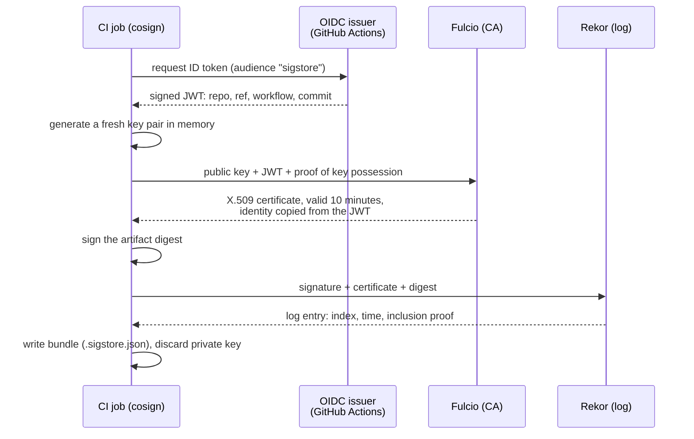

# Signing and attesting artifacts

## Why care?

A release is a set of files: a container image, binaries, archives, a checksums file, an SBOM. The people who run them download them from a registry or a release page. They have no direct way to know that the bytes came from your build.

Real attacks used exactly this gap:

- **Codecov (2021).** Attackers changed the Bash uploader script on Codecov's download server. For two months, thousands of CI pipelines ran the changed script and sent their environment variables, including secrets, to the attackers. It was found only because one customer compared the script's SHA-256 with the one published on GitHub, and they differed.
- **SolarWinds (2020).** The malicious update was **signed** with the vendor's real code-signing key, because the attackers changed the build server. A signature alone said "this came from SolarWinds", which was true, and nothing about **how** it was built.
- **xz-utils (2024).** The backdoor was only in the release tarballs, not in the Git history. Nothing tied the tarball to a commit and a build.

So you need two answers for every artifact. **Who** produced it (a signature), and **how** it was produced (an attestation: from which commit, by which workflow, on which runner). And the people who deploy it must **check** both, by digest, against an identity they expect.

[Supply chain security](../security/supply-chain.md#under-the-hood-signatures-provenance-and-slsa) already verified a keyless signature on the distroless image and introduced SLSA levels. [Container security](../containers/security.md#signing-proving-who-built-an-image) signed a local SBOM with a key pair. This page goes deeper: what is inside a Sigstore certificate and a transparency log entry, how attestations are built, how GitHub artifact attestations and the SLSA generator fit in, and how to wire all of it into a Go release.

## The idea: sign the digest, bind it to an identity, write it in a public log

### What to sign

Sign every file a user may download or run, or sign a file that pins all of them:

| Artifact                     | Why sign it                                                 | Usual tool                      |
| ---------------------------- | ----------------------------------------------------------- | ------------------------------- |
| Container image              | Kubernetes pulls it; the admission controller checks it     | `cosign sign`, `actions/attest` |
| Binaries and archives        | Users install them by hand or with a package manager        | `cosign sign-blob`, GoReleaser  |
| `checksums.txt`              | One signature covers every file listed in it                | `cosign sign-blob`              |
| SBOM                         | Scanners trust its list of components                       | attest it, don't only upload it |
| Provenance, vuln scan report | They are claims; an unsigned claim can be written by anyone | in-toto attestation             |

Signing `checksums.txt` is a common shortcut: one signature, and a user checks the file they downloaded with `sha256sum --check --ignore-missing`. It is safe because the checksums file contains a SHA-256 for each artifact, and SHA-256 has no known way to make a second file with the same hash.

### Sign the digest, not the name

A **tag** (`ghcr.io/acme/ordersd:1.4.0`) or a file name (`ordersd_1.4.0_linux_amd64.tar.gz`) is a name. Anyone with write access can point it at other bytes later. A **digest** (`sha256:...`) is the hash of the bytes themselves. Every Sigstore signature and every attestation is about a digest, never about a name:

- `cosign sign-blob` hashes the file and signs the hash.
- `cosign sign` signs a small JSON payload that contains the image **manifest digest**.
- An in-toto attestation lists its subjects as `name` plus `digest`. The name is only a label.

The rule follows: sign `repo@sha256:...`, verify `repo@sha256:...`, and deploy `repo@sha256:...`. If you verify by tag and deploy by tag, the tag can move between the two steps.

### Keyless signing in one picture

With a key pair, the question "who signed this?" becomes "who had the private key?", and you must protect, rotate and revoke that key. **Keyless** signing in Sigstore replaces the long-lived key with a short-lived certificate for an **identity** that a trusted identity provider has just proven:



The verifier never needs your key. It needs three things it already trusts (Fulcio's CA certificate, Rekor's public key, both from the Sigstore **trust root**), plus your policy: "the certificate must name the workflow `release.yml` of `github.com/acme/orders`, and the issuer must be GitHub Actions".

## Under the hood: the Fulcio certificate

**OIDC** (OpenID Connect) is a standard for identity tokens. A GitHub Actions job with `permissions: id-token: write` can ask GitHub for a **JWT** (JSON Web Token): a signed JSON document with claims such as `repository`, `ref`, `workflow_ref`, `sha`, `event_name` and `runner_environment`. GitHub signs it; anyone can check the signature with GitHub's public keys at `https://token.actions.githubusercontent.com/.well-known/jwks`.

**Fulcio** is Sigstore's certificate authority (CA). It checks the JWT, checks that the caller owns the private key (the caller signs a challenge), and issues an X.509 certificate that is valid for 10 minutes. Fulcio copies the claims from the token into the certificate, so the identity travels with every signature.

### Decode a real certificate

`cosign`, `gh`, `crane` and `jq` are already in the project's tools from earlier chapters ([Container security](../containers/security.md), [CI pipelines](../delivery/ci-pipelines.md)).

The GitHub CLI (`cli/cli`) publishes GitHub artifact attestations for its releases. Download one archive into its own directory (it is never run), and let `gh` check it:

```console
$ d=$(mktemp -d "$TMPDIR/gh.XXXXXX") && cd "$d"
$ curl -sSfLO https://github.com/cli/cli/releases/download/v2.106.0/gh_2.106.0_linux_amd64.tar.gz
$ gh attestation verify gh_2.106.0_linux_amd64.tar.gz --repo cli/cli
Loaded digest sha256:a476449fa9625413c54a3734eded62e9e480e49f421ff08e7f3b3879c059a033 for file://gh_2.106.0_linux_amd64.tar.gz
Loaded 1 attestation from GitHub API

The following policy criteria will be enforced:
- Predicate type must match:................ https://slsa.dev/provenance/v1
- Source Repository Owner URI must match:... https://github.com/cli
- Source Repository URI must match:......... https://github.com/cli/cli
- Subject Alternative Name must match regex: (?i)^https://github\.com/cli/cli/
- OIDC Issuer must match:................... https://token.actions.githubusercontent.com

✓ Verification succeeded!

The following 1 attestation matched the policy criteria

- Attestation #1
  - Build repo:..... cli/cli
  - Build workflow:. .github/workflows/deployment.yml@refs/heads/trunk
  - Signer repo:.... cli/cli
  - Signer workflow: .github/workflows/deployment.yml@refs/heads/trunk
```

`gh` hashed the file, asked the GitHub API for attestations about that digest, and checked them. With `--format json` it prints the Sigstore bundle it used. The certificate is in the bundle as base64 DER (the binary form of X.509); `openssl` decodes it:

```console
$ gh attestation verify gh_2.106.0_linux_amd64.tar.gz --repo cli/cli --format json > v.json
$ jq -r '.[0].attestation.bundle.verificationMaterial.certificate.rawBytes' v.json | base64 -d > cert.der
$ openssl x509 -inform der -in cert.der -noout -text \
>   | sed -n '/Issuer:/,/Not After/p;/Subject Alternative/,/CT Precertificate/p' | sed '$d;s/ *$//'
        Issuer: O=sigstore.dev, CN=sigstore-intermediate
        Validity
            Not Before: Nov 25 22:46:40 2026 GMT
            Not After : Nov 25 22:56:40 2026 GMT
            X509v3 Subject Alternative Name: critical
                URI:https://github.com/cli/cli/.github/workflows/deployment.yml@refs/heads/trunk
            1.3.6.1.4.1.57264.1.1:
                https://token.actions.githubusercontent.com
            1.3.6.1.4.1.57264.1.2:
                workflow_dispatch
            1.3.6.1.4.1.57264.1.3:
                529111a21612ff1e29dc45e567a157df24e0e243
            1.3.6.1.4.1.57264.1.4:
                Deployment
            1.3.6.1.4.1.57264.1.5:
                cli/cli
            1.3.6.1.4.1.57264.1.6:
                refs/heads/trunk
            1.3.6.1.4.1.57264.1.8:
                .+https://token.actions.githubusercontent.com
            1.3.6.1.4.1.57264.1.9:
                .Lhttps://github.com/cli/cli/.github/workflows/deployment.yml@refs/heads/trunk
            1.3.6.1.4.1.57264.1.10:
                .(529111a21612ff1e29dc45e567a157df24e0e243
            1.3.6.1.4.1.57264.1.11:
                .github-hosted
            1.3.6.1.4.1.57264.1.12:
                ..https://github.com/cli/cli
            1.3.6.1.4.1.57264.1.13:
                .(529111a21612ff1e29dc45e567a157df24e0e243
            1.3.6.1.4.1.57264.1.14:
                ..refs/heads/trunk
            1.3.6.1.4.1.57264.1.15:
                ..212613049
            1.3.6.1.4.1.57264.1.16:
                ..https://github.com/cli
            1.3.6.1.4.1.57264.1.17:
                ..59704711
            1.3.6.1.4.1.57264.1.18:
                .Lhttps://github.com/cli/cli/.github/workflows/deployment.yml@refs/heads/trunk
            1.3.6.1.4.1.57264.1.19:
                .(529111a21612ff1e29dc45e567a157df24e0e243
            1.3.6.1.4.1.57264.1.20:
                ..workflow_dispatch
            1.3.6.1.4.1.57264.1.21:
                .>https://github.com/cli/cli/actions/runs/45714863374/attempts/1
            1.3.6.1.4.1.57264.1.22:
                ..public
            1.3.6.1.4.1.57264.1.23:
                .
production
            1.3.6.1.4.1.57264.1.24:
                .Krepository_owner_id:59704711:repository_id:212613049:environment:production
```

How to read it:

- **Validity: exactly 10 minutes.** After 22:56:40 nobody can make new signatures with this key. The private key never left the runner's memory and is gone.
- **Subject** is empty. The identity is in the **SAN** (Subject Alternative Name), marked critical. For a GitHub workflow it is the URI of the workflow file at a ref. For a person or a cloud service account it is an e-mail address. This is the value `--certificate-identity` compares.
- **`1.3.6.1.4.1.57264.1.x`** are Sigstore's own certificate extensions (57264 is Sigstore's registered enterprise number). `.1` to `.6` are the old, deprecated GitHub-only fields, stored as raw strings. `.8` to `.24` are the current, provider-neutral fields, stored as DER-encoded UTF-8 strings. That is why each value starts with one or two odd characters: `openssl` prints the DER tag and length bytes as text (`.L` is tag `0x0c`, length `0x4c` = 76). In `.23`, the length byte is `0x0a`, a newline.

The fields that matter most for policy:

| OID   | Name                         | Value here                            | Use it to require...                        |
| ----- | ---------------------------- | ------------------------------------- | ------------------------------------------- |
| `.8`  | Issuer (V2)                  | `https://token.actions...`            | GitHub Actions, not a person's Google login |
| `.9`  | Build Signer URI             | `.../deployment.yml@refs/heads/trunk` | the workflow that **signed**                |
| `.10` | Build Signer Digest          | `529111a2...`                         | an exact version of that workflow           |
| `.11` | Runner Environment           | `github-hosted`                       | no self-hosted runners                      |
| `.12` | Source Repository URI        | `https://github.com/cli/cli`          | your repository                             |
| `.13` | Source Repository Digest     | `529111a2...`                         | the commit that was built                   |
| `.14` | Source Repository Ref        | `refs/heads/trunk`                    | a tag, or the default branch                |
| `.15` | Source Repository Identifier | `212613049`                           | the repository **ID** (survives renames)    |
| `.18` | Build Config URI             | `.../deployment.yml@refs/heads/trunk` | the top-level workflow that was **called**  |
| `.20` | Build Trigger                | `workflow_dispatch`                   | no `pull_request` builds                    |
| `.21` | Run Invocation URI           | `.../actions/runs/45714863374/...`    | (audit: link back to the run)               |
| `.22` | Source Repository Visibility | `public`                              | (audit)                                     |
| `.23` | Deployment Environment       | `production`                          | a protected GitHub environment              |

Two details are easy to miss:

- **`.9` and `.18` differ for reusable workflows.** `.18` (Build Config) is the workflow the repository runs. `.9` (Build Signer) and the SAN are the workflow that ran the signing step. When a caller uses a reusable workflow from another repository, the SAN names the **reusable** workflow. The SLSA generator below depends on exactly this.
- **IDs, not names.** `repository_id` and `repository_owner_id` (`.15`, `.17`) don't change when an account is deleted and someone else registers the same name. A name check alone can be fooled by such a "repo-jacking"; GitHub's verifier checks the owner URI and repository URI, and you can add ID checks in an admission policy.

The certificate also has a **CT Precertificate SCT** extension (not shown above): Fulcio writes every certificate it issues to a Certificate Transparency log, like the public web PKI does. If someone tricks Fulcio into issuing a certificate for your identity, it shows up in that log.

## Under the hood: the Rekor log and the bundle

### Why does a 10-minute certificate still verify a year later?

A normal certificate check asks "is the certificate valid **now**?". This one expired days ago, and verification still succeeds. The verifier asks a different question: "was the certificate valid **at the moment of signing**?". It needs a trusted time for that moment, and the signer's own clock is not trusted.

**Rekor** is Sigstore's **transparency log**: an append-only Merkle tree (a tree of hashes, where the root hash depends on every entry) that anyone can read and audit. When cosign uploads a signature, Rekor adds an entry and returns:

- `integratedTime`: when Rekor added the entry, in Unix seconds.
- An **inclusion proof**: the hashes needed to recompute the tree's root hash from this entry, plus a **checkpoint**, the root hash and tree size signed by Rekor.
- In Rekor v1, also a **signed entry timestamp** (SET, called `inclusionPromise` in the bundle): Rekor's signature over the entry and its time.

Look at the same bundle:

```sh
jq '.[0].attestation.bundle.verificationMaterial.tlogEntries[0] | .inclusionProof.hashes |= "\(length) hashes" | .canonicalizedBody |= .[:20]+"..."' v.json
```

```json
{
  "logIndex": "4113215946",
  "logId": {
    "keyId": "wNI9atQGlz+VWfO6LRygH4QUfY/8W4RFwiT5i5WRgB0="
  },
  "kindVersion": {
    "kind": "dsse",
    "version": "0.0.1"
  },
  "integratedTime": "1795646801",
  "inclusionPromise": {
    "signedEntryTimestamp": "MEYCIQD+M+/b6atfVddYP+z8zqkhQ4EinXMgn9PnWUnLSnnDOwIhAKmlAD01X54hay5KMFVRRGbt8Ye+9yIgTdUmzG/ogkc/"
  },
  "inclusionProof": {
    "logIndex": "3991311684",
    "rootHash": "rSaUakJDVwmVsMvuoyxl0JDnNX5oMIioVY5xLTSunco=",
    "treeSize": "3991311689",
    "hashes": "20 hashes",
    "checkpoint": {
      "envelope": "rekor.sigstore.dev - 1193050959916656506\n3991311689\nrSaUakJDVwmVsMvuoyxl0JDnNX5oMIioVY5xLTSunco=\n\n— rekor.sigstore.dev wNI9ajBGAiEAqYOyqseY8EEvuQtlkEV7afB1e+T2H4s3LEywCVsXNx4CIQCKI32y6ZFW9sQhu/FLF9M9iyQSMZIHxVXGHq7wob6fjw==\n"
    }
  },
  "canonicalizedBody": "eyJhcGlWZXJzaW9uIjoi..."
}
```

```console
$ jq -r '.[0].attestation.bundle.verificationMaterial.tlogEntries[0].integratedTime | tonumber | todate' v.json
2026-11-25T22:46:41Z
```

The entry was added at 22:46:41, one second after the certificate's `Not Before` (22:46:40) and well before `Not After` (22:56:40). That is the whole trick: the private key existed only inside that window, and Rekor proves the signature existed inside it too. After the window, the key is gone, so a stolen certificate is useless.

The inclusion proof has 20 hashes for a tree of almost 4 billion entries (2^32 ≈ 4.3 billion), because a Merkle proof grows with the logarithm of the tree size. The two log indexes differ because Rekor v1 is split into **shards**: `logIndex` counts across all shards, `inclusionProof.logIndex` counts inside the current shard's tree.

The log gives a second, quieter protection: **monitoring**. Every signature for your identity is public. A monitor (for example Sigstore's `rekor-monitor`, run on a schedule) can search the log for certificates with your repository's SAN and alert on any you didn't expect. A stolen key in the key-pair world signs silently; here it would leave a public trace.

### Rekor v2 and timestamp authorities

Sigstore made **Rekor v2** generally available in October 2025. It is a **tile-based** log (the log is served as static, cacheable files of hashes), which is cheaper to run. The changes that reach users:

- Rekor v2 accepts only two entry types: `hashedrekord` (a signed digest, from `sign-blob` and `sign`) and `dsse` (an attestation). Older types like `intoto` were removed.
- Rekor v2 returns **no signed entry timestamp**. The trusted time comes from a separate **timestamp authority** (TSA), which signs an RFC 3161 timestamp over the signature. Sigstore runs a public one at `timestamp.sigstore.dev`. In a bundle it appears under `timestampVerificationData.rfc3161Timestamps`.
- Log URLs are no longer fixed. The 2025 shard is `https://log2025-1.rekor.sigstore.dev`, and it will be shut down one day. Clients learn which logs exist from the trust root and where to upload from a **signing config**, both distributed through TUF (below).

On this machine (2026-11-28), the public trust root already lists both logs, while the default signing config that cosign v3.1.6 builds still sends new entries to the v1 log:

```console
$ jq -r '.tlogs[] | [.baseUrl, .publicKey.validFor.start] | @tsv' ~/.sigstore/root/tuf-repo-cdn.sigstore.dev/targets/trusted_root.json
https://rekor.sigstore.dev	2021-01-12T11:53:27Z
https://log2025-1.rekor.sigstore.dev	2025-09-23T00:00:00Z
$ cosign signing-config create --with-default-services --out public-signing-config.json
$ jq -c '{rekor: [.rekorTlogUrls[] | {url, majorApiVersion}], tsa: [.tsaUrls[].url]}' public-signing-config.json
{"rekor":[{"url":"https://rekor.sigstore.dev","majorApiVersion":1}],"tsa":["https://timestamp.sigstore.dev/api/v1/timestamp"]}
```

You don't choose; the signing config does. What you must do is keep clients current (cosign 2.6 or later can verify Rekor v2 entries), and never hard-code a log URL.

### The bundle: one file with everything

A **Sigstore bundle** is a JSON file (media type `application/vnd.dev.sigstore.bundle.v0.3+json`, defined in protobuf in `sigstore/protobuf-specs`, usual file name `<artifact>.sigstore.json`). It replaces the old trio of `.sig`, `.pem` and a Rekor lookup. It has two parts:

- `verificationMaterial`: **who and when**. Either a `certificate` (keyless; v0.3 holds only the leaf, the chain comes from the trust root) or a `publicKey.hint` (key-based), plus `tlogEntries` and/or `timestampVerificationData`.
- The content: **what**. Either `messageSignature` (a digest and a signature over it, from `sign-blob`) or `dsseEnvelope` (a signed attestation).

Because the bundle carries the log entry and its proofs, verification can be **offline**: no call to Rekor, only the trust root. The cosign output "Existence of the claims in the transparency log was verified offline" means exactly this.

### Verify a real release with `cosign verify-blob`

Cosign's own releases ship a bundle next to each binary. Download one binary and its bundle into a fresh directory:

```console
$ d=$(mktemp -d "$TMPDIR/cosign.XXXXXX") && cd "$d"
$ for f in cosign-linux-amd64 cosign-linux-amd64.sigstore.json; do
>   curl -sSfLO "https://github.com/sigstore/cosign/releases/download/v3.1.6/$f"; done
$ jq 'del(.verificationMaterial) | .messageSignature.signature |= .[:20]+"..."' cosign-linux-amd64.sigstore.json
```

```json
{
  "mediaType": "application/vnd.dev.sigstore.bundle.v0.3+json",
  "messageSignature": {
    "messageDigest": {
      "algorithm": "SHA2_256",
      "digest": "MYqZreQVagxBE6qYO0bAoIMPp4lqCWxjEh7ke2EKlMY="
    },
    "signature": "MEUCIQCfHF2Y1Hn6J9pq..."
  }
}
```

```console
$ jq -r .messageSignature.messageDigest.digest cosign-linux-amd64.sigstore.json | base64 -d | xxd -p -c32
318a99ade4156a0c4113aa983b46c0a0830fa7896a096c63121ee47b610a94c6
$ sha256sum cosign-linux-amd64
318a99ade4156a0c4113aa983b46c0a0830fa7896a096c63121ee47b610a94c6  cosign-linux-amd64
$ jq -r .verificationMaterial.certificate.rawBytes cosign-linux-amd64.sigstore.json | base64 -d \
>   | openssl x509 -inform der -noout -ext subjectAltName
X509v3 Subject Alternative Name: critical
    email:keyless@projectsigstore.iam.gserviceaccount.com
```

The signed digest is the file's SHA-256. The identity is not a GitHub workflow: Sigstore builds its releases on Google Cloud Build, with a Google service account. Never guess the identity; read it from the project's documentation (here, the cosign install docs), then pin it exactly:

```console
$ cosign verify-blob cosign-linux-amd64 --bundle cosign-linux-amd64.sigstore.json \
>   --certificate-identity keyless@projectsigstore.iam.gserviceaccount.com \
>   --certificate-oidc-issuer https://accounts.google.com
Verified OK
```

A wrong identity fails, and the error tells you what the certificate really says:

```console
$ cosign verify-blob cosign-linux-amd64 --bundle cosign-linux-amd64.sigstore.json \
>   --certificate-identity https://github.com/sigstore/cosign/.github/workflows/release.yml@refs/tags/v3.1.6 \
>   --certificate-oidc-issuer https://token.actions.githubusercontent.com; echo exit=$?
Error: failed to verify certificate identity: no matching CertificateIdentity found, last error: expected SAN value "https://github.com/sigstore/cosign/.github/workflows/release.yml@refs/tags/v3.1.6", got "keyless@projectsigstore.iam.gserviceaccount.com"
error during command execution: failed to verify certificate identity: no matching CertificateIdentity found, last error: expected SAN value "https://github.com/sigstore/cosign/.github/workflows/release.yml@refs/tags/v3.1.6", got "keyless@projectsigstore.iam.gserviceaccount.com"
exit=1
```

And one extra byte in the file breaks the signature:

```console
$ cp cosign-linux-amd64 tampered && printf x >> tampered
$ cosign verify-blob tampered --bundle cosign-linux-amd64.sigstore.json \
>   --certificate-identity keyless@projectsigstore.iam.gserviceaccount.com \
>   --certificate-oidc-issuer https://accounts.google.com; echo exit=$?
Error: failed to verify signature: could not verify message: invalid signature when validating ASN.1 encoded signature
error during command execution: failed to verify signature: could not verify message: invalid signature when validating ASN.1 encoded signature
exit=1
```

### The trust root: TUF and `trusted_root.json`

The verifier trusts Fulcio's CA certificates, Rekor's public keys, the CT log keys and the TSA certificates. These keys change over time, so they can't be compiled into every client forever. Sigstore distributes them with **TUF** (The Update Framework): a protocol for secure updates where a `root.json`, signed by several independent key holders, says which keys may sign the other metadata. A client starts from a `root.json` embedded at release time and walks forward version by version (`17.root.json`, `18.root.json`, ...), checking each new root with the previous one.

`cosign initialize` refreshes this cache into `~/.sigstore/root/`. The result that verifiers really use is one file, `trusted_root.json`:

```console
$ cosign initialize
$ jq -r '.signed.version, .signed.expires, .signed.roles.root.threshold' ~/.sigstore/root/tuf-repo-cdn.sigstore.dev/root.json
16
2027-04-22T19:27:31Z
3
$ jq -r '.certificateAuthorities[] | [.uri, .validFor.start, (.validFor.end // "-")] | @tsv' \
>   ~/.sigstore/root/tuf-repo-cdn.sigstore.dev/targets/trusted_root.json
https://fulcio.sigstore.dev	2021-03-07T03:20:29Z	2022-12-31T23:59:59.999Z
https://fulcio.sigstore.dev	2022-04-13T20:06:15Z	-
```

Root version 16, and any change needs 3 of the root key holders. Each key has a validity window, so a signature made in 2022 is checked against the CA that was valid in 2022. For **air-gapped** verification, copy `trusted_root.json` to the machine and pass it explicitly. Here, `unshare -Urn` runs cosign with no network at all (see [Namespaces and cgroups](../linux/namespaces-and-cgroups.md#network-namespaces-a-separate-network-stack)):

```console
$ unshare -Urn cosign verify-blob cosign-linux-amd64 --bundle cosign-linux-amd64.sigstore.json \
>   --certificate-identity keyless@projectsigstore.iam.gserviceaccount.com \
>   --certificate-oidc-issuer https://accounts.google.com 2>&1 | head -1
Error: setting trusted material: getting trusted root from TUF for new bundle verification: error getting live trusted root: failed to create TUF client failed to load metadata: tuf refresh failed: Get "https://tuf-repo-cdn.sigstore.dev/17.root.json": dial tcp: lookup tuf-repo-cdn.sigstore.dev on 10.255.255.254:53: dial udp 10.255.255.254:53: connect: network is unreachable
$ cp ~/.sigstore/root/tuf-repo-cdn.sigstore.dev/targets/trusted_root.json .
$ unshare -Urn cosign verify-blob cosign-linux-amd64 --bundle cosign-linux-amd64.sigstore.json \
>   --trusted-root trusted_root.json \
>   --certificate-identity keyless@projectsigstore.iam.gserviceaccount.com \
>   --certificate-oidc-issuer https://accounts.google.com
Verified OK
```

Without the flag, cosign tries to refresh TUF and looks for the next root version, `17.root.json`. With an explicit trust root, no network is needed. Refresh that file on a schedule, through a reviewed path, or verification will start failing when Sigstore rotates a key.

### What changed in cosign v3

Cosign v3 (2025) turned on, by default, what cosign 2.6 offered as opt-in flags: the bundle format (`--new-bundle-format`), the TUF trust root (`--trusted-root`) and the signing config (`--use-signing-config`). For you this means:

- `sign-blob` writes a bundle with `--bundle`; separate `--output-signature` and `--output-certificate` files are the old way.
- Image signatures are stored as bundles, attached as **OCI referrers** (below).
- `--tlog-upload=false` is deprecated and refused together with a signing config. To sign without a log, give a signing config that names no log (next section).
- No flags were removed yet. The Sigstore team announced that cosign v4 will remove about half of them, so prefer the new forms now.

## Under the hood: key-based signing, for real

Keyless signing needs a browser login or a CI OIDC token, and it writes to the public log, so it can't be shown here. Key-based signing can, fully offline. This also is how you sign in an **air-gapped** network.

```console
$ d=$(mktemp -d "$TMPDIR/keysign.XXXXXX") && cd "$d"
$ printf 'a476449fa9625413c54a3734eded62e9e480e49f421ff08e7f3b3879c059a033  ordersd_linux_amd64.tar.gz\n' > checksums.txt
$ COSIGN_PASSWORD="" unshare -Urn cosign generate-key-pair
Private key written to cosign.key
Public key written to cosign.pub
$ COSIGN_PASSWORD="" unshare -Urn cosign sign-blob --key cosign.key --tlog-upload=false \
>   --bundle checksums.txt.sigstore.json -y checksums.txt
Flag --tlog-upload has been deprecated, prefer using a --signing-config file with no transparency log services
Error: --tlog-upload=false is not supported with --signing-config or --use-signing-config. Provide a signing config with --signing-config without a transparency log service, which can be created with `cosign signing-config create` or `curl https://raw.githubusercontent.com/sigstore/root-signing/refs/heads/main/targets/signing_config.v0.2.json | jq 'del(.rekorTlogUrls)'` for the public instance
error during command execution: --tlog-upload=false is not supported with --signing-config or --use-signing-config. Provide a signing config with --signing-config without a transparency log service, which can be created with `cosign signing-config create` or `curl https://raw.githubusercontent.com/sigstore/root-signing/refs/heads/main/targets/signing_config.v0.2.json | jq 'del(.rekorTlogUrls)'` for the public instance
```

The v2 flag is gone in practice. `cosign signing-config create` with no service flags gives a config with no CA, no log and no TSA:

```console
$ unshare -Urn cosign signing-config create --out offline-signing-config.json
$ cat offline-signing-config.json
{"mediaType":"application/vnd.dev.sigstore.signingconfig.v0.2+json", "rekorTlogConfig":{}, "tsaConfig":{}}
$ COSIGN_PASSWORD="" unshare -Urn cosign sign-blob --key cosign.key --signing-config offline-signing-config.json \
>   --bundle checksums.txt.sigstore.json -y checksums.txt
Using payload from: checksums.txt
Wrote bundle to file checksums.txt.sigstore.json
$ jq . checksums.txt.sigstore.json
```

```json
{
  "mediaType": "application/vnd.dev.sigstore.bundle.v0.3+json",
  "verificationMaterial": {
    "publicKey": {
      "hint": "san4+ZMY2p1x49lXkfvGjXqcZNXohVO9jgtMDK5fWmw="
    }
  },
  "messageSignature": {
    "messageDigest": {
      "algorithm": "SHA2_256",
      "digest": "Z2S+WXuaz0hLnnk+H5vYVw6KwP2v0hMZuAWKIKfQ6RU="
    },
    "signature": "MEUCIQDhXRV4nIHXmudktbq0byD4AzVUnxQcKuCt1l7S3zKFxgIgObOOqO+tRqRipQMs83TwZFj9MRGOvXAl6F6AtsULaDU="
  }
}
```

Compare it with the keyless bundle: no `certificate`, no `tlogEntries`, no timestamp. The `hint` is the SHA-256 of the public key in DER form, so a verifier with several keys can pick the right one:

```console
$ openssl pkey -pubin -in cosign.pub -outform der | openssl dgst -sha256 -binary | base64
san4+ZMY2p1x49lXkfvGjXqcZNXohVO9jgtMDK5fWmw=
$ unshare -Urn cosign verify-blob --key cosign.pub --bundle checksums.txt.sigstore.json --insecure-ignore-tlog checksums.txt
WARNING: Skipping tlog verification is an insecure practice that lacks transparency and auditability verification for the blob.
Verified OK
$ COSIGN_PASSWORD="" unshare -Urn cosign generate-key-pair --output-key-prefix other >/dev/null 2>&1
$ unshare -Urn cosign verify-blob --key other.pub --bundle checksums.txt.sigstore.json --insecure-ignore-tlog checksums.txt; echo exit=$?
WARNING: Skipping tlog verification is an insecure practice that lacks transparency and auditability verification for the blob.
Error: failed to verify signature: could not verify message: invalid signature when validating ASN.1 encoded signature
error during command execution: failed to verify signature: could not verify message: invalid signature when validating ASN.1 encoded signature
exit=1
```

Without a log entry and without a timestamp, nothing says **when** the signature was made. If the key leaks, an attacker can sign new files and nobody can tell them from old ones. In an air-gapped network, run your own TSA (Sigstore's `timestamp-authority` project) or a private Rekor, and give cosign a signing config that names them.

### Keys in a KMS, not in files

A `cosign.key` file in a CI secret is the weakest form: anyone who can read the secret can sign. Keep the private key in a cloud **KMS** (key management service) or an HSM instead. Cosign then sends only the digest to the KMS, and the key never leaves it:

```sh
cosign generate-key-pair --kms awskms:///alias/ordersd-release
cosign sign --key awskms:///alias/ordersd-release ghcr.io/acme/ordersd@sha256:...
cosign verify --key awskms:///alias/ordersd-release ghcr.io/acme/ordersd@sha256:...
```

The same works with `gcpkms://projects/.../cryptoKeys/...`, `azurekms://...` and `hashivault://...`. The CI job gets permission to **use** the key (for example through [workload identity](../security/secrets-management.md#workload-identity)), not to export it, and every use is in the cloud audit log.

| Question                      | Keyless (Fulcio + Rekor)                                   | Key pair / KMS                       |
| ----------------------------- | ---------------------------------------------------------- | ------------------------------------ |
| What does the verifier trust? | An identity (workflow, e-mail) and the Sigstore root       | A public key you distribute          |
| Key theft                     | Nothing to steal after 10 minutes                          | Rotation and revocation are your job |
| Works offline / air-gapped    | Verification yes (with trust root); signing needs services | Yes                                  |
| Public trace                  | Every signature, with repo name or e-mail, forever         | None, unless you upload to a log     |
| Private repositories          | Public log reveals names; use a private instance           | Fine                                 |
| Policy granularity            | Repo, ref, workflow, trigger, runner, commit               | Only "this key"                      |

For open source and for most companies on GitHub, keyless is the better default. Use a KMS key when signatures must not appear in a public log, when the signer has no OIDC identity, or when an existing PKI policy demands it.

## Under the hood: attestations

A signature says "this identity vouches for these bytes". An **attestation** says "this identity claims **this fact** about these bytes". The facts are machine-readable, so a policy can check them: "built from a tag", "SBOM present", "no critical vulnerabilities at release".

### The in-toto Statement and the DSSE envelope

The format is the **in-toto attestation framework**. Its core is a **Statement**, with three parts:

- `subject`: a list of `{name, digest}`, the artifacts the claim is about.
- `predicateType`: a URI that says what kind of claim this is, for example `https://slsa.dev/provenance/v1`.
- `predicate`: the claim itself, with a schema that depends on the type.

The Statement is wrapped in a **DSSE envelope** (Dead Simple Signing Envelope): `payloadType`, the base64 `payload`, and `signatures`. DSSE signs not the raw payload, but `"DSSEv1" + len(type) + type + len(payload) + payload`. Because the type is signed too, nobody can take a signed JSON document of one kind and present it as another kind.

Here is the provenance attestation of the `gh` release, decoded. `gh attestation download` saves the bundles that the GitHub API returns, as JSON lines:

```console
$ gh attestation download gh_2.106.0_linux_amd64.tar.gz --repo cli/cli
Wrote attestations to file sha256:a476449fa9625413c54a3734eded62e9e480e49f421ff08e7f3b3879c059a033.jsonl.
Any previous content has been overwritten

The trusted metadata is now available at sha256:a476449fa9625413c54a3734eded62e9e480e49f421ff08e7f3b3879c059a033.jsonl
$ mv sha256:a476449f*.jsonl gh.jsonl
$ jq -r '.dsseEnvelope.payload' gh.jsonl | while read -r p; do echo "$p" | base64 -d | jq -c '{predicateType, subjects: (.subject | length)}'; done
{"predicateType":"https://in-toto.io/attestation/release/v0.2","subjects":23}
{"predicateType":"https://slsa.dev/provenance/v1","subjects":21}
$ jq -r '.dsseEnvelope.payload' gh.jsonl | tail -1 | base64 -d | jq '.subject |= [length, .[5]] | del(.predicate.buildDefinition.internalParameters)'
```

```json
{
  "_type": "https://in-toto.io/Statement/v1",
  "subject": [
    21,
    {
      "name": "gh_2.106.0_linux_amd64.tar.gz",
      "digest": {
        "sha256": "a476449fa9625413c54a3734eded62e9e480e49f421ff08e7f3b3879c059a033"
      }
    }
  ],
  "predicateType": "https://slsa.dev/provenance/v1",
  "predicate": {
    "buildDefinition": {
      "buildType": "https://actions.github.io/buildtypes/workflow/v1",
      "externalParameters": {
        "workflow": {
          "ref": "refs/heads/trunk",
          "repository": "https://github.com/cli/cli",
          "path": ".github/workflows/deployment.yml"
        }
      },
      "resolvedDependencies": [
        {
          "uri": "git+https://github.com/cli/cli@refs/heads/trunk",
          "digest": {
            "gitCommit": "529111a21612ff1e29dc45e567a157df24e0e243"
          }
        }
      ]
    },
    "runDetails": {
      "builder": {
        "id": "https://github.com/cli/cli/.github/workflows/deployment.yml@refs/heads/trunk"
      },
      "metadata": {
        "invocationId": "https://github.com/cli/cli/actions/runs/45714863374/attempts/1"
      }
    }
  }
}
```

One attestation covers all 21 release files: one subject per file. The **SLSA provenance v1** predicate has two halves. `buildDefinition` is **what** was asked: the build type, the external parameters a user controls (which workflow, at which ref), internal parameters (left out above: trigger, repository IDs, runner type), and `resolvedDependencies` (the exact commit). `runDetails` is **who** ran it: the `builder.id` and the run. Note that this predicate repeats the facts that are also in the certificate. The certificate is what makes them trustworthy; the predicate makes them easy to read.

The first attestation, with predicate type `https://in-toto.io/attestation/release/v0.2`, is a **release attestation**. GitHub creates it for an **immutable release** (a release whose tag and files can't change after publishing). It is signed by GitHub's own Sigstore instance, with an RFC 3161 timestamp instead of a Rekor entry, and `gh release verify` and `gh release verify-asset` check it.

### Common predicate types

| Predicate type                                    | Content                                     | Made by                                                                                         |
| ------------------------------------------------- | ------------------------------------------- | ----------------------------------------------------------------------------------------------- |
| `https://slsa.dev/provenance/v1`                  | How it was built (SLSA provenance)          | `actions/attest`, SLSA generator                                                                |
| `https://spdx.dev/Document/v2.3`                  | SPDX SBOM                                   | `actions/attest` with `sbom-path` (cosign `--type spdxjson` writes `https://spdx.dev/Document`) |
| `https://cyclonedx.org/bom`                       | CycloneDX SBOM                              | same, `--type cyclonedx`                                                                        |
| `https://cosign.sigstore.dev/attestation/vuln/v1` | Vulnerability scan result                   | `cosign attest --type vuln`                                                                     |
| `https://openvex.dev/ns`                          | VEX: "this CVE does not affect us, because" | `cosign attest --type openvex`                                                                  |

### Make and check an attestation locally

`cosign attest-blob` makes an attestation for a file; `cosign attest` does the same for an image and stores it in the registry. Here, offline with the key from above, a vulnerability scan claim about a stand-in `ordersd` file:

```console
$ printf 'pretend this is the ordersd binary\n' > ordersd
$ cat scan.json
{
  "scanner": { "uri": "https://pkg.go.dev/golang.org/x/vuln/cmd/govulncheck", "version": "v1.1.4", "result": [] },
  "metadata": { "scanStartedOn": "2026-11-28T09:00:00Z", "scanFinishedOn": "2026-11-28T09:00:04Z" }
}
$ COSIGN_PASSWORD="" unshare -Urn cosign attest-blob --key cosign.key --signing-config offline-signing-config.json \
>   --type vuln --predicate scan.json --bundle ordersd.vuln.sigstore.json -y ordersd
Using payload from: ordersd
Using payload from: scan.json
Signing artifact...
Wrote bundle to file ordersd.vuln.sigstore.json
$ jq -r .dsseEnvelope.payloadType ordersd.vuln.sigstore.json
application/vnd.in-toto+json
$ jq -r .dsseEnvelope.payload ordersd.vuln.sigstore.json | base64 -d | jq '{_type, subject, predicateType}'
```

```json
{
  "_type": "https://in-toto.io/Statement/v0.1",
  "subject": [
    {
      "name": "ordersd",
      "digest": {
        "sha256": "2e68572abc3a67d090c6cf19e8985928988895f0453caf1e1f998bf3bdd42cbc"
      }
    }
  ],
  "predicateType": "https://cosign.sigstore.dev/attestation/vuln/v1"
}
```

Cosign hashed the file into the subject, expanded `--type vuln` to the full URI, and wrapped it all in a DSSE envelope (and still writes the older Statement `v0.1`; verifiers accept both). Verification checks the signature **and** the predicate type:

```console
$ unshare -Urn cosign verify-blob-attestation --key cosign.pub --insecure-ignore-tlog \
>   --type vuln --bundle ordersd.vuln.sigstore.json ordersd
WARNING: Skipping tlog verification is an insecure practice that lacks transparency and auditability verification for the blob attestation.
Verified OK
$ unshare -Urn cosign verify-blob-attestation --key cosign.pub --insecure-ignore-tlog \
>   --type slsaprovenance1 --bundle ordersd.vuln.sigstore.json ordersd; echo exit=$?
WARNING: Skipping tlog verification is an insecure practice that lacks transparency and auditability verification for the blob attestation.
Error: invalid predicate type, expected slsaprovenance1 got https://cosign.sigstore.dev/attestation/vuln/v1
error during command execution: invalid predicate type, expected slsaprovenance1 got https://cosign.sigstore.dev/attestation/vuln/v1
exit=1
```

A valid signature on the wrong kind of claim is rejected. For images, `cosign verify-attestation --type slsaprovenance1 --certificate-identity ... --certificate-oidc-issuer ... IMAGE@sha256:...` does the same, and `--policy` takes a CUE or Rego file to check fields inside the predicate, for example "`buildDefinition.externalParameters.workflow.ref` starts with `refs/tags/`".

### Where image signatures live

For images, cosign stores the bundle **in the registry**, next to the image. Cosign 2 and older pushed a tag named `sha256-<digest>.sig`. Cosign 3 pushes an **OCI 1.1 referrer**: a small manifest whose `subject` field points at the image digest. A registry with the referrers API lists them; for a registry without it, cosign writes a fallback index under the tag `sha256-<digest>` (no `.sig`). Look at cosign's own image on GHCR:

```console
$ crane digest ghcr.io/sigstore/cosign/cosign:v3.1.6
sha256:7d08ec40d6f6fd9ced81a498c367ee6d4dd90d73218f58a791f78661bdbef769
$ cosign tree ghcr.io/sigstore/cosign/cosign@sha256:7d08ec40d6f6fd9ced81a498c367ee6d4dd90d73218f58a791f78661bdbef769
📦 Supply Chain Security Related artifacts for an image: ghcr.io/sigstore/cosign/cosign@sha256:7d08ec40d6f6fd9ced81a498c367ee6d4dd90d73218f58a791f78661bdbef769
└── 🔗 https://sigstore.dev/cosign/sign/v1 artifacts via OCI referrer: ghcr.io/sigstore/cosign/cosign@sha256:49e688a8b22fa48bdff50e4ab7ba379daf2f1016c66b4045d4a18b8f908914d9
   └── 🍒 sha256:baadab9a7f51222e333e9bbb61be42d33d8d2f596a1b5526047483df3cb650b0
└── 🔗 https://sigstore.dev/cosign/sign/v1 artifacts via OCI referrer: ghcr.io/sigstore/cosign/cosign@sha256:f57cc7df2484ea1c19cf72404a732b6174c3d88160f915795f4456655eb0c200
   └── 🍒 sha256:dc08f4612cd0fe0aa59a4b30976a420b2709d67e8c4536f6c6840f816bf22417
$ crane manifest ghcr.io/sigstore/cosign/cosign@sha256:49e688a8b22fa48bdff50e4ab7ba379daf2f1016c66b4045d4a18b8f908914d9 \
>   | jq '{artifactType, subject, layers: [.layers[] | {mediaType, size}]}'
```

```json
{
  "artifactType": "application/vnd.dev.sigstore.bundle.v0.3+json",
  "subject": {
    "mediaType": "application/vnd.oci.image.index.v1+json",
    "size": 1895,
    "digest": "sha256:7d08ec40d6f6fd9ced81a498c367ee6d4dd90d73218f58a791f78661bdbef769"
  },
  "layers": [
    {
      "mediaType": "application/vnd.dev.sigstore.bundle.v0.3+json",
      "size": 7207
    }
  ]
}
```

The signature is one layer, a 7 KB Sigstore bundle, and its `subject` is the multi-arch image index. Two consequences: when you **copy** an image to another registry (a mirror, an air-gapped registry), copy its referrers too (`cosign copy` does), or verification there fails. And the signature is per digest: a rebuilt image with a new digest has no signature, even with the same tag.

## Under the hood: GitHub artifact attestations

GitHub runs the Sigstore flow for you and stores the bundles in its **attestations API**, so you don't need cosign in the workflow. It uses the public Sigstore instance (Fulcio + Rekor) for public repositories, and GitHub's own Sigstore instance for private ones; that instance has **no transparency log**, only timestamps, and it works only with GitHub Actions. Private and internal repositories need GitHub Enterprise Cloud.

The action is **`actions/attest`**. Since v4, `actions/attest-build-provenance` and `actions/attest-sbom` are only wrappers around it, and `attest-sbom` is deprecated. One action, three modes: no extra inputs gives SLSA provenance, `sbom-path` gives an SBOM attestation, `predicate-type` plus `predicate-path` gives a custom one. Subjects come from `subject-path` (a glob), `subject-digest` with `subject-name` (for images), or `subject-checksums` (a `sha256sum`-style file, which fits GoReleaser's `checksums.txt`).

Verification with `gh attestation verify` has three useful scopes:

- `--repo cli/cli`: built **in** this repository (source repository URI).
- `--owner cli`: built in any repository of this owner.
- `--signer-workflow cli/cli/.github/workflows/deployment.yml`: signed **by** this workflow. Use it, or `--signer-repo`, when a reusable workflow in another repository signs. Add `--source-ref refs/tags/v2.106.0`, `--deny-self-hosted-runners` or `--predicate-type https://spdx.dev/Document/v2.3` to be stricter.

The wrong workflow fails, even though the repository matches:

```console
$ gh attestation verify gh_2.106.0_linux_amd64.tar.gz --repo cli/cli \
>   --signer-workflow cli/cli/.github/workflows/release.yml; echo exit=$?
Loaded digest sha256:a476449fa9625413c54a3734eded62e9e480e49f421ff08e7f3b3879c059a033 for file://gh_2.106.0_linux_amd64.tar.gz
Loaded 1 attestation from GitHub API

The following policy criteria will be enforced:
- Predicate type must match:................ https://slsa.dev/provenance/v1
- Source Repository Owner URI must match:... https://github.com/cli
- Source Repository URI must match:......... https://github.com/cli/cli
- Subject Alternative Name must match regex: ^https://github\.com/cli/cli/\.github/workflows/release\.yml(@(refs/.*|[0-9a-fA-F]+))?$
- OIDC Issuer must match:................... https://token.actions.githubusercontent.com

✗ Sigstore verification failed

Error: verifying with issuer "sigstore.dev"
exit=1
```

The error message is short; the policy lines above it tell you what was required. A wrong owner fails earlier, because the API has no attestation for that digest under that owner:

```console
$ GH_FORCE_TTY=1 NO_COLOR=1 gh attestation verify gh_2.106.0_linux_amd64.tar.gz --owner sigstore 2>&1 | tail -3
✗ Loading attestations from GitHub API failed

Error: HTTP 404: Not Found (https://api.github.com/orgs/sigstore/attestations/sha256:a476449fa9625413c54a3734eded62e9e480e49f421ff08e7f3b3879c059a033?per_page=30&predicate_type=https%3A%2F%2Fslsa.dev%2Fprovenance%2Fv1)
```

### Offline verification

A deploy system in a closed network can't call the GitHub API. Download the bundles and the trust root once, where you have network, then verify with no network at all:

```console
$ gh attestation trusted-root > trusted_root.jsonl
$ jq -c '{tlogs: [.tlogs[]?.baseUrl], cas: [.certificateAuthorities[]?.uri]}' trusted_root.jsonl
{"tlogs":["https://rekor.sigstore.dev","https://log2025-1.rekor.sigstore.dev"],"cas":["https://fulcio.sigstore.dev","https://fulcio.sigstore.dev"]}
{"tlogs":[],"cas":["fulcio.githubapp.com","fulcio.githubapp.com","fulcio.githubapp.com","fulcio.githubapp.com","fulcio.githubapp.com","fulcio.githubapp.com"]}
$ GH_FORCE_TTY=1 NO_COLOR=1 unshare -Urn gh attestation verify gh_2.106.0_linux_amd64.tar.gz --repo cli/cli \
>   --bundle gh.jsonl --custom-trusted-root trusted_root.jsonl 2>&1 | head -2
Loaded digest sha256:a476449fa9625413c54a3734eded62e9e480e49f421ff08e7f3b3879c059a033 for file://gh_2.106.0_linux_amd64.tar.gz
Loaded 2 attestations from gh.jsonl
```

The trust root has two lines: the public Sigstore instance (with both Rekor logs) and GitHub's private instance (`fulcio.githubapp.com`, no logs). The rest of the output is the same "✓ Verification succeeded!" report as online. Both attestations were loaded; only the provenance one matched the default predicate type.

For images, `gh attestation verify oci://ghcr.io/acme/ordersd@sha256:... --repo acme/orders` reads the attestation from the GitHub API, or from the registry with `--bundle-from-oci` when the workflow used `push-to-registry: true`.

## Under the hood: SLSA Build L3 with the SLSA generator

[SLSA levels](../security/supply-chain.md#slsa-levels) say that Build L3 needs signing material out of reach of the build steps. GitHub's documentation says `actions/attest` gives **Build L2** by default, and L3 when the build runs in a **reusable workflow** that the calling repository can't change.

The **SLSA GitHub generator** (`slsa-framework/slsa-github-generator`) is such a set of reusable workflows. Your workflow builds and outputs the hashes; the generator workflow, in a separate job, writes and signs the provenance. The certificate's SAN then names the **generator**, not your workflow, and the source repository fields name your repository. `slsa-verifier` (`slsa-framework/slsa-verifier`) checks both. Its own release shows the shape:

```console
$ d=$(mktemp -d "$TMPDIR/slsa.XXXXXX") && cd "$d"
$ curl -sSfLO https://github.com/slsa-framework/slsa-verifier/releases/download/v2.7.1/slsa-verifier-linux-amd64.intoto.jsonl
$ jq -c keys slsa-verifier-linux-amd64.intoto.jsonl
["payload","payloadType","signatures"]
$ jq -r '.signatures[0].cert' slsa-verifier-linux-amd64.intoto.jsonl | openssl x509 -noout -ext subjectAltName | tail -1
    URI:https://github.com/slsa-framework/slsa-github-generator/.github/workflows/builder_go_slsa3.yml@refs/tags/v2.0.0
$ jq -r .payload slsa-verifier-linux-amd64.intoto.jsonl | base64 -d \
>   | jq '{predicateType, builder: .predicate.builder.id, source: .predicate.invocation.configSource}'
```

```json
{
  "predicateType": "https://slsa.dev/provenance/v0.2",
  "builder": "https://github.com/slsa-framework/slsa-github-generator/.github/workflows/builder_go_slsa3.yml@refs/tags/v2.0.0",
  "source": {
    "uri": "git+https://github.com/slsa-framework/slsa-verifier@refs/tags/v2.7.1",
    "digest": {
      "sha1": "ea584f4502babc6f60d9bc799dbbb13c1caa9ee6"
    },
    "entryPoint": ".github/workflows/release.yml"
  }
}
```

The file is a bare DSSE envelope (an older format than the bundle, with the certificate inside the signature), and the predicate is SLSA provenance v0.2. The signer is the generator's Go builder at a release tag; the source is `slsa-verifier` at tag `v2.7.1`. The check:

!!! tip "New tool: `slsa-verifier`"

    ```sh
    mise use slsa-verifier@2.7.1
    ```

    This adds it to the project's `mise.toml`, pinned to an exact version. See [Adding tools as you go](../toolbox/mise.md#adding-tools-as-you-go).

```console
$ slsa-verifier verify-artifact slsa-verifier-linux-amd64 \
>   --provenance-path slsa-verifier-linux-amd64.intoto.jsonl \
>   --source-uri github.com/slsa-framework/slsa-verifier \
>   --source-tag v2.7.1
Verified signature against tlog entry index 253498065 at URL: https://rekor.sigstore.dev/api/v1/log/entries/108e9186e8c5677afa02a3fd7263c0270f7f47fb8ac9be29d9b6d3a31c4e6fd64a6f2ff7470fa4d1
Verified build using builder "https://github.com/slsa-framework/slsa-github-generator/.github/workflows/builder_go_slsa3.yml@refs/tags/v2.0.0" at commit ea584f4502babc6f60d9bc799dbbb13c1caa9ee6
Verifying artifact slsa-verifier-linux-amd64: PASSED

PASSED: SLSA verification passed
```

The tool that mise installed checks a downloaded copy of itself: the binary is only read and hashed, never run. Ask for a different source, and it fails:

```console
$ slsa-verifier verify-artifact slsa-verifier-linux-amd64 \
>   --provenance-path slsa-verifier-linux-amd64.intoto.jsonl \
>   --source-uri github.com/acme/orders

FAILED: SLSA verification failed: source used to generate the binary does not match provenance: expected source 'acme/orders', got 'slsa-framework/slsa-verifier'
```

That is the check a deploy step needs: not "has provenance", but "built from **our** repository, at a tag, by the trusted builder".

The generator has one rule that clashes with SHA pinning: you **must** reference it as `@vX.Y.Z`. A SHA or a short tag like `@v2` fails the build, because the verifier checks the builder's tag against its list of trusted releases. It is the one `uses:` you pin by tag:

```yaml
provenance:
  needs: build
  permissions:
    actions: read # read the workflow run
    id-token: write # sign the provenance
    contents: write # upload it to the release
  # Must be @vX.Y.Z, not a SHA: slsa-verifier checks the builder tag.
  uses: slsa-framework/slsa-github-generator/.github/workflows/generator_generic_slsa3.yml@v2.1.0 # f7dd8c54c2067bafc12ca7a55595d5ee9b75204a
  with:
    base64-subjects: ${{ needs.build.outputs.hashes }}
    upload-assets: true
```

Which to choose? `actions/attest` is simpler and verified with `gh`; it is Build L2, or L3 if you move the build into your own reusable workflow in a separate, locked-down repository. The SLSA generator gives L3 out of the box and is verified with `slsa-verifier`, but it adds a second tool and the tag-pinning exception. For a new GitHub project, start with `actions/attest`.

## Under the hood: signing a Go release in CI

### A minimal keyless workflow

Two jobs. `build` compiles and has only `contents: read`. `sign` gets `id-token: write` and `attestations: write`, and runs no build code, so a compromised test or build tool can't mint a signing token. ([Workflow security](workflow-security.md) explains why `permissions: {}` at the top and `persist-credentials: false` matter.)

```yaml
name: release
on:
  push:
    tags: ["v*.*.*"]

permissions: {}

jobs:
  build:
    runs-on: ubuntu-24.04
    permissions:
      contents: read
    steps:
      - uses: actions/checkout@3d3c42e5aac5ba805825da76410c181273ba90b1 # v7.0.1
        with:
          persist-credentials: false
      - uses: actions/setup-go@d8cbb8045d7f43706b9177cceb36c1f91a6644d5 # v7.1.0
        with:
          go-version-file: examples/orders/go.mod
          cache: false # no shared cache in a release build
      - name: Build
        working-directory: examples/orders
        run: |
          mkdir -p dist
          for arch in amd64 arm64; do
            CGO_ENABLED=0 GOOS=linux GOARCH=$arch \
              go build -trimpath -ldflags="-s -w" -o "dist/ordersd_linux_$arch" ./cmd/ordersd
          done
          (cd dist && sha256sum ordersd_* > checksums.txt)
      - uses: actions/upload-artifact@cf430e030ddbb5b0abf93d22962f4752f3646cd9 # v7.0.2
        with:
          name: dist
          path: examples/orders/dist/

  sign:
    needs: build
    runs-on: ubuntu-24.04
    permissions:
      id-token: write # OIDC token for Fulcio
      attestations: write # store provenance in the attestations API
    steps:
      - uses: actions/download-artifact@9000827ccba6bdab643e8b6fd33ac0654aef8333 # v8.0.2
        with:
          name: dist
          path: dist
      - uses: sigstore/cosign-installer@881c63bd87e38389154debd8331404ce7ca8a3ab # v4.1.4
        with:
          cosign-release: v3.1.6
      - name: Sign checksums (keyless)
        run: cosign sign-blob --yes --bundle dist/checksums.txt.sigstore.json dist/checksums.txt
      - name: Attest provenance for every file in checksums.txt
        uses: actions/attest@1e69f48acb82d1966a394da916b4c1698aa569d6 # v4.2.2
        with:
          subject-checksums: dist/checksums.txt
      - uses: actions/upload-artifact@cf430e030ddbb5b0abf93d22962f4752f3646cd9 # v7.0.2
        with:
          name: signed
          path: dist/
```

`cosign sign-blob` finds the GitHub OIDC token by itself ("ambient credentials"); no secret is configured. The certificate's SAN will be `https://github.com/acme/orders/.github/workflows/release.yml@refs/tags/v1.4.0`. A user verifies:

```sh
sha256sum --check --ignore-missing checksums.txt
cosign verify-blob checksums.txt --bundle checksums.txt.sigstore.json \
  --certificate-identity-regexp '^https://github\.com/acme/orders/\.github/workflows/release\.yml@refs/tags/v[0-9]+\.[0-9]+\.[0-9]+$' \
  --certificate-oidc-issuer https://token.actions.githubusercontent.com
gh attestation verify ordersd_linux_amd64 --repo acme/orders \
  --signer-workflow acme/orders/.github/workflows/release.yml --source-ref refs/tags/v1.4.0
```

The regexp is anchored at both ends, escapes every dot, and allows only release tags. That is the minimum. `--certificate-identity` with the exact tag is even better when the verifier knows which version it expects.

<!-- TODO(real-output): this workflow needs a pushed tag on a GitHub repository and writes to public Rekor; creating GitHub resources and uploading to Rekor are out of scope here. -->

For an **image**, sign the digest that the push step returned, never the tag. The job also needs `packages: write`, because cosign pushes the signature into GHCR:

```yaml
- name: Sign image by digest
  env:
    DIGEST: ${{ steps.push.outputs.digest }} # never ${{ }} inside run: directly
  run: cosign sign --yes "ghcr.io/acme/ordersd@${DIGEST}"
- uses: actions/attest@1e69f48acb82d1966a394da916b4c1698aa569d6 # v4.2.2
  with:
    subject-name: ghcr.io/acme/ordersd
    subject-digest: ${{ steps.push.outputs.digest }}
    push-to-registry: true # also needs permissions: artifact-metadata: write
```

[The secure pipeline](secure-pipeline.md) puts these pieces together for `ordersd`, including the deploy-time check in Kubernetes.

### GoReleaser

**GoReleaser** builds, archives, checksums, SBOMs and signs a Go release from one file. Its `signs:` section runs any command per artifact; with cosign v3 the recommended form writes one bundle for the checksums file. `sboms:` runs `syft` (SPDX JSON by default) for each archive. `docker_signs:` signs images by digest. This file passes `goreleaser check`:

!!! tip "New tool: `goreleaser`"

    ```sh
    mise use goreleaser@2.20.3
    ```

    This adds it to the project's `mise.toml`, pinned to an exact version. See [Adding tools as you go](../toolbox/mise.md#adding-tools-as-you-go).

```yaml
version: 2

builds:
  - id: ordersd
    main: ./cmd/ordersd
    binary: ordersd
    env: [CGO_ENABLED=0]
    flags: [-trimpath]
    ldflags:
      [
        "-s -w -X github.com/acme/orders/internal/buildinfo.version={{ .Version }}",
      ]
    mod_timestamp: "{{ .CommitTimestamp }}" # reproducible file times
    goos: [linux]
    goarch: [amd64, arm64]

archives:
  - formats: [tar.gz]

checksum:
  name_template: checksums.txt

sboms:
  - artifacts: archive # one SPDX SBOM per archive, made with syft

signs:
  - cmd: cosign
    signature: "${artifact}.sigstore.json"
    args: ["sign-blob", "--bundle=${signature}", "${artifact}", "--yes"]
    artifacts: checksum # one keyless signature covers every file

dockers_v2:
  - images: ["ghcr.io/acme/ordersd"]
    tags: ["{{ .Version }}"]
    platforms: [linux/amd64, linux/arm64]

docker_signs:
  - cmd: cosign
    args: ["sign", "${artifact}@${digest}", "--yes"] # by digest
    artifacts: all
```

The SBOMs are listed in `checksums.txt`, so the one signature covers them too. GoReleaser does not create GitHub attestations itself: add an `actions/attest` step after it with `subject-checksums: dist/checksums.txt`. Run GoReleaser in a job with `id-token: write` (cosign) and `contents: write` (upload to the release), and nothing else.

### ko

**ko** builds Go container images without a Dockerfile. It needs no Docker daemon, uses a small static base image by default, writes an SPDX SBOM and attaches it to the image, and prints the pushed image **by digest** (`ghcr.io/acme/ordersd@sha256:...`). That printed reference is exactly what `cosign sign` and `actions/attest` need. ko itself does not sign.

## Under the hood: Notation, the other standard

**Notation** (from the Notary Project, a CNCF project) is the main alternative to cosign for images. Signatures are also stored as OCI referrers, but the trust model is classic **X.509 PKI**: you sign with a key and certificate from your own CA or a cloud KMS (AWS Signer and Azure Key Vault have plugins), and verifiers use a **trust store** (which CA certificates) plus a **trust policy** (which registries, which identities). There is no public log and no keyless mode by default; a timestamp authority can be added.

Choose Notation when your company already runs a PKI and needs revocation through CRLs or OCSP, or your cloud provider's tooling expects it. Choose Sigstore for open source, for GitHub-native identity, and for public transparency. Kyverno can verify both.

## Try it

1. Download another `gh` release archive (for example `gh_2.106.0_linux_arm64.tar.gz`) into a fresh `mktemp -d` directory and verify it with `gh attestation verify --repo cli/cli`. Then add `--source-ref refs/tags/v2.106.0`. Does it pass? Read OID `.14` in the certificate to explain why.
2. Decode the certificate of cosign's `cosign-linux-amd64.sigstore.json` with `openssl x509 -text`. Which `57264` extensions does a Google service account identity have, compared with a GitHub workflow?
3. With the key pair from the key-based section, sign a file, verify it, then remove `--insecure-ignore-tlog`. Read the error: what is missing?
4. Run `cosign tree` on an image you use in production. Does it have signatures? Attestations? Are they stored as referrers or `.sig` tags?
5. Write the `cosign verify` command your Kubernetes policy should run for `ghcr.io/acme/ordersd`, with an anchored identity regexp that accepts only release tags.
6. Copy `trusted_root.json` and a bundle to a directory and verify inside `unshare -Urn`. Which file do you have to refresh when Sigstore rotates a key?

## Traps

- **Verifying by tag.** `cosign verify ghcr.io/sigstore/cosign/cosign:v3.1.6` works: cosign resolves the tag first, without a warning. Your deploy may then pull a different digest. Resolve once, verify and deploy the same `@sha256:`.
- **Identity regexps that match everyone.** `--certificate-identity-regexp '.*'`, a missing `^`/`$`, or unescaped dots (`github.com` matches `githubXcom`). Anyone can get a Sigstore certificate. Pin the issuer exactly and the identity to one workflow.
- **"Has a signature" as the policy.** A signature from a fork, a pull request build, or a developer's laptop is still a valid signature. Check the identity, the ref (a tag or the default branch), the trigger, and the runner environment.
- **Signing in a job that runs untrusted code.** If tests, linters or a `pull_request` build share the job that has `id-token: write`, any of them can mint a token and sign. Separate the signing job and give it no build steps.
- **Pinning the SLSA generator by SHA.** It breaks: the generator must be `@vX.Y.Z`. Everything else stays SHA-pinned.
- **Leaking private names into a public log.** Keyless signing on the public instance writes the repository URL or your e-mail into Rekor, forever. Private repositories use GitHub's private instance through `actions/attest`; with plain cosign, use a key, a KMS or a private Sigstore.
- **Mirroring images without their signatures.** `docker pull && docker push` drops referrers. Use `cosign copy` or a mirror tool that copies referrers, or verification in the target cluster fails.
- **Treating the attestation as a vulnerability check.** Provenance says how something was built, not that it is safe. An SBOM attestation lists components; you still have to scan it.
- **Old clients.** Rekor v2 entries need cosign 2.6 or later (and current `gh`, `slsa-verifier`, policy-controller, Kyverno). Upgrade verifiers before signers.

## Check yourself

??? question "1. A Fulcio certificate expired a year ago, but `cosign verify-blob` still says \"Verified OK\". Why is that correct, and what would make it wrong?"

    The verifier doesn't ask whether the certificate is valid now. It asks whether it was
    valid when the signature was made. The trusted time comes from the Rekor entry
    (`integratedTime`, with a signed entry timestamp or inclusion proof) or from a TSA
    timestamp, and it must fall inside the 10-minute window. The private key only existed
    in that window. It would be wrong if the time came from the signer's own clock, or if
    the verifier skipped the log and timestamp checks (`--insecure-ignore-tlog`) for a
    keyless signature.

??? question "2. Your policy checks `--certificate-identity-regexp '^https://github.com/acme/'`. Name two ways an attacker can still get a matching signature."

    The regexp is not anchored at the end and doesn't fix the workflow or the ref, so any
    workflow in any `acme` repository on any branch matches, including a workflow run by a
    pull request from a contributor with write access, or a new repository someone in the
    org creates. The dot in `github.com` is unescaped too. Anchor both ends, escape dots,
    name one workflow file, and allow only release tags, for example
    `^https://github\.com/acme/orders/\.github/workflows/release\.yml@refs/tags/v[0-9]+\.[0-9]+\.[0-9]+$`.

??? question "3. What is the difference between a signature and an attestation, in terms of what is signed?"

    A cosign signature signs the artifact's digest (for an image, a small payload with the
    manifest digest). It only says "this identity vouches for these bytes". An attestation
    signs an in-toto Statement in a DSSE envelope: subjects (names and digests), a
    `predicateType`, and a predicate with claims such as SLSA provenance or an SBOM. DSSE
    signs the payload type too, so a verifier can require a specific kind of claim and
    read its fields.

??? question "4. In a provenance certificate made by the SLSA generator for `acme/orders`, the SAN names `slsa-framework/slsa-github-generator/...`. Why is that the point, not a mistake?"

    The SAN and Build Signer URI (OID `.9`) name the workflow that actually signed. In the
    generator, that is the reusable workflow, which runs in its own job that `acme/orders`
    can't modify. So the provenance was written by trusted builder code, not by your build
    steps (Build L3). The source repository extensions (`.12`, `.13`, `.14`) and the Build
    Config URI (`.18`) still name `acme/orders`, its commit and ref, and `slsa-verifier`
    checks both halves.

??? question "5. Why does `gh attestation verify` work for a private repository even though nothing appears in the public Rekor log?"

    For private and internal repositories, `actions/attest` signs with GitHub's own Sigstore
    instance (`fulcio.githubapp.com`), which has no transparency log. The trusted time comes
    from a timestamp authority (an RFC 3161 timestamp in the bundle). `gh` has that
    instance's CA and TSA in its trust root (`gh attestation trusted-root` shows it). The
    cost is less transparency: nobody outside can monitor what was signed.

??? question "6. When would you choose a KMS key over keyless signing?"

    When signatures must not reveal names in a public log and no private Sigstore is
    available; when the signer has no OIDC identity (an air-gapped build, a legacy CI);
    or when a policy requires keys in an HSM. Put the key in a KMS, never in a CI secret
    file, give CI permission to use it but not export it, and add a timestamp (a private
    TSA) so that signatures made before a key compromise can be told apart from new ones.

??? question "7. GHCR has a tag `sha256-7d08...` (without `.sig`) next to the cosign image. What is it?"

    It is the OCI referrers **fallback** tag. Cosign 3 stores each signature as an OCI 1.1
    referrer manifest whose `subject` is the image digest. On a registry without the
    referrers API, cosign also writes an index of those referrers under the tag
    `sha256-<digest>`, so clients can still find them. Cosign 2 used `sha256-<digest>.sig`
    tags with a different format.

## Recap

- Sign **digests**, not names, and sign everything a user downloads; one signed `checksums.txt` covers many files.
- **Keyless** Sigstore: an OIDC token proves the identity, **Fulcio** issues a 10-minute certificate with the identity in the **SAN** and the build facts in `1.3.6.1.4.1.57264.1.x` extensions, and **Rekor** (or a **TSA**) proves the signature was made inside that window.
- A **bundle** (`.sigstore.json`, v0.3) carries certificate, signature and log proofs, so verification can be offline with only `trusted_root.json`, distributed through **TUF** (`cosign initialize`).
- Cosign v3 uses bundles, signing configs and OCI referrers by default. Rekor v2 is tile-based, has no SET, and relies on timestamp authorities. Never hard-code log URLs.
- **Attestations** are in-toto Statements (subject, predicateType, predicate) in a **DSSE** envelope: SLSA provenance, SBOMs, scan results. Verify the predicate type and the identity.
- On GitHub, **`actions/attest`** (the old `attest-build-provenance` and `attest-sbom` are wrappers) plus `gh attestation verify --repo/--owner/--signer-workflow` gives Build L2; a locked reusable workflow or the **SLSA generator** with `slsa-verifier` gives L3.
- GoReleaser signs the checksums file and makes SBOMs; ko builds images by digest. Keep `id-token: write` in a job that runs no build code.
- Use a KMS key, a private Sigstore or **Notation** when a public log or keyless identity doesn't fit.

Next: [Secure pipeline](secure-pipeline.md), where `ordersd` goes from a signed commit to a verified deploy.
