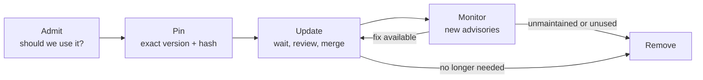

# Third-party dependencies

## Why care?

[Supply chain security](../security/supply-chain.md) showed what Go checks for you: `go.sum`, the checksum database, read-only builds, minimal version selection (MVS) and `govulncheck`. Those checks answer one question: "Did I get the same bytes as everyone else, and do they have a known bug?" They do not answer the questions a team must answer every week:

- Should we add this module at all?
- Who decides, and on what facts?
- When a new version appears, how long do we wait, and who reviews it?
- When an advisory appears for code we shipped last year, who hears about it?
- When do we remove a module again?

These are **process** questions. Tools help, but only if the process says when to run them and what to do with the result. Three real incidents show the cost of a missing process:

- **event-stream (2018).** A new maintainer added a dependency that stole Bitcoin wallets. It went unnoticed for more than two months.
- **xz-utils (2024).** A trusted maintainer hid a backdoor in release tarballs. The code in Git was clean.
- **npm, September 2025.** A phishing email gave an attacker one maintainer's npm account. Malicious versions of `chalk`, `debug` and other packages with billions of weekly downloads were live for about two hours.

This page follows one dependency through its whole life and gives you the configuration and commands for each step.

## The idea: a dependency has a lifecycle

A dependency is not a one-time decision. It is a relationship with code, and with people you have never met. Treat it as a lifecycle with five steps:



| Step        | Question                                         | Main tools                                               |
| ----------- | ------------------------------------------------ | -------------------------------------------------------- |
| **Admit**   | Is this module worth the risk?                   | deps.dev, OpenSSF Scorecard, `go mod graph`, a policy    |
| **Pin**     | Is every build using exactly the reviewed bytes? | `go.mod` + `go.sum`, lockfiles, `tool`, `mise.lock`      |
| **Update**  | Is the new version safe to take, and when?       | Dependabot or Renovate, a cooldown, a review checklist   |
| **Monitor** | Did a new advisory appear for what we run?       | `govulncheck`, OSV, OSV-Scanner, dependency review in CI |
| **Remove**  | Do we still need it?                             | `go mod tidy`, `go mod why`                              |

The most effective step is the first one. A dependency you never admit needs no pinning, no updates, no monitoring and no removal.

## Under the hood: admitting a dependency

### Questions to ask

Ask these questions before the first `go get`. Write the answers in the pull request that adds the module, so a reviewer can check them.

| Question                                         | Why it matters                                                                       | How to check                                       |
| ------------------------------------------------ | ------------------------------------------------------------------------------------ | -------------------------------------------------- |
| Do we need it? Can the standard library do it?   | Every module is code you ship but did not review                                     | Read the Go docs first: `net/http`, `log/slog`, …  |
| Who maintains it?                                | A company, a foundation, or one person with a day job                                | Repository, `CODEOWNERS`, release signers          |
| Is it active?                                    | Unfixed bugs stay unfixed; security reports go unanswered                            | Recent releases, issue replies, Scorecard          |
| What is the **bus factor**?                      | The number of people who can leave before nobody can release a fix. One is fragile   | Commit authors over the last year                  |
| Which licence?                                   | Some licences (for example AGPL) have duties your company may not accept             | deps.dev, the `LICENSE` file                       |
| How heavy is it?                                 | Its own dependencies come too, and each one is a new maintainer to trust             | `go mod graph`, `go list -m all` before and after  |
| What can it do? Network, files, `exec`, `unsafe` | A logging library that opens network connections is suspicious                       | Read the code; capslock (see below)                |
| Does it have a security policy?                  | Tells you how vulnerabilities are reported and fixed                                 | `SECURITY.md`, Scorecard `Security-Policy` check   |
| Is the name exactly right?                       | Typosquats like `github.com/boltdb-go/bolt` copy a real module with a backdoor added | Compare with the project's own docs and repository |

The **bus factor** question matters more than it seems. The xz-utils backdoor was possible because one tired volunteer maintained a library that half the Linux world used, and he accepted help from a stranger.

### deps.dev: the facts in one place

[deps.dev](https://deps.dev) (Open Source Insights, run by Google) collects facts about packages in Go, npm, PyPI, Maven, Cargo and NuGet: versions, licences, advisories, and the **OpenSSF Scorecard** of the source repository. Scorecard is an automated check of a repository's security practices (code review, branch protection, pinned dependencies, and more), each scored from 0 to 10.

deps.dev has a free, public, read-only API. No key is needed. Module names go into the URL path, so encode `/` as `%2F`. Look at `github.com/spf13/cobra`, a popular command-line library:

```console
$ curl -s 'https://api.deps.dev/v3/systems/go/packages/github.com%2Fspf13%2Fcobra' \
>   | jq '{versions: (.versions|length), latest: [.versions[]|select(.isDefault)]}'
{
  "versions": 802,
  "latest": [
    {
      "versionKey": {
        "system": "GO",
        "name": "github.com/spf13/cobra",
        "version": "v1.10.2"
      },
      "publishedAt": "2025-12-03T23:51:15Z",
      "isDefault": true,
      "isDeprecated": false,
      "deprecatedReason": ""
    }
  ]
}
```

802 "versions" sounds like a lot. Most of them are **pseudo-versions** (`v0.0.0-<time>-<commit>`) that someone once requested from the Go proxy. The default (latest release) is v1.10.2, published in December 2025: almost a year before today. Now the version itself:

```console
$ curl -s 'https://api.deps.dev/v3/systems/go/packages/github.com%2Fspf13%2Fcobra/versions/v1.10.2' \
>   | jq '{licenses, advisoryKeys, links, slsaProvenances}'
{
  "licenses": [
    "Apache-2.0"
  ],
  "advisoryKeys": [],
  "links": [
    {
      "label": "SOURCE_REPO",
      "url": "https://github.com/spf13/cobra"
    }
  ],
  "slsaProvenances": []
}
```

Apache-2.0, no known advisories, no SLSA provenance. The licence is the first gate: if your policy does not allow it, stop here. Then the **project** (the source repository), with its Scorecard:

```console
$ curl -s 'https://api.deps.dev/v3/projects/github.com%2Fspf13%2Fcobra' \
>   | jq '{openIssuesCount, starsCount, license, scorecard: {date: .scorecard.date,
>         overallScore: .scorecard.overallScore, checks: [.scorecard.checks[] | {name, score}]}}'
{
  "openIssuesCount": 516,
  "starsCount": 44855,
  "license": "Apache-2.0",
  "scorecard": {
    "date": "2026-08-24T00:00:00Z",
    "overallScore": 6.2,
    "checks": [
      { "name": "Dangerous-Workflow", "score": 10 },
      { "name": "Maintained", "score": 2 },
      { "name": "Packaging", "score": -1 },
      { "name": "Code-Review", "score": 8 },
      { "name": "Security-Policy", "score": 10 },
      { "name": "CII-Best-Practices", "score": 0 },
      { "name": "Binary-Artifacts", "score": 10 },
      { "name": "License", "score": 10 },
      { "name": "Token-Permissions", "score": 10 },
      { "name": "Pinned-Dependencies", "score": 0 },
      { "name": "Fuzzing", "score": 0 },
      { "name": "Signed-Releases", "score": -1 },
      { "name": "Branch-Protection", "score": -1 },
      { "name": "SAST", "score": 0 }
    ]
  }
}
$ curl -s 'https://api.deps.dev/v3/projects/github.com%2Fspf13%2Fcobra' \
>   | jq '.scorecard.checks[] | select(.name=="Maintained" or .name=="Pinned-Dependencies") | {name, reason}'
{
  "name": "Maintained",
  "reason": "1 commit(s) and 2 issue activity found in the last 90 days -- score normalized to 2"
}
{
  "name": "Pinned-Dependencies",
  "reason": "dependency not pinned by hash detected -- score normalized to 0"
}
```

(The `checks` array is shown one object per line to save space.) How to read this:

- **Overall 6.2** is an average. Never decide on the average. Read the checks that matter for your risk.
- **Maintained: 2.** Very little activity in the last 90 days. For a mature library like cobra, that can simply mean "finished". For a young library, it is a warning. Combine it with the release date above.
- **Code-Review: 8.** Most changes are reviewed by a second person. This is one of the most useful checks: a stolen account alone cannot push code.
- **Pinned-Dependencies: 0.** The project's own CI uses actions by tag. That is a risk for the project's build, not directly for your code.
- **-1** means "could not check" (for example, branch protection settings are not public). It is not a failure.

Scorecard is a signal, not a verdict. A score of 4 on a library your team knows well can be fine. A score of 9 on a brand-new module from an unknown account is not a reason to trust it.

!!! note "deps.dev and Go dependency graphs"

    The deps.dev API has a `:dependencies` endpoint that returns the resolved dependency
    graph of a version. For Go it currently answers `dependencies not found`; it works for
    npm, Cargo, Maven, PyPI and NuGet. For Go, use the `go` command itself, as in the next section.

### Weight: what comes with it

Each module you add brings its own `require` lines. In Go, you can see the whole graph without running any code. In a copy of `examples/orders`:

```console
$ go mod graph | head -8
github.com/acme/orders go@1.27
github.com/acme/orders golang.org/x/mod@v0.43.0
github.com/acme/orders golang.org/x/sync@v0.25.0
github.com/acme/orders golang.org/x/sys@v0.50.0
github.com/acme/orders golang.org/x/telemetry@v0.0.0-20261116191925-e77a43154acb
github.com/acme/orders golang.org/x/tools@v0.53.0
github.com/acme/orders golang.org/x/vuln@v1.10.0
go@1.27 toolchain@go1.27
$ go mod graph | wc -l
35
$ go mod graph | grep '^golang.org/x/vuln@'
golang.org/x/vuln@v1.10.0 github.com/google/go-cmdtest@v0.4.1-0.20220921163831-55ab3332a786
golang.org/x/vuln@v1.10.0 github.com/google/go-cmp@v0.6.0
golang.org/x/vuln@v1.10.0 golang.org/x/mod@v0.43.0
golang.org/x/vuln@v1.10.0 golang.org/x/sync@v0.25.0
golang.org/x/vuln@v1.10.0 golang.org/x/telemetry@v0.0.0-20261116191925-e77a43154acb
golang.org/x/vuln@v1.10.0 golang.org/x/tools@v0.53.0
golang.org/x/vuln@v1.10.0 golang.org/x/tools/go/packages/packagestest@v0.1.1-deprecated
golang.org/x/vuln@v1.10.0 github.com/google/renameio@v0.1.0
golang.org/x/vuln@v1.10.0 golang.org/x/sys@v0.50.0
golang.org/x/vuln@v1.10.0 golang.org/x/tools/go/expect@v0.1.1-deprecated
golang.org/x/vuln@v1.10.0 go@1.26.0
```

Each line is an edge: "this module version requires that module version". One `tool` line for `govulncheck` brought 35 edges and 13 modules. The graph lists **requirements**, not code that is compiled. To see how many packages are really built, ask `go list`:

```console
$ go list -deps -f '{{if not .Standard}}{{.ImportPath}}{{end}}' golang.org/x/vuln/cmd/govulncheck \
>   | sed '/^$/d' | wc -l
61
```

61 non-standard packages are compiled into the `govulncheck` binary. That is its real weight.

`go mod why` explains **why** a module or package is in the graph. It prints the shortest import path from your module:

```console
$ go mod why -m golang.org/x/sys golang.org/x/telemetry
# golang.org/x/sys
golang.org/x/vuln/cmd/govulncheck
golang.org/x/telemetry
golang.org/x/sys/windows

# golang.org/x/telemetry
golang.org/x/vuln/cmd/govulncheck
golang.org/x/telemetry
$ go mod why -m github.com/yuin/goldmark golang.org/x/net
# github.com/yuin/goldmark
(main module does not need module github.com/yuin/goldmark)

# golang.org/x/net
(main module does not need module golang.org/x/net)
```

Two lessons:

- `go mod why` looks at **all** platforms, not only yours. On Linux you never compile `golang.org/x/sys/windows`, but it is part of the answer.
- `goldmark` and `x/net` are in the graph (so `go.sum` lists them and MVS considers them), but no package you build imports them. They are **graph-only**: they can still raise the versions you get through MVS, but their code is not in your binary. A version-only scanner will still report their advisories.

Run the same three commands before and after `go get` on a branch, and paste the difference in the pull request. "This adds 2 modules and 9 packages" is a fact a reviewer can judge.

### A written dependency policy

Without a written policy, every new module starts the same discussion again, and the answer depends on who reviews. Keep the policy short, keep it in the repository (for example `docs/dependency-policy.md`), and link it from `CONTRIBUTING.md`. An example:

```markdown
# Dependency policy

1. Prefer the Go standard library. Copy a small helper (with credit and licence) instead of
   adding a module for less than about 100 lines of code.
2. A pull request that adds a direct dependency must answer: why not the standard library,
   who maintains it, licence, Scorecard checks Code-Review and Maintained, and the output of
   `go list -m all` before and after.
3. Allowed licences: MIT, BSD-2-Clause, BSD-3-Clause, Apache-2.0, ISC, MPL-2.0.
   Anything else needs approval from the legal team.
4. A new direct dependency needs approval from a member of @acme/platform (CODEOWNERS on go.mod).
5. Version updates wait at least 3 days after release (7 days for major versions).
   Security updates do not wait.
6. Every update is a pull request that passes CI and dependency review. Only patch and minor
   updates of development tools may merge automatically.
7. A dependency with no release for 2 years, or with an unfixed known vulnerability for
   90 days, is reviewed for replacement.
8. Every quarter, the team runs `go mod tidy` and removes dependencies it no longer needs.
```

Rule 4 makes the policy real: a `CODEOWNERS` line such as `go.mod @acme/platform` plus a required review (see [GitHub repositories](github-repositories.md)) means nobody can skip it.

## Under the hood: pinning

**Pinning** means that every build uses exactly the version, and the exact bytes, that were reviewed.

### Go: `go.mod`, `go.sum` and MVS

Go pins by design, as explained in [Modules](../go/modules.md#minimal-version-selection-why-go-picks-the-oldest-version) and [Supply chain security](../security/supply-chain.md#mvs-nothing-upgrades-behind-your-back):

- `go.mod` records the minimum version of each requirement. With MVS, the build uses exactly that version until someone edits `go.mod`. There are no version ranges.
- `go.sum` records the hash of every module version, checked against the public checksum database.
- Builds are read-only (`-mod=readonly`): they never change `go.mod`.

So a Go module needs no separate lockfile. `go.mod` plus `go.sum` already are one.

### Other ecosystems: lockfiles and frozen installs

Most other ecosystems use **version ranges** in the manifest (`"prettier": "^3.0.0"`) and a **lockfile** that records the versions and hashes actually chosen. The lockfile only protects you if the install command refuses to change it. This repository installs its Markdown tools with Bun, and the `install` task in `mise.toml` runs:

```sh
bun install --frozen-lockfile
```

With `--frozen-lockfile`, Bun installs the exact versions in `bun.lock` and does not update it. If `package.json` and `bun.lock` disagree, the install fails. `bun ci` is the same command. Other ecosystems have the same idea under other names: `npm ci`, `pnpm install --frozen-lockfile`, `uv sync --locked`, `cargo build --locked`.

Two more details make the lockfile stronger here. `package.json` pins exact versions (`"prettier": "3.10.1"`, no `^`), so even a fresh lock resolves the same versions. And Bun can enforce its own age gate (`minimumReleaseAge` under `[install]` in `bunfig.toml`), so a version younger than the limit cannot be installed at all.

### Tools: the `tool` directive and `mise.lock`

Tools are dependencies too: linters, code generators, `govulncheck`, the Go toolchain itself. Pin them like code:

- **Go tools** in `go.mod` with the `tool` directive (see [Modules](../go/modules.md#tools-the-tool-directive)). `examples/orders` pins `govulncheck` this way: same version for every developer and CI, hash-checked by `go.sum`, built from source.
- **Binary tools** with mise. `mise.toml` names the versions; `mise.lock` records, per platform, the download URL and a checksum. This repository sets `locked = true`, so mise installs only what `mise.lock` records:

```toml
[[tools.actionlint]]
version = "1.7.12"
backend = "aqua:rhysd/actionlint"
specifiers = ["1.7.12"]

[tools.actionlint."platforms.linux-x64"]
checksum = "sha256:8aca8db96f1b94770f1b0d72b6dddcb1ebb8123cb3712530b08cc387b349a3d8"
url = "https://github.com/rhysd/actionlint/releases/download/v1.7.12/actionlint_1.7.12_linux_amd64.tar.gz"
url_api = "https://api.github.com/repos/rhysd/actionlint/releases/assets/384924896"
provenance = "github-attestations"
```

The `provenance` line says mise verified a GitHub artifact attestation for this download when it wrote the lock: the binary was built by the project's own workflow. [Artifact signing](artifact-signing.md) explains how such attestations work.

- **CI actions** by full commit SHA, see [Workflow security](workflow-security.md).
- **Container base images** by digest (`image@sha256:...`), see [Container security](../containers/security.md).

## Under the hood: updating

Pinning without updating is slow decay: known vulnerabilities pile up, and when you finally must upgrade, the jump is large and risky. The goal is **small, frequent, reviewed** updates. An **update bot** opens one pull request per update (or per group), so CI and a reviewer see each change.

### Why a cooldown helps

A **cooldown** (Renovate calls it **minimum release age**) is a waiting period: the bot does not propose a version until it has been public for some days. The reason is how malicious releases usually end:

- In the **September 2025 npm** attack, an attacker phished the npm account of the maintainer of `chalk` and `debug`, with a fake email from the look-alike domain `npmjs.help`. The malicious versions stole cryptocurrency in browsers. GitHub reports that they were live for roughly two hours before npm removed them.
- GitHub's own review of 21 incidents from 2018 to 2026 found that most malicious versions were caught and removed within hours of publication.
- Counter-example: event-stream's payload was encrypted and stayed hidden for more than two months. A cooldown does not catch everything.

So most malicious versions are removed long before a 3-day cooldown ends. A cooldown costs you a few days of delay on feature updates. It costs nothing on **security** updates, because both bots let security fixes skip the wait. Since July 2026, Dependabot applies a default cooldown of 3 days to all version updates on github.com.

### Dependabot

**Dependabot** is built into GitHub. It is configured with `.github/dependabot.yml`. For `examples/orders` (Go module and Dockerfile in a subfolder) and the workflows of this repository. This is the repository's real `.github/dependabot.yml`, which also has a `bun` entry for the lint tools:

```yaml
version: 2
updates:
  - package-ecosystem: gomod
    directory: /examples/orders
    schedule:
      interval: weekly
      day: monday
    cooldown:
      default-days: 3
      semver-major-days: 30
      semver-minor-days: 7
      semver-patch-days: 3
    groups:
      golang-x:
        patterns:
          - "golang.org/x/*"
        update-types:
          - minor
          - patch
    open-pull-requests-limit: 5
    labels: [dependencies, go]

  - package-ecosystem: github-actions
    directory: /
    schedule:
      interval: weekly
    cooldown:
      default-days: 7
    groups:
      actions:
        patterns:
          - "*"

  - package-ecosystem: docker
    directory: /examples/orders
    schedule:
      interval: weekly
    cooldown:
      default-days: 3
```

What each part does:

- **`cooldown`** delays version updates. `default-days` applies to everything; the `semver-*-days` keys set a different wait per kind of version bump. The per-bump keys work for `gomod`, but not for `github-actions` or `docker`, so those use only `default-days`. `include` and `exclude` lists (with `*` wildcards) choose which dependencies the cooldown covers.
- **`groups`** put several updates into one pull request. All `golang.org/x/*` minor and patch updates arrive together, because they usually move together. Major updates stay separate: they need more review.
- **`open-pull-requests-limit`** caps open version-update pull requests (the default is 5). Security update pull requests have their own limit.
- **`github-actions`** with directory `/` scans `.github/workflows`. When a workflow pins an action by SHA with a `# v5.1.0` comment, Dependabot updates both the SHA and the comment.

**Dependabot security updates** are separate from version updates: when a Dependabot alert has a fix, Dependabot opens a pull request at once, with no cooldown. You turn them on in the repository settings (see [GitHub repositories](github-repositories.md)).

### Renovate

**Renovate** (by Mend) is an open-source update bot. It runs as a hosted GitHub App or as a self-hosted job, supports many more file types, and has far more options. It reads `renovate.json`:

```json
{
  "$schema": "https://docs.renovatebot.com/renovate-schema.json",
  "extends": ["config:recommended", "helpers:pinGitHubActionDigests"],
  "schedule": ["before 6am on monday"],
  "minimumReleaseAge": "3 days",
  "internalChecksFilter": "strict",
  "postUpdateOptions": ["gomodTidy"],
  "packageRules": [
    {
      "matchUpdateTypes": ["major"],
      "minimumReleaseAge": "7 days",
      "dependencyDashboardApproval": true
    },
    {
      "matchManagers": ["gomod"],
      "matchPackageNames": ["golang.org/x/**"],
      "matchUpdateTypes": ["minor", "patch"],
      "groupName": "golang.org/x"
    },
    {
      "matchManagers": ["github-actions"],
      "groupName": "GitHub Actions"
    },
    {
      "matchDepTypes": ["devDependencies"],
      "matchUpdateTypes": ["minor", "patch"],
      "automerge": true
    }
  ]
}
```

What each part does:

- **`config:recommended`** is Renovate's base preset. It also turns on the **Dependency Dashboard**, an issue that lists every pending update.
- **`helpers:pinGitHubActionDigests`** rewrites `uses: actions/checkout@v5` to a commit SHA with a version comment, and keeps both up to date.
- **`minimumReleaseAge`** is the cooldown. While a version is too young, Renovate shows a pending status check `renovate/stability-days`. With **`internalChecksFilter: strict`** (the default), Renovate does not even create the branch until a version is old enough. The datasource must give a release time: the Go proxy does, Docker Hub does, but GHCR and Quay images do not, so the age check cannot work for them.
- **`postUpdateOptions: gomodTidy`** runs `go mod tidy` after each Go update, so `go.sum` stays clean.
- **`packageRules`** are checked in order; all matching rules apply, and later rules win. Major updates wait 7 days and need a click on the dashboard first (`dependencyDashboardApproval`).
- **`automerge`** only for minor and patch updates of `devDependencies` (here: `prettier`, `markdownlint-cli2`). These tools never reach production, and CI checks them fully. Renovate merges only when all required checks pass.

Security updates (Renovate calls them `vulnerabilityAlerts`) skip `minimumReleaseAge` and are raised as soon as Renovate sees them.

One Go-specific detail: Renovate does not update **indirect** (`// indirect`) requirements by default, unless a `tool` directive needs them. In `examples/orders` every requirement is indirect and comes from the `govulncheck` tool, so they are updated.

### Dependabot or Renovate?

| Topic                  | Dependabot                                  | Renovate                                                |
| ---------------------- | ------------------------------------------- | ------------------------------------------------------- |
| Setup                  | Built into GitHub; one YAML file            | GitHub App or self-hosted; one JSON file                |
| Platforms              | GitHub only                                 | GitHub, GitLab, Bitbucket, Azure DevOps, Gitea, …       |
| Cooldown               | `cooldown` (default 3 days since July 2026) | `minimumReleaseAge`, with a status check                |
| Grouping               | `groups` per ecosystem, multi-ecosystem     | `packageRules` + `groupName`, very flexible             |
| Automerge              | No built-in; use a workflow                 | Built in, per rule, after required checks               |
| Security alerts        | Native Dependabot alerts and security PRs   | Uses the platform's alerts (`vulnerabilityAlerts`)      |
| Pinning actions by SHA | Updates existing SHA pins                   | Can also create them (`helpers:pinGitHubActionDigests`) |
| Overview               | One PR list                                 | Dependency Dashboard issue                              |

Choose Dependabot when you are on GitHub and want something simple. Choose Renovate when you have many repositories, several platforms, or need automerge and fine-grained rules. Do not run both on the same files: they will open duplicate pull requests.

### Reviewing an update pull request

An update pull request changes two lines in `go.mod` and several in `go.sum`. The real change is in code you do not see. A green CI run proves the new version compiles and passes **your** tests. It does not prove the version is benign. Review it with this checklist:

1. **Read the release notes and changelog.** Does the change match the version number? A patch release that "refactors the HTTP client" deserves attention.
2. **Look at the source diff between the two versions,** not only the release notes. Attackers do not write release notes for their backdoor. For a Go module, compare the exact bytes that the proxy serves:

   ```sh
   go mod download -json github.com/spf13/cobra@v1.9.1 github.com/spf13/cobra@v1.10.2 | jq -r .Dir
   diff -r "$(go env GOMODCACHE)/github.com/spf13/cobra@v1.9.1" \
           "$(go env GOMODCACHE)/github.com/spf13/cobra@v1.10.2" | less
   ```

   This compares what you will compile, which can differ from the Git repository. In xz-utils, the backdoor was only in the release tarballs, not in Git.

3. **Look for new transitive dependencies.** Compare `go list -m all` on the base branch and on the update branch. A new module that nobody asked for is the event-stream pattern.
4. **Look for new capabilities.** Did the new version start to open network connections, run programs (`os/exec`), read environment variables, or use `unsafe` or cgo? Search the diff for new imports of `net`, `os/exec`, `unsafe`, `syscall` and `plugin`, and for new `init` functions.
5. **Check who released it.** A first release by a new maintainer, or a release after a long silence, deserves a slower review.

**Capslock** (from Google) automates step 4 for Go. It follows the call graph from your packages into the standard library and reports **capabilities** such as `CAPABILITY_NETWORK`, `CAPABILITY_EXEC`, `CAPABILITY_FILES`, `CAPABILITY_UNSAFE_POINTER` and `CAPABILITY_CGO`. Save a baseline on the base branch, then compare on the update branch:

!!! tip "New tool: `capslock`"

    ```sh
    mise use go:github.com/google/capslock/cmd/capslock@0.3.4
    ```

    This adds it to the project's `mise.toml`, pinned to an exact version. See [Adding tools as you go](../toolbox/mise.md#adding-tools-as-you-go).

```sh
git switch main
capslock -packages ./... -output=json > capslock-main.json
git switch renovate/golang.org-x
capslock -packages ./... -output=compare capslock-main.json
```

On `examples/orders`, the summary (the default output) lists what the service can do today, counted over every call path into the standard library:

```console
$ capslock -packages ./...
Capslock is an experimental tool for static analysis of Go packages.
Share feedback and file bugs at https://github.com/google/capslock.
For additional debugging signals, use verbose mode with -output=verbose
To get machine-readable full analysis output, use -output=json


FILES: 22 references
MODIFY_SYSTEM_STATE/SIGNALS: 3 references
NETWORK: 34 references
READ_SYSTEM_STATE: 7 references
REFLECT: 30 references
UNANALYZED: 34 references
```

An HTTP service with config files and signal handling: network, files and signals are expected. There is no `EXEC`. To see a comparison fail, save the baseline, then (in a copy) add one function to `internal/order` that runs `exec.Command("hostname")`:

```console
$ capslock -packages ./... -output=json > capslock-main.json
$ # ...add the function in a copy, then in the copy:
$ capslock -packages ./... -output=compare capslock-main.json
Package github.com/acme/orders/internal/order has new capability EXEC compared to the baseline.
                 github.com/acme/orders/internal/order.hostName
order.go:119:48  os/exec.Command
$ echo $?
1
```

`-output=compare` reports capabilities that are new or gone compared with the baseline file, with the call path, and exits with 1, so a CI job can fail on it. Here the domain package, which should only hold business rules, can suddenly run programs. A minor update of a parsing library that suddenly gains `NETWORK` or `EXEC` must be explained before it merges. `UNANALYZED` counts calls capslock could not follow (often through interfaces or `reflect`); treat it as "unknown", not "safe".

## Under the hood: monitoring

Monitoring answers: "Is anything we **already** run affected by a new advisory?" The code did not change; the knowledge did.

### `govulncheck` and the OSV database

`govulncheck` is the first tool for Go, because it reports only vulnerabilities your code can reach. [Supply chain security](../security/supply-chain.md#under-the-hood-known-vulnerabilities-with-govulncheck) shows it on source and on binaries. Run it on every pull request and on a schedule.

Its data comes from the Go vulnerability database, which publishes in the **OSV** format (Open Source Vulnerability). OSV is a simple JSON schema plus a database at [osv.dev](https://osv.dev) that collects advisories from many ecosystems: Go, npm, PyPI, Maven, crates.io, Linux distributions, and the GitHub Advisory Database. One record can have several IDs (**aliases**): a `GO-` ID, a `CVE-` ID and a `GHSA-` ID for the same bug.

The OSV API is public and needs no key. To ask "which advisories affect `golang.org/x/net` v0.17.0?", send a query:

```sh
curl -s -d '{"package": {"name": "golang.org/x/net", "ecosystem": "Go"}, "version": "v0.17.0"}' \
  https://api.osv.dev/v1/query | jq -r '.vulns[] | [.id, .summary] | @tsv'
```

<!-- TODO(real-output): the POST query could not run in this session (outbound POST requests are blocked); the read-only GET calls below are real. -->

deps.dev gives the same list of advisory IDs with a plain GET:

```console
$ curl -s 'https://api.deps.dev/v3/systems/go/packages/golang.org%2Fx%2Fnet/versions/v0.17.0' \
>   | jq -c '{licenses, advisories: (.advisoryKeys | length), first: .advisoryKeys[:5]}'
{"licenses":["BSD-3-Clause"],"advisories":25,"first":[{"id":"GHSA-4v7x-pqxf-cx7m"},{"id":"GHSA-5cv4-jp36-h3mw"},{"id":"GHSA-qxp5-gwg8-xv66"},{"id":"GHSA-vvgc-356p-c3xw"},{"id":"GO-2024-2687"}]}
```

25 advisory IDs for a version from October 2023. Fetch one full record from OSV:

```console
$ curl -s https://api.osv.dev/v1/vulns/GO-2024-2687 \
>   | jq '{id, published, aliases, summary,
>         affected: [.affected[] | {package: .package.name, ranges: .ranges[0].events,
>                    symbols: (.ecosystem_specific.imports[0].symbols | length)}]}'
{
  "id": "GO-2024-2687",
  "published": "2024-04-03T21:12:01Z",
  "aliases": [
    "BIT-golang-2023-45288",
    "CVE-2023-45288",
    "GHSA-4v7x-pqxf-cx7m"
  ],
  "summary": "HTTP/2 CONTINUATION flood in net/http",
  "affected": [
    {
      "package": "stdlib",
      "ranges": [
        { "introduced": "0" },
        { "fixed": "1.21.9" },
        { "introduced": "1.22.0-0" },
        { "fixed": "1.22.2" }
      ],
      "symbols": 190
    },
    {
      "package": "golang.org/x/net",
      "ranges": [
        { "introduced": "0" },
        { "fixed": "0.23.0" }
      ],
      "symbols": 72
    }
  ]
}
```

(Each range event is shown on one line to save space.) Three things to notice. The GHSA ID in the deps.dev list (`GHSA-4v7x-pqxf-cx7m`) is an alias of this Go record: count unique bugs, not IDs. The same bug affects both the standard library and `x/net` (the HTTP/2 code is shared), with different fixed versions. And the Go records list the vulnerable **symbols** (functions and methods): that list is what lets `govulncheck` check reachability.

### OSV-Scanner: one scanner for every lockfile

`govulncheck` knows only Go. A repository also has a `bun.lock`, a Dockerfile and maybe Python tools. **OSV-Scanner** (from Google) reads lockfiles and manifests of many ecosystems and checks them against OSV.

!!! tip "New tool: `osv-scanner`"

    ```sh
    mise use osv-scanner@2.7.1
    ```

    This adds it to the project's `mise.toml`, pinned to an exact version. See [Adding tools as you go](../toolbox/mise.md#adding-tools-as-you-go).

```sh
osv-scanner scan source -r .                    # every lockfile under the repository
osv-scanner scan -L examples/orders/go.mod      # one file
osv-scanner scan image ghcr.io/acme/ordersd:1.4.0
osv-scanner scan source -r . --format json --output-file osv.json
```

<!-- TODO(real-output): osv-scanner not installed -->

When you accept a finding (for example, the vulnerable code is unreachable), record the decision with an expiry date in `osv-scanner.toml`, next to the scanned file. Ignoring an ID also ignores its aliases:

```toml
[[IgnoredVulns]]
id = "GO-2024-2687"
effectiveUntil = 2027-01-31
reason = "Only the HTTP/2 client is linked; no HTTP/2 server. Upgrade tracked in ACME-1234."
```

An ignore without `effectiveUntil` is a decision nobody will ever review again.

### Dependabot alerts

**Dependabot alerts** are GitHub's built-in monitoring. GitHub builds a **dependency graph** from your manifests (`go.mod`, `bun.lock`, …) and compares it with the GitHub Advisory Database. When a new advisory matches, you get an alert, and (if enabled) a security update pull request. Alerts are version-based: they do not know if your code calls the vulnerable function. Use them as a net under `govulncheck`, not instead of it. Turning them on is part of [GitHub repositories](github-repositories.md).

### Dependency review in pull requests

Alerts tell you about problems after they are on the default branch. **`actions/dependency-review-action`** stops them at the door: it compares the dependency graph of the pull request with its base, and fails if the pull request **adds** a vulnerable version, a disallowed licence, or a banned package. Resolve the SHAs first:

```console
$ git ls-remote --tags https://github.com/actions/checkout | grep v7
3d3c42e5aac5ba805825da76410c181273ba90b1	refs/tags/v7
9c091bb21b7c1c1d1991bb908d89e4e9dddfe3e0	refs/tags/v7.0.0
3d3c42e5aac5ba805825da76410c181273ba90b1	refs/tags/v7.0.1
$ git ls-remote https://github.com/actions/dependency-review-action \
>   refs/tags/v5.0.1 'refs/tags/v5.0.1^{}'
bbc44d14a204704ccc493733616cd1e93a0321ec	refs/tags/v5.0.1
```

Both are lightweight tags (no `^{}` line), so the tag hash is the commit. The workflow:

```yaml
name: dependency-review

on:
  pull_request:

permissions: {}

jobs:
  dependency-review:
    runs-on: ubuntu-latest
    permissions:
      contents: read
    steps:
      - uses: actions/checkout@3d3c42e5aac5ba805825da76410c181273ba90b1 # v7.0.1
        with:
          persist-credentials: false
      - uses: actions/dependency-review-action@bbc44d14a204704ccc493733616cd1e93a0321ec # v5.0.1
        with:
          fail-on-severity: moderate
          fail-on-scopes: runtime, development
          allow-licenses: MIT, BSD-2-Clause, BSD-3-Clause, Apache-2.0, ISC, MPL-2.0
          deny-packages: pkg:golang/github.com/boltdb-go/bolt
          show-openssf-scorecard: true
          warn-on-openssf-scorecard-level: 3
```

- **`permissions: {}`** at the top and only `contents: read` for the job. It needs nothing more. (`comment-summary-in-pr` would need `pull-requests: write`; the job summary is enough.)
- **`fail-on-severity: moderate`** fails on moderate, high and critical advisories. The default is `low`.
- **`allow-licenses`** is the licence policy from above, as SPDX IDs. Any other licence fails the check. The action also has `deny-licenses`, but it is **deprecated** and may be removed in the next major version, so use an allow list. An allow list is also safer: a licence nobody thought of fails by default.
- **`deny-packages`** blocks specific packages by **purl** (package URL), here the known Go typosquat.
- **`show-openssf-scorecard`** prints the Scorecard of each new dependency in the summary, and warns below level 3.

Make the check **required** in a ruleset, or it only gives advice. On private repositories, dependency review needs GitHub Code Security (part of GitHub Advanced Security).

## Under the hood: where modules come from

By default, the `go` command downloads from `proxy.golang.org`. Two alternatives give a company more control.

**Vendoring** (`go mod vendor`) copies all dependency source into `vendor/` in your repository (see [Modules](../go/modules.md#vendoring)). Every line of third-party code is in your Git history and visible in reviews. Builds need no network.

**A private module proxy** sits between your builds and the internet. Two common choices:

- **Athens**, an open-source Go module proxy you run yourself. It can use an allow-list or block-list ("filter file") of modules.
- **JFrog Artifactory** (or Sonatype Nexus), a general artifact manager with a Go "remote" repository that caches `proxy.golang.org`. It also serves npm, PyPI, Maven and container images, and integrates with licence and vulnerability scanning.

Builds then use only the proxy:

```sh
GOPROXY=https://artifactory.acme.internal/artifactory/api/go/go-remote,off
GOPRIVATE=github.com/acme/*
```

`off` at the end means "never go to the internet directly". `GOPRIVATE` keeps private modules away from the public proxy and checksum database, as explained in [Supply chain security](../security/supply-chain.md#private-modules-goprivate-gonosumdb-goproxy). Keep the public checksum database **on** (`GOSUMDB` unset): the proxy is one more server that could be compromised, and `sum.golang.org` checks it.

| Approach               | Strengths                                                                             | Weaknesses                                                                        |
| ---------------------- | ------------------------------------------------------------------------------------- | --------------------------------------------------------------------------------- |
| Public proxy only      | Zero setup; caches every version forever                                              | No company control; builds depend on the internet; no central log of what entered |
| Vendoring              | Offline builds; all third-party code visible in diffs; no proxy to run                | Large diffs and repository; per-repository, no company-wide view                  |
| Private proxy          | One place to allow, block, scan and log; builds survive internet and upstream outages | A service to run and secure; a new single point of failure and of attack          |
| Private proxy + vendor | Maximum control, for regulated or air-gapped environments                             | All the costs of both                                                             |

Most companies use a private proxy and do not vendor. The proxy also answers an incident question quickly: "Did any build in the company download version X of module Y last week?"

## Under the hood: removing

Removal is the step teams forget. A module that nobody uses still sits in `go.sum`, still appears in scans and alerts, and can still raise versions through MVS.

`go mod tidy` adds missing requirements and removes requirements that no package in your module needs, for any platform and including tests. Check it in CI without changing files (Go 1.23 and later):

```sh
go mod tidy -diff
```

It prints the change it would make and exits with an error if there is one. `tidy` cannot know that a package you **import** is no longer worth it. For that, look at the direct requirements and ask, for each one, `go mod why -m <module>` and "would we admit this today?". Replacing a 50-line use of a large module with the standard library removes a whole subtree of the graph.

To remove a tool, drop its `tool` line and its requirements together:

```sh
go get -tool golang.org/x/vuln/cmd/govulncheck@none
go mod tidy
```

## Case studies

### event-stream (2018)

`event-stream` was a popular npm package. Its original author no longer maintained it. In 2018 a user named `right9ctrl` offered to help and was given publish rights. He released version 3.3.6 with a new dependency, `flatmap-stream`. That package contained an encrypted payload that only ran inside the build of the Copay Bitcoin wallet (by BitPay) and tried to steal private keys from wallets with large balances. It stayed unnoticed for more than two months, until a developer reported it on GitHub in November 2018. npm removed the malicious versions.

**Lessons:** a maintainer change is a security event. A new transitive dependency in a patch release must be explained. A cooldown would not have helped: the payload was hidden for months. Review of the diff (step 3 of the checklist) and a small dependency tree would have.

### xz-utils (2024)

`xz-utils` (the `liblzma` compression library) is installed on almost every Linux system. Over about two years, an account named "Jia Tan" built trust with useful contributions and became a co-maintainer. Versions 5.6.0 and 5.6.1 contained a backdoor that, through `liblzma`, targeted the OpenSSH server on some Linux distributions. The malicious build code was only in the **release tarballs**, not in the Git repository. On 29 March 2024, Andres Freund, a developer at Microsoft, noticed that SSH logins used unexpected CPU time and reported it. It became CVE-2024-3094 with CVSS score 10. It was caught before most stable distributions shipped it.

**Lessons:** a bus factor of one is a security risk, and an attacker can be patient. What you build from must match the reviewed source: compare the artifact you download with the source repository, or build from source. Pinning helped too: systems that did not take the newest version were safe.

### polyfill.io (2024)

`polyfill.io` was a CDN service that websites loaded JavaScript from with a `<script>` tag. In February 2024 a company called Funnull bought the domain and the related GitHub account. In June 2024, researchers at Sansec reported that `cdn.polyfill.io` served code that redirected some mobile visitors to scam and gambling sites. More than 100,000 websites included the script. On 27 June 2024, the registrar Namecheap suspended the domain. Cloudflare and Fastly had already offered safe mirrors.

**Lessons:** a script loaded from someone else's domain at run time is a dependency with **no pin at all**: no version, no hash, no review. The owner of the domain can change it for every visitor at any moment. Vendor the file, or pin it with Subresource Integrity (`integrity="sha384-..."`). And a change of owner, for a domain or a package, must trigger a review.

## Try it

1. Pick a module your team uses. Query deps.dev for its latest version and its project. Write the five facts your policy asks for (licence, advisories, Code-Review, Maintained, last release).
2. In a scratch copy of a Go project, run `go list -m all > before.txt`, `go get` one candidate module, run `go list -m all > after.txt`, and `diff before.txt after.txt`. How many modules did one `go get` add?
3. Run `go mod why -m` for every module in `go list -m all`. Which ones does your code not need at all?
4. Write a `dependabot.yml` (or `renovate.json`) for one of your repositories with a cooldown, one group, and a longer wait for major versions.
5. Fetch an OSV record for an advisory in one of your modules (`curl -s https://api.osv.dev/v1/vulns/<ID>`). Which symbols are affected, and does your code call any of them?
6. Add the dependency-review workflow above to a test repository, open a pull request that adds a module with a licence outside the allow list, and read the summary.

## Traps

- **Admitting by stars.** Many stars show popularity, not maintenance or safety. Read Code-Review, Maintained and the release history.
- **Trusting the Scorecard average.** One number hides what matters. Read the individual checks, and remember `-1` means "unknown".
- **Automerge for everything.** Automerge turns a stolen maintainer account into a change in your main branch, signed off by nobody. Limit it to low-risk updates (development tools, patch versions) behind required checks.
- **No cooldown, or a cooldown on security fixes.** Without a cooldown, you are among the first to install a malicious release. With a cooldown on security fixes, you stay vulnerable longer for no reason. Both bots exempt security updates; keep it that way.
- **"CI is green, merge it."** CI proves the update compiles and passes your tests. A backdoor passes your tests too. Read the diff, look for new dependencies and new capabilities.
- **Reviewing Git, shipping tarballs.** What you compile comes from the proxy or the registry. Compare that, as xz-utils showed.
- **Ignores without an expiry date.** An `osv-scanner.toml` ignore or a dismissed alert without a date becomes permanent. Always add `effectiveUntil` and a reason.
- **Dependency review that is not required.** A failed check that can be merged anyway is only a comment. Make it required in a ruleset.
- **Running Dependabot and Renovate on the same files.** You get two pull requests for every update and twice the review work.
- **Never removing anything.** Every unused module keeps producing alerts and can raise versions through MVS. Run `go mod tidy -diff` in CI and review direct requirements every quarter.

## Check yourself

??? question "1. A teammate wants to add a module with 30,000 stars and a Scorecard overall score of 7.5. Is that enough to approve it?"

    No. Stars and the average are not the facts your policy needs. Check the licence, the
    Code-Review and Maintained checks, the date of the last release, who the maintainers are,
    and what the module brings with it (`go list -m all` before and after). Then ask whether
    the standard library could do the job.

??? question "2. Why does a cooldown of a few days stop most malicious releases, and which kind of attack does it not stop?"

    Most malicious versions are found and removed within hours: in September 2025 the
    `chalk` and `debug` versions were live for about two hours. A bot that waits three days
    never proposes them. A cooldown does not stop a well-hidden payload that stays unnoticed
    for months, like event-stream's, or a backdoor from a trusted maintainer, like xz-utils.
    For those you need review, few dependencies and checks of what you build from.

??? question "3. Your Renovate config has `minimumReleaseAge: \"3 days\"`. A critical vulnerability fix is released today. When does Renovate open the pull request?"

    At once. Security updates (`vulnerabilityAlerts`) skip `minimumReleaseAge`. The same is
    true for Dependabot: security updates ignore `cooldown`. A package manager with its own
    age gate (for example Bun's `minimumReleaseAge`) can still refuse the version.

??? question "4. `go mod why -m github.com/yuin/goldmark` prints \"main module does not need module github.com/yuin/goldmark\", but the module is in `go list -m all`. Is its code in your binary? Can it still affect you?"

    Its code is not compiled: no package you build imports it. It is in the graph because
    another module (here `golang.org/x/tools`) requires it. It can still affect you: MVS uses
    its `go.mod` to pick versions, `go.sum` lists it, and version-only scanners report its
    advisories.

??? question "5. Why does the dependency-review workflow use `allow-licenses` and not `deny-licenses`?"

    `deny-licenses` is deprecated and may be removed in the next major version. An allow list
    is also the safer default: a licence that nobody listed fails the check, instead of
    passing silently.

??? question "6. An update PR changes `golang.org/x/net` from v0.40.0 to v0.41.0. CI is green. What do you check before you approve?"

    The release notes; the source diff between the two versions as the proxy serves them
    (`go mod download` both and `diff -r`); new modules in `go list -m all`; new capabilities
    such as network, `os/exec`, `unsafe` or cgo (capslock `-output=compare` helps); and who
    published the release. Green CI only proves it compiles and passes your tests.

??? question "7. Your company runs a private Go proxy. Should you set `GOSUMDB=off`, since all downloads now come from a trusted server?"

    No. Keep `sum.golang.org` on for public modules. The proxy is one more server that can be
    compromised; the public checksum database proves that it serves the same bytes as everyone
    else. Use `GOPRIVATE` only for your own private module paths.

## Recap

- A dependency has a lifecycle: **admit, pin, update, monitor, remove**. The cheapest step is not admitting it.
- **Admit** with facts: need, maintainers, activity, bus factor, licence, weight, capabilities. deps.dev gives licences, advisories and Scorecard checks through a free API; `go mod graph`, `go mod why` and `go list` show the weight. Write a short **policy** and enforce it with `CODEOWNERS` on `go.mod`.
- **Pin**: Go's `go.mod` + `go.sum` + MVS already are a lockfile. Elsewhere, commit the lockfile and install with `--frozen-lockfile`. Pin tools with `tool` and `mise.lock`.
- **Update** in small, reviewed steps with Dependabot or Renovate. Use a **cooldown** (most malicious versions are removed within hours), group related updates, and automerge only low-risk ones. Security updates skip the cooldown.
- **Review** an update by reading the source diff of what you compile, new transitive modules and new capabilities. CI green is not a review.
- **Monitor** with `govulncheck` first, OSV and OSV-Scanner for all ecosystems, Dependabot alerts as a net, and **dependency review** as a required check on every pull request.
- A **private proxy** (Athens, Artifactory) gives one place to control and log what enters; keep the checksum database on. Vendoring suits offline and regulated builds.
- **Remove** what you do not need: `go mod tidy -diff` in CI, and a regular look at every direct requirement.

Next: [Artifact signing](artifact-signing.md), where you prove that the binary and image you ship were built by your own pipeline from reviewed source.
