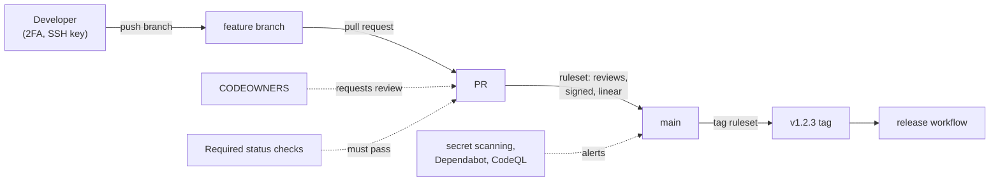
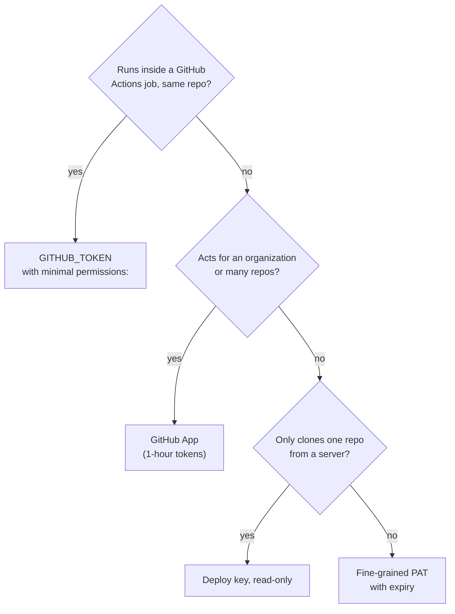

# Configuring a GitHub repository

## Why care?

Every later control in this chapter assumes that `main` contains only reviewed code. Signed commits, pinned actions, signed images: they all start from "the source is what the team agreed on". The repository settings are what make that true. Some real failures, none of them a bug in the product code:

- **PHP source server (2021).** Attackers pushed two commits to the project's own Git server, into `php-src`, under the names of two core developers. The commits added a backdoor. Nobody reviewed them before they landed, because direct pushes were allowed.
- **Codecov (2021).** An attacker changed a bash uploader script that thousands of CI jobs downloaded. The script sent the jobs' environment variables, with their tokens, to the attacker. Many of those tokens could write to repositories.
- **Stolen OAuth tokens (2022).** Attackers used OAuth tokens issued to Heroku and Travis CI to download private repositories of dozens of organizations, including npm. The tokens were long-lived and had wide scopes.
- **tj-actions/changed-files (2025).** A stolen personal access token gave write access to the action's repository. The attacker moved the version tags to a malicious commit. Nothing on GitHub stopped a tag from moving.

Each case has a matching setting: required reviews, short-lived credentials, least-privilege tokens, protected tags. On this page you read the real settings of public repositories with `gh api`, write a ruleset for `main` and `v*` tags as JSON, and score a repository with OpenSSF Scorecard.

## The idea: the repository is a security boundary

A GitHub repository holds three things that an attacker wants: the source, the credentials that CI uses, and the right to publish releases. The settings decide **who** may change each one, and **how**. Think of four layers, from the outside in:

1. **Accounts.** Who is this person? Strong login (two-factor authentication) and narrow, short-lived tokens for machines.
2. **Organization.** What may members and workflows do by default? Base permissions, who may create repositories, which actions may run, what the `GITHUB_TOKEN` may do.
3. **Repository rules.** How may a change reach `main` or a release tag? Pull request, reviews, status checks, signatures, no force push.
4. **Detection.** What do we learn when something slips through? Secret scanning, Dependabot alerts, code scanning, a way for outsiders to report a vulnerability.

The goal is a simple sentence you can check: **"No single person, and no single stolen token, can change `main` or a release without a second person seeing it."** Scorecard, at the end of the page, measures how close you are.



## Under the hood: accounts and credentials

### Two-factor authentication

GitHub requires two-factor authentication (2FA) for every account that contributes code on github.com. The second factor is not equal in strength:

| Second factor                   | Phishing-resistant? | Notes                                                                  |
| ------------------------------- | ------------------- | ---------------------------------------------------------------------- |
| SMS                             | No                  | SIM swap moves your number to the attacker's phone                     |
| TOTP app (6-digit code)         | No                  | A fake login page can ask for the code and use it within 30 seconds    |
| GitHub Mobile push              | No                  | Users approve prompts they did not start ("push fatigue")              |
| **Passkey** or **security key** | **Yes**             | The browser signs a challenge bound to `github.com`; a fake site fails |

A **passkey** is a WebAuthn credential: a key pair where the private key stays in a device (a phone, a laptop's secure chip, or a hardware key). The browser only uses it for the real domain, so a phishing site on `githuhb.com` gets nothing. For maintainers and organization owners, register at least two passkeys or security keys (one as a spare) and remove SMS. An organization can **require 2FA** for all members; members without it are removed.

### SSH keys for Git

Git over SSH uses a key pair. The [Git signing page](../git/config-hooks-signing.md#fido2-security-keys-sk) explains `ed25519-sk` keys: the private key lives on a hardware key and every use needs a touch. That matters here because an SSH key on GitHub can push to **every** repository your account can write to. A key in `~/.ssh` without a passphrase is a password stored in a file. Use `-sk` keys, or at least a passphrase and an agent, and delete keys you no longer use (`gh ssh-key list`).

The same key type can be registered twice: as an **authentication key** (to push) and as a **signing key** (to sign commits). They are separate entries on GitHub. [Signed commits](signed-commits.md) covers signing.

### Machine credentials: PATs, GitHub Apps, deploy keys

Scripts and other systems also need access. There are four choices. They differ in **whose** identity they use, **what** they can reach, and **how long** they live.

| Credential                          | Acts as         | Scope                                                    | Lifetime                   | Use for                                  |
| ----------------------------------- | --------------- | -------------------------------------------------------- | -------------------------- | ---------------------------------------- |
| Personal access token, classic      | You             | Every repository you can access, coarse scopes (`repo`)  | Can be set to never expire | Nothing new. Replace it                  |
| Personal access token, fine-grained | You             | Selected repositories, per-permission (`contents: read`) | Has an expiry date         | Personal scripts, short tasks            |
| GitHub App installation token       | The app (a bot) | Repositories the app is installed on, its permissions    | **1 hour**                 | Bots, CI across repositories, automation |
| Deploy key                          | One repository  | One repository, read-only or read-write                  | Until removed              | A server that only clones one repository |

The mechanism behind the ranking:

- A **classic PAT** with the `repo` scope can write to every repository you can write to, in every organization you belong to. When it leaks, the blast radius is your whole account. This is the kind of token behind the tj-actions incident.
- A **fine-grained PAT** names its repositories and permissions, and it must have an expiry date. An organization can require owner approval before a fine-grained PAT can reach its repositories, and can block classic PATs completely.
- A **GitHub App** has its own identity. It holds a private key, and with it asks GitHub for an **installation token** that expires after one hour. When a person leaves the team, the app keeps working, and nothing is tied to their account. Actions in the log show the app name, not a person.
- A **deploy key** is an SSH key attached to one repository. It is not tied to a person either, but it never expires, and with write access it can push to that repository. Prefer read-only.

Inside GitHub Actions you rarely need any of these. The job's `GITHUB_TOKEN` (see [CI pipelines](../delivery/ci-pipelines.md#the-github_token-and-permissions)) is created per job and expires with it. For cloud access, use OIDC, not a stored key: see [workload identity](../security/secrets-management.md#workload-identity) and [Workflow security](workflow-security.md).



## Under the hood: organization settings

Most repositories in a company live in an **organization**. Organization settings are defaults that every repository inherits. Set them once and new repositories start safe.

### Base permissions and repository creation

**Base permissions** are what every organization member gets on every repository: `No permission`, `Read`, `Write` or `Admin`. Set them to `No permission` or `Read`. Give `Write` through **teams** on the repositories a team owns. With `Write` as the base, one stolen account can push branches, open PRs and run workflows in every repository.

**Repository creation** decides which members may create repositories, and which visibility (public, private, internal). Limit public repository creation to a few people. A test repository made public by mistake is a common source of leaked secrets.

**Outside collaborators** are people who are not members but have access to some repositories. Review the list regularly. Owners can stop members from inviting them.

### Actions policy

Under **Settings → Actions → General**, the organization (or a single repository) decides four things:

1. **Which actions may run.** "Allow all actions" lets any workflow run code from any public repository. The safer option is "Allow _OWNER_, and select non-_OWNER_, actions and reusable workflows", with an allow list in `OWNER/REPOSITORY@TAG-OR-SHA` form. Wildcards such as `actions/*` work, and a `!` prefix blocks an entry. The same page has **"Require actions to be pinned to a full-length commit SHA"**: workflows that use `@v4` then fail. This turns the [SHA-pinning advice](../delivery/ci-pipelines.md#pin-actions-by-commit-sha) into a rule.
2. **Default `GITHUB_TOKEN` permissions.** "Read and write permissions" or "Read repository contents and packages permissions". Choose read. A workflow that needs more must then say so in its own `permissions:` block, where a reviewer can see it.
3. **"Allow GitHub Actions to create and approve pull requests".** Leave it off. Otherwise a workflow can open a PR and approve it, and the approval counts as a review.
4. **Approval for fork pull request workflows.** For public repositories, a workflow run from a fork PR can wait for a maintainer to approve it. The options are "Require approval for first-time contributors who are new to GitHub", "Require approval for first-time contributors", and "Require approval for all external contributors". The last one is the safest for repositories with expensive or sensitive CI: a drive-by PR can't run code on your runners at all until someone looks at it.

You can read all of this with `gh api`. This site's own repository, then a public fork of the same account:

```console
$ gh api repos/johankees/software-engineering-tutor/actions/permissions
{"enabled":true,"allowed_actions":"all","sha_pinning_required":false}
$ gh api repos/johankees/software-engineering-tutor/actions/permissions/workflow
{"default_workflow_permissions":"read","can_approve_pull_request_reviews":false}

$ gh api repos/johankees/dotfiles/actions/permissions/workflow
{"default_workflow_permissions":"write","can_approve_pull_request_reviews":true}
$ gh api repos/johankees/dotfiles/actions/permissions/fork-pr-contributor-approval
{"approval_policy":"first_time_contributors"}
```

Two repositories of the same person, two different results. The first has a read-only token by default. The second is an older fork: its token can write, and workflows may approve PRs. Defaults change over time, but existing repositories keep the value they had. That is why you read settings, and don't assume them. Both still allowed all actions and didn't require SHA pins when this page was written. The first one, this site's repository, has since been fixed: see [This repository's settings](#this-repositorys-settings).

## Under the hood: rulesets

### Branch protection and rulesets

GitHub has two ways to protect a branch:

- **Branch protection rules** (the older, "classic" way). One rule per branch name pattern. If two patterns match a branch, only one rule applies.
- **Rulesets** (the newer way). A named set of rules with a target (branches, tags, or pushes), conditions (which refs) and a bypass list. Many rulesets can match the same ref.

Use rulesets for new work. The reasons are about mechanism, not style:

- **Layering.** Rulesets have no priority. When several rulesets, or a ruleset and a branch protection rule, match the same ref, GitHub combines all their rules. If the same rule appears twice with different values, **the most restrictive version applies**. An organization ruleset ("every default branch needs one approval") and a repository ruleset ("this repo also needs CodeQL") add up, and a repository admin can't weaken the organization one.
- **Bypass lists.** You name exactly who may skip the rules: a repository role, a team, a GitHub App, or Dependabot. The mode is "Always allow" or "For pull requests only"; the second still forces a PR, but lets that actor merge it without the full set of checks. Classic protection has a single "do not allow bypassing" switch that either includes admins or not.
- **Enforcement status.** A ruleset is `active` or `disabled`, and on GitHub Enterprise also `evaluate`. In evaluate mode, nothing is blocked, but the **Rule insights** page shows which pushes and merges would have failed. You can roll out a strict rule, watch for a week, then switch it on. You can also disable a ruleset without deleting it.
- **Tag rulesets.** The same engine protects tags. The old "protected tags" feature was retired in 2024 and moved into rulesets.
- **Visibility.** Anyone with read access can see the active rulesets of a repository. With classic protection, only admins can read the settings.

Rulesets and classic protection are free on public repositories. On **private** repositories they need GitHub Pro, Team or Enterprise. You can see that limit with this site's repository, as it was when this page was written: private, on a free plan:

```console
$ gh api repos/johankees/software-engineering-tutor/rulesets
{"message":"Upgrade to GitHub Pro or make this repository public to enable this feature.","documentation_url":"https://docs.github.com/rest/repos/rules#get-all-repository-rulesets","status":"403"}
$ gh api repos/johankees/software-engineering-tutor/branches/main/protection
{"message":"Upgrade to GitHub Pro or make this repository public to enable this feature.","documentation_url":"https://docs.github.com/rest/branches/branch-protection#get-branch-protection","status":"403"}
```

So on this repository, nothing stopped a direct push to `main`. Many controls on this page (rulesets, secret scanning, CodeQL, private vulnerability reporting) were simply not available. The fix was to make the repository public, after a `gitleaks` scan of the whole history found only documented examples, and then to apply the settings as code. The next section and [This repository's settings](#this-repositorys-settings) show how.

### Reading a real ruleset

`ossf/scorecard` (the Scorecard project itself) uses rulesets. `gh ruleset list` shows three, and `gh ruleset check` shows what applies to one branch after layering:

```console
$ gh ruleset list -R ossf/scorecard
24134169	code-review	ossf/scorecard (repo)	active	1
24131809	main	ossf/scorecard (repo)	active	5
25283967	release-tags	ossf/scorecard (repo)	active	3

$ gh ruleset check main -R ossf/scorecard
6 rules apply to branch main in repo ossf/scorecard

- deletion
  (configured in ruleset 24131809 from repository ossf/scorecard)

- non_fast_forward
  (configured in ruleset 24131809 from repository ossf/scorecard)

- pull_request: [...] [require_code_owner_review: false] [require_last_push_approval: false] [required_approving_review_count: 1] [required_review_thread_resolution: true] [...]
  (configured in ruleset 24134169 from repository ossf/scorecard)

- pull_request: [...] [require_code_owner_review: false] [require_last_push_approval: false] [required_approving_review_count: 0] [required_review_thread_resolution: false] [...]
  (configured in ruleset 24131809 from repository ossf/scorecard)

- required_linear_history
  (configured in ruleset 24131809 from repository ossf/scorecard)

- required_status_checks: [do_not_enforce_on_create: true] [required_status_checks: [map[context:CodeQL integration_id:57789] map[context:dependency-review integration_id:15368] ... map[context:unit-test integration_id:15368]]] [strict_required_status_checks_policy: true]
  (configured in ruleset 24131809 from repository ossf/scorecard)
```

(The `pull_request` lines are trimmed with `[...]`; the full lines also list merge methods and dismissal settings.)

Layering is visible here. Two rulesets each have a `pull_request` rule: one asks for 0 approvals, the other for 1. The effective rule is 1 approval, with all review threads resolved. The status checks name an `integration_id` too: `15368` is GitHub Actions and `57789` is the CodeQL app. A check with the same name, reported by another app or by a person through the statuses API, does not count. Without that pin, anyone with write access could post a green "unit-test" status from their laptop.

The full ruleset as JSON is what you would store as code. Trimmed to the shape:

```console
$ gh api repos/ossf/scorecard/rulesets/24131809 --jq '{name,target,enforcement,conditions,rules: [.rules[].type],bypass_actors}'
{"bypass_actors":null,"conditions":{"ref_name":{"exclude":[],"include":["~DEFAULT_BRANCH"]}},"enforcement":"active","name":"main","rules":["deletion","non_fast_forward","required_linear_history","required_status_checks","pull_request"],"target":"branch"}
```

`~DEFAULT_BRANCH` follows the default branch, even if it is renamed. `bypass_actors` is `null` because only admins may see who can bypass: a reader learns the rules, not the exceptions.

The tag ruleset:

```console
$ gh api repos/ossf/scorecard/rulesets/25283967 --jq '{name,target,enforcement,conditions,rules}'
{"conditions":{"ref_name":{"exclude":[],"include":["~ALL"]}},"enforcement":"active","name":"release-tags","rules":[{"type":"creation"},{"type":"update"},{"type":"deletion"}],"target":"tag"}
```

No one outside the bypass list may create, move or delete **any** tag. That is exactly the control the tj-actions repository lacked.

### The rules for `main`, and why each one

| Rule (UI name / API `type`)                                                        | What it stops                                                                                               |
| ---------------------------------------------------------------------------------- | ----------------------------------------------------------------------------------------------------------- |
| Require a pull request before merging / `pull_request`                             | Direct pushes to `main`. Every change gets a PR, a diff and a log                                           |
| Required approvals / `required_approving_review_count`                             | One person merging their own change. Set at least 1                                                         |
| Dismiss stale approvals / `dismiss_stale_reviews_on_push`                          | "Approve, then push something else." A new push that changes the diff removes the approval                  |
| Require review from Code Owners / `require_code_owner_review`                      | A change to sensitive paths approved by someone who doesn't own them                                        |
| Require approval of the most recent reviewable push / `require_last_push_approval` | The last pusher approving their own push. Someone other than the last pusher must approve                   |
| Require conversation resolution / `required_review_thread_resolution`              | Merging with open review comments                                                                           |
| Require status checks / `required_status_checks` (strict, with app)                | Merging red or untested code; strict mode also needs the branch to be up to date with `main`                |
| Require signed commits / `required_signatures`                                     | Commits without a verified signature. Details and merge-method traps in [Signed commits](signed-commits.md) |
| Require linear history / `required_linear_history`                                 | Merge commits. History is a straight line, easier to audit and to bisect                                    |
| Block force pushes / `non_fast_forward`                                            | Rewriting history that people already reviewed and deployed                                                 |
| Restrict deletions / `deletion`                                                    | Deleting `main` (and with it, the protection) and creating it again                                         |

Two rules close a gap together. With only "1 approval", an attacker with one stolen account opens a harmless PR, waits for a real approval, then pushes a malicious commit and merges. **Dismiss stale approvals** removes the approval when the diff changes. **Require last-push approval** makes sure the person who pushed last is not the only approver, which also covers the case where a reviewer adds a commit to someone else's PR and approves it themselves.

A newer option (in public preview) covers pull requests that the Copilot coding agent opens under its own app identity: they need one more approval than configured. It is on by default, and you see it as `require_extra_approval_for_unattributed_changes` in the API output above.

### CODEOWNERS

A **CODEOWNERS** file maps path patterns to owners (users or teams). GitHub looks for it in `.github/`, the repository root, then `docs/`, and uses the first one found. Patterns use `.gitignore` syntax, and **the last matching line wins**. Owners need write access. When a PR changes a matching file, GitHub requests a review from the owners. With "Require review from Code Owners" on, their approval is required.

The real file of `sigstore/cosign`, in the repository root:

```console
$ gh api repos/sigstore/cosign/contents/CODEOWNERS --jq .content | base64 -d
* @sigstore/cosign-codeowners

/.github/ @sigstore/dep-maintainers
/release/ @sigstore/dep-maintainers
go.mod @sigstore/dep-maintainers
go.sum @sigstore/dep-maintainers
```

Everything belongs to the main team. The files that control **how code is built and released** (workflows, release config, dependencies) belong to a smaller team. That is the important part. Without it, a contributor can change `.github/workflows/release.yml` in an ordinary PR, and an ordinary reviewer may not notice what that means.

Also protect the file itself. If anyone may edit CODEOWNERS, they can make themselves owner of everything in the same PR. When the file lives in `.github/`, a rule like `/.github/ @org/platform-security` covers it. The cosign file lives in the root, so only the `*` line matches it: any member of the main team can change who owns the workflows. A line `/CODEOWNERS @sigstore/dep-maintainers` would close that gap.

GitHub skips lines with errors silently in the review flow. Check them with the API:

```console
$ gh api repos/sigstore/cosign/codeowners/errors
{"errors":[]}
```

### Settings as code

Clicking through settings pages doesn't scale, and leaves no history. Rulesets are JSON, so you can keep them in a repository, review changes to them in PRs, and apply them with `gh api`. Here is a ruleset for `main` that follows the table above. Save it as `ruleset-main.json`:

```json
{
  "name": "main",
  "target": "branch",
  "enforcement": "active",
  "conditions": {
    "ref_name": { "include": ["~DEFAULT_BRANCH"], "exclude": [] }
  },
  "bypass_actors": [],
  "rules": [
    { "type": "deletion" },
    { "type": "non_fast_forward" },
    { "type": "required_linear_history" },
    { "type": "required_signatures" },
    {
      "type": "pull_request",
      "parameters": {
        "required_approving_review_count": 1,
        "dismiss_stale_reviews_on_push": true,
        "require_code_owner_review": true,
        "require_last_push_approval": true,
        "required_review_thread_resolution": true,
        "allowed_merge_methods": ["squash"]
      }
    },
    {
      "type": "required_status_checks",
      "parameters": {
        "strict_required_status_checks_policy": true,
        "required_status_checks": [
          { "context": "check", "integration_id": 15368 }
        ]
      }
    }
  ]
}
```

`bypass_actors` is empty on purpose: no one, not even an admin, merges without a review. In an emergency an admin can still change the ruleset, and that change is logged in the audit log. The `context` must be the exact job name that CI reports (here, the `check` job of `ci.yml`), and `15368` pins it to GitHub Actions.

A tag ruleset for releases, `ruleset-tags.json`:

```json
{
  "name": "release-tags",
  "target": "tag",
  "enforcement": "active",
  "conditions": {
    "ref_name": { "include": ["refs/tags/v*"], "exclude": [] }
  },
  "bypass_actors": [
    { "actor_id": 5, "actor_type": "RepositoryRole", "bypass_mode": "always" }
  ],
  "rules": [
    { "type": "creation" },
    { "type": "update" },
    { "type": "deletion" }
  ]
}
```

Only repository admins (role ID `5`) may create `v*` tags. No one may move or delete them except admins. Role IDs are fixed numbers, not names, and the API does not explain them. To confirm one, add the role as a bypass actor in the web UI and use **Export ruleset**: the exported JSON shows the ID. In a larger team, replace the role with a release team (`"actor_type": "Team"`) or a release GitHub App (`"actor_type": "Integration"`).

The commands to apply them. They are shown here, not run: they change a repository.

```sh
gh api --method POST repos/OWNER/REPO/rulesets --input ruleset-main.json
gh api --method POST repos/OWNER/REPO/rulesets --input ruleset-tags.json
gh api --method PUT  repos/OWNER/REPO/rulesets/RULESET_ID --input ruleset-main.json  # update later
```

For many repositories, use an organization ruleset (`orgs/ORG/rulesets`, with a `repository_name` condition) or a tool such as the GitHub Terraform provider (`github_repository_ruleset`, see [Infrastructure as code](../delivery/infrastructure-as-code.md)). A scheduled job that compares `gh api .../rulesets` with the stored JSON finds drift: someone "temporarily" changed a setting.

## Under the hood: detection and disclosure

Rules stop known-bad actions. Detection finds what got through, or what was already there.

### Secret scanning and push protection

**Secret scanning** looks for known token formats (AWS keys, GitHub tokens, Slack webhooks, and a few hundred more) in the whole Git history, issues and PRs. For many providers, GitHub tells the provider, and the provider revokes the token. **Push protection** goes further: it checks a push **before** GitHub accepts it, and rejects it if it contains a secret. The developer sees the file and line in the `git push` error. Bypassing needs a reason, and the bypass creates an alert.

Both are free on public repositories. Private repositories need **GitHub Secret Protection** (a paid product for Team and Enterprise). You read the state in the repository's `security_and_analysis` field. It is only visible to admins: for a public repository you don't own, it is `null`.

```console
$ gh api repos/johankees/dotfiles --jq '.security_and_analysis'
{"dependabot_security_updates":{"status":"disabled"},"secret_scanning":{"status":"enabled"},"secret_scanning_non_provider_patterns":{"status":"disabled"},"secret_scanning_push_protection":{"status":"enabled"},"secret_scanning_validity_checks":{"status":"disabled"}}

$ gh api repos/ossf/scorecard --jq '.security_and_analysis'
null
```

`secret_scanning_validity_checks` asks the provider whether a found token still works, so you fix live ones first. `non_provider_patterns` adds generic patterns such as private keys and connection strings, with more false positives. Push protection only knows formats; it does not replace keeping secrets out of the repository in the first place (see [Secrets management](../security/secrets-management.md)).

### Dependabot alerts and security updates

**Dependabot alerts** compare the dependency graph (`go.mod`, `package-lock.json`, workflow `uses:` lines and more) with the GitHub Advisory Database. **Dependabot security updates** then open a PR that bumps the vulnerable dependency to the first fixed version. Both are free on all repositories. Alerts are not reachability analysis: for Go, keep `govulncheck` as the gate, as shown on [Supply chain security](../security/supply-chain.md#under-the-hood-known-vulnerabilities-with-govulncheck). Version updates (all updates, not only security fixes), grouping and cooldown belong to [Dependencies](dependencies.md).

```console
$ gh api repos/johankees/dotfiles/vulnerability-alerts -i | head -1
HTTP/2.0 404 Not Found
$ gh api repos/johankees/dotfiles/automated-security-fixes
{"enabled":false,"paused":false}
```

The `404` from `vulnerability-alerts` means "alerts are off" (`204` would mean on). An unusual way to answer, but documented.

### Code scanning with CodeQL default setup

**Code scanning** runs a static analyzer and shows the results as alerts on the repository and as annotations on PRs. **CodeQL** is GitHub's analyzer; it builds a database of the code and runs queries for flaws such as SQL injection or path traversal. **Default setup** is a switch in Settings → Code security: GitHub picks the languages, runs on pushes, PRs and weekly, and you write no workflow. Use **advanced setup** (a workflow file) only when you need custom queries or a special build. Free on public repositories; private ones need **GitHub Code Security**. A ruleset rule (`code_scanning`) can then block merges on new alerts above a severity.

### Private vulnerability reporting, SECURITY.md and advisories

A security researcher who finds a bug needs a private way to tell you. Without one, they open a public issue, and everyone learns about the hole before the fix.

- **`SECURITY.md`** in the root, `.github/` or `docs/` says how to report, which versions get fixes, and how fast you answer. GitHub links it from the Security tab.
- **Private vulnerability reporting** (public repositories) adds a "Report a vulnerability" button. The report becomes a draft **security advisory**, visible only to maintainers and the reporter.
- A **security advisory** is the private workspace for the fix: you can discuss it, create a temporary private fork to develop the patch, request a **CVE** ID from GitHub, and then publish. Publishing adds it to the Advisory Database, so Dependabot alerts everyone who depends on the affected versions.

```console
$ gh api repos/ossf/scorecard/private-vulnerability-reporting
{"enabled":true}
$ gh api 'repos/sigstore/cosign/security-advisories?per_page=3' --jq '.[] | {ghsa_id, cve_id, severity, summary}'
{"cve_id":null,"ghsa_id":"GHSA-fx35-mq7g-6g98","severity":"high","summary":"Verification bypass via public key in legacy bundle"}
{"cve_id":"CVE-2026-39395","ghsa_id":"GHSA-w6c6-c85g-mmv6","severity":"medium","summary":"verify-blob-attestation reports false positive when payload parsing fails"}
{"cve_id":"CVE-2026-24122","ghsa_id":"GHSA-wfqv-66vq-46rm","severity":"low","summary":"Signatures considered valid with certificates that outlive expired CA certificates"}
```

That is the normal life of a mature project: vulnerabilities are found, reported privately, fixed, and published with an ID that tools understand.

### Environments

An **environment** (for example `production`) is a named target for deployments. It can have **required reviewers** (a person must approve the job before it runs), a **wait timer**, and **deployment branch rules** (only `main` or `v*` tags may deploy). Its secrets are only given to jobs that reference the environment and pass those rules. So a workflow on a feature branch can't read production secrets, even if someone edits it. This site deploys through one:

```console
$ gh api repos/johankees/software-engineering-tutor/environments --jq '.environments[] | {name, protection_rules, deployment_branch_policy}'
{"deployment_branch_policy":{"custom_branch_policies":true,"protected_branches":false},"name":"github-pages","protection_rules":[{"id":74242560,"node_id":"GA_kwDOV-C1Xc4EbNoA","type":"branch_policy"}]}
```

A branch policy, but no required reviewer. [Workflow security](workflow-security.md) explains how to design environments, and why they are the right place for deploy credentials.

## Under the hood: OpenSSF Scorecard

**OpenSSF Scorecard** is an automated check of a repository's security practices. It reads the repository through the GitHub API and gives each practice a score from 0 to 10, plus a weighted total. It answers "how is this project run?", not "is this code safe?". You use it two ways: on **your** repositories to find gaps, and on **dependencies** before you adopt them (see [Dependencies](dependencies.md)).

The main checks:

| Check                                                                                                                 | Looks for                                                                        |
| --------------------------------------------------------------------------------------------------------------------- | -------------------------------------------------------------------------------- |
| `Branch-Protection`                                                                                                   | Rules on the default and release branches: reviews, status checks, no force push |
| `Code-Review`                                                                                                         | Recent changes merged through reviewed PRs                                       |
| `Dangerous-Workflow`                                                                                                  | `pull_request_target` with untrusted checkout, script injection in `run:`        |
| `Token-Permissions`                                                                                                   | Workflows with read-only top-level `permissions:`                                |
| `Pinned-Dependencies`                                                                                                 | Actions pinned by SHA, container images by digest, no `curl \| bash`             |
| `Dependency-Update-Tool`                                                                                              | Dependabot or Renovate configured                                                |
| `Security-Policy`                                                                                                     | A `SECURITY.md`                                                                  |
| `SAST`                                                                                                                | CodeQL or another static analyzer on every commit                                |
| `Signed-Releases`                                                                                                     | Signatures or provenance attached to releases                                    |
| `Vulnerabilities`                                                                                                     | Open OSV advisories against the project's dependencies                           |
| `Binary-Artifacts`, `Fuzzing`, `Maintained`, `License`, `CI-Tests`, `Contributors`, `Packaging`, `CII-Best-Practices` | Further signals                                                                  |

### Reading a real score

The Scorecard project scans popular open-source repositories every week and publishes results in a public API. Here is `sigstore/cosign`, trimmed with `jq`:

```console
$ curl -s https://api.securityscorecards.dev/projects/github.com/sigstore/cosign \
    | jq '{date, scorecard: .scorecard.version, score, checks: [.checks[] | "\(.score)  \(.name): \(.reason)"]}'
{
  "date": "2026-11-28T01:30:50Z",
  "scorecard": "v5.7.0",
  "score": 8.7,
  "checks": [
    "10  Dependency-Update-Tool: update tool detected",
    "10  Dangerous-Workflow: no dangerous workflow patterns detected",
    "10  Maintained: 30 commit(s) and 1 issue activity found in the last 90 days -- score normalized to 10",
    "10  Binary-Artifacts: no binaries found in the repo",
    "10  Code-Review: all changesets reviewed",
    "0  Token-Permissions: detected GitHub workflow tokens with excessive permissions",
    "2  CII-Best-Practices: badge detected: InProgress",
    "10  License: license file detected",
    "10  Vulnerabilities: 0 existing vulnerabilities detected",
    "7  SAST: SAST tool detected but not run on all commits",
    "-1  Branch-Protection: internal error: error during branchesHandler.setup: internal error: some github tokens can't read classic branch protection rules: https://github.com/ossf/scorecard-action/blob/main/docs/authentication/fine-grained-auth-token.md",
    "10  Packaging: packaging workflow detected",
    "10  Fuzzing: project is fuzzed",
    "8  Pinned-Dependencies: dependency not pinned by hash detected -- score normalized to 8",
    "10  Security-Policy: security policy file detected",
    "9  Signed-Releases: 5 out of the last 5 releases have a total of 5 signed artifacts and 3 immutable releases.",
    "10  CI-Tests: 28 out of 28 merged PRs checked by a CI test -- score normalized to 10",
    "10  Contributors: project has 76 contributing companies or organizations"
  ]
}
```

Three lessons in this output:

- **A low score names a concrete fix.** The `details` field says which file and line:

  ```console
  $ curl -s https://api.securityscorecards.dev/projects/github.com/sigstore/cosign \
      | jq -r '.checks[] | select(.name=="Token-Permissions") | .details[] | select(startswith("Warn"))'
  Warn: no topLevel permission defined: .github/workflows/cut-release.yml:1
  Warn: no topLevel permission defined: .github/workflows/e2e-tests.yml:1
  Warn: no topLevel permission defined: .github/workflows/tests.yaml:1
  ```

  Three workflows have no top-level `permissions:` block, so they run with the repository default. If that default is "read and write", every job in them can push. A one-line fix each: `permissions: {}` at the top, more per job.

- **`-1` means "could not check", not "bad".** `Branch-Protection` failed because the scanner's token can't read classic branch protection on a repository it doesn't administer. You saw the same `404` earlier. Rulesets are readable by everyone; classic protection is not. This is one more reason to use rulesets.
- **A score is a summary, not a verdict.** 8.7 is good. Still, read the 0 and the -1 before you trust the 8.7.

### Running Scorecard yourself

The `scorecard` CLI runs the same checks with your own token. It can also see private repositories and admin-only settings:

!!! tip "New tool: `scorecard`"

    ```sh
    mise use scorecard@5.7.0
    ```

    This adds it to the project's `mise.toml`, pinned to an exact version. See [Adding tools as you go](../toolbox/mise.md#adding-tools-as-you-go).

```sh
export GITHUB_AUTH_TOKEN="$(gh auth token)"
scorecard --repo=github.com/sigstore/cosign --checks=Token-Permissions,Pinned-Dependencies --show-details
```

<!-- TODO(real-output): the scorecard CLI is not installed in the authoring environment; the public API output above has the same checks, scores and details. -->

### The Scorecard workflow

To get a score for your own repository on every change, run `ossf/scorecard-action`. It uploads results to code scanning (alerts on the Security tab) and, for public repositories, publishes them to the public API and the badge.

```yaml
# .github/workflows/scorecard.yml
name: scorecard

on:
  branch_protection_rule: # re-score when protection changes
  schedule:
    - cron: "30 4 * * 1" # weekly, Monday 04:30 UTC
  push:
    branches: [main]

permissions: {}

jobs:
  analysis:
    runs-on: ubuntu-latest
    permissions:
      contents: read
      security-events: write # upload SARIF to code scanning
      id-token: write # sign the published results (OIDC)
    steps:
      - uses: actions/checkout@3d3c42e5aac5ba805825da76410c181273ba90b1 # v7.0.1
        with:
          persist-credentials: false

      - uses: ossf/scorecard-action@23f22cd43608bae7a1f1fa2603d7314dee9538a5 # v2.6.0
        with:
          results_file: results.sarif
          results_format: sarif
          publish_results: true # public repositories only

      - uses: actions/upload-artifact@043fb46d1a93c77aae656e7c1c64a875d1fc6a0a # v7.0.1
        with:
          name: scorecard-sarif
          path: results.sarif
          retention-days: 5

      - uses: github/codeql-action/upload-sarif@915412ff23e8b7659517e607487dbeae018f2934 # v4.39.5
        with:
          sarif_file: results.sarif
```

The SHAs were resolved with `git ls-remote --tags`; `scorecard-action` and `codeql-action` use annotated tags, so the pins are the peeled `^{}` commits. `publish_results: true` adds requirements: the workflow may only use a small set of approved actions and no `run:` steps in that job, so a modified workflow can't publish fake results. The published results are signed with the job's OIDC identity, which is why `id-token: write` is there.

## Try it

You need `gh` (logged in), `jq` and `curl`. Everything here only reads.

1. Score a dependency you use. Pick one from your `go.mod`:

   ```sh
   curl -s https://api.securityscorecards.dev/projects/github.com/OWNER/REPO \
     | jq -r '.checks[] | "\(.score)\t\(.name)"' | sort -n
   ```

   Read the lowest three. Would they change your decision to use it?

2. Compare effective rules on two public repositories:

   ```sh
   gh ruleset check main -R ossf/scorecard
   gh api repos/golang/go/rules/branches/master
   ```

   An empty `[]` does not mean "unprotected". The project may use classic protection, or review outside GitHub (Go uses Gerrit).

3. Audit a repository you administer. Read the four groups of settings and write down each value:

   ```sh
   R=OWNER/REPO
   gh api repos/$R --jq '{visibility, allow_merge_commit, allow_squash_merge, allow_rebase_merge, security_and_analysis}'
   gh api repos/$R/actions/permissions
   gh api repos/$R/actions/permissions/workflow
   gh api repos/$R/rulesets
   gh api repos/$R/codeowners/errors
   gh api repos/$R/private-vulnerability-reporting
   ```

4. Write `ruleset-main.json` for that repository with your real CI job names. Validate it by reading, not writing: compare the `context` values with `gh api repos/$R/commits/main/check-runs --jq '.check_runs[].name'`. Apply it only through your normal change process.

## Traps

- **"Admins can bypass, it's fine."** Then a stolen admin account bypasses too. Keep the bypass list empty for `main`, or "For pull requests only", and keep the number of admins small.
- **Required checks by name only.** Anyone with write access can post a commit status with that name. Pin the check to the GitHub Actions app (`integration_id`).
- **Approve, then push.** Without "dismiss stale approvals" and "require last-push approval", an approval stays valid for code the reviewer never saw.
- **CODEOWNERS that doesn't cover `.github/`.** Workflows decide what runs with your secrets. An ordinary PR that edits them is the shortest path to production credentials.
- **A required check that never runs.** If a workflow has `paths:` filters, its check doesn't run on PRs that touch other paths, and the PR waits forever. Teams then remove the requirement. Use a job that always runs and decides inside.
- **Classic PATs in CI secrets.** A leaked classic PAT is a leaked user, across every organization. Use a GitHub App, `GITHUB_TOKEN`, or OIDC.
- **Assuming defaults.** Old repositories keep old defaults (write tokens, all actions allowed). Read the settings; don't trust the date the documentation changed.
- **Protecting `main` but not tags.** Release workflows usually start from a tag. If anyone with write access can push `v9.9.9`, they can start a release from any commit.
- **Private repository on a free plan.** Rulesets, push protection and CodeQL are not available. The API returns `403`; the UI simply doesn't show the options. Know which plan protects which repository.

## A checklist of settings

| Area         | Setting                                                           | Value                                    |
| ------------ | ----------------------------------------------------------------- | ---------------------------------------- |
| Account      | 2FA                                                               | Passkey or security key, 2 registered    |
| Account      | SSH keys                                                          | `-sk` or passphrase; unused keys removed |
| Organization | Require 2FA                                                       | On                                       |
| Organization | Base permissions                                                  | `No permission` or `Read`                |
| Organization | Classic PATs                                                      | Blocked; fine-grained PATs need approval |
| Organization | Public repository creation                                        | Owners only                              |
| Actions      | Allowed actions                                                   | Own org + allow list                     |
| Actions      | Require actions pinned to a full-length commit SHA                | On                                       |
| Actions      | Default `GITHUB_TOKEN` permissions                                | Read                                     |
| Actions      | Allow Actions to create and approve pull requests                 | Off                                      |
| Actions      | Fork PR workflow approval                                         | All external contributors                |
| `main`       | Ruleset: PR, 1+ approval, stale dismissal, last-push, code owners | Active, empty bypass list                |
| `main`       | Required status checks, strict, pinned to app                     | On                                       |
| `main`       | Signed commits, linear history, no force push, no deletion        | On                                       |
| Tags         | Ruleset on `refs/tags/v*`: creation, update, deletion             | Release team or app only                 |
| Repository   | CODEOWNERS covers `.github/`, release config, `go.mod`, itself    | Yes, no errors                           |
| Detection    | Secret scanning + push protection                                 | On                                       |
| Detection    | Dependabot alerts + security updates                              | On                                       |
| Detection    | Code scanning, CodeQL default setup                               | On                                       |
| Disclosure   | `SECURITY.md` + private vulnerability reporting                   | Present, on                              |
| Deploy       | Environments with branch rules and reviewers                      | For every deploy target                  |
| Measurement  | Scorecard workflow                                                | Weekly and on push                       |

## This repository's settings

This site's repository applies the checklist above to itself, as code that is reviewed like any other change:

| File                                 | What it holds                                                                                           |
| ------------------------------------ | ------------------------------------------------------------------------------------------------------- |
| `.github/rulesets/main.json`         | The ruleset for `main`                                                                                  |
| `.github/rulesets/release-tags.json` | The ruleset for `v*` tags                                                                               |
| `scripts/github-settings.sh`         | `apply` writes every setting with `gh api`; `check` reads them back and fails on drift                  |
| `.github/CODEOWNERS`                 | Owner of everything, repeated for `.github/`, `scripts/`, `mise.toml`, `mise.lock` and `.gitleaks.toml` |
| `SECURITY.md`                        | How to report a problem: private vulnerability reporting                                                |
| `.github/workflows/scorecard.yml`    | Scorecard, weekly and on every push to `main`                                                           |

`scripts/github-settings.sh apply` makes the repository public, allows only squash merges (with auto-merge and branch deletion), turns on secret scanning with push protection, Dependabot alerts and security updates, private vulnerability reporting, immutable releases and CodeQL default setup. It sets the Actions policy to GitHub's own actions plus an allow list of three (`jdx/mise-action`, `ossf/scorecard-action`, `step-security/harden-runner`), **requires SHA pins**, keeps the token read-only, and asks for approval before fork PRs from any outside contributor run. Then it creates or updates both rulesets from their JSON files. `mise run github:check` runs the read-only half; a difference means someone changed a setting by hand.

The `main` ruleset is the one from [Settings as code](#settings-as-code), with one honest change. This repository has **one maintainer**, and GitHub never counts an author's approval of their own PR. So `required_approving_review_count` is 0, and code-owner review and last-push approval are off: with them on, no PR could ever merge. What still holds for every change: it must arrive as a PR, every commit must be signed (by GitHub's rule, **and** by a key in `.github/allowed_signers`, checked by the `Commit signatures` job), the four required checks must pass on an up-to-date branch, and nobody, admins included, is on the bypass list. When a second maintainer joins, the review rules go back on in the same JSON file.

## Check yourself

??? question "1. A teammate wants to give the release bot a classic PAT with the `repo` scope, \"because it just works\". What do you propose, and why is it safer?"

    A GitHub App installed only on the repositories the bot needs, with only the
    permissions it needs (for example `contents: write`). The app gets installation tokens
    that expire after one hour and belong to the app, not to a person. A classic `repo` PAT
    acts as the person, reaches every repository they can write to, and may never expire.
    If it leaks, the attacker is that person.

??? question "2. An organization ruleset requires 1 approval on every default branch. A repository ruleset for the same branch requires 0 approvals. How many approvals are needed, and why?"

    One. Rulesets have no priority; GitHub combines all rulesets and branch protection
    rules that match a ref, and for the same rule the most restrictive value applies. That
    is the point of layering: a repository admin can add rules, but can't weaken the
    organization's rules from inside the repository.

??? question "3. The ruleset requires 1 approval. Alice opens a PR, Bob approves it, then Alice pushes one more commit and merges. Which two settings would have stopped this, and how?"

    "Dismiss stale approvals when new commits are pushed" removes Bob's approval when the
    diff changes, so the PR needs a new approval. "Require approval of the most recent
    reviewable push" requires the latest push to be approved by someone other than the
    person who pushed it. Together they make sure a second person approved the exact code
    that merges.

??? question "4. Your required status check is named `test`. Why does the ruleset also store an `integration_id`?"

    Anyone with write access can set a commit status named `test` through the statuses
    API, from any machine. The `integration_id` (for example `15368` for GitHub Actions)
    says that only a check from that app counts. Without it, a "green" check proves
    nothing about what ran.

??? question "5. CODEOWNERS has `* @org/devs` as its only line. Which risk does this leave open, and what lines would you add?"

    Any developer can change workflows, release configuration and CODEOWNERS itself, and
    another developer approves it as an ordinary change. Add later lines (the last match
    wins) such as `/.github/ @org/platform-security`, `/release/ @org/release`,
    `go.mod @org/release`, `go.sum @org/release` and `/CODEOWNERS @org/platform-security`
    if the file is in the root. Then turn on "Require review from Code Owners".

??? question "6. Scorecard gives your public repository `-1` for `Branch-Protection` even though `main` is protected. What does `-1` mean, and what change fixes it?"

    `-1` means the check could not run, not that protection is missing. Classic branch
    protection is only readable by admins, and the scanner's token is not an admin of
    your repository. Rulesets are readable by everyone with read access, so moving the
    protection to rulesets lets Scorecard (and your developers) see it.

??? question "7. Why is a tag ruleset on `v*` part of supply chain security, and not only tidiness?"

    The release workflow builds and signs what a `v*` tag points to, and users and
    tools trust tags as versions. If anyone with write access can create or move a tag,
    they can release any commit, including one that never passed review, or move an
    existing version to a malicious commit (as in the tj-actions attack). Restricting
    creation, update and deletion to a release team or app closes that path.

## Recap

- The repository is a security boundary for source, CI credentials and releases. Goal: **no single person or token changes `main` or a release alone**.
- **Accounts:** passkeys or security keys for 2FA, `-sk` SSH keys. **Machines:** `GITHUB_TOKEN` or OIDC inside Actions, GitHub Apps (1-hour tokens) for bots, read-only deploy keys for one-repo servers, fine-grained PATs at most. Retire classic PATs.
- **Organization:** read-only base permissions, few people who create public repositories, an allow list of actions with **SHA pinning required**, read-only default `GITHUB_TOKEN`, no PR approval by Actions, approval for fork PR workflows.
- **Rulesets** over classic protection: they **layer** (most restrictive wins), have explicit **bypass lists**, an **evaluate** mode, cover **tags**, and are readable by everyone.
- For `main`: PR, 1+ approval, **dismiss stale approvals**, **last-push approval**, code owners, strict status checks pinned to an app, signed commits, linear history, no force push or deletion. For `v*` tags: only the release team or app.
- **CODEOWNERS** must cover `.github/`, release config, dependency files and itself.
- **Detection:** secret scanning with push protection, Dependabot alerts and security updates, CodeQL default setup. **Disclosure:** `SECURITY.md`, private vulnerability reporting, security advisories with CVEs.
- Keep settings **as code** (`gh api`, ruleset JSON, Terraform), check for drift, and measure with **OpenSSF Scorecard**: read the low and `-1` checks, not only the total.

Next: [Signed commits](signed-commits.md), where you make the "require signed commits" rule work for every commit, merge method and release tag.
