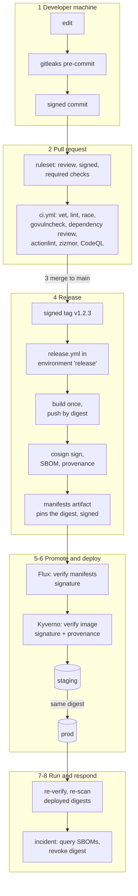

# A secure pipeline, commit to deploy

## Why care?

The earlier pages of this chapter each secure one link. This page connects them, because an attacker only needs the **weakest** link:

- Branch rules on `main` are perfect, but the release workflow runs on any tag, and anyone with write access can push a tag from a laptop.
- Every image is signed, but the cluster never checks the signature.
- The cluster checks signatures, but it accepts **any** Sigstore signature. Anyone can get one for free with a GitHub account.
- Production runs a verified digest, but the Flux manifests that choose the digest come from an unsigned source.
- A vulnerability in a library is announced on Friday. Nobody can say which of 40 services contain it, because the SBOMs were written to build logs and never kept.

On this page one change to `ordersd` travels from a developer's editor to a running pod. At each stage you see the control, the threat it stops, and the real file or command. You get four complete files to copy: `ci.yml`, `release.yml`, a Kyverno policy and a Flux source. At the end there is a one-page checklist and a mapping to SLSA.

## The idea: one change, eight gates

A **control** is a check that can say "no". A pipeline is secure when every way to production passes the same controls, and the last control (in the cluster) checks the evidence that the earlier ones produced.



What each stage adds, and what the next stage can rely on:

| Stage           | Produces                                     | Next stage relies on                         |
| --------------- | -------------------------------------------- | -------------------------------------------- |
| 1. Developer    | A signed commit with no secrets in it        | "This commit came from a known person"       |
| 2. Pull request | A reviewed change that passed every check    | "Only reviewed, green code is on `main`"     |
| 3. Merge        | A commit on `main`                           | "The tag points to code that passed CI"      |
| 4. Release      | One image digest, signed, with SBOM and SLSA | "This digest was built by our workflow"      |
| 5. Promotion    | The same digest in staging, then production  | "Prod runs what staging tested, bit for bit" |
| 6. Deploy       | A pod that admission control let in          | "Nothing unsigned or foreign runs"           |
| 7. Runtime      | A fresh verdict on what is running now       | "New advisories are noticed"                 |
| 8. Incident     | A list of affected digests; a block rule     | "We can find and stop a bad release"         |

### The worked example

The application repository is `acme/orders`: the contents of `examples/orders` in this site's repository, plus a `deploy/` folder with a Kustomize base (Deployment and Service, `image: ordersd`, see [Packaging](../kubernetes/packaging.md)). The clusters read a separate **fleet** repository, as in [GitOps](../delivery/gitops.md#environment-promotion-staging-then-production). The image is `ghcr.io/acme/ordersd`.

Every tool comes from `mise`, at one exact version, with checksums in `mise.lock` (see [Tools: the `tool` directive and `mise.lock`](dependencies.md#tools-the-tool-directive-and-miselock)). In this site's repository they are already in `mise.toml`. In your own repository, add them with `mise use`, for example `mise use cosign@3.1.6 syft@1.57.2 flux2@2.10.1 gitleaks@8.30.1 zizmor@1.33.1`. The `acme/orders` file:

```toml
# mise.toml in acme/orders: every tool, one exact version. mise.lock holds the checksums.
[tools]
go = "1.27.4"
golangci-lint = "2.15.0"
actionlint = "1.7.12"
zizmor = "1.33.1"
cosign = "3.1.6"
syft = "1.57.2"
flux2 = "2.10.1"
gitleaks = "8.30.1"

[settings]
# Install only what mise.lock records; `mise lock` after a version change.
locked = true

[tasks."ci:go"]
description = "Everything the go job checks"
run = [
  "go mod tidy -diff",
  "go mod verify",
  "go vet ./...",
  "golangci-lint run ./...",
  "go test -race -count=1 ./...",
  "go tool govulncheck ./...",
]

[tasks."ci:workflows"]
description = "Lint and audit the GitHub Actions workflows"
run = ["actionlint", "zizmor .github/workflows"]

[tasks.pre-commit]
description = "Block staged secrets before they become a commit"
run = "gitleaks git --pre-commit --staged --redact --no-banner"
```

CI runs the same tasks as a developer does (`mise run ci:go`). So "it passes on my machine" and "it passes in CI" mean the same thing, with the same tool versions.

## Under the hood: 1. the developer machine

**Threats:** a secret pasted into code; a commit pushed with a stolen account password or token, under someone else's name.

**Signed commit.** Git lets anyone write any name and email into a commit. A signature binds the commit to a key that GitHub knows belongs to the author. Set it up once with [Git signing](../git/config-hooks-signing.md#under-the-hood-signing-commits), with a hardware-backed `-sk` key if you can. [Signed commits and tags](signed-commits.md) explains how GitHub checks the signature and why the merge method matters.

**Secret scan before the commit.** A secret that reaches a commit is in the history, and a push sends it to every clone. GitHub [push protection](github-repositories.md#secret-scanning-and-push-protection) stops many known token formats at push time. A local hook stops them one step earlier, before the commit exists. `mise` writes the hook for the `pre-commit` task:

```console
$ mise generate git-pre-commit --task pre-commit
#!/bin/sh
STAGED="$(git diff-index --cached --name-only -z HEAD | xargs -0)"
export STAGED
export MISE_PRE_COMMIT=1
exec mise run pre-commit
```

Add `--write` to save it as `.git/hooks/pre-commit`. In a scratch repository, with a fake GitHub token (`ghp_` and 36 random characters) staged in `config.go`, the task's command says:

```console
$ gitleaks git --pre-commit --staged --redact --no-banner --no-color --verbose
Finding:     REDACTED
Secret:      REDACTED
RuleID:      github-pat
Entropy:     4.784184
File:        config.go
Line:        3
Fingerprint: config.go:github-pat:3

8:19AM INF 0 commits scanned.
8:19AM INF scanned ~73 bytes (73 bytes) in 172ms
8:19AM WRN leaks found: 1
$ echo $?
1
```

Exit code 1 stops the commit. `--redact` keeps the secret out of the terminal and out of any log. A local hook is a **convenience**, not a control: anyone can skip it with `git commit --no-verify`. The controls are push protection and the same scan in CI. If a secret does get out, rotate it first; deleting the commit is not enough (see [Secrets management](../security/secrets-management.md#try-it-find-a-deleted-key-in-git-history)).

## Under the hood: 2. the pull request

**Threats:** an unreviewed change on `main`; a change that breaks tests or adds a known vulnerability; a new dependency with a bad licence or a known advisory; a workflow change that leaks the token; one person (or one stolen account) approving their own change.

### The ruleset is the gate

A **ruleset** is a set of rules that GitHub enforces on branches or tags. For `main` ([The rules for `main`](github-repositories.md#the-rules-for-main-and-why-each-one) has the full list and the `gh api` commands):

- Changes only through a pull request, with one approval from someone other than the last pusher, and a CODEOWNERS review for `.github/` and `deploy/`.
- **Required status checks**: `go`, `workflows`, `dependency-review` and `codeql`. These are the job names in `ci.yml` below. A check that is not required is a suggestion.
- Signed commits required; no force pushes; no deletion.
- No bypass list, or a very short one. Every name on the bypass list is a way around every other rule.

The `merge_group` trigger in `ci.yml` makes the same checks run in a **merge queue**, on the result of the merge, not only on the pull request branch.

### `ci.yml`, complete

```yaml
# .github/workflows/ci.yml: the checks a pull request must pass.
name: ci

on:
  pull_request:
    branches: [main]
  merge_group:
  push:
    branches: [main]

# No token permissions unless a job asks for them.
permissions: {}

concurrency:
  group: ci-${{ github.ref }}
  cancel-in-progress: true

jobs:
  go:
    name: go
    runs-on: ubuntu-24.04
    permissions:
      contents: read
    steps:
      - uses: actions/checkout@3d3c42e5aac5ba805825da76410c181273ba90b1 # v7.0.1
        with:
          persist-credentials: false
      - uses: jdx/mise-action@924e7c586e33d7d4bae9c14e26c5d22e2beb6e78 # v5.3.0
        with:
          version: 2026.11.14
      - name: tidy, verify, vet, lint, race tests, govulncheck
        run: mise run ci:go

  workflows:
    name: workflows
    runs-on: ubuntu-24.04
    permissions:
      contents: read
    steps:
      - uses: actions/checkout@3d3c42e5aac5ba805825da76410c181273ba90b1 # v7.0.1
        with:
          persist-credentials: false
      - uses: jdx/mise-action@924e7c586e33d7d4bae9c14e26c5d22e2beb6e78 # v5.3.0
        with:
          version: 2026.11.14
      - name: actionlint and zizmor
        env:
          GH_TOKEN: ${{ github.token }} # zizmor's online audits (impostor commits, known-vulnerable actions)
        run: mise run ci:workflows

  dependency-review:
    name: dependency-review
    if: github.event_name == 'pull_request'
    runs-on: ubuntu-24.04
    permissions:
      contents: read
    steps:
      - uses: actions/dependency-review-action@bbc44d14a204704ccc493733616cd1e93a0321ec # v5.0.1
        with:
          fail-on-severity: moderate
          deny-licenses: GPL-3.0-only, AGPL-3.0-only

  codeql:
    name: codeql
    runs-on: ubuntu-24.04
    permissions:
      contents: read
      security-events: write # upload results to code scanning
    steps:
      - uses: actions/checkout@3d3c42e5aac5ba805825da76410c181273ba90b1 # v7.0.1
        with:
          persist-credentials: false
      - uses: jdx/mise-action@924e7c586e33d7d4bae9c14e26c5d22e2beb6e78 # v5.3.0
        with:
          version: 2026.11.14
      - uses: github/codeql-action/init@915412ff23e8b7659517e607487dbeae018f2934 # v4.39.5
        with:
          languages: go
          build-mode: autobuild
      - uses: github/codeql-action/analyze@915412ff23e8b7659517e607487dbeae018f2934 # v4.39.5
```

What each job stops:

| Job / step          | Stops                                                                                            | Depth                                                                                 |
| ------------------- | ------------------------------------------------------------------------------------------------ | ------------------------------------------------------------------------------------- |
| `go mod tidy -diff` | A `go.mod` that changed without review, or that does not match the code                          | [Supply chain](../security/supply-chain.md#builds-dont-change-gomod)                  |
| `go mod verify`     | A module cache that was changed on disk (a poisoned cache)                                       | [Supply chain](../security/supply-chain.md)                                           |
| `go vet`, lint      | Bug patterns: lost errors, wrong format strings, unsafe code                                     | [CI pipelines](../delivery/ci-pipelines.md)                                           |
| `go test -race`     | Broken behaviour and data races                                                                  | [CI pipelines](../delivery/ci-pipelines.md)                                           |
| `govulncheck`       | A known vulnerability in a function the code really calls                                        | [Dependencies](dependencies.md#govulncheck-and-the-osv-database)                      |
| `dependency-review` | A pull request that **adds** a vulnerable dependency or a forbidden licence                      | [Dependencies](dependencies.md#dependency-review-in-pull-requests)                    |
| `actionlint`        | Broken workflow syntax, wrong expressions, shell bugs (via shellcheck)                           | [Workflow security](workflow-security.md#actionlint-on-this-repository)               |
| `zizmor`            | Script injection, dangerous triggers, unpinned actions, broad permissions, persisted credentials | [Workflow security](workflow-security.md#zizmor-on-the-same-file)                     |
| `codeql`            | Code patterns such as SQL injection, path traversal, unsafe redirects                            | [GitHub repositories](github-repositories.md#code-scanning-with-codeql-default-setup) |

Each job gets only the permissions it needs. Only `codeql` can write anything, and only security results. A pull request from a fork runs this workflow with a read-only token and no secrets, so a malicious test can read the code, and nothing else.

### Check the workflows themselves

Both workflow files on this page were written into a scratch repository and checked with the pinned tools:

```console
$ actionlint; echo "exit=$?"
exit=0
$ GH_TOKEN=$(gh auth token) zizmor .github/workflows
 INFO zizmor: 🌈 zizmor v1.33.1
 INFO audit: zizmor: 🌈 completed .github/workflows/ci.yml
 INFO audit: zizmor: 🌈 completed .github/workflows/release.yml
No findings to report. Good job!
```

`zizmor --persona=pedantic` also reports nothing. To see that the check has teeth, the same zizmor on a five-line workflow with three classic mistakes (`pull_request_target`, checkout of the pull request head, and `${{ github.event.pull_request.title }}` inside `run:`):

```console
$ zizmor --offline .github/workflows
...
error[dangerous-triggers]: use of fundamentally insecure workflow trigger
 --> .github/workflows/greet.yml:2:1
  |
2 | on: pull_request_target
  | ^^^^^^^^^^^^^^^^^^^^^^^ pull_request_target is almost always used insecurely
...
error[template-injection]: code injection via template expansion
  --> .github/workflows/greet.yml:10:35
   |
10 |       - run: echo "Thanks for ${{ github.event.pull_request.title }}"
   |         --- this run block        ^^^^^^^^^^^^^^^^^^^^^^^^^^^^^^^ may expand into attacker-controllable code
...
8 findings (3 suppressed, 2 unsafe fixes): 0 informational, 1 low, 1 medium, 3 high
$ echo $?
14
```

A non-zero exit fails the `workflows` job, and the ruleset blocks the merge. [Workflow security](workflow-security.md#the-pwn-request) explains each of these attacks.

## Under the hood: 3. merge to main

**Threats:** a release built from a branch that nobody reviewed; a commit that passed CI as a pull request but not after the merge.

Merging is short, but two details matter:

- **The merge method and signatures.** With "Rebase and merge", GitHub rewrites the commits and they lose the author's signature. "Squash" and "merge commit" are signed by GitHub's own key. [Merge methods](signed-commits.md#under-the-hood-merge-methods-and-the-require-signed-commits-rule) explains which one fits the "require signed commits" rule.
- **The merge queue.** Two green pull requests can be red together. The queue tests each merge result before it lands, so every commit on `main` passed the required checks.

`ci.yml` also runs on `push` to `main`. That run is the record that this exact commit passed. The release stage checks that the tag points to a commit on `main`.

## Under the hood: 4. the release

**Threats:** a release from a laptop or a fork; a tag pushed by someone who should not release; a build that differs from the reviewed source; a tag in the registry that someone pushes again with other content; a signature that "anyone" could have made; a build step that steals the signing identity.

### Who may start a release

A release starts when a maintainer pushes a **signed, annotated tag** on a commit on `main`:

```sh
git tag -s v1.2.3 -m "orders v1.2.3"
git push origin v1.2.3
```

Three controls stand in front of the build:

1. A **tag ruleset** for `v*`: only the release team may create tags, and nobody may update or delete them. A tag that can move is not a release ([Signed tags for releases](signed-commits.md#under-the-hood-signed-tags-for-releases)).
2. The `verify-tag` job checks what the ruleset does not: that the tag is **annotated**, that GitHub **verified its signature**, and that the commit is **on `main`**.
3. The build job runs in the **environment** `release`. An environment is a named gate in GitHub with its own rules: only tags matching `v*` may deploy to it, and it can require a second person to approve the run ([Environments](workflow-security.md#environments-a-gate-in-front-of-secrets)).

### `release.yml`, complete

```yaml
# .github/workflows/release.yml: build, sign and attest ordersd for a signed tag v*.
name: release

on:
  push:
    tags: ["v*"]

permissions: {}

# Never run two releases of the same tag at once, and never cancel one halfway.
concurrency:
  group: release-${{ github.ref }}
  cancel-in-progress: false

env:
  IMAGE: ghcr.io/acme/ordersd
  MANIFESTS: ghcr.io/acme/orders-manifests

jobs:
  verify-tag:
    name: verify-tag
    runs-on: ubuntu-24.04
    permissions:
      contents: read
    steps:
      - name: Tag is annotated, signed, and points to a commit on main
        env:
          GH_TOKEN: ${{ github.token }}
        run: |
          obj=$(gh api "repos/$GITHUB_REPOSITORY/git/ref/tags/$GITHUB_REF_NAME" \
            --jq '.object.type + " " + .object.sha')
          if [ "${obj% *}" != tag ]; then
            echo "::error::$GITHUB_REF_NAME is a lightweight tag; use git tag -s"
            exit 1
          fi
          verified=$(gh api "repos/$GITHUB_REPOSITORY/git/tags/${obj#* }" --jq .verification.verified)
          if [ "$verified" != true ]; then
            echo "::error::GitHub could not verify the signature of $GITHUB_REF_NAME"
            exit 1
          fi
          status=$(gh api "repos/$GITHUB_REPOSITORY/compare/main...$GITHUB_SHA" --jq .status)
          case "$status" in
            identical | behind) echo "$GITHUB_SHA is on main" ;;
            *) echo "::error::$GITHUB_SHA is not on main ($status)"; exit 1 ;;
          esac

  release:
    name: release
    needs: verify-tag
    runs-on: ubuntu-24.04
    # Protected environment: only v* tags may use it, and it can require a reviewer.
    environment: release
    permissions:
      contents: read # check out the code
      packages: write # push to ghcr.io
      id-token: write # OIDC token for keyless signing (Fulcio)
      attestations: write # store attestations with GitHub
      artifact-metadata: write # storage record for the pushed image
    outputs:
      digest: ${{ steps.build.outputs.digest }}
    steps:
      - uses: actions/checkout@3d3c42e5aac5ba805825da76410c181273ba90b1 # v7.0.1
        with:
          persist-credentials: false

      # cosign, syft and flux at the versions (and checksums) in mise.toml and mise.lock.
      # No cache in a release job: a cache written by another workflow could poison it.
      - uses: jdx/mise-action@924e7c586e33d7d4bae9c14e26c5d22e2beb6e78 # v5.3.0
        with:
          version: 2026.11.14
          cache: false

      - name: Use the commit time as the build time
        run: echo "SOURCE_DATE_EPOCH=$(git log -1 --format=%ct)" >> "$GITHUB_ENV"

      - uses: docker/setup-buildx-action@f87e5991a6d7451dcb8d9637bfbc97413f497069 # v4.4.1

      - uses: docker/login-action@8aa5831fb8d48d8f76594c7ddde61ae58019f550 # v4.8.0
        with:
          registry: ghcr.io
          username: ${{ github.actor }}
          password: ${{ secrets.GITHUB_TOKEN }}

      - name: Build and push (once)
        id: build
        uses: docker/build-push-action@c3c9e263c25d99ce0380d002d59b67737d91b0dc # v7.4.0
        with:
          context: .
          build-args: VERSION=${{ github.ref_name }}
          outputs: type=image,name=${{ env.IMAGE }}:${{ github.ref_name }},push=true,rewrite-timestamp=true
          # Our own signed SBOM and provenance follow; keep the image a single manifest.
          provenance: false
          sbom: false

      - name: Sign the image by digest (keyless)
        env:
          DIGEST: ${{ steps.build.outputs.digest }}
        run: cosign sign --yes "$IMAGE@$DIGEST"

      - name: SBOM of the pushed image
        env:
          DIGEST: ${{ steps.build.outputs.digest }}
        run: syft scan "registry:$IMAGE@$DIGEST" -o spdx-json=sbom.spdx.json

      - name: Build provenance attestation (SLSA v1)
        uses: actions/attest@1e69f48acb82d1966a394da916b4c1698aa569d6 # v4.2.2
        with:
          subject-name: ${{ env.IMAGE }}
          subject-digest: ${{ steps.build.outputs.digest }}
          push-to-registry: true

      - name: SBOM attestation
        uses: actions/attest@1e69f48acb82d1966a394da916b4c1698aa569d6 # v4.2.2
        with:
          subject-name: ${{ env.IMAGE }}
          subject-digest: ${{ steps.build.outputs.digest }}
          sbom-path: sbom.spdx.json
          push-to-registry: true

      - name: Pin the digest in the manifests, push them, sign them
        env:
          DIGEST: ${{ steps.build.outputs.digest }}
        run: |
          cat >> deploy/kustomization.yaml <<EOF
          images:
            - name: ordersd
              newName: ${IMAGE}
              digest: ${DIGEST}
          EOF
          ref=$(flux push artifact "oci://$MANIFESTS:$GITHUB_REF_NAME" \
            --path=deploy \
            --source="$GITHUB_SERVER_URL/$GITHUB_REPOSITORY" \
            --revision="$GITHUB_REF_NAME@sha1:$GITHUB_SHA" \
            --reproducible \
            --output json | jq -r '.repository + "@" + .digest')
          cosign sign --yes "$ref"
          {
            echo "image: \`$IMAGE@$DIGEST\`"
            echo
            echo "manifests: \`$ref\`"
          } >> "$GITHUB_STEP_SUMMARY"
```

<!-- TODO(real-output): no run of release.yml. It needs a real repository, a tag push, ghcr.io and keyless signing, which this session must not do. Expect a run summary with "image: ghcr.io/acme/ordersd@sha256:..." and "manifests: ghcr.io/acme/orders-manifests@sha256:...". -->

The decisions in this file, one by one:

**Two jobs, least privilege.** `verify-tag` has a read-only token. Only `release` has `id-token: write` (the right to ask GitHub for an OIDC token, which Fulcio turns into a signing certificate), `packages: write`, `attestations: write` and `artifact-metadata: write`. If the tag check fails, the job with the signing identity never starts.

**No `${{ }}` in `run:`.** The tag name and the digest reach the shell through `env:` and are quoted (`"$IMAGE@$DIGEST"`). A tag name can contain characters that a shell would run; as an environment variable it is only data.

**Build once.** The image is built in exactly one place. Every later step, and every environment, uses its **digest**. Nothing downstream rebuilds.

**Reproducible flags.** The Dockerfile builds with `CGO_ENABLED=0 go build -trimpath`, the toolchain is the `golang` image, and `SOURCE_DATE_EPOCH` plus `rewrite-timestamp=true` make BuildKit use the commit time for every timestamp in the image. Pin both base images by digest in the Dockerfile, so a moved tag can't change the toolchain:

```console
$ crane digest golang:1.27.4
sha256:5f1b98fa02fe396ebce2a0227a0e08309e11792915b9dd2e1f71053d7e7e6666
$ crane digest gcr.io/distroless/static-debian12:nonroot
sha256:afa5c872c891853ca7fcf1f12c3edb23f7eeef36189728842dd51042ff57f7ab
```

```dockerfile
FROM golang:1.27.4@sha256:5f1b98fa02fe396ebce2a0227a0e08309e11792915b9dd2e1f71053d7e7e6666 AS build
FROM gcr.io/distroless/static-debian12:nonroot@sha256:afa5c872c891853ca7fcf1f12c3edb23f7eeef36189728842dd51042ff57f7ab
```

Does it work? Two builds of `ordersd` in two different directories, with the same flags as the Dockerfile, and then the binary from inside a `docker build` of the image (on the classic builder, so not with `rewrite-timestamp`):

```console
$ for d in a b; do CGO_ENABLED=0 go build -C $d -trimpath \
>     -ldflags="-s -w -X github.com/acme/orders/internal/buildinfo.version=v1.2.3" \
>     -o ordersd ./cmd/ordersd; done
$ sha256sum a/ordersd b/ordersd
012ec583c7a02f9b092b6aa899fe7a3e74e95840ca6fb7c5c7024ebf212fad5f  a/ordersd
012ec583c7a02f9b092b6aa899fe7a3e74e95840ca6fb7c5c7024ebf212fad5f  b/ordersd
$ DOCKER_BUILDKIT=0 docker build -q --build-arg VERSION=v1.2.3 -t tutor-ordersd:v1.2.3 . >/dev/null
$ id=$(docker create tutor-ordersd:v1.2.3) && docker cp -q $id:/ordersd rescan/ordersd && docker rm $id >/dev/null
$ sha256sum rescan/ordersd
012ec583c7a02f9b092b6aa899fe7a3e74e95840ca6fb7c5c7024ebf212fad5f  rescan/ordersd
```

The same bytes from a laptop and from the container build. Without `-trimpath` the two laptop builds differ (`eb81ba68...` and `306bd8db...`), because the binary then contains the build directory. This is what makes an independent rebuild a real check on the CI build ([Reproducible builds](../delivery/reproducible-builds.md)).

**Push by digest.** `docker/build-push-action` returns `steps.build.outputs.digest`, the SHA-256 of the image manifest. The tag `v1.2.3` exists only for people. Every tool after the build uses `$IMAGE@$DIGEST`. `provenance: false` and `sbom: false` turn off BuildKit's own unsigned attestations; with them on, the pushed digest is an index with extra manifests, which confuses some verifiers. The signed versions follow.

**Keyless signature.** `cosign sign --yes "$IMAGE@$DIGEST"` asks GitHub for an OIDC token, gets a short-lived certificate from Fulcio for the workflow's identity, signs the digest, and records it in the Rekor log. There is no key to steal. The identity in the certificate is the workflow file and ref:

```text
https://github.com/acme/orders/.github/workflows/release.yml@refs/tags/v1.2.3
```

That string is what the cluster checks. With cosign v3 the signature is stored as a Sigstore bundle next to the image ([What changed in cosign v3](artifact-signing.md#what-changed-in-cosign-v3)).

**SBOM.** `syft` lists every package in the **pushed** image, not in a local copy. For the image built above, `syft` sees this:

```console
$ syft -q docker:tutor-ordersd:v1.2.3 -o spdx-json=sbom.spdx.json -o table
NAME                    VERSION           TYPE
base-files              12.4+deb12u15     deb
ca-certificates         20250419~deb12u1  deb
github.com/acme/orders  UNKNOWN           go-module
media-types             10.0.0            deb
netbase                 6.4               deb
stdlib                  go1.27.4          go-module
tzdata                  2026b-0+deb12u1   deb
```

`ordersd` has no third-party Go modules, so the list is short: the Go standard library and the few Debian packages of distroless. (`UNKNOWN` is the main module version of a build outside Git. In CI the checkout has the tag, and Go records `v1.2.3`.)

**Attestations.** `actions/attest` writes two signed **in-toto** statements about the digest: SLSA build provenance (which repository, commit, workflow and runner built it) and the SBOM. `push-to-registry: true` stores them in the registry next to the image, so a cluster can read them without the GitHub API. The older `actions/attest-build-provenance` and `actions/attest-sbom` are now wrappers; `attest-sbom` prints a deprecation warning. [GitHub artifact attestations](artifact-signing.md#under-the-hood-github-artifact-attestations) shows the JSON.

**Manifests as a signed artifact.** The last step writes the digest into `deploy/kustomization.yaml` and pushes the folder as an OCI artifact with `flux push artifact`, then signs it. The deployable unit is now one digest, `orders-manifests@sha256:...`, which pins the image digest inside it.

**SLSA level.** This workflow produces SLSA Build L2 provenance: a hosted platform signs it. For Build L3 the signing must happen where the build steps can't reach it. On GitHub, that means a **reusable workflow** that the `acme/orders` repository calls but can't change ([SLSA Build L3](artifact-signing.md#under-the-hood-slsa-build-l3-with-the-slsa-generator), [Reusable workflows](workflow-security.md#under-the-hood-reusable-workflows)). Then the certificate identity becomes the reusable workflow, not `release.yml`. Flux itself works this way, and the identity check shows it:

```console
$ cosign verify ghcr.io/fluxcd/source-controller@sha256:1405a9e460833df9aff920664243c0df271f42be05e0bf38db31d2b7e9ebbaab \
>   --certificate-oidc-issuer https://token.actions.githubusercontent.com \
>   --certificate-identity-regexp '^https://github\.com/fluxcd/source-controller/\.github/workflows/release\.yml@refs/tags/v.*$'
Error: no matching attestations: failed to verify certificate identity: no matching CertificateIdentity found, last error: expected SAN value to match regex "^https://github\.com/fluxcd/source-controller/\.github/workflows/release\.yml@refs/tags/v.*$", got "https://github.com/fluxcd/gha-workflows/.github/workflows/controller-release.yaml@refs/tags/v0.17.0"
error during command execution: no matching attestations: failed to verify certificate identity: no matching CertificateIdentity found, last error: expected SAN value to match regex "^https://github\.com/fluxcd/source-controller/\.github/workflows/release\.yml@refs/tags/v.*$", got "https://github.com/fluxcd/gha-workflows/.github/workflows/controller-release.yaml@refs/tags/v0.17.0"
$ cosign verify ghcr.io/fluxcd/source-controller@sha256:1405a9e460833df9aff920664243c0df271f42be05e0bf38db31d2b7e9ebbaab \
>   --certificate-oidc-issuer https://token.actions.githubusercontent.com \
>   --certificate-identity-regexp '^https://github\.com/fluxcd/gha-workflows/\.github/workflows/controller-release\.yaml@refs/tags/v.*$' \
>   --certificate-github-workflow-repository fluxcd/source-controller > /dev/null

Verification for ghcr.io/fluxcd/source-controller@sha256:1405a9e460833df9aff920664243c0df271f42be05e0bf38db31d2b7e9ebbaab --
The following checks were performed on each of these signatures:
  - The cosign claims were validated
  - Existence of the claims in the transparency log was verified offline
  - The code-signing certificate was verified using trusted certificate authority certificates
```

With a shared reusable workflow, the identity says **which workflow** signed, and the extra check `--certificate-github-workflow-repository` says **which repository** called it. Check both, or every repository that may call the workflow can sign "your" images.

## Under the hood: 5. promotion

**Threats:** production runs something that staging never ran; a "rebuild for production" picks up a new base image or a changed dependency; someone edits production by hand.

The rule is simple: **promote the digest, never rebuild.** The manifests artifact from the release contains the image digest. Staging follows new releases; production pins one artifact digest, and promotion is a pull request in the fleet repository that copies the digest that staging runs.

Staging, in the fleet repository:

```yaml
# clusters/staging/orders.yaml in the fleet repo.
apiVersion: source.toolkit.fluxcd.io/v1
kind: OCIRepository
metadata:
  name: orders
  namespace: flux-system
spec:
  interval: 5m
  url: oci://ghcr.io/acme/orders-manifests
  ref:
    semver: ">=1.0.0" # staging follows every release; prod pins ref.digest instead
  verify:
    provider: cosign
    matchOIDCIdentity:
      - issuer: '^https://token\.actions\.githubusercontent\.com$'
        subject: '^https://github\.com/acme/orders/\.github/workflows/release\.yml@refs/tags/v[0-9]+\.[0-9]+\.[0-9]+$'
---
apiVersion: kustomize.toolkit.fluxcd.io/v1
kind: Kustomization
metadata:
  name: orders
  namespace: flux-system
spec:
  interval: 10m
  sourceRef:
    kind: OCIRepository
    name: orders
  path: ./
  prune: true
  wait: true
  targetNamespace: orders
```

Production is the same file with one difference:

```yaml
# clusters/prod/orders.yaml: only the ref differs.
spec:
  ref:
    digest: sha256:<the digest staging runs> # wins over semver and tag
```

`ref.digest` takes precedence over all other `ref` fields. The promotion pull request changes one line, gets a review (CODEOWNERS for `clusters/prod/`), and `git log` of the fleet repository is the history of production. To find the digest, read the staging source:

```sh
flux get sources oci orders -n flux-system   # REVISION: v1.2.3@sha256:...
```

<!-- TODO(real-output): no cluster in this session (kubectl has no context), and no acme/orders-manifests artifact exists. Expect REVISION "v1.2.3@sha256:<64 hex>" and READY True with "stored artifact for digest 'v1.2.3@sha256:...'". -->

Because both environments verify the same signature, a digest that someone pushed by hand into the registry is refused in staging **and** in production.

## Under the hood: 6. deploy

**Threats:** an image that our pipeline did not build (a developer push, a typosquat, a registry compromise); an image signed by someone else; manifests from an unverified source; long-lived cloud keys in CI that deploy directly.

Two checks, at two points:

1. **Flux verifies the manifests** before it applies them. Without this, an attacker who can push to `orders-manifests` chooses what runs.
2. **The admission controller verifies every image** before a pod starts, whoever created the pod: Flux, a person with `kubectl`, or a compromised operator.

### Flux: `spec.verify` on the source

The `verify` block above makes source-controller refuse an artifact unless a cosign signature on its digest has a certificate whose issuer and subject match the regular expressions. `provider: cosign` with `matchOIDCIdentity` is keyless; with `secretRef` it would use public keys instead. source-controller verifies cosign v3 bundles since v1.8.0 (Flux 2.8). Anchor both expressions with `^...$`; an unanchored `subject` matches a fork whose URL **contains** yours.

The check that source-controller runs is the same as this one, on Flux's own manifests artifact:

```console
$ cosign verify ghcr.io/fluxcd/flux-manifests@sha256:443d3afbda24dd5244aa912047ad456793b1c158201ce5f2f0d8f86ccfe4fe2b \
>   --certificate-oidc-issuer https://token.actions.githubusercontent.com \
>   --certificate-identity-regexp '^https://github\.com/acme/'
Error: no matching attestations: failed to verify certificate identity: no matching CertificateIdentity found, last error: expected SAN value to match regex "^https://github\.com/acme/", got "https://github.com/fluxcd/flux2/.github/workflows/release.yaml@refs/tags/v2.10.1"
error during command execution: no matching attestations: failed to verify certificate identity: no matching CertificateIdentity found, last error: expected SAN value to match regex "^https://github\.com/acme/", got "https://github.com/fluxcd/flux2/.github/workflows/release.yaml@refs/tags/v2.10.1"
```

A real, valid signature, by the wrong identity: refused. If verification fails, the `OCIRepository` is not Ready and the `Kustomization` keeps the last good revision.

<!-- TODO(real-output): no cluster. Expect `flux get sources oci orders` to show READY False with a message like "failed to verify the signature using provider 'cosign': no matching signatures were found" for an artifact signed by another identity. -->

### Kyverno: `ImageValidatingPolicy`

Kyverno is an admission controller: the API server asks it about every new object, and it can say no. Since Kyverno 1.20, image checks are written as an `ImageValidatingPolicy` with CEL expressions. The older `ClusterPolicy` with `verifyImages` was deprecated in 1.19 and no longer runs in 1.20; if you still have one, migrate it before you upgrade (see the Kyverno [migration guide](https://kyverno.io/docs/guides/migration-to-cel/)).

```yaml
# ordersd-ivpol.yaml: Kyverno 1.20 admission check for every Pod that runs ordersd.
apiVersion: policies.kyverno.io/v1
kind: ImageValidatingPolicy
metadata:
  name: ordersd-release-only
spec:
  validationActions: [Deny]
  failurePolicy: Fail
  webhookConfiguration:
    timeoutSeconds: 30
  matchConstraints:
    resourceRules:
      - apiGroups: [""]
        apiVersions: ["v1"]
        operations: ["CREATE", "UPDATE"]
        resources: ["pods"]
  matchImageReferences:
    - glob: "ghcr.io/acme/ordersd*"
  validationConfigurations:
    mutateDigest: true # rewrite a tag to the digest that was verified
    verifyDigest: true # and refuse a Pod whose image is still a tag
    required: true
  attestors:
    # Who may sign: release.yml of acme/orders, on a v* tag. Used for the
    # cosign signature and for the GitHub attestations.
    - name: release
      cosign:
        keyless:
          identities:
            - issuer: https://token.actions.githubusercontent.com
              subjectRegExp: '^https://github\.com/acme/orders/\.github/workflows/release\.yml@refs/tags/v[0-9]+\.[0-9]+\.[0-9]+$'
        ctlog:
          url: https://rekor.sigstore.dev
  attestations:
    - name: slsa
      intoto:
        type: https://slsa.dev/provenance/v1
  variables:
    - name: allImages
      expression: >-
        images.?containers.orValue([]) + images.?initContainers.orValue([]) +
        images.?ephemeralContainers.orValue([])
  validations:
    - message: ordersd must be signed by the release workflow of acme/orders on a v* tag
      expression: >-
        variables.allImages.map(image,
          verifyImageSignatures(image, [attestors.release]) > 0
        ).all(ok, ok)
    - message: ordersd needs SLSA provenance from acme/orders, built on a GitHub-hosted runner
      expression: >-
        variables.allImages.map(image,
          verifyAttestationSignatures(image, attestations.slsa, [attestors.release]) > 0 &&
          extractPayload(image, attestations.slsa).predicate.buildDefinition.externalParameters.workflow.repository == "https://github.com/acme/orders" &&
          extractPayload(image, attestations.slsa).predicate.buildDefinition.internalParameters.github.runner_environment == "github-hosted"
        ).all(ok, ok)
```

Line by line:

- `validationActions: [Deny]` and `failurePolicy: Fail`: refuse the pod if a check fails, **and** if Kyverno can't decide (registry down, timeout). Fail-open would let an attacker win by making the check slow.
- `matchImageReferences`: only `ordersd` images. The glob also matches `ghcr.io/acme/ordersd-anything`, which then must also be signed by our workflow, so a look-alike name is refused, not ignored.
- `mutateDigest` and `verifyDigest`: the pod runs the digest that was verified, never a tag that could move between the check and the pull.
- The **attestor** is the identity from the release workflow: exact issuer, and a subject anchored with `^...$` that allows only `release.yml` of `acme/orders` on a tag `vX.Y.Z`. A run of the same workflow on a branch has a different subject (`@refs/heads/...`) and is refused.
- The second validation reads the **verified** provenance. `extractPayload` only works after `verifyAttestationSignatures` succeeded in the same expression. It checks two fields that the signature alone does not prove: the source repository, and that the build ran on a GitHub-hosted runner, not a self-hosted one.

There is no cluster in this session, but the Kyverno CLI runs the same policy engine. It shows that the policy compiles and matches, and how it decides. First, a pod with an `ordersd` digest; the image does not exist, so the check can't run, and that counts as an error (with `failurePolicy: Fail`, a denial):

!!! tip "New tool: `kyverno`"

    ```sh
    mise use kyverno@1.20.0
    ```

    This adds it to the project's `mise.toml`, pinned to an exact version. See [Adding tools as you go](../toolbox/mise.md#adding-tools-as-you-go).

```console
$ kyverno version | head -1
Version: v1.20.0
$ kyverno apply ordersd-ivpol.yaml --resource pod.yaml --explain --remove-color
Applying 1 policy rule(s) to 1 resource(s)...
Policy:   ordersd-release-only (ImageValidatingPolicy)
Resource: Pod/ordersd (namespace: orders)

SCOPE      applied  matched kind Pod, namespace orders, operation CREATE
VARIABLES           allImages: images.?containers.orValue([]) + images.?initContainers.orValue([]) + images.?ephemeralContainers.orValue([])  ->  [ghcr.io/acme/ordersd@sha256:824b07591c4ae332856c9ee310b911cd1a6d7a01f594f328200610be171eda35]
IMAGES     checked  containers: ghcr.io/acme/ordersd@sha256:824b07591c4ae332856c9ee310b911cd1a6d7a01f594f328200610be171eda35
VALIDATION ERROR    [0] variables.allImages.map(image,
  verifyImageSignatures(image, [attestors.release]) > 0
).all(ok, ok)  ->  failed to get imagedata: GET https://ghcr.io/token?scope=repository%3Aacme%2Fordersd%3Apull&service=...
VALIDATION NOT RUN  [1] variables.allImages.map(image,
...
pass: 0, fail: 0, warn: 0, error: 1, skip: 0
```

Second, an impostor: the same policy with the glob changed to `ghcr.io/fluxcd/source-controller*`, and a pod with Flux's real, validly signed image. The signature is fine; the identity is not ours:

```console
$ kyverno apply ivpol-flux.yaml --resource pod-flux.yaml --explain --remove-color | grep -E 'VERDICT|message'
VERDICT    FAIL     variables.allImages.map(image,
                    message: "ordersd must be signed by the release workflow of acme/orders on a v* tag; verification details: image \"ghcr.io/fluxcd/source-controller@sha256:1405a9e460833df9aff920664243c0df271f42be05e0bf38db31d2b7e9ebbaab\", attestor \"release\": failed to verify cosign signatures: no matching attestations: failed to verify certificate identity: no matching CertificateIdentity found, last error: expected SAN value to match regex \"^https://github\\.com/acme/orders/\\.github/workflows/release\\.yml@refs/tags/v[0-9]+\\.[0-9]+\\.[0-9]+$\", got \"https://github.com/fluxcd/gha-workflows/.github/workflows/controller-release.yaml@refs/tags/v0.17.0\""
```

With Flux's own identity in `subjectRegExp` (and only the signature validation), the result is `pass: 1`. And the provenance validation, pointed at a public demo image that has a GitHub SLSA attestation in the registry (`ghcr.io/nirmata/demo-github-attestations-sbom:github-attestation`, with that repository and its `ci.yml` identity), also passes:

```console
$ kyverno apply ivpol-demo.yaml --resource pod-demo.yaml --explain --remove-color | grep -E 'VERDICT|pass:'
VERDICT    PASS     variables.allImages.map(image,
pass: 1, fail: 0, warn: 0, error: 0, skip: 0
```

So both halves work on real Sigstore data: cosign v3 signatures, and GitHub attestations read from the registry.

<!-- TODO(real-output): no cluster with Kyverno. In a cluster, expect `kubectl run` of an unsigned ordersd image to fail with: admission webhook "ivpol.validate.kyverno.svc-fail" denied the request: ... ordersd must be signed by the release workflow ... -->

### Sigstore policy-controller: the alternative

If you run the Sigstore **policy-controller** instead of Kyverno, the same rule is a `ClusterImagePolicy`. It applies only in namespaces with the label `policy.sigstore.dev/include=true` (`kubectl label namespace orders policy.sigstore.dev/include=true`), and a policy with `mode: warn` only warns.

```yaml
# ordersd-cip.yaml: the same rule for Sigstore policy-controller.
apiVersion: policy.sigstore.dev/v1beta1
kind: ClusterImagePolicy
metadata:
  name: ordersd-release-only
spec:
  images:
    - glob: "ghcr.io/acme/ordersd**"
  authorities:
    - name: release-provenance
      keyless:
        url: https://fulcio.sigstore.dev
        identities:
          - issuer: https://token.actions.githubusercontent.com
            subjectRegExp: '^https://github\.com/acme/orders/\.github/workflows/release\.yml@refs/tags/v[0-9]+\.[0-9]+\.[0-9]+$'
      ctlog:
        url: https://rekor.sigstore.dev
      # GitHub attestations are Sigstore bundles; policy-controller reads only attestations in this format.
      signatureFormat: bundle
      attestations:
        - name: slsa
          predicateType: https://slsa.dev/provenance/v1
          policy:
            type: cue
            data: |
              predicate: buildDefinition: externalParameters: workflow: repository: "https://github.com/acme/orders"
              predicate: buildDefinition: internalParameters: github: runner_environment: "github-hosted"
```

One limit decides the design: policy-controller (v0.15.1 today) reads the Sigstore **bundle** format only for **attestations**, not for plain signatures. cosign v3 writes signatures as bundles. So with policy-controller, rely on the SLSA attestation (which is itself signed by the same identity) rather than on the cosign signature.

<!-- TODO(real-output): policy-controller not run; no cluster. The ClusterImagePolicy and the Flux and Kyverno resources on this page were checked field by field against the CRD schemas of policy-controller v0.15.1, source-controller v1.10.2, kustomize-controller v1.10.2 and Kyverno v1.20.0 (unknown fields, enums, required fields): all OK. -->

### Deploy credentials: none in CI

With Flux, CI never talks to the cluster: there is no kubeconfig and no cloud key in GitHub to steal. The cluster pulls. For a private registry, source-controller authenticates as a Kubernetes ServiceAccount: `spec.provider: aws`, `azure` or `gcp` uses the cloud's workload identity, so no long-lived secret exists. Where a workflow must reach a cloud (Terraform, a push deploy), use **OIDC**: the cloud trusts GitHub's token for one repository, branch or environment, and hands out credentials for one hour ([OIDC instead of stored cloud keys](workflow-security.md#under-the-hood-oidc-instead-of-stored-cloud-keys), [Workload identity](../security/secrets-management.md#workload-identity)).

## Under the hood: 7. runtime

**Threats:** a vulnerability published after the release; a pod that started before the policy existed; a policy that was changed or switched to audit.

Admission control only sees new pods. What runs today was checked last week, against last week's advisories. Two jobs, on a schedule (nightly is common):

**Re-scan the deployed digests.** A Go binary records its module versions, so `govulncheck` can scan the binary itself, taken from the deployed image (here the one copied out of the image above; `go tool` runs from inside the module, where `govulncheck` is pinned):

```console
$ go tool govulncheck -mode=binary -show verbose ../rescan/ordersd
Scanning your binary for known vulnerabilities...

Fetching vulnerabilities from the database...

Checking the binary against the vulnerabilities...

The package pattern matched the following root package:
  github.com/acme/orders
Govulncheck scanned the following 1 modules and the go1.27.4 standard library:
  github.com/acme/orders@(devel)

No vulnerabilities found.
```

For the OS packages, scan the SBOM. That needs no image pull at all:

```console
$ grype -q sbom:sbom.spdx.json
No vulnerabilities found
```

**Re-verify what runs.** List the image digests of running pods and check each one again, with the same identity as the policy. A pod whose digest fails is either very old or got in around the policy, and both need a look:

```sh
kubectl get pods -A -o jsonpath='{range .items[*]}{range .status.containerStatuses[*]}{.imageID}{"\n"}{end}{end}' |
  grep 'ghcr.io/acme/ordersd@' | sort -u | while read -r ref; do
    gh attestation verify "oci://$ref" --bundle-from-oci --repo acme/orders \
      --cert-identity-regex '^https://github\.com/acme/orders/\.github/workflows/release\.yml@refs/tags/v' >/dev/null \
      || echo "FAILED: $ref"
  done
```

<!-- TODO(real-output): no cluster and no acme/orders image. -->

Kyverno also evaluates policies in the background and writes **policy reports** (`kubectl get policyreports -A`), which show existing resources that violate a policy. Alert on a policy that changes to `validationActions: [Audit]`: that is a quiet way to switch a control off.

## Under the hood: 8. incident

**Threats:** "Is lib X 1.2 anywhere in production?" takes days to answer; a known-bad release keeps running or comes back on the next restart.

### Which deployments contain lib X?

You need two lists: the digests that run (from the cluster, as above), and what is inside each digest (the SBOM attestation). The SBOM attestation is better than an SBOM file in a bucket, because it is **signed** and bound to the digest. A public demo image shows the query. Fetch and verify the SBOM attestation from the registry, then ask it about OpenSSL:

```console
$ gh attestation verify oci://ghcr.io/nirmata/demo-github-attestations-sbom@sha256:d7090d38b4efdeecc9236bfada8044f3ec99f22b58f6d57167f839eaa0070600 \
>   --bundle-from-oci --repo nirmata/demo-attestations-kyverno \
>   --predicate-type https://spdx.dev/Document/v2.3 --format json > demo-sbom.json
$ jq -r '.[0].verificationResult.signature.certificate.subjectAlternativeName' demo-sbom.json
https://github.com/nirmata/demo-attestations-kyverno/.github/workflows/ci.yml@refs/heads/main
$ jq -r '.[0].verificationResult.statement.predicate.packages[] | select(.name | test("ssl|crypto")) | [.name, .versionInfo] | @tsv' demo-sbom.json
libcrypto3	3.3.7-r0
libssl3	3.3.7-r0
ssl_client	1.36.1-r31
```

For `ordersd`, the same query for the Go standard library (from the SBOM above):

```console
$ jq -r '.packages[] | select(.name=="stdlib") | [.name, .versionInfo, (.externalRefs[]? | select(.referenceType=="purl") | .referenceLocator)] | @tsv' sbom.spdx.json
stdlib	go1.27.4	pkg:golang/stdlib@1.27.4
```

Run this over every running digest and you have the list of affected deployments, with proof of what each one contains. Without an SBOM per digest, the only answer is "rebuild everything and hope".

### Revoke a release

A bad release is still validly signed; the signature says who built it, not that it is good. You can't "unsign" it, and deleting the tag in the registry does not remove the digest from nodes or caches. Block the **digest** in the admission policy, and keep the block in Git:

```yaml
# Added to ordersd-ivpol.yaml under spec.
variables:
  # ... allImages as before ...
  - name: revoked
    expression: >-
      ["sha256:<digest of v1.2.3>"]
validations:
  - message: this ordersd release is revoked; see INC-1234
    expression: >-
      variables.allImages.all(image, !variables.revoked.exists(d, image.endsWith(d)))
  # ... the two validations as before ...
```

With the Flux test policy from above (which passes for Flux's signed image) and Flux's digest put in the `revoked` list, the same validly signed image is refused:

```console
$ kyverno apply ivpol-revoke.yaml --resource pod-flux.yaml --explain --remove-color | grep -E 'VERDICT|message:|pass:'
VERDICT    FAIL     variables.allImages.all(image, !variables.revoked.exists(d, image.endsWith(d)))  ->  false
                    message: "this ordersd release is revoked; see INC-1234"
pass: 0, fail: 1, warn: 0, error: 0, skip: 0
```

Then, in order: pin production back to the previous manifests digest (one-line revert in the fleet repository), restart the pods so admission runs again, and watch the policy reports until no pod runs the revoked digest. If the signing identity itself was abused (for example, a malicious commit that got a valid tag), tighten the identity too: for example, allow only tags of a new major version, or move releases to a reusable workflow, and look for the abuse in Rekor, where every certificate for your workflow identity is public.

## This site's own pipeline

This site is built and deployed by the same rules. It has no container image and no Kubernetes, so stages 4 to 6 are simpler: the output is a folder of HTML that GitHub Pages serves. Everything else applies as written:

| Stage           | What this repository does                                                                                                                                                                                                            | Where                                         |
| --------------- | ------------------------------------------------------------------------------------------------------------------------------------------------------------------------------------------------------------------------------------ | --------------------------------------------- |
| 1. Developer    | Commits signed with `ED25519-SK` hardware keys; `mise run pre-commit` scans staged files with `gitleaks`                                                                                                                             | `.github/allowed_signers`, `mise.toml`        |
| 2. Pull request | Required checks: `Check` (format, Markdown, `actionlint`, `zizmor`, build, Go vet/lint/race tests, `go mod verify`, `govulncheck`, `gitleaks` over the history), `Workflow audit (online)`, `Commit signatures`, `Dependency review` | `.github/workflows/ci.yml`                    |
| 3. Merge        | Ruleset on `main`: PR only, squash only, signed commits, linear history, strict up-to-date checks, no bypass                                                                                                                         | `.github/rulesets/main.json`                  |
| 4. Build        | One job with only `contents: read`, pinned `mise` (version and SHA-256), tools from `mise.lock`, no cache                                                                                                                            | `.github/workflows/pages.yml`                 |
| 5. Promotion    | None: the artifact that the build job uploads is the one the deploy job publishes                                                                                                                                                    | `pages.yml`                                   |
| 6. Deploy       | A separate job, the only one with `pages: write` and `id-token: write`, in the `github-pages` environment that only `main` may deploy to                                                                                             | `pages.yml`, environment settings             |
| 7. Runtime      | Scorecard weekly; Dependabot alerts and security updates; CodeQL default setup; secret scanning with push protection                                                                                                                 | `scorecard.yml`, `scripts/github-settings.sh` |
| 8. Incident     | Private vulnerability reporting and a security policy                                                                                                                                                                                | `SECURITY.md`                                 |

Every action in every workflow is pinned by SHA, and the repository's Actions policy refuses anything else. Dependabot proposes updates for actions, Go modules, the Docker base images (pinned by digest) and the bun lint tools, each after a cooldown. `mise run github:check` confirms that the settings on GitHub still match the files.

## Try it

1. Copy `ci.yml` and `release.yml` into a scratch repository, then run `actionlint` and `zizmor .github/workflows`. Change `env: DIGEST: ...` in one step to an inline `${{ steps.build.outputs.digest }}` inside `run:`. Which audit reports it, and why is a digest still not "trusted input" in principle?
2. Build `ordersd` twice in two directories with and without `-trimpath`, and compare `sha256sum`. Then build it once with a different `VERSION`. Which part of the binary changed?
3. Run `kyverno apply` with the policy from this page against a pod that uses `ghcr.io/fluxcd/source-controller` by digest (change the glob). Read the `--explain` output. Then change `subjectRegExp` until it passes, and write down the shortest regex that is still safe.
4. Verify Flux's manifests artifact with `cosign verify`, first with a loose `--certificate-identity-regexp '^https://github\.com/fluxcd/'`, then with the exact release workflow. Why is the loose one too loose for a policy?
5. Pick a public image with a GitHub SBOM attestation and list all its packages with `gh attestation verify --bundle-from-oci --predicate-type https://spdx.dev/Document/v2.3`. Then run `grype` on the extracted predicate.

## Traps

- **Signing without verifying.** Signatures, SBOMs and provenance protect nothing until the cluster checks them. Start with the admission policy, then add the evidence it needs.
- **A loose identity.** `--certificate-identity-regexp '.*'`, an unanchored regex, or `issuerRegExp` for GitHub accepts anyone with a free Sigstore certificate. Pin the issuer exactly; anchor the subject with `^...$`; include the ref (`@refs/tags/v...`).
- **Verifying a tag, running a tag.** The tag can move between the check and the pull. Verify by digest and run that digest (`mutateDigest`, `verifyDigest`).
- **Fail-open admission.** `failurePolicy: Ignore` turns a registry outage, or a slow attacker, into "allow". Use `Fail`, and exclude only `kube-system` and the policy engine's own namespace.
- **Rebuilding for production.** A new build is a new artifact with new inputs, even from the same commit. Promote the digest.
- **Releases from any tag.** Without a tag ruleset and the `verify-tag` job, anyone with write access releases by pushing a tag from a laptop, and the release workflow signs it with your identity.
- **Caches in the release job.** A cache written by a pull request workflow can be read by the release job. Turn caching off there ([Cache poisoning](workflow-security.md#cache-poisoning)).
- **`ClusterPolicy` examples from blog posts.** Kyverno 1.20 no longer runs them. Old examples with `verifyImages` and `type: SigstoreBundle` still show up in search results.
- **policy-controller and cosign v3 signatures.** policy-controller reads bundles only for attestations. A policy that requires a plain signature fails for every image signed with cosign v3.
- **Reusable workflow identity.** When signing moves to a shared reusable workflow, the certificate subject becomes that workflow. Check the calling repository too, or every repository that may call it can sign for you.
- **Forgetting the manifests.** A perfect image policy does not help if anyone can change the Deployment that names the image. Verify the Flux source as well.

## Checklist

One page, for a review of any pipeline. Each row is a control that can say "no".

| Stage       | Control                                             | Threat stopped                                         | Tool                                | Link                                                                                                 |
| ----------- | --------------------------------------------------- | ------------------------------------------------------ | ----------------------------------- | ---------------------------------------------------------------------------------------------------- |
| 1 Developer | Signed commits, hardware key                        | Commits under a false name; stolen password            | Git, SSH `-sk` key                  | [Signed commits](signed-commits.md)                                                                  |
| 1 Developer | Pre-commit secret scan; push protection             | Secrets in history                                     | gitleaks, GitHub secret scanning    | [GitHub repositories](github-repositories.md#secret-scanning-and-push-protection)                    |
| 2 PR        | Ruleset: PR only, review, CODEOWNERS, no bypass     | Unreviewed code on `main`; self-approval               | GitHub rulesets                     | [GitHub repositories](github-repositories.md#under-the-hood-rulesets)                                |
| 2 PR        | Required checks: vet, lint, race tests, govulncheck | Bugs, races, reachable known vulnerabilities           | Go, golangci-lint, govulncheck      | [CI pipelines](../delivery/ci-pipelines.md)                                                          |
| 2 PR        | Dependency review                                   | New vulnerable or wrongly licensed dependency          | dependency-review-action            | [Dependencies](dependencies.md#dependency-review-in-pull-requests)                                   |
| 2 PR        | Workflow lint and audit                             | Script injection, dangerous triggers, unpinned actions | actionlint, zizmor                  | [Workflow security](workflow-security.md)                                                            |
| 2 PR        | Static analysis                                     | Injection and other code flaws                         | CodeQL                              | [GitHub repositories](github-repositories.md#code-scanning-with-codeql-default-setup)                |
| 2 PR        | `permissions: {}`, per-job scopes, SHA pins         | Token theft, moved action tags                         | GitHub Actions                      | [Workflow security](workflow-security.md#under-the-hood-the-github_token)                            |
| 3 Merge     | Merge queue; signed merge commits                   | Broken combination of green PRs; unsigned history      | GitHub merge queue                  | [Signed commits](signed-commits.md#under-the-hood-merge-methods-and-the-require-signed-commits-rule) |
| 4 Release   | Tag ruleset; signed annotated tag on `main`         | Releases from laptops, forks or side branches          | Rulesets, `gh api`                  | [Signed commits](signed-commits.md#under-the-hood-signed-tags-for-releases)                          |
| 4 Release   | Protected `release` environment                     | Release job started by the wrong ref or person         | GitHub environments                 | [Workflow security](workflow-security.md#environments-a-gate-in-front-of-secrets)                    |
| 4 Release   | Build once; pinned toolchain; `-trimpath`           | Differing builds; moved base image                     | Go, BuildKit, digests in Dockerfile | [Reproducible builds](../delivery/reproducible-builds.md)                                            |
| 4 Release   | Keyless signature by digest                         | Images from outside the pipeline; stolen signing keys  | cosign, Fulcio, Rekor               | [Artifact signing](artifact-signing.md)                                                              |
| 4 Release   | SLSA provenance and SBOM attestations               | "Built where, from what?"; unknown contents            | actions/attest, syft                | [Artifact signing](artifact-signing.md#under-the-hood-github-artifact-attestations)                  |
| 5 Promotion | Same digest staging to prod, by pull request        | Untested bits in prod; hand edits                      | Flux `ref.digest`, fleet repo       | [GitOps](../delivery/gitops.md#environment-promotion-staging-then-production)                        |
| 6 Deploy    | Verify manifests signature                          | Changed deploy manifests                               | Flux `spec.verify`                  | [This page](#flux-specverify-on-the-source)                                                          |
| 6 Deploy    | Admission: identity, digest, provenance fields      | Foreign, unsigned or self-hosted-built images          | Kyverno, policy-controller          | [This page](#kyverno-imagevalidatingpolicy)                                                          |
| 6 Deploy    | No deploy credentials in CI; OIDC where needed      | Stolen long-lived cloud keys                           | Flux pull, cloud workload identity  | [Workflow security](workflow-security.md#under-the-hood-oidc-instead-of-stored-cloud-keys)           |
| 7 Runtime   | Scheduled re-scan and re-verify of running digests  | New advisories; pods that predate the policy           | govulncheck, grype, gh attestation  | [Dependencies](dependencies.md#under-the-hood-monitoring)                                            |
| 8 Incident  | SBOM query per digest; digest block list in policy  | Slow impact analysis; a bad release that comes back    | jq, Kyverno                         | [This page](#under-the-hood-8-incident)                                                              |

### SLSA mapping

SLSA v1.2 is the current approved version of the specification. It has two tracks: **Build** (levels L0 to L3) and **Source** (levels L1 to L4). The working draft adds a **Dependency** track (Dep L1 "Inventoried", L2 "Controlled", L3 "Screened"), a Build Environment track, and Build L4. Draft levels may still change.

| SLSA track and level | What it asks                                               | Where this pipeline does it                                          |
| -------------------- | ---------------------------------------------------------- | -------------------------------------------------------------------- |
| Source L1            | A version control system with discrete revisions           | Git on GitHub                                                        |
| Source L2            | Preserve change history; source provenance                 | Rulesets: no force push, no deletion; signed commits and tags        |
| Source L3            | Enforced organisational technical controls                 | Rulesets with required checks and no bypass, on `main` and `v*` tags |
| Source L4            | Code review                                                | Required review by another person, CODEOWNERS                        |
| Build L1             | Provenance exists                                          | `actions/attest` SLSA v1 provenance                                  |
| Build L2             | Signed provenance from a hosted build platform             | GitHub-hosted runners; Sigstore-signed attestation                   |
| Build L3             | Hardened platform; signing out of reach of build steps     | Only with a reusable workflow the repo can't change; not this file   |
| Dependency (draft)   | Inventory, controlled ingestion, screening of dependencies | `go.sum` and sumdb, SBOMs, govulncheck, dependency review, cooldowns |

The levels describe the **producer**. They only protect you if the **consumer** checks them: the Kyverno policy is where "Build L2 from `acme/orders` on a hosted runner" becomes a rule.

## Check yourself

??? question "1. The release workflow signs every image it builds. Why is that not enough, and what turns it into a control?"

    A signature only says who signed. If nothing checks it, an unsigned image or an image
    signed by anyone else runs just the same. It becomes a control when the cluster
    refuses images that lack a signature from the **exact** identity of the release
    workflow (issuer plus anchored subject), by digest. Here that is the Kyverno policy,
    plus Flux's `spec.verify` for the manifests.

??? question "2. Someone with write access runs the release workflow's steps from a branch `fix` in the same repository. The image gets a valid keyless signature. Does Kyverno admit it?"

    No. The certificate subject contains the ref:
    `.../release.yml@refs/heads/fix`. The policy's `subjectRegExp` allows only
    `@refs/tags/vX.Y.Z`. The tag ruleset and the `verify-tag` job make sure that only
    release managers can create such a tag, signed and on `main`.

??? question "3. Why does production pin the digest of the manifests artifact instead of rebuilding from the tag, or using the tag `v1.2.3`?"

    A rebuild is a new artifact: a new base image, a new dependency resolution, a new
    build machine, so different bits than staging tested. A tag can be pushed again with
    other content. A digest names exactly one set of bytes, and it pins the image digest
    inside it. So production runs what staging ran, and a reviewer sees the change as one
    line in the fleet repository.

??? question "4. Your team uses Sigstore policy-controller, and after the move to cosign v3 every pod is refused. What happened, and what is the fix?"

    cosign v3 stores signatures as Sigstore bundles, and policy-controller reads the bundle
    format only for attestations, not for plain signatures. The fix is to verify the SLSA
    provenance attestation (with `signatureFormat: bundle` and its `predicateType`), which
    is signed by the same identity and says more than the signature anyway.

??? question "5. A critical CVE in a library is announced. How do you find which running services contain it, and how is that answer trustworthy?"

    List the image digests of running pods. For each digest, fetch and verify its SBOM
    attestation (`gh attestation verify --bundle-from-oci --predicate-type
    https://spdx.dev/Document/v2.3`) and query the packages with `jq`. The answer is
    trustworthy because each SBOM is signed by the release identity and bound to that
    digest, not a file in a bucket that anyone could have changed. Then rescan the same
    SBOMs (`grype sbom:...`) or binaries (`govulncheck -mode=binary`).

??? question "6. Release v1.2.3 turned out to contain a malicious commit. Its signature is valid. How do you stop it from running?"

    Signatures can't be taken back, and deleting the registry tag leaves the digest on
    nodes and in caches. Add the digest to a block list in the admission policy, revert
    production to the previous manifests digest in the fleet repository, restart the
    affected pods so admission runs again, and watch policy reports. Then find out how the
    commit got a release tag, and tighten that control.

??? question "7. This pipeline is SLSA Build L2. What would Build L3 require on GitHub, and what changes in the policy?"

    The provenance must be generated and signed where the build steps can't influence it:
    a reusable workflow in a separate repository, which `acme/orders` calls but can't
    change. The certificate subject then names the reusable workflow, so the policy must
    check that subject **and** the calling repository (from the provenance, or with
    `--certificate-github-workflow-repository` in cosign), or any repository that calls the
    workflow could produce "valid" images.

## Recap

- A secure pipeline is a chain of **controls that can say "no"**, and the last one, in the cluster, checks the evidence of all the others.
- **Developer:** signed commits; a secret scan before the commit is a convenience, push protection and CI are the controls.
- **Pull request:** a ruleset with required checks (`go`, `workflows`, `dependency-review`, `codeql`), no bypass, CODEOWNERS. Every job starts from `permissions: {}`, pins actions by SHA, and runs the same `mise` tasks as a laptop.
- **Release:** a signed, annotated tag on `main`, checked by `verify-tag`; a protected environment; build **once** with reproducible flags; push and use **by digest**; keyless `cosign sign`; SLSA provenance and SBOM attestations in the registry; manifests as a signed OCI artifact.
- **Promotion:** the same digest goes from staging to production by a one-line pull request. Never rebuild.
- **Deploy:** Flux verifies the manifests (`spec.verify`, `matchOIDCIdentity`); Kyverno's `ImageValidatingPolicy` (or policy-controller's `ClusterImagePolicy`) verifies image identity, digest and provenance fields, and fails closed. CI holds no deploy credentials.
- **Runtime and incident:** re-scan and re-verify running digests on a schedule; answer "where is lib X?" from signed SBOMs; revoke a release by blocking its digest.
- **SLSA v1.2:** Source L1 to L4 come from repository settings; this pipeline is Build L2, and Build L3 needs a reusable workflow; the Dependency track is still a draft.

## You finished Secure delivery

You can now follow a change from the developer's key to a running pod, and name the control at every step: the rules on the repository, the checks on a pull request, the hardening of the workflows, the care with dependencies, the signatures and attestations on each artifact, and the policies that check them before anything runs.

You finished the Secure delivery chapter. Next: [Architecture](../architecture/index.md), where the question changes from "can we trust this build?" to "how should the code inside it be shaped?". Or go back to the [chapter overview](index.md).
