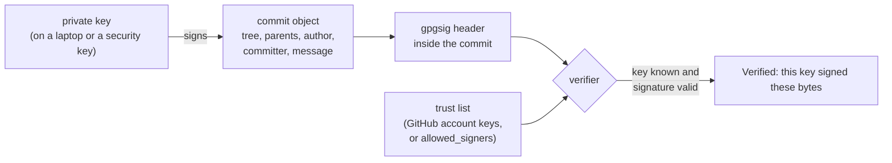
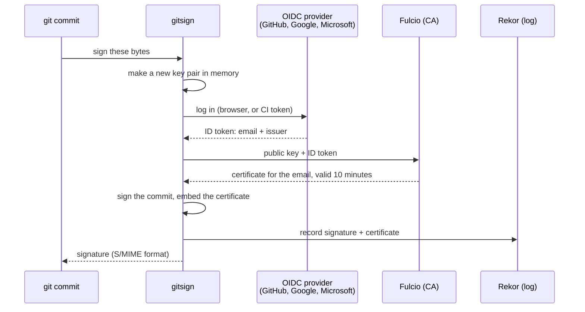

# Signed commits and tags on GitHub

## Why care?

- "The PR says the commit is from our lead developer. Is it?"
- "We turned on 'Require signed commits'. Now the **Rebase and merge** button does not work."
- "I rebased my branch, and the green **Verified** badges are gone."
- "My security key is lost. Are all my old commits now unverified?"
- "We use gitsign. Why does GitHub show every commit as **Unverified**?"

The Git chapter showed how to [sign a commit with an SSH key](../git/config-hooks-signing.md#under-the-hood-signing-commits) and how to verify it with an allowed signers file. This page is about what happens **after the push**: what GitHub checks, what the badge means, how merge methods change signatures, how to sign release tags, how keyless signing with Sigstore works, and how to enforce your own rule in CI, because the badge alone is not a policy.

## The idea: a signature binds a key to an object

A Git commit has three identities. They are often the same person, but they don't have to be:

| Identity      | Where it is stored                    | Who sets it                                | Proves anything? |
| ------------- | ------------------------------------- | ------------------------------------------ | ---------------- |
| **Author**    | `author` line in the commit           | whoever made the commit (free text)        | No               |
| **Committer** | `committer` line in the commit        | whoever made the commit object (free text) | No               |
| **Signer**    | the key that made the `gpgsig` header | whoever holds the private key              | Yes, the key     |

The **author** wrote the change. The **committer** created this commit object, for example by a rebase, a cherry-pick, or a merge button on GitHub. Both are plain text: `git commit --author="CTO <cto@example.com>"` works for anyone.

A **signature** is the only part that is checked with cryptography. It proves one thing: **the holder of this private key signed exactly these bytes** (tree, parents, author, committer, message). It does **not** prove:

- that the author line is true (a signer can sign a commit with any author);
- that the person read or meant the change (an agent, a script or malware on the laptop can use an unlocked key);
- that the code is safe or reviewed.

So "Verified" means "a key we know signed this". The question "**whose** key, and do we trust it for **this** repository?" is a separate decision, and someone has to make it: GitHub makes it with its own rules, and you can make it in CI with yours.



## Under the hood: a real signed commit

Almost every commit in this repository is signed with an SSH key of type `ED25519-SK`, which lives on a FIDO2 security key. Here is the newest one, verified locally with the author's allowed signers file:

```console
$ git log --show-signature -1
commit f3fcce2420f24d24eb2c42a3abf7f4e7e02c3a30
Good "git" signature for 22237801+johankees@users.noreply.github.com with ED25519-SK key SHA256:l+dUqMwO6hMjO7OVBKg3f/QB9YlMQ+AimGFL5sxIUuc
Author: Johan-Kees Vliek <22237801+johankees@users.noreply.github.com>
Date:   Sat Nov 28 07:43:50 2026 +0100

    chore(build): add pr task and Makefile wrapper for mise tasks
```

Read the second line carefully. `for 22237801+...@users.noreply.github.com` is the **principal**: the name next to the key in the allowed signers file. Git found the key in that file and printed the name it found there. Git did **not** compare it with the `Author:` line. If someone signed a commit with this key and wrote a different author, the line would look the same.

The raw object shows where the signature lives:

```console
$ git cat-file commit HEAD | head -7
tree fe0d5d95e800f5d443e87ba5d62d0ffe59cec4b1
parent 298e8d38350d3c1939a5b0b14e5047bcd4eaa217
author Johan-Kees Vliek <22237801+johankees@users.noreply.github.com> 1795848230 +0100
committer Johan-Kees Vliek <22237801+johankees@users.noreply.github.com> 1795848909 +0100
gpgsig -----BEGIN SSH SIGNATURE-----
 U1NIU0lHAAAAAQAAAFMAAAAac2stc3NoLWVkMjU1MTlAb3BlbnNzaC5jb20AAAAgUWfoOs
 vNk5NX0R6fgsmVS3lnmgTiEH76Rdrm1KZPhnwAAAANc3NoOmpvaGFua2VlcwAAAANnaXQA
```

Note the two times: the author time and the committer time differ by about 11 minutes. The commit was amended after it was first written, and the amend made a new object with a new committer time and a new signature.

For scripts, the format placeholders give one line per commit. This repository's history has a mix:

```console
$ git log --no-show-signature --format='%G?' | sort | uniq -c
     48 G
      5 N
```

48 commits are good (`G`), and 5 have no signature (`N`). Which ones?

```console
$ git log --no-show-signature --reverse --format='%h %G? %s' | nl | awk '$3=="N"'
     1	a339c24 N chore: initialize repository with zensical site, mise tasks and CI
     2	3f1bb92 N docs(fundamentals): write chapter 1 on bits, encodings, CPU, memory and processes
     3	0c83fcd N chore(tooling): run prettier and markdownlint with bun
     4	aea3486 N feat(site): enable previous/next footer navigation
    38	30f7545 N build: add uv to mise toolchain
```

The first four were made before signing was set up. Commit 38 is more interesting: one unsigned commit between signed ones. Nothing stopped it, and on GitHub it simply shows no badge. This is the gap that vigilant mode and a CI check close (both below). Signing is not retroactive: you can't add a signature to an old commit without making a new commit with a new hash, which rewrites all history after it.

## Under the hood: how GitHub verifies

GitHub checks the signature when you **push**. For each commit, it needs three things to say **Verified**:

1. The signature is valid for the commit's bytes.
2. The key is uploaded to a GitHub account **as a signing key**. For SSH, GitHub has two key types: **authentication** keys (for `git push` over SSH) and **signing** keys. The same public key can be added as both, but it must be added as a signing key to verify commits.
3. The **committer email** of the commit is a **verified email** of that same account. GitHub matches the committer, not the author.

The author of this repository has four security keys registered as signing keys (one primary, three backups):

```console
$ gh api user/ssh_signing_keys --jq '.[] | [.title, (.key | split(" ")[0]), .created_at[0:10]] | @tsv'
YubiKey signing	sk-ssh-ed25519@openssh.com	2026-06-29
YubiKey signing	sk-ssh-ed25519@openssh.com	2026-06-29
YubiKey signing	sk-ssh-ed25519@openssh.com	2026-06-29
YubiKey signing	sk-ssh-ed25519@openssh.com	2026-07-04
```

The result of the check is stored with the commit, and you can read it from the REST API:

```console
$ gh api repos/johankees/software-engineering-tutor/commits/f3fcce2420f24d24eb2c42a3abf7f4e7e02c3a30 \
>   --jq '.commit.verification | {verified, reason, verified_at}'
{"reason":"valid","verified":true,"verified_at":"2026-11-28T06:55:20Z"}
$ gh api repos/johankees/software-engineering-tutor/commits/30f7545 \
>   --jq '{sha: .sha[0:7], v: (.commit.verification | {verified, reason, verified_at})}'
{"sha":"30f7545","v":{"reason":"unsigned","verified":false,"verified_at":null}}
```

The full object also has `signature` (the armored signature) and `payload` (the commit without the `gpgsig` header: the exact bytes that were signed). `verified_at` is 11 seconds after the committer time (06:55:09 UTC): that is the push.

`reason` explains a failure. The REST documentation lists these values, and they tell you what to fix:

| `reason`           | Meaning                                                 | Usual fix                                     |
| ------------------ | ------------------------------------------------------- | --------------------------------------------- |
| `valid`            | signature good, key and email match                     | none                                          |
| `unsigned`         | no signature                                            | sign the commit                               |
| `unknown_key`      | key is not registered to any account                    | upload it as a **signing** key                |
| `no_user`          | no account has the committer email                      | use your verified (or `noreply`) email        |
| `unverified_email` | the account has the email, but it is not verified       | verify the email on GitHub                    |
| `bad_email`        | the committer email is not in the signing GPG key's IDs | add the email to the GPG key, or change email |
| `expired_key`      | the key had expired                                     | extend or replace the key                     |
| `invalid`          | the signature does not match the bytes                  | the commit was changed after signing          |

### The three badges and vigilant mode

By default, GitHub shows **Verified** for a good signature, **Unverified** for a signature it could not verify, and **nothing** for an unsigned commit. That default has a weak point. An attacker who wants to look like you does not need to forge a signature. They make an **unsigned** commit with your name and email. It shows no badge, and most people don't notice that a badge is missing.

**Vigilant mode** fixes this for your identity. You turn it on in **Settings → SSH and GPG keys → Flag unsigned commits as unverified**. Then:

- **Verified**: valid signature, and you are the committer.
- **Partially verified**: valid signature, but you are a co-author (not the committer) with vigilant mode on. The signature is the committer's, so it does not prove you agreed to the change.
- **Unverified**: invalid signature, or an unsigned commit where you (as committer or author) have vigilant mode on.

Turn it on only when you sign **every** commit and tag, from every machine, with a verified email as committer. Otherwise your own unsigned commits are flagged too.

### Verification records persist

GitHub stores the result when it first verifies a commit, with the `verified_at` timestamp, and does not change it later. The documentation is explicit: once verified, a commit "remains verified within its repository's network" (forks included), and if the key is "later revoked, expired, or otherwise altered, previously verified commits retain their verified status". GitHub does not re-verify old commits.

This is a design choice with two sides:

- **Good**: you can rotate keys, lose a security key, or leave a company, and history keeps its badges.
- **Limit**: the badge means "**was** valid when pushed". If a key was stolen, commits the attacker pushed **before** you removed the key stay Verified. GitHub does not mark them. You have to find them yourself (by time, by key fingerprint) and revert them.

## Under the hood: merge methods and the "require signed commits" rule

A ruleset (or branch protection) can **require signed commits** on a branch. Then GitHub refuses any push or merge that adds a commit that is not signed **and** verified. (See [GitHub repositories](github-repositories.md) for rulesets in general.) The hard part is that the merge methods on GitHub create commits, and GitHub cannot use your key.

GitHub signs commits that **it** creates with its own GPG key, the **web-flow** key. You can see these commits on any public repository that uses the merge button. On `cli/cli`, the author is the PR author (or Dependabot), the committer is GitHub, and the signature is GitHub's (personal email addresses are replaced with placeholders in the outputs on this page):

```console
$ gh api 'repos/cli/cli/commits?per_page=3' \
>   --jq '.[] | [.sha[0:7], .commit.author.email, .commit.committer.email, .commit.verification.reason] | @tsv'
aec3808	<contributor-1>@users.noreply.github.com	noreply@github.com	valid
d1d33e5	<contributor-2>@github.com	noreply@github.com	valid
8a93995	49699333+dependabot[bot]@users.noreply.github.com	noreply@github.com	valid
$ gh api users/web-flow/gpg_keys --jq '.[] | {key_id, created_at, expires_at}'
{"created_at":"2017-09-27T17:36:51.000+02:00","expires_at":"2024-01-16T21:00:00.000+01:00","key_id":"4AEE18F83AFDEB23"}
{"created_at":"2024-01-16T19:13:57.000+01:00","expires_at":null,"key_id":"B5690EEEBB952194"}
```

That is author, committer and signer as three different identities in one commit. The signer is **GitHub**, so the badge here means "GitHub made this commit through its web interface", not "the author signed it".

| Method on GitHub       | What lands on the base branch               | Signatures                                                                                                                                                 |
| ---------------------- | ------------------------------------------- | ---------------------------------------------------------------------------------------------------------------------------------------------------------- |
| **Merge commit**       | the PR's own commits + one new merge commit | PR commits keep the author's signatures (same objects). The merge commit is signed by web-flow.                                                            |
| **Squash and merge**   | one new commit                              | Signed by web-flow. The PR's commits are gone from the branch, but GitHub still checks them: unsigned commits on the head branch can block a squash merge. |
| **Rebase and merge**   | new copies of the PR's commits              | GitHub always re-creates the commits (new committer, new hashes) and **cannot sign them**: it has no access to your key. They land without a signature.    |
| **Local fast-forward** | the exact commits you pushed                | Your signatures are kept. You need permission to push to the base branch.                                                                                  |

So with "require signed commits", plan on **merge commit** or **squash**. For a linear history with the author's own signatures, rebase locally, sign, and push the fast-forward yourself (GitHub's documented workaround). Stacked pull requests (generally available since October 2026) are an exception: the **Rebase stack** action creates signed replacement commits. That is a separate feature, not the **Rebase and merge** button.

### A local rebase drops signatures too

A rebase makes new commit objects. The `gpgsig` header is part of the old object, so it can't move. Here is a local clone of this repository; rebasing the last two commits without signing:

```console
$ git log --no-show-signature -3 --format='%h %G? %cd %s' --date=iso
f3fcce2 G 2026-11-28 07:55:09 +0100 chore(build): add pr task and Makefile wrapper for mise tasks
298e8d3 G 2026-11-28 07:55:02 +0100 feat(site): add hero home page and collapsible navigation
891c999 G 2026-11-28 06:50:39 +0100 docs: rewrite all chapters in a professional tone
$ GIT_COMMITTER_DATE="2026-11-28T12:00:00+0100" git rebase -q --no-gpg-sign --force-rebase HEAD~2
$ git log --no-show-signature -3 --format='%h %G? %cd %s' --date=iso
c5cc905 N 2026-11-28 12:00:00 +0100 chore(build): add pr task and Makefile wrapper for mise tasks
9407a6a N 2026-11-28 12:00:00 +0100 feat(site): add hero home page and collapsible navigation
891c999 G 2026-11-28 06:50:39 +0100 docs: rewrite all chapters in a professional tone
```

New hashes, new committer time, `N`. To fix it, sign the new commits as they are made, or re-sign them afterwards:

```sh
git rebase --gpg-sign main                                   # sign each rewritten commit
git rebase --exec 'git commit --amend --no-edit --gpg-sign' main   # re-sign a range in place
```

Both make new objects signed by **your** key. That is correct for your own branch. For someone else's commits, you become the signer: their signature is gone, and only a review can say that the content is still theirs. With a security key, every re-signed commit needs a touch.

## Under the hood: signed tags for releases

A release is usually a **tag**, and a lightweight tag is only a ref: a name that points to a commit, with no author and no signature. An **annotated tag** is an object (`object`, `type`, `tag`, `tagger`, message), and it can carry its own signature. Sign it, because the tag says "**this** commit is release v1.4.0", and that statement is what your build and your users trust:

```sh
git tag -s v1.4.0 -m "v1.4.0"      # annotated + signed, uses gpg.format and user.signingKey
git verify-tag v1.4.0              # checks the tag object's signature
git tag -v v1.4.0                  # same, and prints the tag
git push origin v1.4.0
```

<!-- TODO(real-output): this repository has no tags, and the sandbox could not create a throwaway signing key; run `git tag -s` and `git verify-tag` on a scratch repo with a test SSH key and paste the output. -->

`git verify-tag` checks the **tag** object, not the commit it points to. A signed tag on an unsigned commit is valid: the tagger vouches for the commit hash, and the hash fixes the whole tree and history. That is enough for a release, as long as the tagger's key is one you trust for releases.

GitHub verifies tags the same way as commits and shows a badge on the **Tags** page. To protect tags, use a **tag ruleset** for a pattern such as `v*`: restrict who can create, update and delete them. A tag that can be moved is not a release. The ruleset documentation describes "require signed commits" in terms of commits; it does not say that it checks the signature of the tag object. Check the tag signature yourself in the release workflow (see [Secure pipeline](secure-pipeline.md)):

```sh
git fetch --force origin "refs/tags/$TAG:refs/tags/$TAG"   # actions/checkout may fetch only the commit
test "$(git cat-file -t "$TAG")" = tag                     # refuse lightweight tags
git -c gpg.ssh.allowedSignersFile="$RUNNER_TEMP/release_signers" verify-tag "$TAG"
```

## Under the hood: keyless signing with gitsign

Long-lived keys have long-lived problems: they get lost, copied and forgotten in old allowed signers files. **gitsign** (part of the Sigstore project, release v0.18.0 in October 2026) signs commits without a long-lived key. It uses the same parts as cosign keyless signing (see [Artifact signing](artifact-signing.md)):



1. gitsign makes a fresh key pair for this signature.
2. You prove who you are to an **OIDC** (OpenID Connect) provider, the same login you use for GitHub or Google. In CI, the workflow's OIDC token is used.
3. **Fulcio**, Sigstore's certificate authority, issues a short-lived X.509 certificate that binds the public key to your identity (email and issuer).
4. gitsign signs the commit, puts the certificate into the signature, and throws the private key away.
5. The signature is recorded in **Rekor**, the public transparency log. The log entry proves that the signature was made while the certificate was valid.

Set it up per repository (or with `--global`):

!!! tip "New tool: `gitsign`"

    ```sh
    mise use gitsign@0.18.0
    ```

    This adds it to the project's `mise.toml`, pinned to an exact version. See [Adding tools as you go](../toolbox/mise.md#adding-tools-as-you-go).

```sh
git config --local gpg.x509.program gitsign   # use gitsign for x509 signatures
git config --local gpg.format x509            # gitsign speaks the x509 (S/MIME) interface
git config --local commit.gpgsign true
git config --local tag.gpgsign true
```

<!-- TODO(real-output): signing needs an interactive OIDC login in a browser; run a gitsign-signed commit and paste the output. The verification below is real. -->

### A real gitsign signature

gitsign's own release tag is signed with gitsign. Fetch it and look at the object:

```console
$ git fetch -q --depth 1 https://github.com/sigstore/gitsign refs/tags/v0.18.0:refs/tags/v0.18.0
$ git cat-file tag v0.18.0 | head -8
object 93dbc8d96dcba19cf57de7a1990d523207a00035
type commit
tag v0.18.0
tagger <maintainer> <maintainer-email> 1792524714 -0400

v0.18.0
-----BEGIN SIGNED MESSAGE-----
MIII/AYJKoZIhvcNAQcCoIII7TCCCOkCAQExDTALBglghkgBZQMEAgEwCwYJKoZI
```

The signature is a PKCS #7 (S/MIME) block, and it contains the certificate. Decode it with OpenSSL:

```console
$ git cat-file tag v0.18.0 | sed -n '/BEGIN SIGNED MESSAGE/,/END SIGNED MESSAGE/p' \
>   | sed 's/SIGNED MESSAGE/PKCS7/' > sig.pem
$ openssl pkcs7 -in sig.pem -print_certs | openssl x509 -noout -issuer -dates -ext subjectAltName
issuer=O=sigstore.dev, CN=sigstore-intermediate
notBefore=Oct 20 19:31:56 2026 GMT
notAfter=Oct 20 19:41:56 2026 GMT
X509v3 Subject Alternative Name: critical
    email:<maintainer-email>
$ openssl pkcs7 -in sig.pem -print_certs | openssl x509 -noout -text | grep -A1 '1\.3\.6\.1\.4\.1\.57264\.1\.1:'
            1.3.6.1.4.1.57264.1.1:
                https://accounts.google.com
```

The certificate was issued by Sigstore's intermediate CA, for the maintainer's email address (redacted here) as proven by `https://accounts.google.com` (Fulcio's OID extension `57264.1.1` holds the issuer), and it was valid for **exactly 10 minutes**. The tagger time, 1792524714, is 19:31:54 UTC on that day: the tag was signed inside the window.

Note what is public now: the email is in the commit **and** in the public Rekor log, forever. For private repositories or private emails, that can matter. Sigstore supports a private Fulcio and Rekor for this case.

### How verification differs

With an SSH key, you trust a **key**: "this key belongs to Alice". With gitsign, you trust an **identity and an issuer**: "a certificate from Fulcio for `alice@example.com`, proven by `https://github.com/login/oauth`". Verify like this:

```sh
gitsign verify \
  --certificate-identity=alice@example.com \
  --certificate-oidc-issuer=https://github.com/login/oauth \
  HEAD
```

`gitsign verify-tag` does the same for tags. On the real `v0.18.0` tag from above (the regular expression matches any address at the maintainer's company; the address itself is redacted):

```console
$ gitsign verify-tag v0.18.0 \
>   --certificate-identity-regexp '@chainguard\.dev$' \
>   --certificate-oidc-issuer https://accounts.google.com
tlog index: 3342550745
gitsign: Signature made using certificate ID 0x5eb2625fb67af0be31ba6fefff796018dc58f824 | CN=sigstore-intermediate,O=sigstore.dev
gitsign: Good signature from [<maintainer>@chainguard.dev](https://accounts.google.com)
Validated Git signature: true
Validated Rekor entry: true
Validated Certificate claims: true
$ gitsign verify-tag v0.18.0 \
>   --certificate-identity-regexp '@example\.com$' \
>   --certificate-oidc-issuer https://accounts.google.com
Error: no signer could be verified: signer 0: failed to verify certificate identity: no matching CertificateIdentity found, last error: expected SAN value to match regex "@example\.com$", got "<maintainer>@chainguard.dev"
```

Three checks passed: the signature over the tag, the Rekor entry (which proves the signature was made while the certificate was valid), and the identity you asked for. Plain Git, without gitsign configured, hands the S/MIME signature to GnuPG's `gpgsm`, which knows nothing about Rekor:

```console
$ git verify-tag v0.18.0
gpgsm: Signature made 2026-10-20 19:31:56 UTC
gpgsm:                using nistp256 key 5EB2625FB67AF0BE31BA6FEFFF796018DC58F824
gpgsm: certificate has expired
```

(First lines only.) For `gpgsm` the 10-minute certificate is simply expired. That is the whole design problem of short-lived certificates in one line: without the transparency log, a verifier can't tell that the signature was made in time.

`git verify-commit` also works with gitsign configured, but the gitsign README warns: Git does not pass the expected identity to the signing tool, so it checks only that the signature is valid and that it is in Rekor, **not who made it**. Its output says `Validated Certificate claims: false`. Anyone can get a Fulcio certificate for their own email, so a check without an expected identity proves almost nothing. Always use `gitsign verify` with both flags.

### GitHub shows gitsign as Unverified

GitHub verifies S/MIME signatures against the certificate authorities in its trust store (the Debian ca-certificates bundle). The Sigstore CA is not in it. And a 10-minute certificate is expired at every later check, unless the verifier also checks Rekor, which GitHub does not do. The gitsign README states that GitHub "doesn't recognize Gitsign signatures as verified at the moment", and the real tag above confirms it:

```console
$ gh api repos/sigstore/gitsign/git/tags/7a1faeb3d4f1dbce64e68f2450124b5df41778ea \
>   --jq '{tag, verification: (.verification | {verified, reason})}'
{"tag":"v0.18.0","verification":{"reason":"bad_cert","verified":false}}
```

(`bad_cert` is not in the REST documentation's list of reasons, but it is what the API returns.) Consequence: a branch that **requires signed commits** on GitHub refuses gitsign commits. gitsign then only works together with your own CI verification, not with GitHub's rule.

### SSH keys or gitsign?

| Question                                  | SSH key (ideally `-sk`)    | gitsign                                                                                            |
| ----------------------------------------- | -------------------------- | -------------------------------------------------------------------------------------------------- |
| GitHub "Verified" badge and required rule | Yes                        | No (Unverified, `bad_cert`)                                                                        |
| Key to protect, back up, rotate           | Yes (a hardware key helps) | No long-lived key; your login is the key                                                           |
| Works offline                             | Yes                        | No: needs OIDC, Fulcio and Rekor at signing time                                                   |
| What the verifier trusts                  | a list of public keys      | an issuer + identity, and the Sigstore roots                                                       |
| Public record                             | No                         | Yes: every signature and email in Rekor                                                            |
| Best for                                  | most teams on GitHub today | bots and CI identities, teams that verify in their own CI, organizations that already run Sigstore |

For a team on GitHub that wants the required-signatures rule, use SSH signing keys, on hardware where possible. Use gitsign where a long-lived key is the bigger problem, for example commits made by CI, and verify them in your own pipeline.

## Under the hood: verify history in CI yourself

GitHub's badge answers "does **some** GitHub account own this key and this email?". It does not answer your real policy questions:

- Is the signer **a member of this team**, with rights to this repository? Any GitHub user can get a Verified badge on a commit in your PR.
- Does the signer match the **committer** you expect, or is it someone else's valid key?
- Is the key still trusted **today**, or was it the one on the stolen laptop?
- Do you accept gitsign, and which identities?

You answer these with your own trust list in the repository, `.github/allowed_signers`, and a check over every new commit. The script checks two things for each commit in `base..head`: Git says `G` (the key is in the file and the signature is valid), and the principal of that key equals the committer email:

```sh
#!/usr/bin/env sh
# Usage: verify-signatures.sh <base> <head>
# Fails if any commit in base..head is not signed by a trusted key
# whose principal matches the committer email.
set -eu
base="$1" head="$2"
bad=0
commits="$(git rev-list --no-merges "$base..$head")"
for c in $commits; do
  status="$(git log -1 --no-show-signature --format='%G?' "$c")"
  signer="$(git log -1 --no-show-signature --format='%GS' "$c")"
  email="$(git log -1 --no-show-signature --format='%ce' "$c")"
  if [ "$status" != "G" ]; then
    echo "FAIL $c: signature status $status" >&2; bad=1
  elif [ "$signer" != "$email" ]; then
    echo "FAIL $c: signed by $signer, committer is $email" >&2; bad=1
  else
    echo "ok   $c $signer"
  fi
done
exit "$bad"
```

`commits=` is a separate step on purpose: inside `for c in $(...)`, a failing `git rev-list` (a wrong base, a shallow clone) would give an empty list, and the script would pass. Run on this repository, and on the rebased clone from above:

```console
$ ./verify-signatures.sh origin/main~3 origin/main; echo "exit=$?"
ok   f3fcce2420f24d24eb2c42a3abf7f4e7e02c3a30 22237801+johankees@users.noreply.github.com
ok   298e8d38350d3c1939a5b0b14e5047bcd4eaa217 22237801+johankees@users.noreply.github.com
ok   891c99943438c5c0816ac31b38dd8e3ce2a28cab 22237801+johankees@users.noreply.github.com
exit=0
$ ./verify-signatures.sh HEAD~2 demo; echo "exit=$?"     # in the rebased clone
FAIL c5cc905cea9ef807784ce4b288377347e56ee6d6: signature status N
FAIL 9407a6aa12d7088f43b583c7f53062004634883a: signature status N
exit=1
```

The workflow runs it on every pull request, over the PR's own commits (before GitHub makes a merge or squash commit):

```yaml
name: signatures

on:
  pull_request:

permissions:
  contents: read

jobs:
  verify:
    runs-on: ubuntu-24.04
    steps:
      - uses: actions/checkout@3d3c42e5aac5ba805825da76410c181273ba90b1 # v7.0.1
        with:
          fetch-depth: 0 # the range base..head needs the history, not one commit
          persist-credentials: false
      - name: Verify commit signatures
        env:
          BASE: ${{ github.event.pull_request.base.sha }}
          HEAD: ${{ github.event.pull_request.head.sha }}
        run: |
          # Trust list and script come from the BASE branch, not from the PR.
          git show "$BASE:.github/allowed_signers" > "$RUNNER_TEMP/allowed_signers"
          git show "$BASE:scripts/verify-signatures.sh" > "$RUNNER_TEMP/verify-signatures.sh"
          git config gpg.ssh.allowedSignersFile "$RUNNER_TEMP/allowed_signers"
          sh "$RUNNER_TEMP/verify-signatures.sh" "$BASE" "$HEAD"
```

The important lines:

- **`fetch-depth: 0`**. The default clone has one commit, the PR merge commit. Then `base..head` can't be computed, and `rev-list` fails. With the script above, that is a failure, not a silent pass.
- **The trust list comes from `$BASE`**. If the job used the file from the checked-out PR, a PR could add its own key to `allowed_signers` and sign its commits with it. Reading the file from the base branch means a new key must first be merged by someone who is already trusted, through review (and a CODEOWNERS rule on that file).
- **The SHAs go through `env:`**, not straight into `run:`. These two values are safe, but it is the habit that prevents script injection (see [Workflow security](workflow-security.md)).
- **`--no-merges`**: merge commits that a developer makes locally are skipped here. Remove it if you want them signed too.
- The runner needs `ssh-keygen` (OpenSSH 8.8 or later for key lifetimes); GitHub's Ubuntu runners have it.

This repository runs exactly this: the script is `scripts/verify-signatures.sh`, the trust list is `.github/allowed_signers` (the four public keys above), and the job is `Commit signatures` in `ci.yml`. It skips Dependabot's PRs, whose commits GitHub signs; the ruleset's own signature rule still checks those. Make the job a **required status check** in the branch ruleset. Then GitHub's rule ("some valid signature") and your rule ("one of **our** keys, matching the committer") both apply. To accept gitsign commits for CI bots, add a second branch in the script that calls `gitsign verify` with the expected identity and issuer.

## Under the hood: hardware keys, key loss and rotation

A signing key on a FIDO2 security key (`ed25519-sk`, see [the Git chapter](../git/config-hooks-signing.md#under-the-hood-signing-commits)) can't be copied off the token, and every signature needs a touch. Malware on the laptop can't take the key away, and it can't sign silently. That is the strongest answer to "signature proves the key, not the intent": a touch is at least a human action.

Plan for loss before it happens:

- **Register backup keys now.** Make a key on a second token, add it to GitHub as a signing key and to `allowed_signers`. That is why the account above has several keys.
- **Losing a key** (no theft): remove it from GitHub. Old commits stay Verified, because records persist. New commits from that key would get `unknown_key`.
- **A stolen or leaked key**: remove it from GitHub **and** from `allowed_signers` at once. Then find every commit it signed after the time of the leak, and review or revert it. GitHub will not flag those commits for you.

In `allowed_signers`, you don't have to delete an old key to stop trusting it. OpenSSH 8.8 and later support key lifetimes, and Git marks a signature valid "if the signing key was valid at the time of the signature's creation":

```text
alice@example.com namespaces="git",valid-before="20261201" ssh-ed25519 AAAA...old
alice@example.com namespaces="git",valid-after="20261201" sk-ssh-ed25519@openssh.com AAAA...new
```

Old commits keep verifying; new commits must use the new key. But be precise about the limit: the "time of creation" comes from the **commit's own timestamp**, which the signer writes. Someone holding the old key can set `GIT_COMMITTER_DATE` to last year. So `valid-before` is right for **rotation**; for a **compromised** key, add it to `gpg.ssh.revocationFile`, so that every signature from it is invalid, and re-sign or accept the old commits by an explicit review.

## Try it

1. Run `git log --format='%h %G? %GS %ce' -20` in one of your repositories. Which commits are signed, and do the signer and committer always match?
2. Read the `verification` object of one of your own commits with `gh api repos/<owner>/<repo>/commits/<sha> --jq .commit.verification`, and compare `payload` with `git cat-file commit <sha>`.
3. Find a squash-merged commit on a public repository. Who are the author, the committer and the signer?
4. In a scratch repository, sign two commits with a throwaway SSH key, rebase them with `--no-gpg-sign`, and run the CI script over the range. Then fix it with `git rebase --gpg-sign`.
5. Fetch a signed tag of a project you use, and verify it: `git verify-tag` for SSH or GPG, the OpenSSL steps above for gitsign.
6. Add a `valid-before` date to a key in a scratch `allowed_signers` file and check which commits still verify.

## Traps

- **Reading "Verified" as "written by the author".** It means a known key signed it, and GitHub matched the **committer** email. On a squash merge, the signer is GitHub.
- **No vigilant mode.** Without it, an unsigned commit in your name shows no badge, and nobody notices the missing badge.
- **"Require signed commits" plus "Rebase and merge".** GitHub can't sign the rebased copies. Use merge or squash, or rebase and push locally.
- **Rebasing other people's signed commits.** Their signatures are gone; at best the commits carry yours.
- **Lightweight release tags.** No tagger, no signature, and easy to move. Use `git tag -s` and a tag ruleset.
- **`git verify-commit` for gitsign.** It doesn't check who signed. Use `gitsign verify` with identity and issuer.
- **A CI check that reads `allowed_signers` from the PR.** The PR can trust itself. Read it from the base branch.
- **A shallow checkout in the CI check.** `base..head` fails or is empty. Use `fetch-depth: 0`, and fail if `rev-list` fails.
- **Trusting `valid-before` against a stolen key.** The timestamp is chosen by the signer. Use the revocation file.

## Check yourself

??? question "1. A commit shows Verified on GitHub. Its author is your CTO. What do you know?"

    That the committer email belongs to a GitHub account, and that a signing key of that
    account signed exactly this commit. You don't know that the CTO wrote it: the author
    line is free text, and GitHub matches the committer, not the author. If it was a
    squash merge, the signer is GitHub's web-flow key.

??? question "2. Your branch requires signed commits. A PR with signed commits can't be merged with \"Rebase and merge\". Why, and what are your options?"

    GitHub always re-creates the commits for a rebase merge (new committer, new hashes)
    and has no access to the author's key, so the copies are unsigned. Use a merge commit
    or squash (GitHub signs those with its web-flow key), or rebase locally with
    `--gpg-sign` and push the fast-forward yourself.

??? question "3. A developer's security key was stolen last week and removed from GitHub today. What happens to the commits it signed?"

    They stay Verified: GitHub stores the verification result at push time and doesn't
    re-verify. So you must find the commits signed by that key since the theft (by key
    fingerprint and push time), review or revert them, and remove the key from
    `allowed_signers` or add it to the revocation file.

??? question "4. Why does GitHub show gitsign commits as Unverified, and what does that mean for the required-signatures rule?"

    The Sigstore CA is not in GitHub's trust store, and the 10-minute certificate is
    expired at any later check unless the verifier also checks Rekor, which GitHub doesn't.
    The API reports `bad_cert`. A branch that requires signed commits on GitHub refuses
    them, so gitsign needs your own CI verification instead.

??? question "5. `git verify-commit` succeeds on a gitsign commit. Is that enough?"

    No. Git doesn't pass an expected identity to gitsign, so it checks only that the
    signature is valid and in Rekor. Anyone can get a certificate for their own email.
    Run `gitsign verify --certificate-identity=... --certificate-oidc-issuer=...`.

??? question "6. Your CI job checks signatures with `.github/allowed_signers` from the PR checkout. What is the attack, and the fix?"

    The PR adds the attacker's key to `allowed_signers` and signs its commits with that
    key; the check then trusts the PR's own claim. Read the file (and the script) from the
    base commit with `git show "$BASE:.github/allowed_signers"`, and protect the file with
    review and CODEOWNERS.

??? question "7. Why is a signed annotated tag useful even when the tagged commit is not signed?"

    The tag signature covers the tag object, which names the commit by hash. The hash
    fixes the whole tree and history, so the tagger's signature vouches for exactly that
    release content. A lightweight tag has no object and no signature, and can be moved.

## Recap

- A commit has an **author**, a **committer** and a **signer**. Only the signer is proven, and only as "this key signed these bytes", not intent or authorship.
- GitHub says **Verified** when the key is an uploaded **signing** key and the **committer email** is a verified email of that account. The REST `verification.reason` says why not.
- **Vigilant mode** flags unsigned commits in your name; **Partially verified** means you are a co-author, not the signer.
- Verification records **persist**: rotation and loss don't remove badges, and theft doesn't either.
- Merge and squash on GitHub are signed by the **web-flow** key; **rebase and merge** can't be signed by GitHub; a local rebase drops signatures unless you re-sign.
- Sign releases with **`git tag -s`**, verify with `git verify-tag`, and protect `v*` with a tag ruleset.
- **gitsign** signs with a 10-minute Fulcio certificate from your OIDC login, recorded in Rekor. Verify with `gitsign verify` and an expected identity. GitHub shows it as Unverified.
- Enforce **your** policy in CI: `git verify-commit` semantics over `base..head`, signer equals committer, trust list from the base branch, `fetch-depth: 0`, required status check.
- Use hardware keys, register backups, use `valid-before` for rotation and the revocation file for compromise.

Next: [Workflow security](workflow-security.md), where the attacker targets the CI jobs that run these checks.
