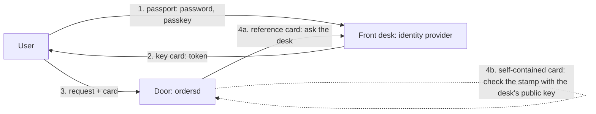

# Authentication

## Why care?

Four review comments that all came from this page's topic:

- "The API accepts any JWT whose signature checks out. Signed by **whom**, for **which** service?"
- "We store the access token in `localStorage`. One XSS bug, and every token on the page is gone."
- "The mobile app has a client secret compiled into it. It is not a secret any more."
- "`billing-job` calls `ordersd` with Alice's password, because 'it needed some account'."

Authentication answers one question: **who is making this request?** It sounds simple. But the answer travels through browsers, identity providers, tokens, cookies, keys and clocks, and every hop is a place to get it wrong. [Threat modeling](threat-modeling.md) found that `ordersd` has no authentication at all: anyone who can reach the port can read every order. This page fixes the "who?" part. The [next page](authorization.md) fixes the "may they?" part.

On this page you run a real OpenID Connect provider (Dex) in Docker, walk an authorization-code-with-PKCE login using only `curl`, take a JWT apart, and break a naive JWT verifier in Go in two different ways. Then you fix it.

## The idea: a hotel key card

You arrive at a hotel.

- At the **front desk** you show your passport once. The desk checks it carefully. That is the **login**: password, passkey, or a corporate identity provider.
- The desk gives you a **key card**. The card does not contain your passport. It says "room 412, until Friday noon", and the lock can check that the hotel made it. That is a **token** (or a **session**).
- Every **door** checks the card, not your passport. Doors are fast, and they never see your passport. That is your **API**, checking the token on every request.
- The card **expires**. If you lose it, the desk can cancel it. Short life and revocation limit the damage of a stolen card.

There are two kinds of card:

- A **reference** card: just a number. The door asks the desk "is 7731 valid?" every time. That is a **session ID** (or an opaque token). Easy to cancel, but every check needs the desk.
- A **self-contained** card: it carries "room 412, until Friday" plus the hotel's stamp. The door checks the stamp itself. That is a **JWT**. Fast, no desk needed, but hard to cancel before it expires.



Three words you will see everywhere:

| Word               | Meaning                                                                                    |
| ------------------ | ------------------------------------------------------------------------------------------ |
| **Authentication** | Proving who you are. Short form: **authn**                                                 |
| **Authorization**  | Deciding what you may do. Short form: **authz**. Next page                                 |
| **Credential**     | The thing that proves it: password, private key, session cookie, token, client certificate |

## Under the hood: sessions vs tokens

### Server-side sessions

The classic web app: after login, the server stores a session (`id → user, expiry`) in memory, Redis or a database, and gives the browser the **ID** in a cookie. Every request sends the cookie; the server looks up the ID.

- **Good:** logout and "kick this user out" are instant: delete the row. The cookie holds no data an attacker can read or change.
- **Cost:** every request needs the session store. Every service that wants to check the user must reach it.

The session ID must be **unguessable**: at least 128 random bits from `crypto/rand`, never a counter, a timestamp or a hash of the username. `crypto/rand.Text()` (Go 1.24+) returns such a string.

### Tokens

A token is a credential the client sends in a header, usually `Authorization: Bearer <token>`. **Bearer** means exactly what it says: whoever holds the token is you. There is no second check. A token in a log file is as good as a password in a log file.

Tokens are either **opaque** (a random string; the API asks the issuer about it, called **introspection**) or **self-contained** (a JWT the API verifies itself). Self-contained tokens scale well between services, but you cannot take one back before `exp`. So they must be **short-lived** (minutes), and a longer-lived **refresh token** gets new ones.

| Question                    | Server session (cookie)            | Self-contained token (JWT)                  |
| --------------------------- | ---------------------------------- | ------------------------------------------- |
| Where is the state?         | Server store                       | In the token                                |
| Revoke now?                 | Yes, delete the row                | No, wait for `exp` (or keep a deny list)    |
| Each request costs          | One store lookup                   | One signature check, no network             |
| Works across many services? | Only if all reach the store        | Yes, they need only the issuer's public key |
| Typical client              | Browser                            | Other services, mobile apps, CLIs           |
| Main risk if stolen         | Session hijack until logout/expiry | Full access until `exp`                     |

For a browser app, a common, safe shape is: the browser holds **only a session cookie**; your backend (a "backend for frontend") holds the tokens and calls APIs with them. Tokens then never reach JavaScript.

### Cookies: three flags that matter

A cookie is the browser's way to send a credential automatically. "Automatically" is the danger: the browser also sends it when **another site** makes your browser call you (that's CSRF, see [Web and API security](web-and-api-security.md)). Three attributes turn the cookie into a safe container:

```go
// Command cookie prints a safe session cookie and a broken one.
package main

import (
	"crypto/rand"
	"fmt"
	"net/http"
)

func main() {
	id := rand.Text() // 26 chars, 130 random bits
	good := &http.Cookie{
		Name:     "__Host-session", // browser enforces: Secure, Path=/, no Domain
		Value:    id,
		Path:     "/",
		MaxAge:   8 * 3600,
		Secure:   true,                 // HTTPS only
		HttpOnly: true,                 // JavaScript cannot read it
		SameSite: http.SameSiteLaxMode, // not sent on cross-site POSTs
	}
	fmt.Println("Set-Cookie:", good)

	bad := &http.Cookie{Name: "session", Value: "user=alice;role=admin"}
	fmt.Println("Set-Cookie:", bad, "| valid:", bad.Valid())
}
```

```console
$ go run ./cmd/cookie
Set-Cookie: __Host-session=WBYN5ICS3CZVZ7UNBGI2S3ORBG; Path=/; Max-Age=28800; HttpOnly; Secure; SameSite=Lax
2026/11/27 12:24:10 net/http: invalid byte ';' in Cookie.Value; dropping invalid bytes
Set-Cookie: session=user=alicerole=admin | valid: http: invalid byte ';' in Cookie.Value
```

| Attribute             | What it stops                                                                                                 |
| --------------------- | ------------------------------------------------------------------------------------------------------------- |
| `HttpOnly`            | `document.cookie` cannot read it, so an XSS bug cannot copy the session out                                   |
| `Secure`              | Never sent over plain HTTP, so nobody on the café Wi-Fi sees it                                               |
| `SameSite=Lax`        | Not sent on cross-site subrequests and POSTs. Main CSRF defence. `Strict` is stricter; `None` is off          |
| `__Host-` name prefix | The browser rejects the cookie unless it is `Secure`, `Path=/` and has no `Domain`; subdomains can't plant it |

The second cookie shows two mistakes at once. First, Go silently **drops** the `;` and still sends something: always check `Valid()` for values you build. Second, and worse: it puts `role=admin` **in the cookie**. The client can edit any cookie. A cookie should hold a random ID, and the server keeps the meaning.

## Under the hood: OAuth 2 and OpenID Connect

### OAuth 2: four roles

OAuth 2 is about **delegation**: "let `orderctl` call `ordersd` for me, without giving `orderctl` my password." It has four roles:

| Role                     | In our example                                                           |
| ------------------------ | ------------------------------------------------------------------------ |
| **Resource owner**       | Alice, the human                                                         |
| **Client**               | `orderctl`, the app that wants to act for Alice                          |
| **Authorization server** | The identity provider (here Dex; in a company: Entra ID, Okta, Keycloak) |
| **Resource server**      | `ordersd`, the API that accepts the token                                |

The authorization server issues an **access token**. The resource server checks it. OAuth 2 itself says nothing about **who** the user is; it only says "this client may do this". That gap is why OIDC exists.

### The flows you should use

There used to be many flows. Today two cover almost everything (the others are deprecated in the OAuth security best current practice):

- **Authorization code + PKCE**, when a **human** logs in (web, mobile, CLI). The browser goes to the identity provider, the user logs in **there**, and the browser comes back with a one-time **code**. The client swaps the code for tokens.
- **Client credentials**, when a **service** calls a service and no human is involved: `billing-job` sends its own client ID and secret (or better, a signed assertion) and gets a token for itself.

Dead flows: **implicit** (tokens in the URL fragment, visible to the browser history and any script) and **resource owner password** (the client sees the user's password, which is the thing OAuth was invented to avoid).

### PKCE: proof that you started the login

The code comes back in a URL redirect. On a phone, another app can register the same URL scheme and catch it. On a desktop, it can end up in logs. PKCE (Proof Key for Code Exchange, "pixie") makes a stolen code useless:

1. The client makes a random **verifier** and sends only its SHA-256 hash, the **challenge**, with the login request.
2. When it swaps the code for tokens, it sends the **verifier**.
3. The server hashes the verifier and compares. A thief has the code, but not the verifier.

```mermaid
sequenceDiagram
    participant U as Browser (Alice)
    participant C as orderctl (client)
    participant AS as Dex (authorization server)
    participant RS as ordersd (resource server)
    C->>C: verifier = random; challenge = SHA256(verifier)
    C->>U: open /auth?client_id&redirect_uri&state&code_challenge
    U->>AS: GET /auth ...
    AS->>U: login page (password, passkey, SSO)
    U->>AS: credentials
    AS->>U: 302 redirect_uri?code=...&state=...
    U->>C: code, state
    C->>AS: POST /token code + code_verifier
    AS->>C: access_token, id_token, refresh_token
    C->>RS: GET /v1/orders, Authorization: Bearer access_token
```

`state` is a random value the client checks when the browser comes back. It stops an attacker from making you finish **their** login (login CSRF).

### OIDC: identity on top of OAuth

**OpenID Connect** adds three things to OAuth 2:

- **The ID token**: a JWT for the **client**, saying who logged in (`sub`), at which issuer (`iss`), for which client (`aud`), and when. The client reads it. APIs should **not** accept ID tokens as access tokens: the audience is the client, not the API.
- **Discovery**: one well-known URL, `<issuer>/.well-known/openid-configuration`, that lists every endpoint and feature.
- **JWKS**: a URL with the issuer's **public** signing keys, so anyone can verify its tokens. Keys rotate; each has a `kid` (key ID) and tokens name the `kid` that signed them.

## Try it: a real OIDC provider in Docker

[Dex](https://dexidp.io/) is a small OIDC provider written in Go. We give it a config with two clients and a **mock connector**, which logs you in as a fixed test user without a password form, so the whole browser part works with `curl` GETs.

```yaml
# ~/tutor/dex/config.yaml
issuer: http://127.0.0.1:5556/dex
storage:
  type: memory
web:
  http: 0.0.0.0:5556
oauth2:
  skipApprovalScreen: true
  grantTypes: [authorization_code, refresh_token, client_credentials]
connectors:
  - type: mockCallback
    id: mock
    name: Example
staticClients:
  - id: orderctl
    name: orderctl
    public: true # a CLI cannot keep a secret: PKCE instead
    redirectURIs: ["http://127.0.0.1:5555/callback"]
  - id: billing-job
    name: billing-job
    secret: tutor-fake-client-secret
    redirectURIs: ["http://127.0.0.1:5555/unused"]
```

Start it. `docker create` plus `docker cp` puts the config inside the container without a volume:

```console
$ docker create --rm --name tutor-dex -p 127.0.0.1:5556:5556 \
    ghcr.io/dexidp/dex:v2.44.0 dex serve /etc/dex/tutor.yaml
$ docker cp ~/tutor/dex/config.yaml tutor-dex:/etc/dex/tutor.yaml
$ docker start tutor-dex
$ docker logs tutor-dex 2>&1 | tail -4
time=2026-11-27T11:22:16.615Z level=INFO msg="config refresh tokens rotation" enabled=true
time=2026-11-27T11:22:16.616Z level=INFO msg="keys expired, rotating"
time=2026-11-27T11:22:16.659Z level=INFO msg="keys rotated" next_rotation=2026-11-27T17:22:16.659Z
time=2026-11-27T11:22:16.659Z level=INFO msg="listening on" server=http address=0.0.0.0:5556
```

Note "keys rotated, next_rotation" 6 hours later. Dex rotates its signing key by itself. Your verifier must cope with that.

### Discovery and JWKS

```console
$ curl -s http://127.0.0.1:5556/dex/.well-known/openid-configuration | jq .
{
  "issuer": "http://127.0.0.1:5556/dex",
  "authorization_endpoint": "http://127.0.0.1:5556/dex/auth",
  "token_endpoint": "http://127.0.0.1:5556/dex/token",
  "jwks_uri": "http://127.0.0.1:5556/dex/keys",
  "userinfo_endpoint": "http://127.0.0.1:5556/dex/userinfo",
  "device_authorization_endpoint": "http://127.0.0.1:5556/dex/device/code",
  "introspection_endpoint": "http://127.0.0.1:5556/dex/token/introspect",
  "grant_types_supported": [
    "authorization_code",
    "refresh_token"
  ],
  "response_types_supported": [
    "code"
  ],
  "subject_types_supported": [
    "public"
  ],
  "id_token_signing_alg_values_supported": [
    "RS256"
  ],
  "code_challenge_methods_supported": [
    "S256",
    "plain"
  ],
  "scopes_supported": [
    "openid",
    "email",
    "groups",
    "profile",
    "offline_access"
  ],
  "token_endpoint_auth_methods_supported": [
    "client_secret_basic",
    "client_secret_post"
  ],
  ...
}
```

(The `claims_supported` list at the end is cut.) What to read in it:

- `issuer` must match, **character for character**, the `iss` in every token, and the URL you configured.
- `id_token_signing_alg_values_supported: ["RS256"]`. This issuer signs with RS256 only. So your verifier should accept RS256 only. Hold that thought.
- `code_challenge_methods_supported` includes `plain`. Never use it: `plain` sends the verifier itself as the challenge, which gives a thief everything. Use `S256`.
- `grant_types_supported` does not list `client_credentials`, even though the config asked for it. Discovery tells you what the server **really** offers; trust it over your config file. <!-- TODO(real-output): client credentials token from Dex; check Dex v2.44 docs for how to enable the grant. -->

The keys:

```console
$ curl -s http://127.0.0.1:5556/dex/keys | jq .
{
  "keys": [
    {
      "use": "sig",
      "kty": "RSA",
      "kid": "73bb7b701b88ae760b7d50d7eecdada9e4171a9d",
      "alg": "RS256",
      "n": "sSzpvDLy7Xu37m43phFH0535rueqiEL0ZJa3uqaCoGLETkRmz4H_03tSQMslrQ6v9azPLSr12KM77VwG0IPiopz...",
      "e": "AQAB"
    }
  ]
}
```

(`n` shortened.) `n` and `e` are the RSA **public** key: modulus and exponent, base64url-encoded. `AQAB` is the bytes `01 00 01`, which is 65537. A tiny Go program turns them into an `*rsa.PublicKey` (the `Discover` function is shown further down):

```console
$ go run ./cmd/jwks http://127.0.0.1:5556/dex
kid=73bb7b701b88ae760b7d50d7eecdada9e4171a9d RSA 2048 bits, e=65537
$ go run ./cmd/jwks http://localhost:5556/dex
jwks: discovery issuer "http://127.0.0.1:5556/dex", want "http://localhost:5556/dex"
exit status 1
```

The second call is the same server under another name. The discovery check refuses it, and that is correct: `localhost` and `127.0.0.1` are different issuers as far as OIDC is concerned. In production this check stops an attacker who can make you fetch "discovery" from their URL.

### An authorization-code login with PKCE, by hand

Make a verifier and its S256 challenge:

```console
$ verifier=$(openssl rand 32 | basenc --base64url | tr -d '=')
$ challenge=$(printf %s "$verifier" | openssl dgst -sha256 -binary | basenc --base64url | tr -d '=')
$ echo verifier=$verifier; echo challenge=$challenge
verifier=W-ig6k-XMDHmetg6FuKUcxXWJRht69UbKaC6NwBf8ms
challenge=ClI59gF2V-Ck0OVE5e3te4luBB1wgI4C4BKTmGnA6xM
```

Now do what the browser would do: open the authorization endpoint, and follow each redirect by hand.

```console
$ curl -s -o /dev/null -w '%{http_code} %{redirect_url}\n' \
  "http://127.0.0.1:5556/dex/auth?client_id=orderctl&response_type=code&scope=openid+email+profile&redirect_uri=http://127.0.0.1:5555/callback&state=af0ifjsldkj&code_challenge=$challenge&code_challenge_method=S256"
302 http://127.0.0.1:5556/dex/auth/mock?client_id=orderctl&code_challenge=ClI59gF2V-Ck0OVE5e3te4luBB1wgI4C4BKTmGnA6xM&code_challenge_method=S256&redirect_uri=http%3A%2F%2F127.0.0.1%3A5555%2Fcallback&response_type=code&scope=openid+email+profile&state=af0ifjsldkj
```

Dex sends us to the login of the only connector, `mock`. A real one would show a password form or redirect to your company's SSO. Follow it twice more:

```console
302 http://127.0.0.1:5556/dex/callback?state=h6ook3hgdav6lvpkhzi3sa754
303 http://127.0.0.1:5555/callback?code=soiq23rpbloxvqkbjn263h4wz&state=af0ifjsldkj
```

The last redirect goes to `orderctl`'s callback with a **code** and our own `state` back. Notice what is **not** there: no token, no password. The code is useless without the verifier. The last step, the client swapping code and verifier for tokens, is a POST:

```console
$ curl -s http://127.0.0.1:5556/dex/token \
    -d grant_type=authorization_code -d client_id=orderctl \
    -d code=soiq23rpbloxvqkbjn263h4wz \
    -d redirect_uri=http://127.0.0.1:5555/callback \
    -d code_verifier="$verifier"
```

<!-- TODO(real-output): the token response (access_token, id_token, expires_in) and the error for a wrong code_verifier. The session's safety hook blocked this POST. -->

What to look for when you run it: a JSON body with `access_token`, `id_token`, `token_type: "bearer"` and `expires_in`. Run it a second time with the same code: it must fail, because a code is single-use. Run it with a wrong `code_verifier`: it must fail with `invalid_grant`. In Go, `golang.org/x/oauth2` does this exchange for you, including PKCE (`oauth2.GenerateVerifier`, `oauth2.S256ChallengeOption`, `oauth2.VerifierOption`).

Clean up:

```sh
docker stop tutor-dex
```

## Under the hood: a JWT, taken apart

A JWT (JSON Web Token) is three base64url strings joined by dots: `header.payload.signature`. The signature covers `header.payload`, the exact bytes. Here is one minted by a small Go issuer (the demo program below), decoded:

```console
token:     eyJhbGciOiJSUzI1NiIsImtp...S50YA0RBGqcw (527 bytes)
header:    {"alg":"RS256","kid":"key-1","typ":"JWT"}
payload:   {"iss":"http://127.0.0.1:44640","sub":"alice","aud":"ordersd","exp":1795778943,"iat":1795778643}
signature: 256 bytes of RSA signature
```

- **Header.** `alg` is the signing algorithm, `kid` which key signed it. These are **claims by the token about itself**, written by whoever made the token. That includes an attacker.
- **Payload.** The claims. `iss` issuer, `sub` subject (the user ID, stable and unique **per issuer**, so key users by `iss` + `sub`, never by email), `aud` audience (the service the token is for), `exp` expiry and `iat` issued-at, in Unix seconds.
- **Signature.** 256 bytes, because a 2048-bit RSA signature is 2048 bits. RS256 is RSA PKCS #1 v1.5 with SHA-256. HS256 would be an HMAC with SHA-256 and a **shared secret** (32 bytes). See [Cryptography](cryptography.md) for both.

**The payload is not encrypted.** Anyone with the token can read it: `base64 -d` is enough. Never put secrets or personal data in a JWT you would not print in a log.

To **verify** a JWT you must check, in this order:

1. The algorithm is the one **you** expect. Not the one the header asks for.
2. The key is one **you** trust for that issuer, found by `kid` in the issuer's JWKS.
3. The signature is valid over the exact `header.payload` bytes.
4. `iss` is the expected issuer, `aud` contains **your** service, `exp` is in the future (`nbf`, if present, is in the past), with a small leeway for clock skew.

Most JWT disasters skip step 1 or step 4.

## Try it: break a naive JWT verifier

Old JWT libraries had an API like `Verify(token, key []byte)`. The library read `alg` from the token and used `key` for whatever algorithm it found. That one design choice gives two attacks. Here it is, in a scratch module `~/tutor/jwtdemo`:

```go
// NaiveVerify is WRONG on purpose. It lets the token's own header pick
// the algorithm, and it uses one "key" for every algorithm.
func NaiveVerify(tok string, key []byte) (Claims, error) {
	parts := strings.Split(tok, ".")
	if len(parts) != 3 {
		return Claims{}, errors.New("not a JWT")
	}
	var h struct{ Alg string }
	hb, _ := b64.DecodeString(parts[0])
	json.Unmarshal(hb, &h)
	input := []byte(parts[0] + "." + parts[1])
	sig, _ := b64.DecodeString(parts[2])

	switch h.Alg {
	case "none":
		// "Unsecured JWT": nothing to check.
	case "HS256":
		m := hmac.New(sha256.New, key)
		m.Write(input)
		if !hmac.Equal(sig, m.Sum(nil)) {
			return Claims{}, errors.New("bad HMAC")
		}
	case "RS256":
		blk, _ := pem.Decode(key)
		pub, err := x509.ParsePKIXPublicKey(blk.Bytes)
		if err != nil {
			return Claims{}, err
		}
		d := sha256.Sum256(input)
		if err := rsa.VerifyPKCS1v15(pub.(*rsa.PublicKey), crypto.SHA256, d[:], sig); err != nil {
			return Claims{}, err
		}
	default:
		return Claims{}, fmt.Errorf("unknown alg %q", h.Alg)
	}
	var c Claims
	pb, _ := b64.DecodeString(parts[1])
	return c, json.Unmarshal(pb, &c)
}
```

The server is configured with the issuer's **public** key as a PEM file, because the issuer uses RS256. That looks right. The attacker, Mallory, has no private key. She has only public things: the token format and the public key, which the issuer publishes on purpose.

- **Attack 1: `alg=none`.** The JWT standard defines an "unsecured" JWT with `"alg":"none"` and an empty signature. Mallory writes `{"alg":"none"}`, a payload with `"role":"admin"`, and no signature. The naive verifier has a `case "none"` and checks nothing.
- **Attack 2: key confusion (RS256 → HS256).** Mallory writes `{"alg":"HS256"}` and computes an **HMAC** over her payload, using the server's **public key PEM bytes** as the HMAC secret. The naive verifier sees HS256 and computes the HMAC with "the key" it was given, which is the same public PEM. The HMACs match.

The demo program mints a real token, the two forgeries, and three more cases, then runs them through the naive verifier and a fixed one. The issuer runs on an `httptest.Server` that serves discovery and JWKS, like Dex did:

```console
$ go run ./cmd/attack
token:     eyJhbGciOiJSUzI1NiIsImtp...S50YA0RBGqcw (527 bytes)
header:    {"alg":"RS256","kid":"key-1","typ":"JWT"}
payload:   {"iss":"http://127.0.0.1:44640","sub":"alice","aud":"ordersd","exp":1795778943,"iat":1795778643}
signature: 256 bytes of RSA signature

Naive verifier (key = public key PEM):
  real token for alice               ACCEPTED  sub=alice role=""
  alg=none, role=admin               ACCEPTED  sub=mallory role="admin"
  HS256 keyed with the PUBLIC key    ACCEPTED  sub=mallory role="admin"
  RS256, payload swapped             REJECTED  crypto/rsa: verification error
  RS256, wrong audience              ACCEPTED  sub=alice role=""
  RS256, expired                     ACCEPTED  sub=alice role=""

Fixed verifier (RS256 only, key by kid from JWKS, iss/aud/exp checked):
  real token for alice               ACCEPTED  sub=alice role=""
  alg=none, role=admin               REJECTED  alg "none" not allowed
  HS256 keyed with the PUBLIC key    REJECTED  alg "HS256" not allowed
  RS256, payload swapped             REJECTED  signature: crypto/rsa: verification error
  RS256, wrong audience              REJECTED  aud "billing", want "ordersd"
  RS256, expired                     REJECTED  expired at 10:24:03
```

Read the naive block line by line:

- Both forgeries are **accepted as `mallory` with `role=admin`**. No private key was needed.
- Swapping the payload of a real token is caught: the signature really is checked, when it is RS256. "We verify signatures" is true, and it is not enough.
- A token for **another service** (`aud: billing`) is accepted. If `billing` and `ordersd` trust the same issuer, any token for one works on the other. That's the "signed by whom, for which service?" review comment.
- An **expired** token is accepted. Signatures don't expire; only your `exp` check does.

### The fixed verifier

```go
// Verifier checks RS256 tokens from one issuer, for one audience.
type Verifier struct {
	Issuer   string
	Audience string
	Keys     map[string]*rsa.PublicKey // by kid, from the issuer's JWKS
	Now      func() time.Time
	Leeway   time.Duration // allowed clock skew
}

// Verify returns the claims only if every check passes.
func (v *Verifier) Verify(tok string) (Claims, error) {
	parts := strings.Split(tok, ".")
	if len(parts) != 3 {
		return Claims{}, errors.New("not a JWT")
	}
	var h struct{ Alg, Kid string }
	hb, err := b64.DecodeString(parts[0])
	if err != nil || json.Unmarshal(hb, &h) != nil {
		return Claims{}, errors.New("bad header")
	}
	// 1. The algorithm is OUR choice, not the token's.
	if h.Alg != "RS256" {
		return Claims{}, fmt.Errorf("alg %q not allowed", h.Alg)
	}
	// 2. The key comes from our trusted key set, found by kid.
	pub, ok := v.Keys[h.Kid]
	if !ok {
		return Claims{}, fmt.Errorf("unknown kid %q", h.Kid)
	}
	sig, err := b64.DecodeString(parts[2])
	if err != nil {
		return Claims{}, errors.New("bad signature encoding")
	}
	d := sha256.Sum256([]byte(parts[0] + "." + parts[1]))
	if err := rsa.VerifyPKCS1v15(pub, crypto.SHA256, d[:], sig); err != nil {
		return Claims{}, fmt.Errorf("signature: %w", err)
	}
	// 3. Only now read the claims, and check every one we rely on.
	var c Claims
	pb, err := b64.DecodeString(parts[1])
	if err != nil || json.Unmarshal(pb, &c) != nil {
		return Claims{}, errors.New("bad payload")
	}
	now := v.Now()
	switch {
	case c.Iss != v.Issuer:
		return Claims{}, fmt.Errorf("iss %q, want %q", c.Iss, v.Issuer)
	case c.Aud != v.Audience:
		return Claims{}, fmt.Errorf("aud %q, want %q", c.Aud, v.Audience)
	case now.After(time.Unix(c.Exp, 0).Add(v.Leeway)):
		return Claims{}, fmt.Errorf("expired at %s", time.Unix(c.Exp, 0).UTC().Format(time.TimeOnly))
	}
	return c, nil
}
```

The two real fixes are structural, not extra `if`s:

- **The key has a type.** `Keys` holds `*rsa.PublicKey`, not `[]byte`. There is no way to feed it to an HMAC by mistake. A key belongs to exactly one algorithm.
- **The algorithm comes from configuration.** The verifier knows "this issuer signs RS256". The header's `alg` is checked against that, never used to choose code.

The keys come from discovery, never from the token. (Some JWT headers can carry a key, `jwk`, or a URL to keys, `jku`. A verifier that follows them lets the attacker pick the key. Ignore them.)

```go
// Discover reads the issuer's discovery document, checks that it names
// the same issuer, then loads the RSA signing keys from its jwks_uri.
func Discover(c *http.Client, issuer string) (map[string]*rsa.PublicKey, error) {
	var disc struct {
		Issuer  string `json:"issuer"`
		JWKSURI string `json:"jwks_uri"`
	}
	if err := getJSON(c, issuer+"/.well-known/openid-configuration", &disc); err != nil {
		return nil, err
	}
	if disc.Issuer != issuer {
		return nil, fmt.Errorf("discovery issuer %q, want %q", disc.Issuer, issuer)
	}
	var set struct {
		Keys []struct{ Kty, Kid, Use, Alg, N, E string }
	}
	if err := getJSON(c, disc.JWKSURI, &set); err != nil {
		return nil, err
	}
	keys := map[string]*rsa.PublicKey{}
	for _, k := range set.Keys {
		if k.Kty != "RSA" || k.Use != "sig" {
			continue
		}
		n, err1 := b64.DecodeString(k.N)
		e, err2 := b64.DecodeString(k.E)
		if err1 != nil || err2 != nil {
			return nil, fmt.Errorf("key %s: bad encoding", k.Kid)
		}
		keys[k.Kid] = &rsa.PublicKey{N: new(big.Int).SetBytes(n), E: int(new(big.Int).SetBytes(e).Int64())}
	}
	return keys, nil
}
```

!!! warning "This is a teaching verifier"

    It shows what a verifier must do. It is not complete: `aud` can be a list, keys rotate (Dex did, at
    startup), so an unknown `kid` should trigger one rate-limited JWKS refresh, and `nbf` is missing. In
    real code use a maintained library and **configure it strictly**: for example
    `github.com/coreos/go-oidc/v3` (`oidc.NewProvider`, `provider.Verifier(&oidc.Config{ClientID: ...})`)
    or `github.com/golang-jwt/jwt/v5` with `jwt.WithValidMethods([]string{"RS256"})`,
    `jwt.WithIssuer`, `jwt.WithAudience` and `jwt.WithExpirationRequired`. Libraries fixed `alg=none`
    and key confusion years ago, but only for the keys and options you give them.

## Passkeys: no shared secret at all

Passwords are a **shared secret**: the server stores (a hash of) the thing the user types, so phishing sites and database leaks both work. **Passkeys** (WebAuthn / FIDO2) replace that with public-key crypto:

1. At registration, the user's device (phone, laptop, security key) makes a **new key pair for this site only**. The server stores the **public** key.
2. At login, the server sends a random **challenge**. The device signs it with the private key, after a local check (fingerprint, face, PIN). The server verifies the signature.
3. The browser includes the **origin** (`https://shop.example.com`) in what gets signed. A phishing site at `shop-example.login.com` gets a signature for the wrong origin, which the real server rejects.

What you gain: nothing reusable is stored on the server, nothing reusable is typed, and phishing fails by design. What you still own: account recovery (the weakest path decides your real security), and the session or token you issue **after** the passkey login, which is everything on this page. In an enterprise you usually don't implement WebAuthn yourself; the identity provider does, and your service sees an OIDC login like the one above.

## Service identity: when no human is involved

`billing-job` calls `ordersd` at 3 a.m. Nobody logs in. The service still needs an identity, and it must **not** borrow a human's. Three ways, from oldest to best:

| Way                                        | How it proves identity                                                                                 | Weak spot                                                                                                     |
| ------------------------------------------ | ------------------------------------------------------------------------------------------------------ | ------------------------------------------------------------------------------------------------------------- |
| **Static secret** (API key, client secret) | Sends a long-lived string. OAuth client credentials turns it into short-lived tokens                   | The secret itself: it lives in config, leaks, rarely rotates. See [Secrets management](secrets-management.md) |
| **mTLS**                                   | Both sides show a certificate in the TLS handshake. The client cert **is** the identity                | Issuing and rotating certs; mapping cert names to services                                                    |
| **Workload identity tokens**               | The platform (Kubernetes, a cloud) gives the workload a short-lived, signed token that says what it is | You must check `aud`, like any JWT                                                                            |

**mTLS** you have already built: [TLS](../networking/tls.md#try-it-a-private-ca-and-mutual-tls) made a private CA and a Go server that requires client certificates. The server then reads `r.TLS.PeerCertificates[0]` to know **who** called. Nothing to steal from a config file: the private key never leaves the workload.

**SPIFFE** standardises the naming. Every workload gets an ID like `spiffe://acme.example/ns/prod/sa/billing-job`, delivered either as an X.509 certificate (an "SVID", with the ID in the URI SAN) or as a JWT. The SPIRE agent hands them out after checking **what** is asking (which node, which pod, which binary), and rotates them every hour or so. Service meshes (Istio, Linkerd) do the same with their own CA: every pod gets a cert, and mTLS happens in the sidecar.

**Kubernetes service account tokens** are workload identity tokens you have already decoded: [Decode the token](../kubernetes/config-and-secrets.md#decode-the-token) showed a projected token with `iss`, `sub: system:serviceaccount:...`, `aud` and a one-hour `exp`. Clouds accept these tokens directly ("workload identity federation"): AWS, GCP and Azure trust your cluster's issuer and swap the token for cloud credentials. No static key anywhere. `ordersd` can verify such a token with exactly the `Verifier` above: the cluster's issuer has discovery and JWKS like Dex.

The rule is the same for humans and services: **short-lived credentials, minted from something that cannot be copied out of a config file, checked for audience.**

## Traps

- **Trusting the header's `alg`.** The attacker writes the header. Configure the algorithm per issuer; never accept `none`.
- **One key type for everything.** Passing a public key as `[]byte` to a verifier that can also do HMAC gives key confusion. Keep keys typed.
- **Skipping `aud`.** Every token from your company's issuer then works on every service. Check that the token was made **for you**.
- **Accepting ID tokens as access tokens.** The ID token's audience is the client app. APIs need access tokens issued for them.
- **Following `jku`/`jwk`/`x5u` headers.** That lets the token choose the key that verifies it. Load keys only from the configured issuer's JWKS.
- **Long-lived JWTs "because revocation is hard".** Make them short (5-15 minutes) and use refresh tokens, or use sessions when you need instant logout.
- **Tokens in `localStorage` or URLs.** Any XSS reads `localStorage`; URLs end up in logs, history and `Referer` headers. Use `HttpOnly` cookies in browsers, headers elsewhere.
- **Keying users by email.** Emails change and can be re-registered. Use `iss` + `sub`.
- **A client secret in a mobile app or CLI.** Anyone can extract it. Mark the client public and use PKCE.
- **`plain` PKCE.** Always `S256`.
- **Logging the `Authorization` header.** A bearer token in a log is a credential in a log. Redact it in your access-log middleware (see [Structured logging](../observability/structured-logging.md)).

## Check yourself

??? question "1. The naive verifier is configured with an RSA public key. How can an attacker sign a token it accepts, without any private key?"

    Two ways. Set `"alg":"none"` and leave the signature empty: the verifier has a `none` branch that
    checks nothing. Or set `"alg":"HS256"` and HMAC the token with the public key's PEM bytes as the
    secret: the verifier uses "its key" for HMAC too, so the MACs match. Both work because the token,
    not the server, chose the algorithm.

??? question "2. Your API checks the RS256 signature and `exp`. A token from the same company issuer, made for the `billing` service, works on `ordersd`. What's missing, and why does it matter?"

    The `aud` check. Without it, any service that receives tokens (and some log them, or are less
    trusted) can replay them against every other service that trusts the same issuer. Each service
    must accept only tokens whose `aud` names it.

??? question "3. Why does PKCE make a stolen authorization code useless, and why is `plain` no better than nothing?"

    The token endpoint wants the verifier, and only its SHA-256 hash travelled in the browser. The thief
    has the code but cannot invert the hash. With `plain`, the "challenge" is the verifier itself, so
    whoever saw the login URL can also redeem the code.

??? question "4. When would you choose a server-side session over a JWT for a browser app?"

    When you need instant logout or "kick this user out", when the browser is the only client, and when
    you have one backend (or a shared session store). The session ID in an `HttpOnly; Secure;
    SameSite=Lax` cookie holds no data and is revoked by deleting one row. JWTs fit service-to-service
    calls, where nobody shares a store and short lifetimes are fine.

??? question "5. `billing-job` needs to call `ordersd` every night. Rank: (a) a service account with a password, (b) client credentials with a client secret, (c) a Kubernetes projected token with `aud: ordersd`, or mTLS with SPIFFE IDs."

    (c) is best: short-lived, rotated by the platform, nothing to leak from config, and it names the
    audience. (b) is acceptable: the secret is long-lived, but at least the tokens it gets are short and
    it is a service identity, not a human's. (a) is worst: a human-style account that can log in
    anywhere, with a password that never changes.

??? question "6. `go run ./cmd/jwks http://localhost:5556/dex` failed although Dex was running. Why is that failure a feature?"

    Discovery said `issuer: http://127.0.0.1:5556/dex`. OIDC requires the issuer in the document to
    equal the URL you asked for, exactly. Otherwise an attacker who controls the discovery URL could
    point you at their own keys, and tokens they sign would pass.

## Recap

- **Authentication** proves **who**. A login produces a credential (session cookie or token) that every request carries. Bearer means: whoever holds it is you.
- **Sessions** keep state on the server and revoke instantly. **JWTs** carry their state and are checked offline, so keep them short-lived.
- Session cookies: random ID from `crypto/rand`, `HttpOnly`, `Secure`, `SameSite=Lax`, `__Host-` prefix. Never data in the cookie.
- **OAuth 2** delegates access: **authorization code + PKCE** for humans, **client credentials** for services. Implicit and password flows are dead.
- **OIDC** adds the **ID token**, **discovery** (`/.well-known/openid-configuration`) and **JWKS** (public keys by `kid`). Discovery's `issuer` must match exactly.
- A JWT is `header.payload.signature`, readable by anyone. Verify with **your** algorithm, **your** keys by `kid`, then `iss`, `aud`, `exp`. The naive verifier accepted `alg=none`, an HS256 forgery keyed with the public key, a wrong audience and an expired token.
- **Passkeys** remove the shared secret and stop phishing by signing the origin.
- **Services** need their own identity: mTLS, SPIFFE, or platform tokens like Kubernetes service account tokens. Short-lived, not copyable, audience-checked.

Next: `ordersd` now knows **who** is calling. It still shows Alice's orders to Bob. [Authorization](authorization.md).
