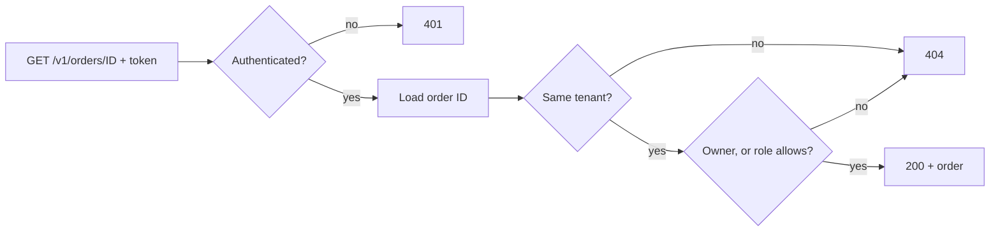
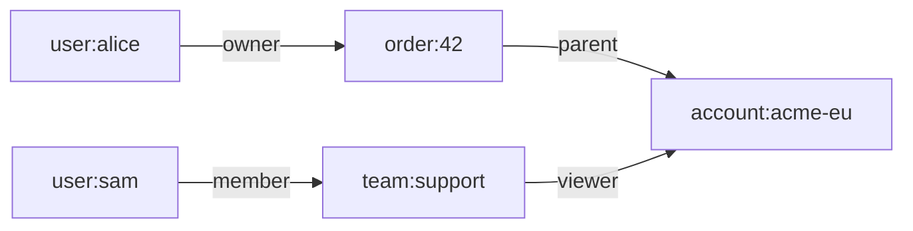

# Authorization

## Why care?

The most common serious API bug has a plain name: **broken object level authorization** (BOLA), also called **IDOR** (insecure direct object reference). It is number one on the OWASP API Security Top 10. It looks like this:

- "I changed the order ID in the URL and saw another customer's address."
- "Support staff of tenant A can open tickets of tenant B, if they know the ticket number."
- "The mobile API hides the button, but the endpoint behind it works for everyone."
- "We added a new `GET /v1/orders/{id}/invoice` route and forgot the check that the old route had."

Every one of these services **had** authentication. The caller was logged in. Nobody asked the second question: **may this caller do this, to this object?**

On this page you add login to a scratch copy of `ordersd`, then read Bob's order as Alice with one `curl`. You fix it in the right layer, prove the fix with a table test, and then look at the models (RBAC, ABAC, ReBAC), policy engines (OPA, Cedar) and PostgreSQL row-level security as a second wall for multi-tenant data.

## The idea: check the object, not only the login

[Authentication](authentication.md) tells you who the caller is. Authorization decides what that caller may do. It works at several levels:

- The **middleware** check runs for every request: "is this a valid, logged-in caller?" It knows nothing about individual orders.
- The **object-level check** decides whether this caller may use **this** order. It needs two facts: who the caller is (from the token) **and** who owns the order (from the loaded order). Only code that has loaded the order knows both.
- A **role plus attributes** rule gives more rights to some callers under conditions. For example, support staff may read every order in their tenant, and a customer may cancel an order only while it is pending.
- The **tenant boundary** separates customer companies that share one system. A caller must never reach data of another tenant, whatever their role.



Authorization is a function: `allow(who, action, what) -> yes / no`. The hard parts are getting all three inputs right, calling it **everywhere**, and making "no" the answer when in doubt.

## Try it: BOLA in a copy of `ordersd`

Copy `examples/orders` to `~/tutor/orders`. Never change the original; we are adding a bug on purpose. Two changes:

1. An `internal/auth` package: a middleware that turns `Authorization: Bearer <token>` into an `Actor` (ID, tenant, roles) in the request context, or answers 401. A table of obviously fake tokens stands in for the JWT verifier of the previous page.
2. A `TenantID` on each order, and `ORDERS_SEED=demo` to create three orders at startup, so we need only GET requests.

```go
// Actor is the authenticated caller.
type Actor struct {
	ID     string   // the customer ID for customers, a staff ID for staff
	Tenant string   // the company the caller belongs to
	Roles  []string // "customer", "support", "admin"
}

// DemoTokens are obviously fake tokens for the tutorial.
var DemoTokens = map[string]Actor{
	"tutor-token-alice": {ID: "alice", Tenant: "acme", Roles: []string{"customer"}},
	"tutor-token-bob":   {ID: "bob", Tenant: "acme", Roles: []string{"customer"}},
	"tutor-token-sam":   {ID: "sam", Tenant: "acme", Roles: []string{"support"}},
	"tutor-token-gina":  {ID: "gina", Tenant: "globex", Roles: []string{"customer"}},
}
```

The routes go behind the middleware. Health checks stay open, because the orchestrator has no token:

```go
	v1 := http.NewServeMux()
	v1.HandleFunc("POST /v1/orders", a.createOrder)
	v1.HandleFunc("GET /v1/orders", a.listOrders)
	v1.HandleFunc("GET /v1/orders/{id}", a.getOrder)

	mux := http.NewServeMux()
	mux.Handle("/v1/", auth.Middleware(auth.DemoTokens, v1)) // authentication: who are you?
	mux.HandleFunc("GET /healthz", a.healthz)
```

The handlers are **unchanged**: exactly the `getOrder` from [Building a service](../go/services.md#handlers-decode-call-respond). Start it:

```console
$ ORDERS_SEED=demo ./bin/ordersd -addr 127.0.0.1:18081
{"time":"2026-11-27T12:25:08.774709017+01:00","level":"INFO","msg":"starting","service":"ordersd","version":"(devel)","revision":"","go_version":"go1.27.4"}
{"time":"2026-11-27T12:25:08.774966256+01:00","level":"INFO","msg":"seeded","service":"ordersd","id":"01a21cc0-8526-7f08-b46e-8fdabbe05981","customer":"alice","tenant":"acme"}
{"time":"2026-11-27T12:25:08.774974983+01:00","level":"INFO","msg":"seeded","service":"ordersd","id":"01a21cc0-8526-7f8e-8dce-2d5b2013fa5c","customer":"bob","tenant":"acme"}
{"time":"2026-11-27T12:25:08.774980894+01:00","level":"INFO","msg":"seeded","service":"ordersd","id":"01a21cc0-8526-7faa-9ea6-7d89e8260354","customer":"gina","tenant":"globex"}
{"time":"2026-11-27T12:25:08.799039074+01:00","level":"INFO","msg":"listening","service":"ordersd","addr":"127.0.0.1:18081"}
```

Authentication works. No token, no orders:

```console
$ curl -s -o /dev/null -w '%{http_code}\n' http://127.0.0.1:18081/v1/orders
401
```

Alice reads her own order. Fine. Now Alice changes the ID in the URL to Bob's:

```console
$ curl -s -H 'Authorization: Bearer tutor-token-alice' \
    http://127.0.0.1:18081/v1/orders/01a21cc0-8526-7f8e-8dce-2d5b2013fa5c | jq .
{
  "id": "01a21cc0-8526-7f8e-8dce-2d5b2013fa5c",
  "tenant_id": "acme",
  "customer_id": "bob",
  "items": [
    {
      "sku": "LAPTOP-9",
      "quantity": 1,
      "price_cents": 189900
    }
  ],
  "status": "pending",
  "total_cents": 189900,
  "created_at": "2026-11-27T11:25:08.77497353Z"
}
```

That's BOLA. And the list endpoint is worse: it gives Alice every order of every tenant.

```console
$ curl -s -H 'Authorization: Bearer tutor-token-alice' http://127.0.0.1:18081/v1/orders \
    | jq -r '.orders[] | "\(.tenant_id) \(.customer_id) \(.total_cents)"'
acme alice 1250
acme bob 189900
globex gina 60000
```

Now look at the access log for the attack:

```json
{
  "time": "2026-11-27T12:25:16.177160824+01:00",
  "level": "INFO",
  "msg": "http request",
  "service": "ordersd",
  "request_id": "01a21cc0-a211-71a9-b8bb-661c9fbfc1e8",
  "method": "GET",
  "path": "/v1/orders/01a21cc0-8526-7f8e-8dce-2d5b2013fa5c",
  "route": "/v1/",
  "status": 200,
  "bytes": 233,
  "duration": 47022
}
```

A normal `200`. No error, no alert. The log doesn't even say **who** made the request. BOLA is invisible to monitoring unless you log the actor and look for one actor touching many owners' objects.

!!! note "Hard-to-guess IDs are not a fix"

    Look at the three seeded IDs: `01a21cc0-8526-7f08-...`, `01a21cc0-8526-7f8e-...`, `01a21cc0-8526-7faa-...`.
    UUIDv7 starts with a timestamp, so IDs made close together share a prefix and leak when they were
    made. Random UUIDv4 would be harder to guess, but IDs leak anyway: in shared links, screenshots,
    support tickets, logs, `Referer` headers, and other API responses. An unguessable ID is a nice
    extra. It is never the check.

## Under the hood: where does the check go?

There are three places you could put "may Alice see this order?". Each one knows different things.

| Layer                 | Knows                           | Good for                                                           | Cannot do                                           |
| --------------------- | ------------------------------- | ------------------------------------------------------------------ | --------------------------------------------------- |
| **Middleware**        | Actor, method, path             | "Logged in?", "has role `admin` for `/admin/*`", tenant from token | Object checks: it hasn't loaded the order           |
| **Handler / service** | Actor **and** the loaded object | Owner checks, state-based rules ("only pending orders")            | Protect lists cheaply: it would load all rows first |
| **Query**             | Actor's IDs as query parameters | Lists and searches: rows you may not see are never loaded          | Rich rules; and you must not forget the `WHERE`     |

So a real service uses all three: **middleware** for authentication and coarse rules, a **policy function** called after loading a single object, and a **filter in the query** for lists. The policy function is one place in the code that says what is allowed:

```go
// Package authz decides what an authenticated actor may do.
// Every function denies unless a rule explicitly allows.
package authz

// Action is something an actor wants to do to an order.
type Action string

// The actions ordersd knows about.
const (
	ReadOrder   Action = "order:read"
	CancelOrder Action = "order:cancel"
)

// Can reports whether a may perform act on o.
func Can(a auth.Actor, act Action, o order.Order) bool {
	// The tenant boundary comes first and holds for every role.
	if a.Tenant == "" || a.Tenant != o.TenantID {
		return false
	}
	owner := a.ID == o.CustomerID
	switch act {
	case ReadOrder:
		return owner || a.Has("support") // RBAC: a role grants more
	case CancelOrder:
		return owner && o.Status == order.StatusPending // ABAC: an attribute decides
	default:
		return false // unknown action: deny
	}
}

// ListFilter returns the rows a may list. The filter goes into the
// query, so rows a may not see are never loaded.
func ListFilter(a auth.Actor) order.Filter {
	if a.Has("support") {
		return order.Filter{TenantID: a.Tenant}
	}
	return order.Filter{TenantID: a.Tenant, CustomerID: a.ID}
}
```

Notice the shape: **every path ends in `false`** unless a rule says yes. The zero `Actor` (no tenant) is denied. An action nobody has written a rule for is denied. That is **deny by default**, and it is the most important property of the function. A policy written as "deny if X, deny if Y, else allow" fails open the day someone adds Z.

The handler calls it after loading:

```go
	o, err := a.svc.Get(r.Context(), id)
	if err != nil {
		a.writeError(w, r, err)
		return
	}
	// Object-level check: the caller is logged in, but may they see THIS order?
	// Answer 404, not 403, so IDs of other customers' orders reveal nothing.
	actor, _ := auth.From(r.Context())
	if !authz.Can(actor, authz.ReadOrder, o) {
		a.writeError(w, r, order.ErrNotFound)
		return
	}
	a.writeJSON(w, r, http.StatusOK, toResponse(o))
```

**404 or 403?** A 403 says "this exists, but not for you". That confirms that a guessed ID is real. For objects owned by other users, answer **404**, exactly like a missing ID. Use 403 when the caller knows the thing exists anyway, for example "you may not cancel your own shipped order".

The list goes through the filter. The service refuses a list without a tenant, so a forgotten filter fails loudly instead of returning everything:

```go
// Filter limits List. Empty fields match everything, so callers must
// always set TenantID.
type Filter struct {
	TenantID   string
	CustomerID string
}

// List returns the orders that match f, oldest first.
func (s *Service) List(ctx context.Context, f Filter) ([]Order, error) {
	if f.TenantID == "" {
		return nil, fmt.Errorf("%w: list without tenant", ErrInvalid)
	}
	orders, err := s.repo.List(ctx, f)
	...
```

In the PostgreSQL store from [Go and SQL](../databases/go-and-sql.md#a-postgresql-store-for-ordersd) the filter becomes `WHERE tenant_id = $1 AND ($2 = '' OR customer_id = $2)`, with placeholders.

There is one more gap: **create**. The request body has `customer_id`. If the server trusts it, Bob creates orders "for Alice" (this is called **mass assignment**: the client sets a field it should not control). The owner and tenant come from the **token**:

```go
	// Owner and tenant come from the token, never from the body.
	actor, _ := auth.From(r.Context())
	if req.CustomerID != actor.ID {
		a.writeProblem(w, r, http.StatusForbidden, "customer_id must be your own")
		return
	}
	n := order.NewOrder{TenantID: actor.Tenant, CustomerID: actor.ID, Items: make([]order.Item, len(req.Items))}
```

### The same attack, after the fix

Restart the fixed build (new IDs, because the store is in memory) and try Bob's order as every user:

```console
$ BOB=01a21dac-6d83-7abf-a905-9f78314a12cc
$ for t in alice bob sam gina; do printf '%-5s ' $t; curl -s -o /dev/null -w '%{http_code}\n' \
    -H "Authorization: Bearer tutor-token-$t" http://127.0.0.1:18081/v1/orders/$BOB; done
alice 404
bob   200
sam   200
gina  404
```

Bob sees his order. Sam, support in the same tenant, sees it. Alice and Gina get a 404. Compare Alice's answer for Bob's real order with her answer for an ID that doesn't exist:

```console
$ curl -s -H 'Authorization: Bearer tutor-token-alice' http://127.0.0.1:18081/v1/orders/$BOB | jq -c .
{"type":"about:blank","title":"Not Found","status":404,"detail":"order not found","request_id":"01a21dac-843d-7cf2-b2fd-6bed8098b3c6"}
$ curl -s -H 'Authorization: Bearer tutor-token-alice' http://127.0.0.1:18081/v1/orders/01a21dac-6d83-7abf-a905-000000000000 | jq -c .
{"type":"about:blank","title":"Not Found","status":404,"detail":"order not found","request_id":"01a21dac-8444-7aaa-9dd2-2e400af942c0"}
```

The same answer. Alice learns nothing. (Response **time** can still differ: a real lookup versus none. For most APIs that is acceptable; for highly sensitive objects, filter in the query instead, so both cases do the same work.) And the lists:

```console
$ for t in alice sam gina; do echo "== $t"; curl -s -H "Authorization: Bearer tutor-token-$t" \
    http://127.0.0.1:18081/v1/orders | jq -r '.orders[] | "\(.tenant_id) \(.customer_id) \(.total_cents)"'; done
== alice
acme alice 1250
== sam
acme alice 1250
acme bob 189900
== gina
globex gina 60000
```

## Under the hood: table tests for authorization

Authorization bugs come back. Someone adds a route, copies a handler without the check, or "simplifies" the policy. The defence is a test that lists **who may do what**, as data. Two levels.

The policy itself, as a [table-driven test](../go/testing.md#table-driven-tests). The rows that matter most are the **denials**:

```go
func TestCan(t *testing.T) {
	var (
		alice = auth.Actor{ID: "alice", Tenant: "acme", Roles: []string{"customer"}}
		bob   = auth.Actor{ID: "bob", Tenant: "acme", Roles: []string{"customer"}}
		sam   = auth.Actor{ID: "sam", Tenant: "acme", Roles: []string{"support"}}
		gsam  = auth.Actor{ID: "sam2", Tenant: "globex", Roles: []string{"support"}}
		anon  = auth.Actor{}
	)
	pending := order.Order{TenantID: "acme", CustomerID: "alice", Status: order.StatusPending}
	shipped := order.Order{TenantID: "acme", CustomerID: "alice", Status: order.StatusShipped}

	tests := []struct {
		name  string
		actor auth.Actor
		act   Action
		o     order.Order
		want  bool
	}{
		{"owner reads", alice, ReadOrder, pending, true},
		{"other customer reads", bob, ReadOrder, pending, false},
		{"support reads in tenant", sam, ReadOrder, pending, true},
		{"support of other tenant", gsam, ReadOrder, pending, false},
		{"zero actor", anon, ReadOrder, order.Order{}, false},
		{"owner cancels pending", alice, CancelOrder, pending, true},
		{"owner cancels shipped", alice, CancelOrder, shipped, false},
		{"support cancels", sam, CancelOrder, pending, false},
		{"unknown action", alice, Action("order:delete"), pending, false},
	}
	for _, tt := range tests {
		t.Run(tt.name, func(t *testing.T) {
			if got := Can(tt.actor, tt.act, tt.o); got != tt.want {
				t.Errorf("Can(%s, %s) = %v, want %v", tt.actor.ID, tt.act, got, tt.want)
			}
		})
	}
}
```

Look at the `zero actor` row: two empty tenants are "equal". Without the `a.Tenant == ""` guard, an actor with no tenant could read an order with no tenant. That row exists because the bug is easy to write.

The policy test can pass while a handler forgets to call the policy. So the second level goes through the **real handler**, with [`httptest`](../go/testing.md#testing-http-httptest), every route, every kind of caller:

```go
	tests := []struct {
		token, method, path, body string
		want                      int
	}{
		{"", "GET", alicesOrder, "", 401},
		{"tutor-token-wrong", "GET", alicesOrder, "", 401},
		{"tutor-token-alice", "GET", alicesOrder, "", 200},
		{"tutor-token-bob", "GET", alicesOrder, "", 404},  // BOLA: must not leak
		{"tutor-token-sam", "GET", alicesOrder, "", 200},  // support, same tenant
		{"tutor-token-gina", "GET", alicesOrder, "", 404}, // other tenant
		{"", "GET", "/v1/orders", "", 401},
		{"tutor-token-alice", "POST", "/v1/orders", body, 201},
		{"tutor-token-bob", "POST", "/v1/orders", body, 403}, // order for someone else
		{"", "GET", "/healthz", "", 200},
	}
```

With the fix, it passes. Now remove the `authz.Can` check from `getOrder` and run it again (IDs replaced by `<id>`, lines cut):

```console
$ go test -count=1 -run TestAccess ./internal/httpapi
--- FAIL: TestAccess (0.00s)
    --- FAIL: TestAccess/GET_/v1/orders/<id>_as_tutor-token-bob (0.00s)
        authz_test.go:52: status = 200, want 404; body: {"id":"<id>","tenant_id":"acme","customer_id":"alice","items":[{"sku":"BOOK-1","quantity":1,"price_cents
    --- FAIL: TestAccess/GET_/v1/orders/<id>_as_tutor-token-gina (0.00s)
        authz_test.go:52: status = 200, want 404; body: {"id":"<id>","tenant_id":"acme","customer_id":"alice","items":[{"sku":"BOOK-1","quantity":1,"price_cents
FAIL
FAIL	github.com/acme/orders/internal/httpapi	0.005s
FAIL
```

The test names the exact attack, and shows the leaked body. Make it a team rule: **a new route needs new rows in this table**, and a reviewer asks for them.

## Under the hood: RBAC, ABAC, ReBAC

`Can` above already mixes two models. Here they are by name, plus the third one you meet in larger systems.

### RBAC: roles

**Role-based access control.** Permissions belong to **roles**; users get roles. "Support may read orders." Simple to explain, simple to audit ("who has `admin`?"). Kubernetes uses it, and you wrote a Role for `ordersd` in [Kubernetes RBAC](../kubernetes/config-and-secrets.md#under-the-hood-rbac).

Its limit: roles know nothing about **which** object. "May read **their own** orders" is not a role. Teams then invent `order-reader-acme-eu-north` roles until nobody understands the list. That is **role explosion**.

### ABAC: attributes

**Attribute-based access control.** The rule looks at attributes of the actor, the object, the action and the environment: `actor.tenant == order.tenant_id`, `order.status == "pending"`, `actor.department == "finance"`, `time < 18:00`. Owner checks are ABAC (`actor.id == order.customer_id`). Very expressive. The cost: rules are harder to audit ("who can read order 42?" means running the rules over every actor).

### ReBAC: relationships

**Relationship-based access control.** Permissions follow a **graph** of relationships: "Alice is the owner of order 42", "order 42 is in account acme-eu", "Sam is a member of team support", "team support is a viewer of account acme-eu". May Sam read order 42? Walk the graph.

Google described its system for this in the **Zanzibar** paper (2019): one global service that stores relationship **tuples** and answers "check" questions for Drive, YouTube, Calendar and others. Open-source systems built on the idea: OpenFGA, SpiceDB, Ory Keto. A tuple has the form `object#relation@subject`:

| Tuple                                        | Reads as                                   |
| -------------------------------------------- | ------------------------------------------ |
| `order:42#owner@user:alice`                  | Alice owns order 42                        |
| `order:42#parent@account:acme-eu`            | Order 42 is in account acme-eu             |
| `team:support#member@user:sam`               | Sam is in team support                     |
| `account:acme-eu#viewer@team:support#member` | Every member of team support views acme-eu |

And a schema says how relations combine: "a `reader` of an order is its `owner`, or any `viewer` of its `parent` account". Then `check(order:42, reader, user:sam)` is **true** through the last three tuples.



ReBAC works well for sharing ("share this folder with that team"), deep hierarchies, and questions in both directions ("what can Sam read?"). The cost: a separate, critical service, and keeping its tuples in sync with your database.

| Model | Decides with                       | Good at                                | Weak at                                     |
| ----- | ---------------------------------- | -------------------------------------- | ------------------------------------------- |
| RBAC  | Actor's roles                      | Coarse, auditable rights; staff tools  | Per-object rules; role explosion            |
| ABAC  | Attributes of actor/object/context | Ownership, tenant, state, time         | Auditing "who can access X?"                |
| ReBAC | A graph of relationships           | Sharing, hierarchies, Drive-style apps | Operating a central service; syncing tuples |

Most enterprise services start where `Can` is: RBAC for staff, ABAC for ownership and tenant. That is fine. Move to ReBAC when sharing and hierarchies appear, not before.

## Under the hood: policy engines

`Can` is Go code. When rules change often, when many services must share them, or when auditors want to read them, teams move the rules into a **policy engine**: the service sends "who, what, which object" as JSON and gets "allow / deny" back. The code still loads the object and still calls the engine **in the same places**. Only the decision moves.

### OPA and Rego

[Open Policy Agent](https://www.openpolicyagent.org/) evaluates policies in a language called **Rego**. Here is `Can`, in Rego:

```rego
package orders.authz

default allow := false

same_tenant if input.actor.tenant == input.order.tenant_id

owner if input.actor.id == input.order.customer_id

allow if {
	input.action == "order:read"
	same_tenant
	owner
}

allow if {
	input.action == "order:read"
	same_tenant
	"support" in input.actor.roles
}

allow if {
	input.action == "order:cancel"
	same_tenant
	owner
	input.order.status == "pending"
}
```

`default allow := false` is deny by default. Several `allow` rules are an OR; the lines inside one rule are an AND. Rego has its own unit tests, so the table from before becomes:

```rego
package orders.authz_test

import data.orders.authz

alice := {"id": "alice", "tenant": "acme", "roles": ["customer"]}

bob := {"id": "bob", "tenant": "acme", "roles": ["customer"]}

sam := {"id": "sam", "tenant": "acme", "roles": ["support"]}

order := {"tenant_id": "acme", "customer_id": "alice", "status": "pending"}

test_owner_reads if authz.allow with input as {"actor": alice, "action": "order:read", "order": order}

test_other_customer_denied if not authz.allow with input as {"actor": bob, "action": "order:read", "order": order}

test_support_reads if authz.allow with input as {"actor": sam, "action": "order:read", "order": order}

test_support_cannot_cancel if not authz.allow with input as {"actor": sam, "action": "order:cancel", "order": order}

test_unknown_action_denied if not authz.allow with input as {"actor": alice, "action": "order:delete", "order": order}
```

Run the tests and one decision with the OPA image. As before, `docker create` and `docker cp` copy the files in without a volume (`run` is a small shell function that does create, cp and `start -a`):

```console
$ run() { docker create --rm --name tutor-opa openpolicyagent/opa:1.23.0 "$@" >/dev/null &&
          docker cp ~/tutor/opa/. tutor-opa:/p >/dev/null && docker start -a tutor-opa; }
$ run test /p -v
/p/orders_test.rego:21:
data.orders.authz_test.test_unknown_action_denied: PASS (6.397904ms)
/p/orders_test.rego:15:
data.orders.authz_test.test_other_customer_denied: PASS (5.784888ms)
/p/orders_test.rego:19:
data.orders.authz_test.test_support_cannot_cancel: PASS (5.816452ms)
/p/orders_test.rego:13:
data.orders.authz_test.test_owner_reads: PASS (6.433861ms)
/p/orders_test.rego:17:
data.orders.authz_test.test_support_reads: PASS (6.425034ms)
--------------------------------------------------------------------------------
PASS: 5/5
$ cat ~/tutor/opa/input.json
{
  "actor": {"id": "bob", "tenant": "acme", "roles": ["customer"]},
  "action": "order:read",
  "order": {"tenant_id": "acme", "customer_id": "alice", "status": "pending"}
}
$ run eval -f pretty -d /p/orders.rego -i /p/input.json data.orders.authz.allow
false
```

Bob may not read Alice's order. In production OPA runs as a sidecar or a library (`github.com/open-policy-agent/opa/v1/rego` can embed it in Go), so a decision is a local call, not a network hop to a central server.

### Cedar

[Cedar](https://www.cedarpolicy.com/) is a policy language from AWS (used by Amazon Verified Permissions), designed to be easy to read and to **analyse**: tools can prove things like "no policy lets a customer read another tenant's orders". Policies have a fixed shape: `permit` or `forbid`, a principal, an action, a resource, and conditions. A `forbid` always beats a `permit`. Roughly:

```text
permit (
    principal,
    action == Action::"order:read",
    resource
) when { resource.tenant == principal.tenant && resource.customer == principal };

forbid (principal, action, resource)
    unless { resource.tenant == principal.tenant };
```

We did not run Cedar here; the syntax above follows the Cedar documentation and is meant to show the shape. The idea to take away is the same for every engine: **the code still loads the object, still calls the decision point on every path, and still denies when the engine is down or the answer is unclear.**

## Under the hood: multi-tenant data

`acme` and `globex` share one `ordersd` and one database. A leak between tenants is the worst kind of BOLA: it breaks contracts, not just privacy. The options, from most to least isolated:

| Design                           | Isolation                         | Cost                                                |
| -------------------------------- | --------------------------------- | --------------------------------------------------- |
| Database (or cluster) per tenant | Strong; easy "delete this tenant" | Many databases to migrate, back up, pay for         |
| Schema per tenant                | Good                              | Thousands of schemas strain migrations and catalogs |
| **Shared tables + `tenant_id`**  | Only as good as every query       | Cheapest; the usual choice                          |

With shared tables, every query must say `WHERE tenant_id = $1`. One forgotten `WHERE` in a report endpoint leaks everything. **PostgreSQL row-level security** (RLS) adds a second wall: the database itself adds the tenant filter to every query, for every statement the app's role runs.

### Try it: RLS in PostgreSQL 18

Start a throwaway PostgreSQL (the [Databases](../databases/index.md) chapter used the same image):

```console
$ docker run -d --rm --name tutor-pg-rls -e POSTGRES_PASSWORD=tutor-fake-pw postgres:18
$ docker exec tutor-pg-rls psql -U postgres -tAc 'select version()'
PostgreSQL 18.7 (Debian 18.7-1.pgdg13+5) on x86_64-pc-linux-gnu, compiled by gcc (Debian 14.2.0-19) 14.2.0, 64-bit
```

A table, three rows, an app role that does **not** own the table, and a policy:

```sql
CREATE TABLE orders (
    id          bigint GENERATED ALWAYS AS IDENTITY PRIMARY KEY,
    tenant_id   text   NOT NULL,
    customer_id text   NOT NULL,
    total_cents bigint NOT NULL
);
INSERT INTO orders (tenant_id, customer_id, total_cents) VALUES
    ('acme', 'alice', 1250), ('acme', 'bob', 189900), ('globex', 'gina', 60000);

-- The app connects as this role. It does not own the table.
CREATE ROLE ordersd LOGIN;
GRANT SELECT, INSERT, UPDATE ON orders TO ordersd;

ALTER TABLE orders ENABLE ROW LEVEL SECURITY;
CREATE POLICY tenant_isolation ON orders
    USING (tenant_id = current_setting('app.tenant_id', true))
    WITH CHECK (tenant_id = current_setting('app.tenant_id', true));
```

- `USING` filters the rows a statement can **see** (SELECT, UPDATE, DELETE).
- `WITH CHECK` checks rows a statement **writes** (INSERT, UPDATE).
- `current_setting('app.tenant_id', true)` reads a custom setting. The `true` means "return NULL if it is not set", and `tenant_id = NULL` is never true. So **no tenant set means no rows**: deny by default, in SQL.

The app sets the tenant at the start of each transaction, from the token. Connect as `ordersd`:

```sql
\echo '-- 1. no tenant set'
SELECT count(*) FROM orders;
\echo '-- 2. tenant acme, inside a transaction'
BEGIN;
SET LOCAL app.tenant_id = 'acme';
SELECT tenant_id, customer_id, total_cents FROM orders;
\echo '-- 3. ask for a globex order by customer name'
SELECT count(*) FROM orders WHERE customer_id = 'gina';
\echo '-- 4. try to write into another tenant'
INSERT INTO orders (tenant_id, customer_id, total_cents) VALUES ('globex', 'mallory', 1);
ROLLBACK;
```

```console
$ docker exec -i tutor-pg-rls psql -U ordersd -d postgres < rls-try.sql
-- 1. no tenant set
 count
-------
     0
(1 row)

-- 2. tenant acme, inside a transaction
BEGIN
SET
 tenant_id | customer_id | total_cents
-----------+-------------+-------------
 acme      | alice       |        1250
 acme      | bob         |      189900
(2 rows)

-- 3. ask for a globex order by customer name
 count
-------
     0
(1 row)

-- 4. try to write into another tenant
ERROR:  new row violates row-level security policy for table "orders"
ROLLBACK
```

Query 3 is the forgotten-`WHERE` bug: it asks for Gina's order with no tenant filter at all. RLS answers 0 rows. Query 4 tries to plant a row in `globex`; `WITH CHECK` refuses.

In Go, with `pgx`, the pattern is one transaction per request: `BEGIN`, then `SELECT set_config('app.tenant_id', $1, true)` (the `true` means "local to this transaction", and unlike `SET` it takes a placeholder), then your queries, then `COMMIT`.

### RLS traps, shown

**The table owner bypasses RLS.** Policies don't apply to the table's owner, and superusers and roles with `BYPASSRLS` skip them always. Give the table to a `migrator` role and connect as that role, with no tenant set:

```console
$ docker exec tutor-pg-rls psql -U postgres -q -c 'CREATE ROLE migrator LOGIN' -c 'ALTER TABLE orders OWNER TO migrator'
$ docker exec tutor-pg-rls psql -U migrator -d postgres -c 'SELECT count(*) FROM orders'
 count
-------
     3
(1 row)

$ docker exec tutor-pg-rls psql -U postgres -d postgres -c 'ALTER TABLE orders FORCE ROW LEVEL SECURITY'
ALTER TABLE
$ docker exec tutor-pg-rls psql -U migrator -d postgres -c 'SELECT count(*) FROM orders'
 count
-------
     0
(1 row)

$ docker exec tutor-pg-rls psql -U postgres -d postgres -c 'SELECT count(*) FROM orders' \
    -c "SELECT rolname, rolsuper, rolbypassrls FROM pg_roles WHERE rolname IN ('postgres','ordersd','migrator')"
 count
-------
     3
(1 row)

 rolname  | rolsuper | rolbypassrls
----------+----------+--------------
 postgres | t        | t
 ordersd  | f        | f
 migrator | f        | f
(3 rows)
```

The owner saw all 3 rows until `FORCE ROW LEVEL SECURITY`. The superuser `postgres` sees all 3 even then. So: the app must connect as a role that is **not** the owner and **not** a superuser, and use `FORCE` anyway, because many apps run migrations and queries as the same role.

**`SET` without `LOCAL` leaks through the connection pool.** A plain `SET` lasts for the whole **connection**, and a pool hands that connection to the next request:

```console
$ docker exec -i tutor-pg-rls psql -U ordersd -d postgres -e
SET app.tenant_id = 'acme';
SET
SELECT count(*) FROM orders;
 count
-------
     2
(1 row)

SELECT count(*) FROM orders;
 count
-------
     2
(1 row)

RESET app.tenant_id;
RESET
SELECT count(*) FROM orders;
 count
-------
     0
(1 row)
```

The first `SELECT` is request 1, for tenant acme. The second is request 2 on the same pooled connection, which **forgot** to set its tenant: it still sees acme's rows. With `SET LOCAL` (or `set_config(..., true)`) inside a transaction, the setting ends at `COMMIT` or `ROLLBACK`, and a forgetful request sees 0 rows instead. Clean up:

```sh
docker stop tutor-pg-rls
```

RLS is the **second** wall. Keep the `WHERE tenant_id = $1` in your queries too (it also lets the planner use the tenant index; see [Indexes](../databases/indexes.md)), and keep `authz.Can` for owner and role rules, which RLS policies could do but are clumsy to test.

## Deny by default, everywhere

The pattern on this page, in one list:

- **Routes:** everything under `/v1/` needs authentication. Public routes (`/healthz`) are listed explicitly.
- **Policy:** `Can` returns `false` unless a rule allows. Unknown actions, empty tenants and unknown roles are denied.
- **Engines:** `default allow := false` in Rego; `forbid` beats `permit` in Cedar. If the engine can't be reached, deny (fail **closed**).
- **Data:** a list without a tenant is an error. RLS with no tenant set returns nothing.
- **Tests:** the access table lists every route; a new route without rows is a review finding.

## Traps

- **Checking the login, not the object.** Authentication middleware is not authorization. Every handler that takes an ID must check that the caller may touch **that** object.
- **Trusting IDs from the body.** `customer_id`, `tenant_id`, `role`, `is_admin` in a request body are attacker input. Take them from the token.
- **Hiding instead of checking.** A hidden button, an unlinked admin page or an unguessable ID is not access control. The API must refuse.
- **403 for other people's objects.** It confirms the object exists. Use 404, like for a missing ID.
- **Filtering after loading for lists.** `List()` then drop rows in Go loads everything, breaks pagination counts, and fails open when the filter is forgotten. Filter in the query.
- **New routes without the check.** The old route had it; the new `/invoice` route doesn't. An access table test per route catches it.
- **Fail-open policies.** "Deny if X, else allow" and "allow if the policy engine times out" both fail open. Write rules that allow, and deny everything else.
- **RLS run as the table owner or a superuser.** Policies don't apply. Use a separate app role and `FORCE ROW LEVEL SECURITY`.
- **`SET` instead of `SET LOCAL` with a pool.** The tenant leaks to the next request on that connection.
- **Not logging the actor.** Without it, BOLA looks like normal traffic. Log the actor ID and tenant (not the token) on every request.

## Check yourself

??? question "1. Alice is logged in and reads Bob's order by changing the ID. Which layer should have stopped her, and why can't authentication middleware do it?"

    The handler (or service), after loading the order: only there are both facts known, the actor from
    the token and the order's owner and tenant. Middleware runs before the order is loaded; it can say
    "logged in" and check coarse roles, but not "owner of this object".

??? question "2. Why does the fixed `ordersd` answer 404 instead of 403 when Alice asks for Bob's order?"

    A 403 tells Alice the ID is real, which helps her enumerate and confirms leaked IDs. A 404 is
    exactly what she gets for an ID that doesn't exist, so she learns nothing. Use 403 only when the
    caller already knows the object exists.

??? question "3. `TestCan` has a row for a zero `Actor` reading a zero `Order`. What bug does it catch?"

    Without the `a.Tenant == ""` guard, an empty actor tenant equals an empty order tenant, so the
    tenant check passes. Combined with an empty actor ID equal to an empty customer ID, the "owner"
    rule would allow it too. Empty must never match empty in an access check.

??? question "4. A team keeps adding roles like `order-reader-acme-eu`. What is happening, and what would you suggest?"

    Role explosion: they are encoding object attributes (tenant, region) into role names, because RBAC
    can't look at the object. Keep a few roles (`support`), and add attribute rules (`actor.tenant ==
    order.tenant`). If sharing and hierarchies grow, consider ReBAC.

??? question "5. RLS is on, the policy is right, but the app still sees every tenant's rows. Name two likely causes."

    The app connects as the table owner (without `FORCE ROW LEVEL SECURITY`) or as a superuser or a
    role with `BYPASSRLS`; policies then don't apply. Or the tenant setting leaks: a plain `SET` on a
    pooled connection from an earlier request, so the setting is a different tenant than intended
    (that one shows another tenant's rows, not all).

??? question "6. Your service calls OPA for every decision. OPA is down. What should the service do, and why?"

    Deny (fail closed), and alert. Allowing on errors turns an outage of the policy engine into a
    data leak, and an attacker who can slow down or crash OPA would get full access. Run OPA as a
    local sidecar or embedded library so it is rarely unreachable.

## Recap

- **Authorization** answers "may **this** actor do **this** action to **this** object?". Being logged in is not enough. BOLA (IDOR) is the top API bug, and it shows up as a normal `200` in the logs.
- Put checks in **three layers**: middleware for authentication and coarse rules, a **policy function** after loading each object, a **filter in the query** for lists.
- Take owner and tenant **from the token**, never from the body. Answer **404** for objects the caller may not see.
- **Deny by default**: every rule allows explicitly, everything else is `false`; fail closed when the decision point is down.
- **RBAC** uses roles, **ABAC** uses attributes (owner, tenant, status), **ReBAC** walks a relationship graph (Zanzibar, OpenFGA, SpiceDB).
- **Policy engines** (OPA/Rego, Cedar) move decisions out of code, with their own tests. The code still calls them on every path.
- **Multi-tenant** shared tables need `tenant_id` in every query. **PostgreSQL RLS** is a second wall: no tenant set means no rows. Don't run it as the owner or a superuser, use `FORCE`, and use `SET LOCAL` / `set_config(..., true)` with pools.
- **Table tests** list who may do what, per route, through the real handler. A new route needs new rows.

Next: `ordersd` now checks tokens and owners. The keys, database passwords and client secrets it needs to do that must live somewhere. [Secrets management](secrets-management.md).
