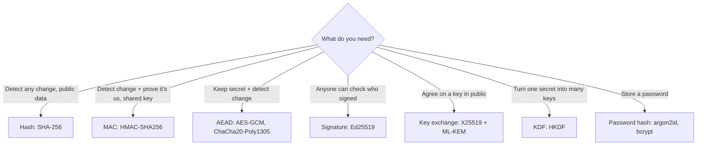

# Cryptography for engineers

## Why care?

You will probably never design a cipher. But you will make decisions about cryptography often:

- "Hash the API key before we store it. SHA-256 is fine, right?"
- "Sign the webhook body: `sha256(secret + body)`."
- "Encrypt the card data with AES-GCM. The nonce can be zero; the key is secret."
- "Compare the token with `==`."

Two of those four are broken, and on this page you break them on your own machine. Most crypto failures in real systems are not broken algorithms. They are good algorithms used the wrong way: the wrong tool for the job, a reused nonce, a fast hash for passwords, a comparison that leaks time.

This page gives you the toolbox (hashes, MACs, authenticated encryption, public-key crypto, key derivation, password hashing, randomness, post-quantum) with Go's standard library, real outputs and real timings. It's the base for the fixes in the [threat model](threat-modeling.md): TLS, tokens, signed images and stored secrets are all built from these parts.

## The idea: one tool per job

Cryptography is a set of tools. Each tool solves one problem:

- A **hash** turns any input into a short, fixed-size value. Anyone can compute it, the same input always gives the same value, and you cannot get the input back from it.
- A **MAC** (message authentication code) is a tag computed with a secret key that two parties share. It proves that the message came from someone with the key and was not changed.
- **Authenticated encryption** (AEAD) keeps data secret and detects any change to it.
- A **signature** is made with a private key and checked with a public key. Anyone can check it, but only the key owner can make it.
- A **key exchange** lets two parties agree on a shared secret over a public network ([TLS](../networking/tls.md#the-idea-encryption-key-exchange-and-signatures) explains this one).
- A **password hash** is a hash that is slow on purpose, so an attacker who tries millions of guesses needs a very long time.

The mistakes on this page all come from using one tool for another tool's job: a hash as a MAC, or a MAC as encryption.



### Setup

All demos live in a scratch module outside the repository. Two of them need `golang.org/x/crypto`; everything else is the standard library (Go 1.27).

```console
$ mkdir -p ~/tutor/crypto && cd ~/tutor/crypto
$ go mod init example.com/cryptodemo
go: creating new go.mod: module example.com/cryptodemo
$ go get golang.org/x/crypto@latest
go: downloading golang.org/x/crypto v0.59.0
go: added golang.org/x/crypto v0.59.0
```

Each demo is a `main` package in its own directory (`hash/`, `lenext/`, ...), run with `go run ./<dir>`. Timings come from an AMD Ryzen 7 5800H laptop (16 threads) under WSL2; yours will differ, but the ratios hold.

## Under the hood: hashes

A cryptographic hash turns any input into a fixed-size digest. Three promises: you can't find an input for a given digest (preimage), you can't find two inputs with the same digest (collision), and one changed bit changes about half the output bits.

```go
// Command hash shows that SHA-256 is fixed-size and that one changed
// character changes the whole digest.
package main

import (
	"crypto/sha256"
	"fmt"
	"math/bits"
)

func main() {
	a := sha256.Sum256([]byte("order 42: 3 books"))
	b := sha256.Sum256([]byte("order 42: 4 books"))
	fmt.Printf("%x\n%x\n", a, b)

	diff := 0
	for i := range a {
		diff += bits.OnesCount8(a[i] ^ b[i])
	}
	fmt.Printf("%d of 256 bits differ\n", diff)

	big := sha256.Sum256(make([]byte, 10<<20))
	fmt.Printf("10 MiB in, %d bytes out\n", len(big))
}
```

```console
$ go run ./hash
1ab2e2e1991af1f0be8c55c4cdf87272aa2d841a47eb6f196a4fd29c71d20e53
2d8a85ed4bc83e9b76a26f5294f116af1d6ca8fb11159771fb698ff94a1fa6fe
131 of 256 bits differ
10 MiB in, 32 bytes out
$ printf 'order 42: 3 books' | sha256sum
1ab2e2e1991af1f0be8c55c4cdf87272aa2d841a47eb6f196a4fd29c71d20e53  -
```

Go and `sha256sum` agree, as they must: a hash has no key and no randomness. That is the point (anyone can check a download) and the limit (anyone can also compute it, so a hash alone proves nothing about _who_).

Use SHA-256 (or SHA-512, or SHA-3) for: checksums, content addresses (Git, image digests, `go.sum`), and as a building block inside HMAC and HKDF. Don't use MD5 or SHA-1 for anything security-related: both have practical collisions.

### Breaking it: length extension

A common homemade "signature" is `sha256(secret || message)`. It looks right: you need the secret to compute it. It is not.

SHA-256 processes input in 64-byte blocks and keeps eight 32-bit words of state. **The digest is that state**, after the last block. So if you know a digest, you know the state, and you can keep hashing from there. The attacker doesn't need the secret; they only need its length (or a few guesses).

Go's `sha256` digest can save and load its state (`encoding.BinaryUnmarshaler`), so the attack is a few lines:

```go
// Command lenext forges a "signed" request protected by sha256(secret || msg),
// without knowing the secret: a length-extension attack. Then it tries the
// same trick against HMAC.
package main

import (
	"crypto/hmac"
	"crypto/sha256"
	"encoding"
	"encoding/binary"
	"fmt"
)

// The server's key. The attacker knows only its length: 16 bytes.
var secret = []byte("tutor-fake-16byt")

func naiveMAC(msg []byte) []byte {
	h := sha256.Sum256(append(append([]byte{}, secret...), msg...))
	return h[:]
}

func realHMAC(msg []byte) []byte {
	h := hmac.New(sha256.New, secret)
	h.Write(msg)
	return h.Sum(nil)
}

// padding is what SHA-256 appends to an n-byte message before the last block.
func padding(n int) []byte {
	p := []byte{0x80}
	for (n+len(p))%64 != 56 {
		p = append(p, 0)
	}
	return binary.BigEndian.AppendUint64(p, uint64(n)*8)
}

// extend continues the hash from tag, as if it had also hashed glue+extra.
func extend(msg, tag, extra []byte, secretLen int) (forgedMsg, forgedTag []byte) {
	glue := padding(secretLen + len(msg))
	state := append([]byte("sha\x03"), tag...) // magic, then the 8 state words = the tag
	state = append(state, make([]byte, 64)...) // empty block buffer
	state = binary.BigEndian.AppendUint64(state, uint64(secretLen+len(msg)+len(glue)))

	d := sha256.New()
	if err := d.(encoding.BinaryUnmarshaler).UnmarshalBinary(state); err != nil {
		panic(err)
	}
	d.Write(extra)
	return append(append(append([]byte{}, msg...), glue...), extra...), d.Sum(nil)
}

func main() {
	msg := []byte("customer=c-1&order=42")
	extra := []byte("&refund=all")

	forged, tag := extend(msg, naiveMAC(msg), extra, len(secret))
	fmt.Printf("attacker sends: %q\n", forged)
	fmt.Println("sha256(secret||msg) accepts forgery:", hmac.Equal(naiveMAC(forged), tag))

	forged, tag = extend(msg, realHMAC(msg), extra, len(secret))
	fmt.Println("HMAC-SHA256 accepts forgery:        ", hmac.Equal(realHMAC(forged), tag))
}
```

```console
$ go run ./lenext
attacker sends: "customer=c-1&order=42\x80\x00\x00\x00\x00\x00\x00\x00\x00\x00\x00\x00\x00\x00\x00\x00\x00\x00\x00\x00\x00\x00\x00\x00\x00\x01(&refund=all"
sha256(secret||msg) accepts forgery: true
HMAC-SHA256 accepts forgery:         false
```

The forged message is ugly (the padding bytes sit in the middle), but many parsers don't care: a query-string parser sees `customer=c-1`, `order=42<junk>`, and `refund=all`. The server computes `sha256(secret || forged)` and gets exactly the attacker's tag.

SHA-512 and SHA-256 both have this property. SHA-3 and BLAKE2 don't, but the right fix is not "a different hash". It is the right tool: a MAC.

## Under the hood: MACs

**HMAC** hashes twice with the key mixed in: `H(key ⊕ opad || H(key ⊕ ipad || msg))`. The outer hash hides the inner state, so there's nothing to extend. That's why the second line above says `false`.

Use HMAC-SHA256 for: webhook signatures, signed cookies, request signing between your services, and HS256 JWTs ([Authentication](authentication.md) shows what goes wrong there). In Go:

```go
mac := hmac.New(sha256.New, key)
mac.Write(body)
expected := mac.Sum(nil)
if !hmac.Equal(expected, receivedMAC) { // never bytes.Equal, never ==
	return errBadSignature
}
```

### Breaking it: the comparison leaks time

Why `hmac.Equal` and not `==`? A comparison that stops at the first different byte takes **longer the more bytes are right**. An attacker who can measure that guesses a tag byte by byte: 256 tries per byte instead of 2^256 tries in total.

```go
// Command timing measures how long a comparison takes when the guess is
// wrong in the first byte versus the last byte.
package main

import (
	"crypto/subtle"
	"fmt"
	"slices"
	"time"
)

// naiveEqual is the loop many people write: stop at the first difference.
func naiveEqual(a, b []byte) bool {
	if len(a) != len(b) {
		return false
	}
	for i := range a {
		if a[i] != b[i] {
			return false
		}
	}
	return true
}

var sink bool

// median of 31 runs, each timing 200,000 comparisons, in ns per comparison.
func measure(f func(a, b []byte) bool, a, b []byte) float64 {
	const n = 200_000
	var runs []float64
	for range 31 {
		start := time.Now()
		for range n {
			sink = f(a, b)
		}
		runs = append(runs, float64(time.Since(start).Nanoseconds())/n)
	}
	slices.Sort(runs)
	return runs[len(runs)/2]
}

func main() {
	for _, size := range []int{64, 4096} {
		run(size)
	}
}

func run(size int) {
	secret := make([]byte, size) // a fake token, all 'k'
	for i := range secret {
		secret[i] = 'k'
	}
	wrongFirst := slices.Clone(secret)
	wrongFirst[0] = 'x'
	wrongLast := slices.Clone(secret)
	wrongLast[size-1] = 'x'

	cmps := []struct {
		name string
		f    func(a, b []byte) bool
	}{
		{"naive loop", naiveEqual},
		{"string ==", func(a, b []byte) bool { return string(a) == string(b) }},
		{"subtle.ConstantTimeCompare", func(a, b []byte) bool { return subtle.ConstantTimeCompare(a, b) == 1 }},
	}
	fmt.Printf("\n%-28s %13s %14s\n", fmt.Sprintf("%d-byte secret", size), "wrong first", "wrong last")
	for _, c := range cmps {
		fmt.Printf("%-28s %10.1f ns %11.1f ns\n", c.name, measure(c.f, secret, wrongFirst), measure(c.f, secret, wrongLast))
	}
}
```

```console
$ go run ./timing

64-byte secret                 wrong first     wrong last
naive loop                          2.2 ns        34.9 ns
string ==                           3.9 ns         3.9 ns
subtle.ConstantTimeCompare         19.1 ns        19.0 ns

4096-byte secret               wrong first     wrong last
naive loop                          2.2 ns      2100.3 ns
string ==                           4.1 ns        51.5 ns
subtle.ConstantTimeCompare       1044.2 ns      1023.8 ns
```

Read it carefully:

- The **naive loop** leaks clearly: 2 ns when the first byte is wrong, 35 ns when only the last one is. Each correct byte adds about half a nanosecond.
- **`==`** looks safe at 64 bytes, because Go compares 32 bytes at a time with vector instructions. At 4096 bytes it leaks (4 ns vs 51 ns). "Safe on this CPU, at this length, with this Go version" is not a property you want to depend on.
- **`subtle.ConstantTimeCompare`** takes the same time either way. It is slower, and that's fine. (It returns early only when the **lengths** differ, and lengths are not secret.)

Half a nanosecond is hard to see across a network, but attackers average millions of requests, and they sit in the same cloud region. Use `hmac.Equal` (which calls `subtle.ConstantTimeCompare`) for every secret comparison: MACs, API keys, reset tokens, CSRF tokens.

## Under the hood: authenticated encryption (AEAD)

Encryption alone hides data, but an attacker can still **flip bits** in the ciphertext, and with stream modes (CTR) the same bits flip in the plaintext. So always use **authenticated encryption with associated data** (AEAD): it encrypts, and it adds a tag that fails if one bit changed.

Two AEADs to know:

- **AES-GCM**: AES in counter mode plus a GHASH tag. Very fast on CPUs with AES instructions (all servers today). 12-byte nonce.
- **ChaCha20-Poly1305**: a stream cipher plus a Poly1305 tag. Fast in software, on phones and small CPUs. **XChaCha20-Poly1305** has a 24-byte nonce, long enough to pick at random forever.

Both take **associated data**: bytes that are authenticated but not encrypted. Put the context there (the order ID, the table and column), so a ciphertext can't be cut from one row and pasted into another.

```go
// Command aead encrypts with AES-256-GCM and XChaCha20-Poly1305, and shows
// that a changed byte or a changed label is rejected.
package main

import (
	"crypto/aes"
	"crypto/cipher"
	"crypto/rand"
	"fmt"

	"golang.org/x/crypto/chacha20poly1305"
)

func main() {
	key := make([]byte, 32)
	rand.Read(key)
	block, _ := aes.NewCipher(key)
	gcm, _ := cipher.NewGCM(block)
	xcc, _ := chacha20poly1305.NewX(key)

	plain := []byte(`{"card_last4":"4242"}`)
	label := []byte("order 42") // additional data: authenticated, not encrypted

	for _, c := range []struct {
		name string
		aead cipher.AEAD
	}{{"AES-256-GCM", gcm}, {"XChaCha20-Poly1305", xcc}} {
		name, aead := c.name, c.aead
		nonce := make([]byte, aead.NonceSize())
		rand.Read(nonce)
		sealed := aead.Seal(nil, nonce, plain, label) // ciphertext || 16-byte tag
		fmt.Printf("%s: nonce %d bytes, %d bytes plain -> %d bytes sealed\n",
			name, len(nonce), len(plain), len(sealed))

		_, err := aead.Open(nil, nonce, sealed, label)
		fmt.Println("  open as is:      ", err)
		sealed[3] ^= 1 // flip one bit
		_, err = aead.Open(nil, nonce, sealed, label)
		fmt.Println("  one bit flipped: ", err)
		sealed[3] ^= 1
		_, err = aead.Open(nil, nonce, sealed, []byte("order 43"))
		fmt.Println("  label 'order 43':", err)
	}
}
```

```console
$ go run ./aead
AES-256-GCM: nonce 12 bytes, 21 bytes plain -> 37 bytes sealed
  open as is:       <nil>
  one bit flipped:  cipher: message authentication failed
  label 'order 43': cipher: message authentication failed
XChaCha20-Poly1305: nonce 24 bytes, 21 bytes plain -> 37 bytes sealed
  open as is:       <nil>
  one bit flipped:  chacha20poly1305: message authentication failed
  label 'order 43': chacha20poly1305: message authentication failed
```

The tag is 16 bytes (21 + 16 = 37). You store the nonce next to the ciphertext; it isn't secret. Go 1.24 added `cipher.NewGCMWithRandomNonce`, which picks a random nonce and prepends it for you, so you can't forget.

### Nonces: number used once

A **nonce** must never repeat under the same key. Not "should rarely". Never. Three safe ways:

- A **random** 12-byte nonce for AES-GCM is fine for up to about 2^32 messages per key; then rotate the key.
- A **random** 24-byte nonce for XChaCha20-Poly1305 is fine for practically any number of messages.
- A **counter** works, if you can guarantee it never resets (crash, restore from backup, two replicas). That's harder than it sounds.

### Breaking it: AES-GCM with a reused nonce

GCM is counter mode: it makes a **keystream** from (key, nonce) and XORs it with the plaintext. Same key and nonce, same keystream. XOR two ciphertexts and the keystream cancels out:

`c1 ⊕ c2 = (p1 ⊕ ks) ⊕ (p2 ⊕ ks) = p1 ⊕ p2`

```go
// Command gcmreuse encrypts two messages with AES-GCM under the same key
// AND the same nonce, then recovers the second message from the first.
package main

import (
	"crypto/aes"
	"crypto/cipher"
	"crypto/rand"
	"fmt"
)

func xor(a, b []byte) []byte {
	out := make([]byte, min(len(a), len(b)))
	for i := range out {
		out[i] = a[i] ^ b[i]
	}
	return out
}

func main() {
	key := make([]byte, 32)
	rand.Read(key)
	block, _ := aes.NewCipher(key)
	gcm, _ := cipher.NewGCM(block)

	nonce := make([]byte, gcm.NonceSize()) // the bug: a fixed nonce (all zero), used twice

	p1 := []byte("refund order 41 to customer c-1, amount 12.50")
	p2 := []byte("refund order 42 to customer c-9, amount 999.0")
	c1 := gcm.Seal(nil, nonce, p1, nil)
	c2 := gcm.Seal(nil, nonce, p2, nil)

	// The attacker sees only c1 and c2 (and the tags at the end).
	n := len(p1)
	fmt.Printf("c1 xor c2: %x\n", xor(c1[:n], c2[:n]))
	fmt.Printf("p1 xor p2: %x\n", xor(p1, p2))

	// If the attacker knows or guesses p1 (a log line, a template), p2 falls out.
	fmt.Printf("recovered: %q\n", xor(xor(c1[:n], c2[:n]), p1))
}
```

```console
$ go run ./gcmreuse
c1 xor c2: 00000000000000000000000000000300000000000000000000000000000008000000000000000000080b171b00
p1 xor p2: 00000000000000000000000000000300000000000000000000000000000008000000000000000000080b171b00
recovered: "refund order 42 to customer c-9, amount 999.0"
```

The two lines are identical: the ciphertexts leak exactly the XOR of the plaintexts, without the key. The zeros even show where the messages are the same. If the attacker knows one plaintext, they can recover the other.

There is a second problem. With two messages under one nonce, an attacker can also solve for GCM's internal authentication key and then **forge** tags for new messages under that nonce. So a reused nonce costs you both secrecy and integrity. A 256-bit key does not help at all.

## Under the hood: public-key crypto

Symmetric crypto needs both sides to share a key. Public-key crypto splits a key into two halves: a **private** key you keep, and a **public** key you hand out. Two jobs:

- **Key exchange** (X25519, ECDH on P-256, ML-KEM): two sides agree on a shared secret over an open line. Then they switch to an AEAD. [TLS](../networking/tls.md#the-idea-encryption-key-exchange-and-signatures) shows X25519 and ML-KEM-768 in Go, with real sizes.
- **Signatures** (Ed25519, ECDSA, RSA-PSS, ML-DSA): the private key signs, anyone with the public key verifies. Use them when the verifier must not be able to sign: release artifacts, container images, JWTs checked by many services, Git commits.

RSA can do both jobs, but today you mostly meet it in certificates and old JWTs (RS256). Don't use it for new designs unless something forces you.

```go
	pub, priv, _ := ed25519.GenerateKey(nil) // nil: use crypto/rand
	sig := ed25519.Sign(priv, msg)
	ok := ed25519.Verify(pub, msg, sig)
```

The `sign` demo signs a release note with three schemes, flips one character, and times each step (one run each, after a warm-up):

```console
$ go run ./sign
Ed25519:   public key   32 B, signature   64 B, keygen       28µs, sign     51µs
  verify original: true
  verify changed:  false
RSA-3072:  public key  384 B, signature  384 B, keygen  220.788ms, sign  3.208ms
  verify original: true
ML-DSA-65: public key 1952 B, signature 3309 B, keygen      263µs, sign    675µs
  verify original: true
```

- **Ed25519** is small, fast and hard to misuse: signing is deterministic, so a bad random number generator can't leak the key. Default choice.
- **RSA-3072** (roughly the strength of a 128-bit key) has 12 times bigger public keys and 6 times bigger signatures, signs 60 times slower, and key generation takes a quarter of a second. Go refuses RSA keys under 1024 bits (`go doc crypto/rsa`).
- **ML-DSA-65** (FIPS 204, in the standard library as `crypto/mldsa`) is post-quantum: 3.3 KB signatures, but fast. More on that below.

### Key derivation: one secret, many keys

A key exchange gives you one shared secret. You need several keys: one per direction, one for encryption, one for a MAC. Never use the same key for two jobs. A **KDF** stretches one good secret into many independent keys. HKDF (RFC 5869) is in the standard library since Go 1.24:

```go
	secret := []byte("tutor-fake-shared-secret-from-ecdh") // e.g. an ECDH or ML-KEM output
	salt := []byte("orders-v1")

	enc, _ := hkdf.Key(sha256.New, secret, salt, "orders: encrypt card data", 32)
	mac, _ := hkdf.Key(sha256.New, secret, salt, "orders: sign webhooks", 32)
	again, _ := hkdf.Key(sha256.New, secret, salt, "orders: encrypt card data", 32)
```

```console
$ go run ./kdf
encrypt key: d2e261978c95871ab8f0f015c81ad9923e5c7577dabaa58e95f70f545c8a47b7
webhook key: cd664fe5061a8a6d49d0cc56467987becd10000fffb4d455424d3df6b548752e
same inputs, same key: true
```

The `info` string is the label of the job. Different label, unrelated key; same label, same key. TLS 1.3 derives all its traffic keys this way.

HKDF is for secrets that are already random (key exchange output, a master key). It is **not** for passwords: it is fast on purpose.

## Under the hood: passwords

A password database will leak one day. When it does, the attacker guesses passwords offline, as fast as their hardware allows. A plain hash, even salted, helps the attacker: it is designed to be fast. A **password hash** is designed to be slow and, ideally, to need a lot of memory, so GPUs and custom chips don't help much.

Always use a random **salt** per user (so equal passwords get different hashes, and one guess can't test every user at once). The functions below take care of that, or take the salt as an argument.

```go
	timeIt("sha256(salt+pw)  (do NOT use)", 1_000_000, func() { sha256.Sum256(append(salt, pw...)) })
	timeIt("PBKDF2-HMAC-SHA256, 600,000 iter", 5, func() { pbkdf2.Key(sha256.New, pw, salt, 600_000, 32) })
	timeIt("bcrypt, cost 10", 5, func() { bcrypt.GenerateFromPassword([]byte(pw), 10) })
	timeIt("bcrypt, cost 12", 5, func() { bcrypt.GenerateFromPassword([]byte(pw), 12) })
	timeIt("argon2id, t=3, 64 MiB, 4 threads", 5, func() { argon2.IDKey([]byte(pw), salt, 3, 64*1024, 4, 32) })
	timeIt("argon2id, t=2, 19 MiB, 1 thread", 5, func() { argon2.IDKey([]byte(pw), salt, 2, 19*1024, 1, 32) })
```

`timeIt` runs each function once to warm up, then `n` times, and prints the average. The end of the program checks a bcrypt hash and tries a 73-byte password:

```console
$ go run ./passwords
sha256(salt+pw)  (do NOT use)              94ns per hash
PBKDF2-HMAC-SHA256, 600,000 iter           93ms per hash
bcrypt, cost 10                          48.1ms per hash
bcrypt, cost 12                         190.8ms per hash
argon2id, t=3, 64 MiB, 4 threads         41.1ms per hash
argon2id, t=2, 19 MiB, 1 thread          20.6ms per hash

bcrypt hash: $2a$12$4GllLFlrrmM/tWcJI5MLReMpa51U8QBGiZ49RfKMV9mkPHBxnIHES
right password: <nil>
wrong password: crypto/bcrypt: hashedPassword is not the hash of the given password
73-byte password: bcrypt: password length exceeds 72 bytes
```

Do the maths for an attacker with only this laptop: 94 ns per SHA-256 is about 10 million guesses per second per core, 170 million with all 16 threads, and a GPU does far more. bcrypt at cost 12 gives the same machine about 80 guesses per second, on all 16 threads. That's a factor of two million.

| Function     | In Go                        | Strengths                                           | Watch out for                                   |
| ------------ | ---------------------------- | --------------------------------------------------- | ----------------------------------------------- |
| **argon2id** | `golang.org/x/crypto/argon2` | Memory-hard: GPUs and ASICs gain little             | Memory per login: 64 MiB x 100 logins = 6.4 GiB |
| **bcrypt**   | `golang.org/x/crypto/bcrypt` | Battle-tested, the hash string stores cost and salt | Only the first 72 bytes count (Go now errors)   |
| **PBKDF2**   | `crypto/pbkdf2` (stdlib)     | FIPS-approved, in the standard library              | Not memory-hard: needs very many iterations     |
| **scrypt**   | `golang.org/x/crypto/scrypt` | Memory-hard                                         | Hard to tune; prefer argon2id for new systems   |

Rules:

- Pick a cost that takes **tens to a few hundred milliseconds** on your server, and re-check it every year or two. Store the parameters with the hash (bcrypt's `$2a$12$` does; for argon2id use the standard `$argon2id$v=19$m=...,t=...,p=...$salt$hash` string format).
- **Upgrade on login**: when a user logs in and their hash uses old parameters, re-hash with the new ones.
- Slow hashing is a **denial-of-service** risk too. Rate-limit the login endpoint ([Web and API security](web-and-api-security.md)).
- For high-entropy **API keys** (random, 128+ bits), a slow hash is not needed: an attacker can't guess them. Store `HMAC-SHA256(server_key, api_key)` or plain SHA-256 so a database leak doesn't hand out working keys, and look them up by that value.

## Under the hood: randomness

Keys, nonces, salts, session IDs and reset tokens must be unpredictable. Use `crypto/rand`, never `math/rand`. Since Go 1.24, `rand.Read` never returns an error (it crashes the program if the OS can't give randomness, which is the safe choice), and `rand.Text` returns a ready-made token:

```go
	fmt.Println("rand.Text():", rand.Text())
	b := make([]byte, 32)
	rand.Read(b) // never returns an error since Go 1.24
	fmt.Println("32 bytes:   ", hex.EncodeToString(b))
```

```console
$ go run ./random
rand.Text(): UMOHYFQM5AI6MHSMDG2TO5BTK5
32 bytes:    da840bc26812a3d762891f9161b39ca032575ce114a8cc83d76ec1a4444b6f9b
```

`rand.Text` gives at least 128 bits of randomness in base32 (`go doc crypto/rand.Text`): good for reset tokens, invitation codes and API keys. Since Go 1.26, functions like `ecdsa.SignASN1` and `rsa.GenerateKey` ignore the `io.Reader` you pass and always use the secure source, so a test helper can't accidentally weaken production keys.

## Under the hood: post-quantum

A large quantum computer would break RSA, ECDH and ECDSA/Ed25519 (Shor's algorithm). It doesn't exist yet. But an attacker can **record encrypted traffic today and decrypt it later** ("harvest now, decrypt later"). For key exchange, that makes the problem urgent now. For signatures, it is less urgent: a signature only needs to be unforgeable while it is checked.

NIST standardised two replacements, and Go ships both:

- **ML-KEM** (FIPS 203, `crypto/mlkem`): a key encapsulation mechanism, the post-quantum replacement for ECDH.
- **ML-DSA** (FIPS 204, `crypto/mldsa`): signatures. You saw its size above.

ML-KEM is new and less studied, so TLS does not rely on it alone. It uses a **hybrid**: run X25519 _and_ ML-KEM-768, and feed both secrets into the key schedule. An attacker must break both. Go turned this on by default in Go 1.24 (`X25519MLKEM768`) and added `SecP256r1MLKEM768` and `SecP384r1MLKEM1024` in Go 1.26 (`go doc crypto/tls.Config`). Check it with an in-memory handshake (code in `pqtls/`: a self-signed certificate, `net.Pipe`, and `tls.Client`/`tls.Server` with **no** `CurvePreferences`):

```go
	st := client.ConnectionState()
	fmt.Println(tls.VersionName(st.Version), tls.CipherSuiteName(st.CipherSuite), st.CurveID)
```

```console
$ go run ./pqtls
TLS 1.3 TLS_AES_128_GCM_SHA256 X25519MLKEM768
$ GODEBUG=tlsmlkem=0 go run ./pqtls
TLS 1.3 TLS_AES_128_GCM_SHA256 X25519
```

So any Go 1.24+ client talking to any Go 1.24+ server already has post-quantum key exchange, unless someone set `CurvePreferences` by hand. That is a good reason **not** to set it. [TLS](../networking/tls.md#under-the-hood-the-tls-13-handshake) shows the same group in a real handshake with `go.dev`.

## Don't build your own

Every broken demo on this page used a correct algorithm from Go's standard library. The bug was always in the code around it. So the rule is not only "don't invent a cipher". It is:

- **Use the highest-level tool that fits.** TLS for data in transit, not your own AEAD protocol. A token library with a strict allow-list of algorithms, not your own JWT parser. `bcrypt.CompareHashAndPassword`, not your own loop. Envelope encryption from your cloud KMS or Vault ([Secrets management](secrets-management.md)), not your own key hierarchy.
- **No knobs.** Hard-code one algorithm per job. "Agility" (reading the algorithm from the message) is how `alg=none` happened ([Authentication](authentication.md)).
- **Labels everywhere.** Associated data in AEADs, `info` in HKDF, a context string in what you sign. Then a value made for one job can't be replayed in another.
- **Get a review.** If you write code that calls `crypto/cipher` or `crypto/subtle` directly, have someone who has broken such code before read it.

## Traps

- **Hash as a MAC.** `sha256(secret || msg)` is forgeable with length extension. Use HMAC.
- **`==` on secrets.** Use `hmac.Equal` or `subtle.ConstantTimeCompare`. Lint for it in review.
- **Encryption without authentication.** AES-CBC or AES-CTR alone lets attackers flip bits or run padding-oracle attacks. Use an AEAD.
- **A fixed or repeated nonce.** One repeat under AES-GCM leaks the XOR of the plaintexts and lets attackers forge tags. Use random nonces (`NewGCMWithRandomNonce`, XChaCha20) and rotate keys.
- **Fast hashes for passwords.** SHA-256, even salted, even 1,000 times. Use argon2id or bcrypt with a measured cost.
- **bcrypt and long inputs.** Only 72 bytes count. Pre-hashing to fit is possible but subtle (base64-encode the hash first, because bcrypt stops at a zero byte). Prefer argon2id when inputs can be long.
- **`math/rand` for tokens.** Its output is predictable. Use `crypto/rand`, or `rand.Text`.
- **One key, two jobs.** Encrypt and MAC with the same key, or sign two kinds of message with one key. Derive separate keys with HKDF and different labels.
- **Pinning `CurvePreferences`.** A hand-written list from an old blog post turns off post-quantum key exchange.

## Check yourself

??? question "1. A partner signs webhooks as `hex(sha256(secret + body))`. What can an attacker who sees one webhook do, and what do you ask the partner to change?"

    Length extension: from one body and its tag, the attacker can compute a valid tag for
    `body + padding + anything`, without the secret. If the receiver's parser tolerates the
    padding bytes, they can add fields. Ask for HMAC-SHA256 over the body (with a timestamp
    inside the signed data to stop replays), compared with `hmac.Equal`.

??? question "2. In the timing demo, `string ==` showed no difference at 64 bytes. Why is it still the wrong choice?"

    It was constant on this CPU at this length because Go compares 32 bytes per step. At
    4096 bytes it leaked (4 ns vs 51 ns). The behaviour depends on CPU, length and Go
    version; nothing promises it. `subtle.ConstantTimeCompare` is documented to take time
    independent of the contents.

??? question "3. Your service encrypts records with AES-GCM and a counter nonce stored in memory. What goes wrong after a restart, and what are two fixes?"

    The counter starts at zero again, so new records reuse nonces of old ones under the same
    key: XOR of plaintexts leaks, and tags can be forged. Fixes: random nonces
    (`cipher.NewGCMWithRandomNonce`, or XChaCha20-Poly1305 with 24-byte nonces), or a fresh
    key per process start (derived with HKDF from a master key and a random salt).

??? question "4. Why does a login with argon2id at 64 MiB need its own rate limit?"

    Each attempt costs about 40 ms of CPU and 64 MiB of memory on your server. A few hundred
    parallel attempts use gigabytes and every core: an easy denial of service. Limit
    attempts per IP and per account, and cap concurrent hashing (a semaphore).

??? question "5. When do you use a signature instead of HMAC?"

    When the party that verifies must not be able to create valid tags. With HMAC everyone
    who can verify holds the key, so everyone can also forge. Signatures fit one signer and
    many verifiers: release binaries, container images, JWTs verified by many services, Git
    commits.

??? question "6. Why does TLS use X25519 and ML-KEM together instead of only ML-KEM?"

    It's a hedge. ML-KEM protects against future quantum computers ("harvest now, decrypt
    later"), but it's new and less studied. X25519 is well studied but breakable by a
    quantum computer. With both secrets mixed into the key schedule, an attacker must
    break both.

## Recap

- **Hash** (SHA-256): a fixed-size digest, no key. Fine for checksums and digests. `sha256(secret || msg)` is **not** a MAC: length extension forges it.
- **HMAC**: the MAC to use. Compare with **`hmac.Equal`**: a naive loop leaked 2 ns vs 35 ns, and `==` leaked at 4 KiB.
- **AEAD** (AES-GCM, XChaCha20-Poly1305): encrypt and authenticate, with associated data for context. **Never reuse a nonce**: one repeat leaked the XOR of two plaintexts.
- **Signatures**: Ed25519 by default (32-byte keys, 64-byte signatures, fast). RSA only when forced. **Key exchange** happens inside TLS.
- **HKDF** turns one random secret into many labelled keys. Not for passwords.
- **Passwords**: argon2id or bcrypt, tuned to tens or hundreds of milliseconds. On this laptop bcrypt-12 is two million times slower than SHA-256, and that's the point.
- **`crypto/rand`** for every secret; `rand.Text` for tokens.
- **Post-quantum**: Go 1.24+ uses hybrid `X25519MLKEM768` in TLS by default. Don't override `CurvePreferences`. `crypto/mlkem` and `crypto/mldsa` are in the standard library.
- **Don't build your own**: use the highest-level tool, hard-code algorithms, label everything, and get a review.

Next: who is calling `ordersd`? Sessions, OAuth 2, OIDC and the JWT traps. [Authentication](authentication.md).
