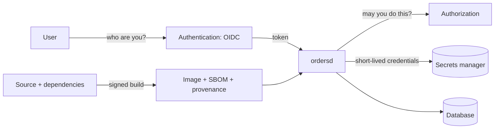

# Security

How systems get attacked, and the small set of ideas that stop most attacks.

## Why go deeper?

Security problems rarely look like a movie hacker. They look like this:

- An API returns another customer's order, because the handler checked the login but not the owner.
- A JWT is accepted with `"alg": "none"`.
- An API key sits in a Git commit from two years ago, in a public fork.
- A popular dependency publishes a new version that steals CI secrets.
- A "temporary" admin endpoint is still on the internet.

Most real incidents come from a short list of mistakes. This chapter explains the mechanisms (crypto, identity, permissions, the supply chain) well enough that you can spot those mistakes in your own code and in review.

## The big picture

1. **Authentication** answers "who are you?". **Authorization** answers "what may you do?". They are different bugs.
2. **Secrets** should be short-lived, never in code, and easy to rotate.
3. **The supply chain** is everything that goes into your binary. You must be able to prove what it is and where it came from.
4. **Defense in depth.** Assume one layer fails. The next one should still hold.

## Reading order

!!! note "Planned chapter"

    This section is a roadmap. The pages below are written in later sessions and linked here when they land.

| #   | Page                       | You will learn                                                                                 |
| --- | -------------------------- | ---------------------------------------------------------------------------------------------- |
| 1   | Threat modeling            | Assets, attackers, trust boundaries, STRIDE, and a 30-minute threat model for `orders`         |
| 2   | Cryptography for engineers | Hashes, MACs, symmetric and public-key crypto, signatures, password hashing; what not to build |
| 3   | Authentication             | Sessions vs tokens, OAuth 2, OIDC, JWT internals and traps, passkeys, service identity         |
| 4   | Authorization              | RBAC, ABAC, ReBAC, object-level checks, policy engines, multi-tenant data                      |
| 5   | Secrets management         | Vault and cloud secret stores, workload identity, rotation, finding leaked secrets             |
| 6   | Supply chain security      | Dependency risk, `govulncheck`, SBOMs, Sigstore signing, SLSA provenance, pinned actions       |
| 7   | Web and API security       | OWASP Top 10 in Go: injection, SSRF, CSRF, CORS, rate limits, security headers                 |

## How each page works

The same shape as the [Fundamentals](../fundamentals/index.md): **Why care?**, **The idea**, **Under the hood**, **Try it**, **Traps** and **Check yourself**. We attack the `orders` service on purpose, on your own machine, then fix it. [Config, hooks and signing](../git/config-hooks-signing.md) already covers signed commits; this chapter extends that trust to builds and images.
