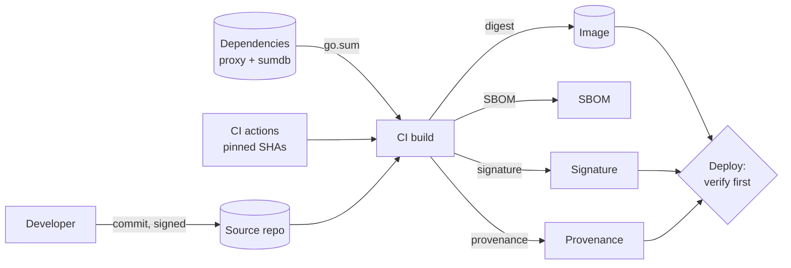

# Supply chain security

## Why care?

Your service is mostly code you didn't write. Some real attacks, none of them a bug in the victim's own code:

- **event-stream (2018).** A popular npm package got a friendly new maintainer. He added a dependency that stole cryptocurrency wallets.
- **SolarWinds (2020).** Attackers changed the **build server**, not the source. Signed updates went to 18,000 customers.
- **xz-utils (2024).** After two years of helpful work, a maintainer hid a backdoor for `sshd` in the release tarballs. One engineer noticed that SSH logins had become 0.5 seconds slower.
- **tj-actions/changed-files (2025).** Attackers moved the version tags of a GitHub Action to a malicious commit. Thousands of workflows printed their CI secrets into public build logs.
- **Go typosquats (2025).** A fake `boltdb-go/bolt` module with a backdoor stayed available from the Go module proxy for years, because the proxy caches every version forever.

The **supply chain** is everything that goes into the binary you run: dependencies, the toolchain, the build system, CI actions, the base image. On this page you check what Go already protects (more than most ecosystems), find a vulnerability that your code really reaches, write an SBOM, verify a real signature on a public image, and pin CI actions to commits.

## The idea: food safety from farm to plate

A restaurant doesn't only check its own kitchen. It asks:

1. **What is in the dish?** An ingredient list (the **SBOM**).
2. **Is any ingredient recalled?** Compare the list with recall notices (**vulnerability scanning**).
3. **Is this the box the farm sent, unopened?** A tamper seal (**checksums**, `go.sum`).
4. **Who packed it, and where?** A signed delivery note (**signatures** and **provenance**).
5. **Do we only buy from approved suppliers?** (**proxies, pinning, policy**).

Each check stops a different attack. None of them stops all.



Attackers aim at every arrow: a typo in a module name (dependencies), a stolen maintainer password (dependencies), a moved tag (actions), a changed build server (build), a re-pushed image tag (deploy).

## Under the hood: how dependencies go wrong

| Attack                   | How it works                                                                 | Main defence                                                  |
| ------------------------ | ---------------------------------------------------------------------------- | ------------------------------------------------------------- |
| **Typosquatting**        | `github.com/boltdb-go/bolt` instead of `github.com/boltdb/bolt`              | Review new dependencies; company proxy with an allow-list     |
| **Maintainer takeover**  | Stolen account, or a "helpful" new maintainer, publishes a bad version       | Don't auto-upgrade; review diffs; MVS; few dependencies       |
| **Tag or version move**  | The same version name points to new code                                     | Checksums (`go.sum`, sumdb); pin by hash or SHA               |
| **Build compromise**     | The source is fine; the build machine adds code                              | Hardened, isolated builds; provenance; reproducible builds    |
| **CI secret theft**      | A dependency's install script, a test, or an action reads CI secrets and env | Short-lived OIDC credentials; least privilege; pinned actions |
| **Known vulnerability**  | Not an attack yet: a published bug in a version you use                      | `govulncheck`; upgrade quickly                                |
| **Dependency confusion** | A public module with the same name as your private one wins the download     | `GOPRIVATE`, `GOPROXY=...,off`; private module paths          |

Two things make Go safer than npm or PyPI here, and you should know why:

- **No install scripts.** `go get` and `go build` never run code from the dependency. npm's `postinstall` does. In Go, dependency code runs only when your program (or your tests, or `go generate`) runs it. (Beware: `go tool` and `go run` **do** run it, which is the whole point.)
- **Checksums for every version, checked by the world.** Next section.

## Under the hood: Go's defences

### `go.sum` and the checksum database

You met `go.sum` in [Modules](../go/modules.md#gosum-trust-on-first-use-checked-by-the-world), with a tampered hash that stops the build. The other half is the **checksum database** at `sum.golang.org`. It is a public, append-only log (a Merkle tree, the same idea as Certificate Transparency for TLS certificates). You can ask it directly; it's a plain GET:

```console
$ curl -s https://sum.golang.org/lookup/golang.org/x/text@v0.3.7
6465158
golang.org/x/text v0.3.7 h1:olpwvP2KacW1ZWvsR7uQhoyTYvKAupfQrRGBFM352Gk=
golang.org/x/text v0.3.7/go.mod h1:u+2+/6zg+i71rQMx5EYifcz6MCKuco9NR6JIITiCfzQ=

go.sum database tree
72361544
/fCORrBXqplAbe8i4RhVJdTCo/6FfW5+AFEb6Hyg6Rg=

— sum.golang.org Az3grvJxIEj7mJai4Y2jo3EQudObkEF/PDO1ZlL6l1WLqMX6kziXME3Ir0gVzWMwjJ8UZ2nniH6HYpQLWJYV6QHyvQk=
```

Line by line: record number 6465158 in the log, the two hashes (the module zip and its `go.mod`), then a **signed tree head**: the log had 72,361,544 records, this is the root hash, and the last line is the server's signature. The `go` command checks that the record is in the tree, and that the tree only ever grows. If `sum.golang.org` showed you a different hash than everyone else, it would have to fork the log, and that can be detected.

Compare with what `go.sum` in a scratch module says about the same version:

```console
$ grep x/text go.sum
golang.org/x/text v0.3.7 h1:olpwvP2KacW1ZWvsR7uQhoyTYvKAupfQrRGBFM352Gk=
golang.org/x/text v0.3.7/go.mod h1:u+2+/6zg+i71rQMx5EYifcz6MCKuco9NR6JIITiCfzQ=
```

Same bytes. So for every **public** module, the first download is also protected: the version you get is the version the whole world gets. What it does **not** tell you is whether that code is good. A malicious v1.2.3 is in the log too, with a perfectly valid hash. Checksums stop "changed later", not "bad from the start".

### `go mod verify`: is the cache still honest?

`go.sum` protects downloads. Your **module cache** (`$GOMODCACHE`) is just files on disk. `go mod verify` re-hashes it. In `examples/orders`:

```console
$ go mod verify
all modules verified
```

Now break it, in a throwaway cache:

```console
$ export GOMODCACHE=~/tutor/modcache
$ go mod download && go mod verify
all modules verified
$ f=$GOMODCACHE/golang.org/x/text@v0.3.7/language/parse.go
$ ls -l $f | cut -c1-10
-r--r--r--
$ chmod u+w $f && echo '// evil' >> $f && go mod verify; echo exit=$?
golang.org/x/text v0.3.7: dir has been modified (/home/you/tutor/modcache/golang.org/x/text@v0.3.7)
exit=1
$ go build -o x . && echo "build ok"
build ok
$ go clean -modcache
```

Two lessons. The cache files are **read-only** on purpose, so an accident can't change them. But `go build` does **not** re-check the cache: it trusts that what is there was verified at download time. Something with write access to your cache (a malicious tool, a poisoned CI cache) changes what you compile. Run `go mod verify` in CI, and don't share a writable module cache between untrusted jobs.

### Builds don't change `go.mod`

Since Go 1.16, build commands act as if `-mod=readonly` is set (`go help build`: "Otherwise, the go command acts as if -mod=readonly were set"). A build never adds or upgrades a dependency by itself:

```console
$ cat main.go
package main

import _ "github.com/google/uuid"

func main() {}
$ go build .
main.go:3:8: no required module provides package github.com/google/uuid; to add it:
	go get github.com/google/uuid
```

Adding a dependency is always an explicit `go get`, which changes `go.mod` and `go.sum`, which shows up in code review. Don't set `GOFLAGS=-mod=mod` in CI: then CI can resolve and record versions that nobody reviewed. Do run `go mod tidy -diff` in CI, so a pull request with an untidy `go.mod` fails.

### MVS: nothing upgrades behind your back

[Minimal version selection](../go/modules.md#minimal-version-selection-why-go-picks-the-oldest-version) picks the **oldest** version that satisfies every `require`, not the newest. If a maintainer account is stolen and v0.45.0 is malicious, your build keeps using v0.44.0 until a human runs `go get -u` and a reviewer approves the diff. In npm with `^1.2.0` ranges, the next fresh install picks the bad version up automatically.

The flip side: security fixes don't arrive by themselves either. That's what the next section is for.

### Private modules: `GOPRIVATE`, `GONOSUMDB`, `GOPROXY`

The enterprise settings are explained in [Proxies and private code](../go/modules.md#proxies-and-private-code-the-enterprise-setup). The security reasons, in short:

| Setting                            | What it does                                                           | Why it matters for security                                                   |
| ---------------------------------- | ---------------------------------------------------------------------- | ----------------------------------------------------------------------------- |
| `GOPRIVATE=github.com/acme/*`      | Sets `GONOPROXY` and `GONOSUMDB` for these paths                       | Private module names don't leak to `proxy.golang.org` or `sum.golang.org`     |
| `GONOSUMDB`                        | Skip the checksum database for these paths                             | Only `go.sum` protects them now. Keep the list as narrow as possible          |
| `GOPROXY=https://goproxy.acme,off` | Download only from the company proxy, never directly from the internet | One place to scan, allow-list and log. `off` blocks dependency confusion      |
| `GOSUMDB=off`, `GOINSECURE`        | Turn off checks                                                        | Almost never correct. `GOINSECURE` allows plain HTTP; it is not a fix for TLS |
| `GOFLAGS=-mod=readonly`            | The default for builds already                                         | Make it explicit if someone set `-mod=mod` somewhere                          |

On this machine the defaults are in place:

```console
$ go env GOPROXY GOSUMDB GONOSUMDB GOPRIVATE GOFLAGS
https://proxy.golang.org,direct
sum.golang.org


```

Three empty lines: no private modules configured, and no flags.

### What do we depend on?

```console
$ go list -m all
github.com/acme/orders
github.com/google/go-cmdtest v0.4.1-0.20220921163831-55ab3332a786
github.com/google/go-cmp v0.6.0
github.com/google/renameio v0.1.0
github.com/yuin/goldmark v1.4.13
golang.org/x/mod v0.43.0
golang.org/x/net v0.63.0
golang.org/x/sync v0.25.0
golang.org/x/sys v0.50.0
golang.org/x/telemetry v0.0.0-20261116191925-e77a43154acb
golang.org/x/tools v0.53.0
golang.org/x/tools/go/expect v0.1.1-deprecated
golang.org/x/tools/go/packages/packagestest v0.1.1-deprecated
golang.org/x/vuln v1.10.0
$ go list -deps -f '{{if not .Standard}}{{.ImportPath}}{{end}}' ./cmd/... | sed '/^$/d'
github.com/acme/orders/internal/buildinfo
github.com/acme/orders/internal/order
github.com/acme/orders/internal/client
github.com/acme/orders/internal/config
github.com/acme/orders/internal/httpapi
github.com/acme/orders/internal/storage/memory
github.com/acme/orders/cmd/ordersd
github.com/acme/orders/cmd/orderctl
```

Thirteen modules in the graph, all of them there because of the `govulncheck` **tool** (see [Tools](../go/modules.md#tools-the-tool-directive)). The binaries themselves import **no** third-party package: only the standard library and `orders` itself. That's the strongest supply-chain defence there is: a dependency you don't have can't hurt you. Before you add one, read [Choosing dependencies](../go/modules.md#choosing-dependencies).

## Under the hood: known vulnerabilities with `govulncheck`

A scanner that says "you use library X, version Y has CVE-123" is often wrong in a useful way: the bug is in a function you never call. `govulncheck` reads the **call graph** and reports three levels: **symbol** (your code calls the vulnerable function), **package** (you import the package, but don't call it), **module** (you require the module).

`examples/orders` is clean:

```console
$ go tool govulncheck ./...
No vulnerabilities found.
```

That is easy with no dependencies. So make a scratch module that pins a 2021 version of `golang.org/x/text` and parses an `Accept-Language` header from a client:

```go
// A tiny Accept-Language picker, pinned to a 2021 golang.org/x/text.
package main

import (
	"fmt"
	"os"

	"golang.org/x/text/language"
)

func main() {
	tags, _, err := language.ParseAcceptLanguage(os.Args[1]) // header from the client
	if err != nil {
		fmt.Println("bad header:", err)
		return
	}
	fmt.Println(tags)
}
```

```console
$ go get golang.org/x/text@v0.3.7
go: downloading golang.org/x/text v0.3.7
go: added golang.org/x/text v0.3.7
$ go build -o oldtext . && ./oldtext 'nl-NL,en;q=0.8'
[nl-NL en]
```

`govulncheck` is pinned in `examples/orders`, so run it from there with `-C`:

```console
$ go tool govulncheck -C ~/tutor/oldtext ./...; echo exit=$?
=== Symbol Results ===

Vulnerability #1: GO-2022-1059
    Denial of service via crafted Accept-Language header in
    golang.org/x/text/language
  More info: https://pkg.go.dev/vuln/GO-2022-1059
  Module: golang.org/x/text
    Found in: golang.org/x/text@v0.3.7
    Fixed in: golang.org/x/text@v0.3.8
    Example traces found:
      #1: main.go:12:46: oldtext.main calls language.ParseAcceptLanguage

Your code is affected by 1 vulnerability from 1 module.
This scan also found 0 vulnerabilities in packages you import and 2
vulnerabilities in modules you require, but your code doesn't appear to call
these vulnerabilities.
Use '-show verbose' for more details.
exit=3
```

**Reachable**: line 12 calls the vulnerable function with input from a client. A long header can make the parser take a very long time. Exit code 3 fails CI.

Now a copy of the module that only parses **one tag from config**, with `language.Parse`:

```console
$ sed -n 12p main.go
	tag, err := language.Parse(os.Args[1]) // one tag from config, not a header
$ go tool govulncheck -C ~/tutor/oldtext2 -show verbose ./...; echo exit=$?
Fetching vulnerabilities from the database...

Checking the code against the vulnerabilities...

The package pattern matched the following root package:
  example.com/oldtext
Govulncheck scanned the following 2 modules and the go1.27.4 standard library:
  example.com/oldtext
  golang.org/x/text@v0.3.7

=== Symbol Results ===

No vulnerabilities found.

=== Package Results ===

Vulnerability #1: GO-2022-1059
    Denial of service via crafted Accept-Language header in
    golang.org/x/text/language
  More info: https://pkg.go.dev/vuln/GO-2022-1059
  Module: golang.org/x/text
    Found in: golang.org/x/text@v0.3.7
    Fixed in: golang.org/x/text@v0.3.8

=== Module Results ===

Vulnerability #1: GO-2026-6629
    Panic parsing crafted input in x/text/secure/precis in golang.org/x/text
  More info: https://pkg.go.dev/vuln/GO-2026-6629
  Module: golang.org/x/text
    Found in: golang.org/x/text@v0.3.7
    Fixed in: golang.org/x/text@v0.41.0

Vulnerability #2: GO-2026-5970
    Infinite loop on invalid input in golang.org/x/text
  More info: https://pkg.go.dev/vuln/GO-2026-5970
  Module: golang.org/x/text
    Found in: golang.org/x/text@v0.3.7
    Fixed in: golang.org/x/text@v0.39.0

Your code is affected by 0 vulnerabilities.
This scan also found 1 vulnerability in packages you import and 2
vulnerabilities in modules you require, but your code doesn't appear to call
these vulnerabilities.
exit=0
```

Same module, same version, three vulnerabilities in it, and **zero** reachable. Exit code 0. A version-only scanner would report three findings here; `govulncheck` reports them as information. Should you upgrade anyway? Yes, soon: the next code change might call `ParseAcceptLanguage`. But it is not a 2 a.m. page.

It also works on a **binary**, using the build info inside it (no source needed, good for "what is running in production?"):

```console
$ go tool govulncheck -mode=binary ~/tutor/oldtext/oldtext; echo exit=$?
=== Symbol Results ===

Vulnerability #1: GO-2022-1059
    Denial of service via crafted Accept-Language header in
    golang.org/x/text/language
  More info: https://pkg.go.dev/vuln/GO-2022-1059
  Module: golang.org/x/text
    Found in: golang.org/x/text@v0.3.7
    Fixed in: golang.org/x/text@v0.3.8
    Vulnerable symbols found:
      #1: language.ParseAcceptLanguage

Your code is affected by 1 vulnerability from 1 module.
This scan also found 0 vulnerabilities in packages you import and 2
vulnerabilities in modules you require, but your code doesn't appear to call
these vulnerabilities.
Use '-show verbose' for more details.
exit=3
```

The fix is one command:

```console
$ go get golang.org/x/text@latest
go: upgraded golang.org/x/text v0.3.7 => v0.44.0
$ go tool govulncheck -C ~/tutor/oldtext ./...; echo exit=$?
No vulnerabilities found.
exit=0
```

Run it in CI on every pull request **and** on a schedule against the default branch and the released binaries: the database grows, and old code becomes vulnerable without any commit. Dependabot or Renovate turn "a fix exists" into a pull request.

## Under the hood: SBOMs

A **software bill of materials** is the ingredient list: every component, its version, and a **purl** (package URL) that every tool understands. [Container security](../containers/security.md#sbom-the-list-of-ingredients) ran `syft` on the `tutor-ordersd:dev` image and wrote SPDX and CycloneDX files. Here, the **binary** alone:

```console
$ CGO_ENABLED=0 go build -trimpath -o ~/tutor/ordersd ./cmd/ordersd
$ go version -m ~/tutor/ordersd
~/tutor/ordersd: go1.27.4
	path	github.com/acme/orders/cmd/ordersd
	mod	github.com/acme/orders	(devel)
	build	-buildmode=exe
	build	-compiler=gc
	build	-trimpath=true
	build	CGO_ENABLED=0
	build	GOARCH=amd64
	build	GOOS=linux
	build	GOAMD64=v1
	build	vcs=git
	build	vcs.revision=673c760dd06661aac812c8f4e4575cb16f851711
	build	vcs.time=2026-11-27T11:18:14Z
	build	vcs.modified=true
$ syft -q ~/tutor/ordersd
NAME                    VERSION                             TYPE
github.com/acme/orders  v0.0.0-20261127111814-673c760dd066  go-module
stdlib                  go1.27.4                            go-module
$ syft -q ~/tutor/oldtext2/x
NAME                 VERSION   TYPE
example.com/oldtext  UNKNOWN   go-module
golang.org/x/text    v0.3.7    go-module
stdlib               go1.27.4  go-module
```

Every Go binary carries its own module list (see [Build info](../delivery/reproducible-builds.md#build-info-go-version-m)). `syft` reads it, and here it also made a pseudo-version from the commit and time that Go stamped (`vcs.revision`, `vcs.time`). Note `vcs.modified=true`: the working tree had uncommitted changes, so this binary does **not** match commit `673c760`. A release build must come from a clean checkout.

Why keep SBOMs at all, if the binary already knows? Because the question in an incident is "**which of our 300 services** contain `x/text` older than v0.41.0?". With SBOMs stored next to every release (in the registry as an attestation, or in a tool like Dependency-Track), that's one query instead of 300 builds.

## Under the hood: signatures, provenance and SLSA

### Verify a real signature

Container security showed how to [sign with cosign](../containers/security.md#signing-who-built-this) using a local key. The distroless base image that `ordersd` uses is signed **keyless**: Google's build signs with a short-lived certificate for a service account identity, recorded in the public Rekor log. Verify the exact digest we build on (this only reads from the registry and Sigstore):

```console
$ crane digest gcr.io/distroless/static-debian12:nonroot
sha256:afa5c872c891853ca7fcf1f12c3edb23f7eeef36189728842dd51042ff57f7ab
$ cosign verify gcr.io/distroless/static-debian12@sha256:afa5c872c891853ca7fcf1f12c3edb23f7eeef36189728842dd51042ff57f7ab \
>   --certificate-oidc-issuer https://accounts.google.com \
>   --certificate-identity keyless@distroless.iam.gserviceaccount.com > cv.json

Verification for gcr.io/distroless/static-debian12@sha256:afa5c872c891853ca7fcf1f12c3edb23f7eeef36189728842dd51042ff57f7ab --
The following checks were performed on each of these signatures:
  - The cosign claims were validated
  - Existence of the claims in the transparency log was verified offline
  - The code-signing certificate was verified using trusted certificate authority certificates
$ jq '.[0].critical, (.[0].optional | {Issuer, Subject, logIndex: .Bundle.Payload.logIndex})' cv.json
```

```json
{
  "identity": {
    "docker-reference": "gcr.io/distroless/static-debian12"
  },
  "image": {
    "docker-manifest-digest": "sha256:afa5c872c891853ca7fcf1f12c3edb23f7eeef36189728842dd51042ff57f7ab"
  },
  "type": "cosign container image signature"
}
{
  "Issuer": "https://accounts.google.com",
  "Subject": "keyless@distroless.iam.gserviceaccount.com",
  "logIndex": 2552182580
}
```

Three checks: the signed payload names **this digest**, the certificate chains to Sigstore's CA (Fulcio), and the entry is in the Rekor log (entry 2,552,182,580). The important part is **who**: you didn't trust a key, you trusted the statement "the identity `keyless@distroless.iam.gserviceaccount.com`, proven by Google's OIDC issuer, signed this". Ask for a different identity and it fails:

```console
$ cosign verify gcr.io/distroless/static-debian12@sha256:afa5c872c891853ca7fcf1f12c3edb23f7eeef36189728842dd51042ff57f7ab \
>   --certificate-oidc-issuer https://token.actions.githubusercontent.com \
>   --certificate-identity-regexp '^https://github.com/acme/' >/dev/null
Error: no matching signatures: none of the expected identities matched what was in the certificate, got subjects [keyless@distroless.iam.gserviceaccount.com] with issuer https://accounts.google.com
error during command execution: no matching signatures: none of the expected identities matched what was in the certificate, got subjects [keyless@distroless.iam.gserviceaccount.com] with issuer https://accounts.google.com
```

That's the check your deploy should do for your **own** images: "signed by the `release.yml` workflow of `github.com/acme/orders`, on a tag", nothing else. In Kubernetes, an admission controller (Sigstore policy-controller, Kyverno) runs it before a pod starts.

### Provenance: how was it built?

A signature says **who**. **Provenance** says **how**: which source commit, which build workflow, which builder, which inputs. It is a signed JSON document (an **in-toto attestation** with a SLSA provenance predicate) attached to the artifact. A verifier can then require "built from `acme/orders` at a tag on `main`, by the official workflow, on a hosted runner", which stops a build from a developer laptop or a fork.

On GitHub, `actions/attest-build-provenance` writes it, and `gh attestation verify` checks it:

```sh
gh attestation verify oci://ghcr.io/acme/ordersd@sha256:... --repo acme/orders
```

<!-- TODO(real-output): no image of ours with build provenance exists to verify. The distroless image has only an SPDX attestation, and `cosign verify-attestation --type https://spdx.dev/Document` with the distroless identity returned "none of the attestations matched the predicate type ... found:" on this machine; not investigated further. -->

### SLSA levels

**SLSA** ("salsa", Supply-chain Levels for Software Artifacts) is a checklist of how much you can trust a build. Its **Build track** has levels:

| Level   | Requires                                                                                                  | Stops                                                                     |
| ------- | --------------------------------------------------------------------------------------------------------- | ------------------------------------------------------------------------- |
| Build 0 | Nothing                                                                                                   | Nothing                                                                   |
| Build 1 | Provenance exists: a record of how it was built                                                           | Mistakes; "which commit is this?" questions                               |
| Build 2 | Built on a **hosted** build platform, which **signs** the provenance                                      | Tampering after the build; builds from laptops                            |
| Build 3 | The platform is **hardened**: builds are isolated, and the signing key is out of reach of the build steps | A malicious build step forging provenance, or one build poisoning another |

GitHub Actions with `attest-build-provenance` on hosted runners reaches Build 2, and Build 3 with a reusable workflow that the calling repository can't change. The level is not the goal. The goal is that your **deploy checks** the provenance; unchecked provenance protects nothing.

[Reproducible builds](../delivery/reproducible-builds.md) add one more check: anyone can rebuild from the source and get the **same bytes**, so a compromised build server would be caught by a second, independent build. Go makes this unusually easy with `-trimpath` and a pinned toolchain.

## Under the hood: CI actions are dependencies too

A GitHub Action runs with your workflow's token and secrets. It is a dependency, with less review than any Go module. This repository's workflows use **tags**:

```console
$ grep -n 'uses:' .github/workflows/*.yml
.github/workflows/pages.yml:21:      - uses: actions/checkout@v5
.github/workflows/pages.yml:22:      - uses: jdx/mise-action@v3
.github/workflows/pages.yml:24:      - uses: actions/upload-pages-artifact@v4
.github/workflows/pages.yml:35:        uses: actions/deploy-pages@v4
.github/workflows/ci.yml:15:      - uses: actions/checkout@v5
.github/workflows/ci.yml:16:      - uses: jdx/mise-action@v3
```

A tag is a pointer the owner (or an attacker with their token) can move to any commit, which is exactly what happened with `tj-actions/changed-files`. [Pin actions by commit SHA](../delivery/ci-pipelines.md#pin-actions-by-commit-sha) explains the rule. To resolve a tag to its commit, ask Git; no API token needed:

```console
$ git ls-remote https://github.com/jdx/mise-action refs/tags/v3 'refs/tags/v3^{}'
5228313ee0372e111a38da051671ca30fc5a96db	refs/tags/v3
$ git ls-remote --tags https://github.com/jdx/mise-action | grep 5228313ee0372e111a38da051671ca30fc5a96db
5228313ee0372e111a38da051671ca30fc5a96db	refs/tags/v3
5228313ee0372e111a38da051671ca30fc5a96db	refs/tags/v3.6.3
$ git ls-remote --tags https://github.com/actions/upload-pages-artifact | grep 7b1f4a764d45c48632c6b24a0339c27f5614fb0b
7b1f4a764d45c48632c6b24a0339c27f5614fb0b	refs/tags/v4
7b1f4a764d45c48632c6b24a0339c27f5614fb0b	refs/tags/v4.0.0
$ git ls-remote --tags https://github.com/actions/deploy-pages | grep d6db90164ac5ed86f2b6aed7e0febac5b3c0c03e
d6db90164ac5ed86f2b6aed7e0febac5b3c0c03e	refs/tags/v4
d6db90164ac5ed86f2b6aed7e0febac5b3c0c03e	refs/tags/v4.0.5
```

Ask for both `refs/tags/v3` and `refs/tags/v3^{}`: for an **annotated** tag, the first line is the tag object and the `^{}` line is the commit it points to. Pin the **commit**. These tags are lightweight, so there is only one line. The second command finds the exact release that shares the commit, for the comment. The pinned form:

```yaml
- uses: actions/checkout@fbc6f3992d24b796d5a048ff273f7fcc4a7b6c09 # v5.1.0
- uses: jdx/mise-action@5228313ee0372e111a38da051671ca30fc5a96db # v3.6.3
```

A SHA pin is immutable, but an action can still download other code at run time (a `docker://` image by tag, a script by URL, or another action by tag inside a composite action). Pinning stops the easy attack; reviewing what an action does stops the rest. And give the job the least it needs: `permissions: contents: read` by default, and OIDC to the cloud instead of stored keys (see [Workload identity](secrets-management.md#who-are-you-workload-identity)), so that there is little to steal.

Commits themselves should be signed, so "who wrote this" is checkable too: see [signing commits](../git/config-hooks-signing.md#under-the-hood-signing-commits).

## Try it

1. In a scratch module, add `golang.org/x/net@v0.17.0`, write a small HTTP/2 server with `golang.org/x/net/http2`, and run `go tool govulncheck -C <dir> ./...` from `examples/orders`. Which findings are symbol level? Then remove the HTTP/2 code and scan again.
2. Run `curl -s https://sum.golang.org/lookup/<module>@<version>` for a module in your own project's `go.sum` and compare the two hashes.
3. Run `syft -q -o cyclonedx-json <your binary>` and find the purl of the standard library.
4. Resolve every `uses:` in one of your own workflows to a commit SHA with `git ls-remote`, and write the pinned lines with a version comment.
5. Verify the signature of another distroless image (`gcr.io/distroless/base-debian12`) by digest. What happens if you give a tag instead of a digest?

## Traps

- **"We have `go.sum`, so our dependencies are safe."** `go.sum` and the checksum database prove you got the same bytes as everyone else. They say nothing about whether those bytes are malicious.
- **Trusting the module cache.** `go build` doesn't re-verify it. Run `go mod verify` in CI; don't share writable caches between untrusted jobs.
- **`GONOSUMDB` or `GOSUMDB=off` "to make the build work".** Fix the private-module setup with `GOPRIVATE` for your own paths only.
- **Scanner fatigue.** Hundreds of unreachable findings train people to ignore the scanner. Gate CI on `govulncheck` symbol results; track the rest.
- **Scanning once.** New advisories appear for old code. Scan on a schedule, and scan what is deployed, not only `main`.
- **Signatures nobody checks.** Signing without verification at deploy time is decoration. Verify by **digest** and by **identity** (issuer + subject), not just "has a signature".
- **Actions by tag.** Tags move. Pin by SHA, keep a version comment, let Dependabot or Renovate update both.
- **`go run pkg@latest` in CI or a README.** It downloads and runs whatever "latest" is today. Pin tools in `go.mod` with the `tool` directive.

## Check yourself

??? question "1. A teammate says: \"The checksum database means a malicious module can never reach us.\" What does it really guarantee?"

    That every user of a module version gets the same bytes, and that those bytes never
    change later (the log is public and append-only, and `go.sum` remembers). It stops a
    tampered proxy, a moved tag, or a targeted "special version for you". It does not judge
    the code: a malicious release is in the log with a valid hash. Review, MVS and few
    dependencies handle that part.

??? question "2. `govulncheck` reports a vulnerability under \"Module Results\" only. Do you need to fix it today?"

    Your code doesn't import the affected package, so it can't be reached now. It is not
    an emergency. Plan the upgrade (a future change may start to use the package), but
    keep the CI gate on symbol results only, so real reachable findings stand out.

??? question "3. Why can't a dependency steal your CI secrets during `go mod download`, while an npm package can during `npm install`?"

    The `go` command never runs dependency code while downloading or building: there are
    no install scripts. npm runs `preinstall`/`postinstall` scripts with the job's
    environment. In Go, dependency code runs when your tests, your program, `go generate`
    or `go tool` run it. So `go test` in CI can still run malicious code: keep secrets out
    of the test job.

??? question "4. Your deploy runs `cosign verify` with `--certificate-identity-regexp '.*'` and `--certificate-oidc-issuer-regexp '.*'`. What is wrong?"

    It accepts a signature from **anyone** with a Sigstore certificate, and anyone can get
    one for free with their own GitHub or Google account. The check then only proves that
    someone signed it. Pin the issuer exactly and the identity to your release workflow,
    for example `https://github.com/acme/orders/.github/workflows/release.yml@refs/tags/...`.

??? question "5. `git ls-remote` for an action's tag returns two lines, `refs/tags/v2` and `refs/tags/v2^{}`, with different hashes. Which one do you pin?"

    The `^{}` one. The tag is annotated: `refs/tags/v2` names the tag object, and `^{}` is
    the commit it points to after peeling. `uses:` needs a commit SHA.

??? question "6. Which SLSA build level stops a malicious build step from writing its own, fake provenance, and why doesn't level 2 already?"

    Build level 3. At level 2 the hosted platform signs the provenance, but a build step
    may still be able to reach the signing material or influence what is signed. Level 3
    requires isolation: the signing happens in a part of the platform the build steps
    can't touch, and builds can't affect each other.

## Recap

- The supply chain is everything that goes into the binary: dependencies, toolchain, build, CI actions, base image. Attacks hit every link.
- Go helps: **no install scripts**, `go.sum` plus the public **checksum database**, read-only builds (`-mod=readonly`), and **MVS**, which never upgrades by itself.
- `go mod verify` checks the module cache; `go build` doesn't. `GOPRIVATE` keeps private names private; a company `GOPROXY` ending in `off` gives one controlled door.
- The fewest dependencies win: `ordersd` imports no third-party package.
- `govulncheck` reports **symbol**, **package** and **module** results. Gate CI on symbol results; it also scans binaries. Run it on a schedule too.
- An **SBOM** answers "where do we use X?" across many services; Go binaries already carry their module list.
- **Signatures** say who, **provenance** says how; both only help if the deploy **verifies** them, by digest and by identity. **SLSA** levels describe how much a build can be trusted.
- CI actions are dependencies: **pin by commit SHA** (`git ls-remote`, peel annotated tags with `^{}`), least-privilege tokens, OIDC instead of stored keys.

Next: [Web and API security](web-and-api-security.md), where the attacker sends requests to the code you wrote yourself.
