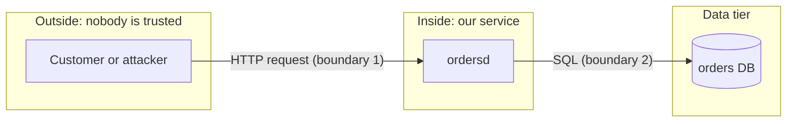
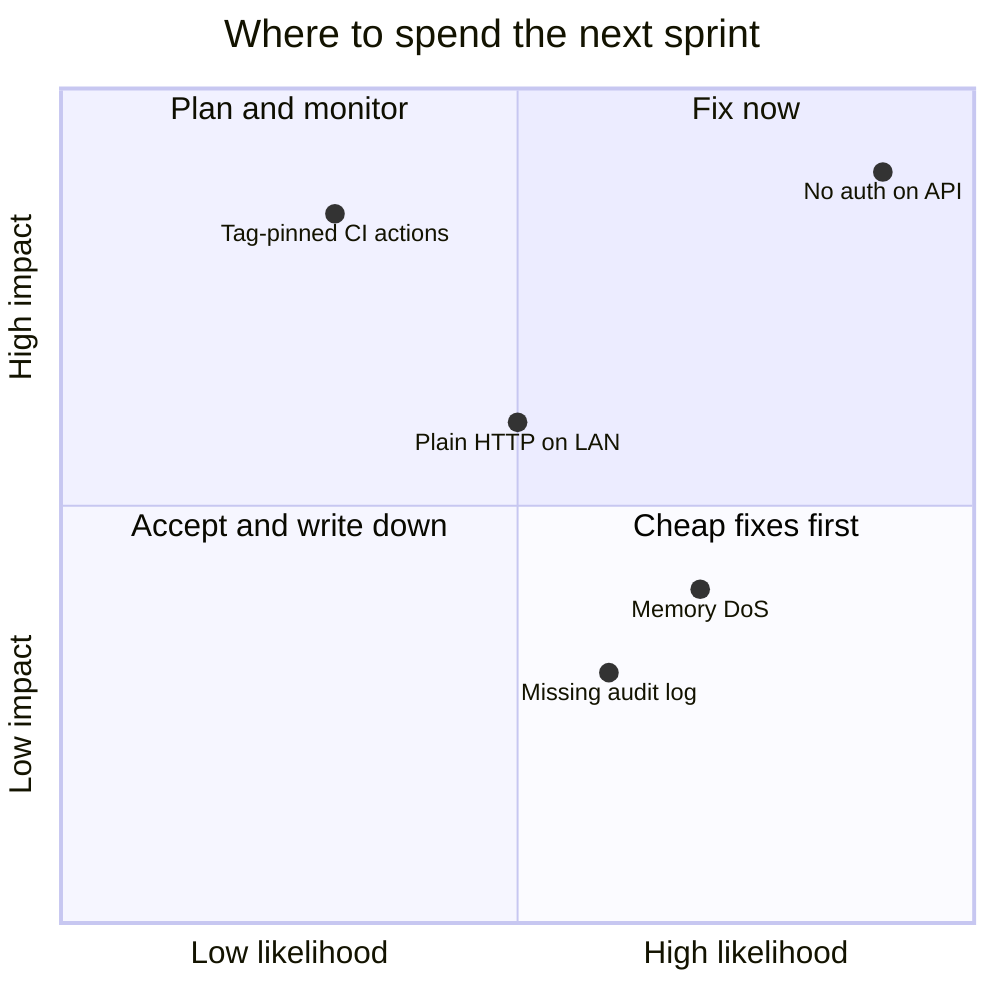
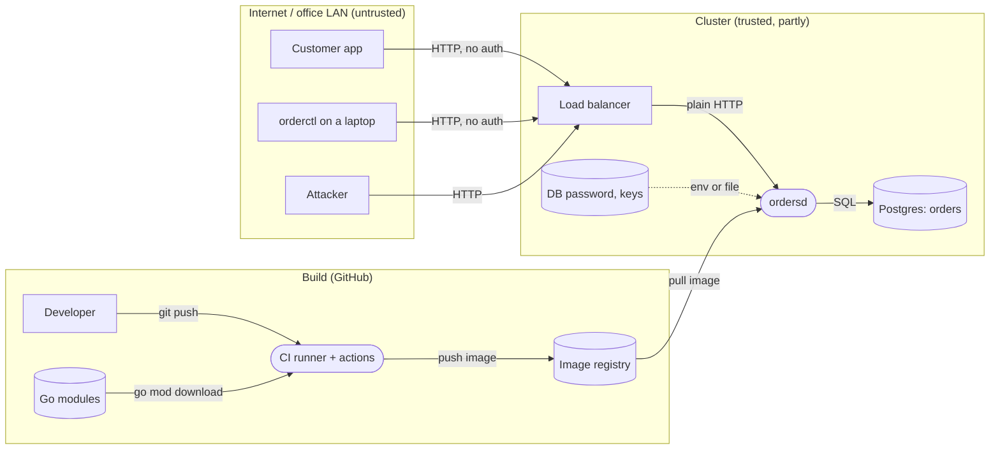

# Threat modeling

## Why care?

Teams often ask questions like these, usually too late:

- "We added login last sprint. Why can a logged-in customer still read every order?"
- "The pentest found 40 issues. Which ones do we fix first?"
- "The service was only meant for the internal network. How did it end up behind the public load balancer?"

Each one is a design question that nobody asked at design time. A **threat model** is the habit of asking them on purpose: before you write the code, and again when the design changes. It is not a document for auditors. It is 30 minutes with a whiteboard and four questions, and it tells you which of the next six pages matter most for _your_ system.

On this page you threat-model the `orders` service from the [Go chapter](../go/services.md). You collect real evidence from the running service, draw where the trust changes, walk through every part with STRIDE, and end with a table of threats. Each threat links to the page in this chapter that fixes it.

## The idea: four questions about your design

A threat model looks at a system from the attacker's side. You list what is valuable, who might attack it, and the places where data or requests enter from a less trusted area. For each entry point you ask what an attacker could do there. Then you protect the entry points that matter most, and you accept the remaining risk on purpose.

Adam Shostack, who wrote the standard book on threat modeling, puts it in four questions:

1. **What are we working on?** Draw the system: the parts and the data that moves between them.
2. **What can go wrong?** Walk every part with a checklist (STRIDE, below).
3. **What are we going to do about it?** For each threat: fix it, remove the feature, move the risk to someone else, or accept it.
4. **Did we do a good job?** Check the fixes exist, and re-run the model when the design changes.



The boxes with labels are **trust boundaries**. Every arrow that crosses one is an entry point. Most attacks happen at an entry point.

## Under the hood: the building blocks

### Assets: what is worth stealing or breaking?

An **asset** is something an attacker wants, or something you can't afford to lose. For `orders`:

- **Order data**: customer IDs, items, prices. Personal data in most countries, so a leak is a legal problem, not only an embarrassment.
- **The ability to create orders**: an attacker who can create orders for other customers can cost you real money.
- **Availability**: no orders, no revenue.
- **Credentials**: database passwords, signing keys, CI tokens. They are assets because they unlock the other assets.
- **The build pipeline and the image**: whoever controls them controls what runs in production.

The last two are easy to forget. Attackers target them, because one stolen CI token can give access to everything else, including all the orders.

### Attackers: who, and what can they do?

You do not need a full list of possible attackers. You need a few **attacker profiles**, each with what they can already reach:

| Attacker                 | What they already have                       | Typical goal                       |
| ------------------------ | -------------------------------------------- | ---------------------------------- |
| Anonymous internet user  | Can send any HTTP request to public ports    | Read data, cause outage, pivot in  |
| Logged-in customer       | A valid account, so they pass authentication | Read or change other people's data |
| Insider or stolen laptop | Network access, maybe a developer's tokens   | Read the database, push code       |
| Compromised dependency   | Code that runs inside your build and binary  | Steal CI secrets, open a backdoor  |
| Neighbour on the network | Can see or change traffic on the same LAN    | Read or change requests in transit |

The second row is the one teams skip. Authentication stops the first attacker. It does nothing against the second one. That is the topic of [Authorization](authorization.md).

### Trust boundaries: where "outside" becomes "inside"

A **trust boundary** is a line where the level of trust changes: data or a request comes from a less trusted place to a more trusted one. Typical boundaries:

- the network edge (internet to load balancer to service),
- process to process (service to database, service to service),
- user space to kernel, container to host ([Container security](../containers/security.md)),
- your code to third-party code (dependencies, CI actions).

Rule of thumb: **at every boundary, the more trusted side must check what comes in.** Who sent it (authentication), are they allowed (authorization), and is it well-formed (input validation).

### Data-flow diagrams: five shapes are enough

A **data-flow diagram** (DFD) has only five kinds of element:

| Element         | Drawn as         | Example in `orders`              |
| --------------- | ---------------- | -------------------------------- |
| External entity | Rectangle        | Customer, developer, GitHub      |
| Process         | Rounded box      | `ordersd`, `orderctl`, CI runner |
| Data store      | Cylinder         | Orders database, image registry  |
| Data flow       | Arrow            | HTTP request, SQL query, `push`  |
| Trust boundary  | Box around parts | "Internet", "cluster", "CI"      |

Keep it at the level of one whiteboard. If you need more than about 15 elements, split it into two diagrams.

### STRIDE: a checklist of six things that go wrong

STRIDE is a mnemonic from Microsoft. Each letter is the opposite of one security property:

| Threat                     | What the attacker does           | Property broken | `orders` example                                 |
| -------------------------- | -------------------------------- | --------------- | ------------------------------------------------ |
| **S**poofing               | Pretends to be someone else      | Authentication  | Sends requests as customer `c-1`                 |
| **T**ampering              | Changes data or code             | Integrity       | Changes an order in transit, or the image        |
| **R**epudiation            | Denies having done something     | Accountability  | "I never created that order", and logs can't say |
| **I**nformation disclosure | Reads what they should not       | Confidentiality | Lists every order with `GET /v1/orders`          |
| **D**enial of service      | Makes it unavailable             | Availability    | Floods `POST /v1/orders` until memory runs out   |
| **E**levation of privilege | Gets rights they should not have | Authorization   | A customer calls an admin route                  |

**STRIDE per element** makes the walk fast: not every letter applies to every shape.

| Element         | S   | T   | R   | I   | D   | E   |
| --------------- | --- | --- | --- | --- | --- | --- |
| External entity | x   |     | x   |     |     |     |
| Process         | x   | x   | x   | x   | x   | x   |
| Data store      |     | x   | x   | x   | x   |     |
| Data flow       |     | x   |     | x   | x   |     |

A data flow can't "pretend to be someone" (it is just bytes), but it can be read (I), changed (T) or cut (D). A process can suffer all six. So you walk the diagram element by element and ask only the questions in that row.

### Risk = likelihood x impact

You will find more threats than you can fix this quarter. Rank them. A simple scale is enough:

- **Likelihood** (1–3): 1 = needs insider access and skill; 2 = needs some access or effort; 3 = anyone on the internet, with a tool or a browser.
- **Impact** (1–3): 1 = annoyance; 2 = one customer harmed, or a short outage; 3 = all customers' data, money, or the whole platform.

Risk = likelihood x impact, from 1 to 9. Fix 6–9 now, plan 3–4, and write down why you accept 1–2.



Do not spend a long time on whether something is a 2 or a 3. The point is the order, not the number.

### Four answers to "what do we do?"

For each threat, pick one:

- **Mitigate**: add a control (a check, a limit, encryption).
- **Eliminate**: remove the feature. An admin endpoint you delete has no bugs.
- **Transfer**: let someone else carry it (a managed identity provider, a WAF, insurance).
- **Accept**: write down that you know and why it is fine for now, with a name and a date.

"Accept" is a real answer. "We didn't think of it" is not.

## Try it: a 30-minute threat model of `orders`

Set a timer. The goal is a good-enough model, not a perfect one.

### Minutes 0–10: what are we working on? Collect evidence

Don't model from memory or from the architecture slide. Look at the real thing. Build and start `ordersd` on a free port:

```console
$ cd examples/orders
$ go build -o ~/tutor/bin/ ./cmd/...
$ cd ~/tutor && ./bin/ordersd -addr :8181 > ordersd.log 2>&1 &
$ cat ordersd.log
{"time":"2026-11-27T12:21:26.44138741+01:00","level":"INFO","msg":"starting","service":"ordersd","version":"(devel)","revision":"673c760dd06661aac812c8f4e4575cb16f851711","go_version":"go1.27.4"}
{"time":"2026-11-27T12:21:26.468197718+01:00","level":"INFO","msg":"listening","service":"ordersd","addr":"[::]:8181"}
```

**Where does it listen?** `[::]:8181` means every address. `ss` agrees: `*` is "all interfaces".

```console
$ ss -ltnp 'sport = :8181'
State  Recv-Q Send-Q Local Address:Port Peer Address:PortProcess
LISTEN 0      4096               *:8181            *:*    users:(("ordersd",pid=1280569,fd=5))
```

The default in `internal/config` is `Addr: ":8080"`, so the same is true in production. Anyone who can reach the machine can reach the API. On this laptop that includes the LAN address:

```console
$ ip -4 -br addr | grep -v '^lo'
docker0          DOWN           172.17.0.1/16
eth1             UP             192.168.4.119/24
br-705dc1346aad  DOWN           172.18.0.1/16
$ curl -s -o /dev/null -w '%{http_code}\n' http://192.168.4.119:8181/v1/orders
200
```

**Who may call it?** Anyone. There is no login. A made-up token is ignored, not rejected:

```console
$ curl -si http://127.0.0.1:8181/v1/orders
HTTP/1.1 200 OK
Content-Type: application/json
X-Content-Type-Options: nosniff
X-Request-Id: 01a21cbd-249f-7928-ace1-691c6db000f8
Date: Fri, 27 Nov 2026 11:21:27 GMT
Content-Length: 14

{"orders":[]}
$ curl -s -o /dev/null -w '%{http_code}\n' -H 'Authorization: Bearer nonsense' http://127.0.0.1:8181/v1/orders
200
```

The source confirms it. There is no code about authentication or TLS anywhere in the module, and the route table is open:

```console
$ cd examples/orders
$ grep -rniE 'authorization|bearer|ListenAndServeTLS|crypto/tls' --include='*.go' . | wc -l
0
$ grep -n 'HandleFunc' internal/httpapi/httpapi.go
43:	mux.HandleFunc("POST /v1/orders", a.createOrder)
44:	mux.HandleFunc("GET /v1/orders", a.listOrders)
45:	mux.HandleFunc("GET /v1/orders/{id}", a.getOrder)
46:	mux.HandleFunc("GET /healthz", a.healthz)
47:	mux.HandleFunc("GET /readyz", a.readyz)
```

`GET /v1/orders` returns **every** order of **every** customer. `orderctl` is a thin client over the same API, so it inherits all of this:

```console
$ ORDERS_SERVER=http://127.0.0.1:8181 ~/tutor/bin/orderctl list
ID  CUSTOMER  STATUS  ITEMS  TOTAL  CREATED
```

**What does it remember about who did what?** One log line per request. Look at what is in it, and what is not:

```console
$ tail -1 ~/tutor/ordersd.log
{"time":"2026-11-27T12:21:36.707813854+01:00","level":"INFO","msg":"http request","service":"ordersd","request_id":"01a21cbd-48c3-7c42-849b-a4d34572bcdf","method":"GET","path":"/v1/orders","route":"GET /v1/orders","status":200,"bytes":14,"duration":38745}
```

A request ID, a path, a status. No user, no client address. If someone reads all the orders, the log can't tell you who.

**What runs in production?** The image is built `FROM gcr.io/distroless/static-debian12:nonroot`:

```console
$ docker image inspect tutor-ordersd:dev --format '{{.Config.User}} {{json .Config.ExposedPorts}} {{.Config.Entrypoint}}'
nonroot:nonroot {"8080/tcp":{}} [/ordersd]
```

Good: not root, no shell. (When this model was made, the base images were pinned by tag only. They are now pinned by digest: see the note below.)

**How is it built?** From the repository root, at the time of this model: the GitHub workflows used actions by **tag**, and the deploy workflow could mint OIDC identity tokens:

```console
$ grep -n 'uses\|permissions\|write' .github/workflows/pages.yml
8:permissions:
10:  pages: write
11:  id-token: write
21:      - uses: actions/checkout@v5
22:      - uses: jdx/mise-action@v3
24:      - uses: actions/upload-pages-artifact@v4
35:        uses: actions/deploy-pages@v4
```

A tag like `v3` can be moved by whoever controls that action's repository. That job holds `id-token: write`, so a moved tag runs someone else's code with the right to ask for a token. ([CI pipelines](../delivery/ci-pipelines.md#pin-actions-by-commit-sha) explains pinning.)

!!! note "What this model changed"

    A threat model is only useful if it leads to changes. These two findings were fixed when the repository applied the [Secure delivery](../secure-delivery/index.md) chapter: every action is now pinned by commit SHA (and the repository's Actions policy refuses any other kind of `uses:`), `pages: write` and `id-token: write` moved from the whole workflow to the deploy job, and both base images in the Dockerfile are pinned by digest.

Stop the service when you are done: `kill %1`.

**Storage.** Today `ordersd` keeps orders in memory (`internal/storage/memory`). The production design adds a Postgres database ([What a database store would look like](../go/services.md#what-a-database-store-would-look-like)). Model the design you are about to ship, not only the code you have: the database is in the diagram.

### Minutes 10–15: draw it



Three boundaries: internet to cluster, `ordersd` to its data, and the build (third-party code and tokens) to production.

### Minutes 15–25: walk it with STRIDE

Go element by element, using the STRIDE-per-element rows. Write down every idea; filter later.

- **Customer / `orderctl` (external entity: S, R).** Anyone can claim to be any customer: `customer_id` is just a field in the JSON body. Nobody can prove later who sent a request.
- **HTTP flow, internet to `ordersd` (T, I, D).** Plain HTTP: a neighbour on the LAN can read or change orders. Unlimited requests: a flood is easy.
- **`ordersd` (process: all six).** S: no authentication. I: `GET /v1/orders` lists everyone's orders; `GET /v1/orders/{id}` returns any order to anyone who has the ID. E: no roles, so when an admin route is added, everyone is admin. D: the body cap (1 MiB) and server timeouts exist, but there is no per-client rate limit, and the in-memory store grows without a limit. R: logs have no user or client.
- **SQL flow and Postgres (data store: T, R, I, D).** A query built with `fmt.Sprintf` would allow injection. The DB password must live somewhere. One shared table for all customers means one missed `WHERE customer_id = $1` leaks everything.
- **Secrets store (data store).** The DB password in an env var shows up in `docker inspect`, crash dumps and CI logs.
- **CI runner and actions (process).** Tag-pinned actions, a dependency that steals tokens, `id-token: write`.
- **Image registry (data store: T).** Anyone who can push can replace the image. Nothing checks a signature before it runs.

### Minutes 25–30: rank and decide

Here is the output: the table you put in the design document or the ticket.

| #   | Threat (STRIDE)                                                       | L   | I   | Risk | Response | Fix, and where it is explained                                                                                                                             |
| --- | --------------------------------------------------------------------- | --- | --- | ---- | -------- | ---------------------------------------------------------------------------------------------------------------------------------------------------------- |
| 1   | Anyone can call any route; `customer_id` is trusted from the body (S) | 3   | 3   | 9    | Mitigate | OIDC tokens, take the customer from the token: [Authentication](authentication.md)                                                                         |
| 2   | Any caller reads every order, or any order by ID (I, E)               | 3   | 3   | 9    | Mitigate | Object-level checks, deny by default, tenant column: [Authorization](authorization.md)                                                                     |
| 3   | Plain HTTP; LAN neighbour reads or changes orders (T, I)              | 2   | 3   | 6    | Mitigate | TLS at the edge, mTLS inside: [TLS](../networking/tls.md#try-it-a-private-ca-and-mutual-tls); primitives in [Cryptography](cryptography.md)                |
| 4   | SQL injection once the DB store lands (T, I)                          | 2   | 3   | 6    | Mitigate | Placeholders, never `fmt.Sprintf`: [Web and API security](web-and-api-security.md)                                                                         |
| 5   | Moved action tag or bad dependency runs in CI with tokens (T, E)      | 2   | 3   | 6    | Mitigate | Pin SHAs, `govulncheck`, `go.sum`, least `permissions:`: [Supply chain security](supply-chain.md)                                                          |
| 6   | Request flood or huge store exhausts memory (D)                       | 3   | 2   | 6    | Mitigate | Rate limits per client, quotas; body cap and timeouts already exist: [Web and API security](web-and-api-security.md)                                       |
| 7   | DB password leaks via env, logs or Git (I)                            | 2   | 3   | 6    | Mitigate | Vault, short-lived DB credentials, rotation, secret scanning: [Secrets management](secrets-management.md)                                                  |
| 8   | Replaced image in the registry runs in production (T)                 | 1   | 3   | 3    | Plan     | Sign images and verify before deploy, pin base images by digest: [Supply chain security](supply-chain.md), [Container security](../containers/security.md) |
| 9   | Logs can't say who did what (R)                                       | 2   | 1   | 2    | Accept\* | Add the subject from the token to the access log once #1 exists: [Authentication](authentication.md)                                                       |
| 10  | Container escape from `ordersd` (E)                                   | 1   | 3   | 3    | Already  | Non-root distroless image; add `--cap-drop ALL` and read-only root: [Container security](../containers/security.md#all-together-for-ordersd)               |

\* Accepted until #1 is done, because before that there is no "who" to log. Owner and date go in the ticket.

Notice what the table gives you: the order to read the rest of this chapter in, for this service. Threats 1 and 2 together are the most common API breach, and they are two different fixes.

## Traps

- **Modelling the slide, not the system.** The slide said "internal service". `ss` said `*:8181`. Collect evidence first.
- **"We have login, so we're safe."** Authentication is one letter of six. Threat 2 survives a perfect login.
- **Trusting fields the client sends.** `customer_id` in the body, `X-User-ID` from a header, a role in a cookie. If the client sends it, the client can change it.
- **Forgetting the build.** CI tokens, actions and dependencies are inside your trust boundary whether you drew them or not.
- **A model done once.** Re-run it when you add a route, a data store, a third-party call, or a new kind of user. Ten minutes in the design review is enough.
- **Arguing scores instead of fixing.** If two people disagree between 6 and 9, it's in the "fix now" box either way.
- **Only mitigating.** Deleting a debug endpoint is cheaper and safer than securing it.

## Check yourself

??? question "1. Name the four threat-modeling questions, in order."

    What are we working on? What can go wrong? What are we going to do about it? Did we do
    a good job? The first is the diagram, the second is STRIDE, the third is the table of
    responses, the fourth is checking the fixes exist and re-running the model when the
    design changes.

??? question "2. Why does a data flow get T, I and D in STRIDE per element, but not S or E?"

    A flow is bytes moving from A to B. Someone can change them (tampering), read them
    (information disclosure) or block them (denial of service). Spoofing and elevation of
    privilege are about an _identity_ or a _process_ getting rights; a flow has neither. The
    spoofing happens at the entity that sends the flow, the elevation in the process that
    receives it.

??? question "3. `ordersd` adds OIDC login. A customer logs in and calls `GET /v1/orders/{id}` with an ID from another customer's email. What happens, and which STRIDE letter is it?"

    Unless the handler checks that the order belongs to the caller, the order comes back.
    It's information disclosure (and elevation of privilege, if they can also change it).
    It's the BOLA/IDOR bug from [Authorization](authorization.md): authentication said
    _who_, nothing checked _may they_.

??? question "4. Why is the CI runner inside your threat model, when it never talks to customers?"

    It builds the binary that talks to customers, and it holds tokens (registry push,
    `id-token: write`). Whoever runs code in it, through a moved action tag or a
    malicious dependency, can change what you ship or steal the keys to production. It's a
    process across a trust boundary (third-party code to your release).

??? question "5. A threat scores likelihood 1, impact 3. Your team wants to skip it. What do you ask?"

    Is the likelihood really 1? (Does it need insider access today, or only until we expose
    the next endpoint?) If yes, pick a response on purpose: plan a fix, or accept it in
    writing with an owner and a date. Impact 3 threats are the ones you should at least
    detect, for example with an alert, even when you don't prevent them.

??? question "6. You can only fix two threats from the `orders` table this sprint. Which two, and why those?"

    Threats 1 and 2 (risk 9): anyone on the network can read and create every customer's
    orders with `curl`. They need nothing but the URL. Everything else needs more access or
    more effort.

## Recap

- A threat model is four questions: **what are we working on, what can go wrong, what will we do, did we do a good job.** Thirty minutes is enough to start.
- List the **assets** (data, money, availability, credentials, the build) and a few **attacker profiles** with what they already have.
- **Trust boundaries** are the entry points. The trusted side checks everything that comes through.
- Draw a **data-flow diagram** with five shapes, then walk it with **STRIDE per element**: Spoofing, Tampering, Repudiation, Information disclosure, Denial of service, Elevation of privilege.
- Rank by **likelihood x impact**, then **mitigate, eliminate, transfer or accept**, in writing.
- Use **evidence**: `ss`, `curl`, `grep` and `docker image inspect` showed that `ordersd` listens on all interfaces, accepts every request, and logs no caller.
- For `orders`, the top two threats are no authentication and no object-level authorization. The rest of this chapter fixes the table, row by row.

Next: the tools every fix in that table is built from. [Cryptography for engineers](cryptography.md).
