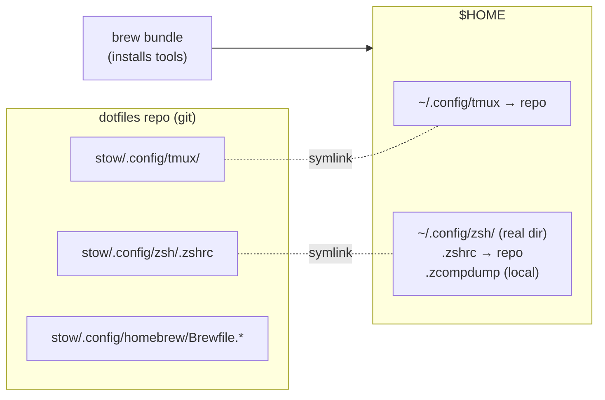

# Dotfiles and everyday CLI tools

## Why care?

Your laptop dies on a Monday. The new one arrives on Wednesday. How long until you can work again: one hour, or two days of "where was that setting"? And when you change your tmux config on one machine, how does the other machine get it?

The answer is a **dotfiles repository**: all config files in git, plus a script that installs the tools and links the files into place. This page shows how the setup in this chapter does it, how the linking really works, and where it can bite. Then we tour the small CLI tools that make the rest of the day faster.

## The idea: a library with a catalogue

Think of the dotfiles repository as a library. The books (config files) live in the library, on shelves. Your home folder doesn't hold copies; it holds **catalogue cards** (symlinks) that point to the shelf. Change the book in the library, and every card points to the new version. Want the library on a new machine? Clone it and print the cards.



The setup's `install.sh` runs stages in order: create the XDG folders, install requirements with Homebrew, apply platform system defaults, link config with **GNU stow**, build the `dot` CLI, install the package profile, and set zsh as the login shell. Each stage is also a `make` target (`make stow`, `make packages`, ...).

## Under the hood: stow is a symlink farm manager

**GNU stow** takes a folder (a "package") and creates symlinks in a target folder, so that the target looks like it contains the package's files. It never copies. Let's try it in a scratch folder:

```text
$ stow --dir=dotfiles/stow/.config --target=home/.config -v .
LINK: tmux => ../../dotfiles/stow/.config/tmux
LINK: zsh => ../../dotfiles/stow/.config/zsh
```

Note what happened: stow linked the **whole folders**, not each file. This is called **tree folding**: if a target folder doesn't exist yet, one symlink to the whole folder is the smallest solution. The links are **relative** (`../../`), so they keep working if you move both folders together.

Folding has a side effect. Anything a program writes into `~/.config/zsh/` would now land **in your git repository**: `.zcompdump`, history, caches. The fix is to create the real folder first. Then stow must "unfold" and link each file:

```text
$ mkdir -p home/.config/zsh   # make it a real directory first
$ stow --dir=dotfiles/stow/.config --target=home/.config -v .
LINK: tmux => ../../dotfiles/stow/.config/tmux
LINK: zsh/.zshrc => ../../../dotfiles/stow/.config/zsh/.zshrc
```

That is exactly why this setup's `setup/stow.sh` starts with a list of `mkdir -p` lines (`~/.config/zsh`, `~/.config/codex`, `~/.local/share/scripts`, ...) before it calls stow. On the real machine, `~/.config/tmux`, `~/.config/nvim` and `~/.config/ghostty` are folded symlinks into the repo, while `~/.config/zsh` and `~/.config/git` are real folders with one link per file. `~/.config/git` also holds a `platform.gitconfig` that is **not** a link: the setup writes it per machine (the credential helper differs between macOS and Linux) and the shared `config` includes it.

The setup calls stow once per top-level target (`stow/.config` → `~/.config`, `stow/.local` → `~/.local`, `stow/.ssh` → `~/.ssh`, ...), so `~/.config` itself always stays a real folder. Only `~/.zshenv` is linked by hand with `ln -Ffs`, because it must live directly in `$HOME`.

### Conflicts, and why `--adopt` is dangerous

If a real file is already where stow wants a link, stow stops. Nothing is changed:

```text
$ stow --dir=dotfiles/stow/.config --target=home/.config .
WARNING! stowing . would cause conflicts:
  * cannot stow ../../dotfiles/stow/.config/tmux/tmux.conf over existing target tmux/tmux.conf since neither a link nor a directory and --adopt not specified
All operations aborted.
exit: 1
```

The error suggests `--adopt`. Read what it does before you use it:

```text
$ stow --dir=dotfiles/stow/.config --target=home/.config --adopt -v .
MV: tmux/tmux.conf -> ../../dotfiles/stow/.config/tmux/tmux.conf
LINK: tmux/tmux.conf => ../../../dotfiles/stow/.config/tmux/tmux.conf
LINK: zsh => ../../dotfiles/stow/.config/zsh
$ cat dotfiles/stow/.config/tmux/tmux.conf
set -g prefix C-b   # old local file
```

`--adopt` **moves the local file into your repository**, over the version in git, and then links it. Your carefully written `set -g prefix C-a` is gone from the working tree, replaced by the machine's old file. It's only safe if you run `git diff` right after and restore what you want (`git restore`). This setup avoids the question: `make backup` moves conflicting files out of `$HOME` into `./backups` before stowing, and `make restore` brings one back.

## Homebrew Brewfiles: the tool list as code

Config is half of a machine. The other half is the tools. **`brew bundle`** reads a `Brewfile`, a small Ruby file with one line per package:

```ruby
brew "ripgrep"
brew "tmux"
brew "zinit"
cask "ghostty"
cask "font-iosevka-nerd-font"
```

| Command                       | Does                                              |
| ----------------------------- | ------------------------------------------------- |
| `brew bundle install`         | Install everything in the Brewfile that's missing |
| `brew bundle check`           | Exit 0 if everything is installed                 |
| `brew bundle cleanup --force` | Uninstall what is **not** in the Brewfile         |
| `brew bundle dump`            | Write a Brewfile from what's installed now        |

This setup has two layers:

1. **`Brewfile.requirements`** per platform (darwin, linux): tools the config needs to work at all (zsh, tmux, neovim, stow, fzf, zinit, ...).
2. **Profiles**: `Brewfile.personal`, `Brewfile.work`, `Brewfile.wsl`. On first install you pick one with fzf. The script links it to `~/.local/share/homebrew/Brewfile` and merges the requirements into it, under a header `# required packages -- do not edit`.

`.zshenv` sets `HOMEBREW_BUNDLE_FILE_GLOBAL` to that path, so `brew bundle --global` always means "this machine's profile". On this machine (the link points to `Brewfile.wsl`):

```text
$ brew bundle check --global
==> Downloading Homebrew API data
✔︎ JSON API packages.x86_64_linux.jws.json
Warning: Calling HOMEBREW_BUNDLE_FORCE_INSTALL_CLEANUP is deprecated! Use `brew bundle cleanup --force` after `brew bundle install` instead.
Warning: Calling HOMEBREW_REQUIRE_TAP_TRUST is deprecated! Use the default behaviour instead.
The Brewfile's dependencies are satisfied.
```

Everything is installed. And Homebrew tells us two variables in `.zshenv` are now deprecated. Config rots, even when nothing breaks.

## Private overlays and secrets

A public dotfiles repository can't hold your name, email, work hosts or keys. This setup keeps a **private overlay**: a second (private) repository, stowed to `~/.config/private/`. The public git config just includes it:

```ini
# we recommend setting user and email in a private repository
# that uses stow to symlink to here
[include]
	path = ~/.config/private/git/config
```

The same trick holds the SSH `allowed_signers` file for commit signing. If the include target doesn't exist, git silently skips it, so the public repo works alone too.

The rules for secrets:

- **Never** commit tokens, keys or passwords, not even "for a moment": git keeps history, and forks and caches keep copies. (The [Git chapter](../git/index.md) shows how hard real removal is.)
- Put secrets in a password manager, a hardware key, or the OS keychain. This setup uses `gh auth git-credential` for HTTPS and FIDO2 security keys for SSH, so there is no secret file to leak.
- Machine-specific values go in generated, uncommitted files (like `platform.gitconfig`) or `*.local` files that `.gitignore` excludes.

## Tour: the everyday CLI tools

All of these are in this setup's `Brewfile.requirements`. For each: the problem it solves, and one thing most people don't know.

### ripgrep (`rg`): search that knows your project

`grep -r` searches everything. `rg` reads `.gitignore`, skips hidden files and binary files, and searches in parallel. A scratch repo with `node_modules/` in `.gitignore` and a hidden `.env`:

```text
$ command grep -r TODO . | command grep -v '^./.git/' | sort
./.env:TODO: secret
./node_modules/lib/x.js:TODO: vendored
./src/main.go:func TODO() {}
$ rg TODO
src/main.go:func TODO() {}
$ rg --hidden TODO
.env:TODO: secret
src/main.go:func TODO() {}
$ rg -uu TODO
.env:TODO: secret
node_modules/lib/x.js:TODO: vendored
src/main.go:func TODO() {}
```

**The trick:** each `-u` removes one filter. `-u` = also ignored files, `-uu` = also hidden, `-uuu` = also binary. When `rg` "can't find" something you know is there, it's usually ignored. Add `-uu` before you doubt yourself.

### fd: `find` with sane defaults

`fd -e go` finds Go files, respects `.gitignore` like `rg`, and uses smart case. **The trick:** `fd` is fast enough to feed other tools: `fd -e go -x gofumpt -l {}` runs a command per result, in parallel.

### fzf: a generic filter

fzf is not "a file finder". It reads **any** list of lines and lets you pick some. That's why it appears everywhere in this setup: `Ctrl+R` history search, fzf-tab completion, the Brewfile picker, `tmux-fzf-url`. Its matching works without the UI too:

```text
$ printf 'cmd/ordersd/main.go\ninternal/order/service.go\ninternal/storage/memory/memory.go\nREADME.md\n' | fzf --filter 'ord serv'
internal/order/service.go
$ printf 'cmd/ordersd/main.go\ninternal/order/service.go\ninternal/storage/memory/memory.go\nREADME.md\n' | fzf --filter "'memory .go$"
internal/storage/memory/memory.go
```

**The trick:** the query is a small language. Spaces mean AND; `'word` means exact match; `^` and `$` anchor; `!` negates. `--filter` makes fzf usable in scripts and tests.

### bat: `cat` with syntax highlighting

`bat file.go` shows line numbers, colours and git changes. **The trick:** when its output is piped, bat behaves like plain `cat`, so `bat` in scripts is safe. It's also the preview engine of many fzf setups.

### delta: a better diff pager

delta renders git diffs with syntax highlighting, line numbers and side-by-side mode. In this setup it is **lazygit's** pager only (`delta --dark --paging=never --line-numbers ...` in `lazygit/config.yml`); `git config core.pager` is not set, so plain `git diff` uses `less`. **The trick:** to use it for git too, set `core.pager = delta` and `interactive.diffFilter = delta --color-only` (the second one makes `git add -p` pretty).

### lazygit: git in a TUI

lazygit shows status, branches, log and stashes in panels; staging lines, interactive rebase and cherry-picks become single keys. This config opens files in the **existing** Neovim (`editPreset: "nvim-remote"`) and uses delta's hyperlinks to jump from a diff line straight into the editor.

### zoxide: `cd` that learns

zoxide records every folder you visit and ranks them by **frecency** (frequency plus recency). This setup runs `zoxide init --cmd cd zsh`, which **replaces `cd`**: `cd ord` jumps to the best match for "ord". A real database with three folders:

```text
$ zoxide query --list --score
  12.0 /tmp/claude-1000/demo/Repos/orders-service
   4.0 /tmp/claude-1000/demo/Repos/dotfiles
   4.0 /tmp/claude-1000/demo/Repos/orders-client
$ zoxide query ord
/tmp/claude-1000/demo/Repos/orders-service
$ zoxide query ord cli
/tmp/claude-1000/demo/Repos/orders-client
```

**The trick:** several words must match in order, and the last word must match the last path part. `cd ord cli` finds `orders-client` even though `orders-service` has a higher score. A normal path (`cd ./x`, `cd ..`) still works like the builtin.

### direnv: env vars per folder

direnv loads an `.envrc` when you enter a folder and unloads it when you leave, through a shell hook (the same `precmd` idea as `mise activate`). **The trick:** it refuses to load a changed `.envrc` until you run `direnv allow`, the same trust idea as `mise trust`. In this setup it overlaps with mise's `[env]` (see [mise](mise.md#mise-next-to-homebrew-fnm-direnv-and-asdf)).

### yazi and gh

- **yazi** is a terminal file manager with previews (images through the passthrough you saw in [tmux](tmux.md#clipboard-and-passthrough)). The `y` function in `.zshrc` starts it with `--cwd-file` and `cd`s to the folder you were in when you quit: a child process can't change its parent's folder, so it writes the path to a file and the shell function does the `cd`.
- **gh** is GitHub's CLI: PRs, issues, Actions logs, and `gh auth git-credential` as git's credential helper. In this setup `gh` is an alias for `gh-switch-user`, another `dot` applet that wraps `gh`.

## Traps

- **Tree folding into the repo.** If stow folds a folder that programs write into, their files land in git. Create real folders first (as `setup/stow.sh` does), and add generated files to `.gitignore`.
- **`--adopt` overwrites your repo.** It moves local files into the repository. Run `git diff` immediately after, every time.
- **Paths that disagree.** The git config includes `agent.gitconfig` (which turns signing off for agent worktrees) for `gitdir:~/.cache/agent/worktrees/**`. `tmux-session end` and the Neovim session picker also use `~/.cache/agent/worktrees`. But the worktrees agents really create on this machine live in `~/.cache/agents/worktrees` (plural), so that include never matches them. One letter, and a rule silently does nothing. When you write a path in two places, put it in one variable.
- **Deprecated settings.** Homebrew warns about `HOMEBREW_BUNDLE_FORCE_INSTALL_CLEANUP` and `HOMEBREW_REQUIRE_TAP_TRUST`. Read warnings after updates; they're cheap to fix now and confusing later.
- **Platform differences.** The terminfo folder layout (`78/` on macOS, `x/` on Linux; see [Terminal and shell](terminal-and-shell.md#traps)) is one example. A dotfiles repo used on two OSes needs a test on both.

## Check yourself

??? question "1. You stow a package and later find `.zcompdump` in `git status` of your dotfiles repo. What happened, and how do you prevent it?"

    stow folded the folder: `~/.config/zsh` became one symlink to the repo folder, so zsh wrote its
    cache into the repo. Unstow, `mkdir -p ~/.config/zsh`, stow again: now only the files are links.

??? question "2. What exactly does `stow --adopt` do with a conflicting file?"

    It moves the existing file from the target into the package (your repo), replacing the repo's
    version in the working tree, and then creates the symlink. Check `git diff` afterwards.

??? question "3. How does this setup keep your name and email out of the public dotfiles?"

    The public git config has `[include] path = ~/.config/private/git/config`. A private repository,
    stowed to `~/.config/private`, provides that file. Git skips the include if it's missing.

??? question "4. `rg password` finds nothing, but you know the word is in a file under `build/`. Why?"

    `build/` is probably in `.gitignore`, and `rg` respects it. Use `rg -u password` (or `-uu` for
    hidden files too).

??? question "5. Why does yazi's `y` wrapper write the folder to a temporary file?"

    A child process can't change the working directory of its parent shell. yazi writes the last
    folder to a file; the shell function reads it and runs `cd` in the shell itself.

## Recap

- A dotfiles repo plus an install script makes a machine reproducible: tools from Brewfiles, config from symlinks.
- GNU stow creates relative symlinks and folds whole folders when it can. Create real folders first where programs write files.
- `--adopt` moves local files into your repo. Check `git diff` after.
- Keep personal and secret data in a private overlay or a keychain, included at run time, never committed.
- Small tools add up: `rg` and `fd` respect `.gitignore`, fzf filters any list, zoxide learns your folders, delta and lazygit make git readable.
- Config rots quietly: deprecated variables, mismatched paths, platform differences. Run the checks (`brew bundle check`, `mise doctor`, `:checkhealth`) now and then.

## You finished the Toolbox

You now know what sits between your keyboard and your code: the terminal and its PTY, zsh and its start-up files, tmux as a server, Neovim as a language and a platform, mise for per-project tools, and the dotfiles repository that ties it together.

One tool is missing, and it is the most important one: the one that holds your code's history. Continue with the [Git chapter](../git/index.md), where we open up `.git` and look at the objects inside.
