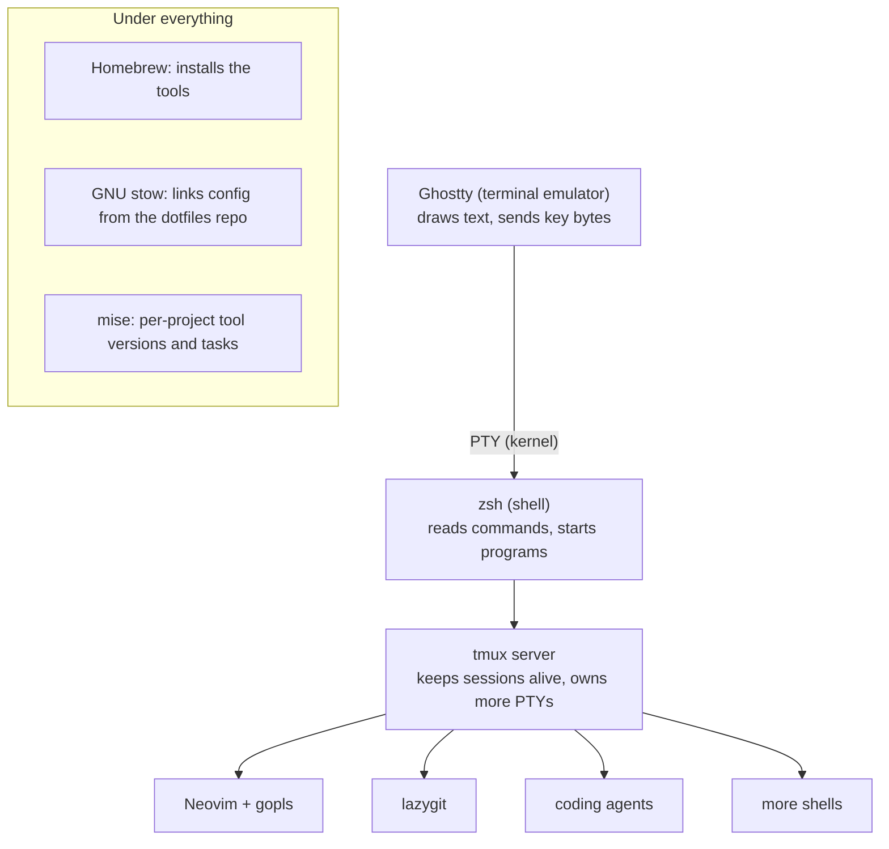

# Toolbox

The tools you touch every minute: terminal, shell, tmux, Neovim, mise and your dotfiles.

## Why the toolbox matters

A carpenter with a blunt saw can still build a table. It just takes three times longer, and the cuts are not straight. Software is the same. You can write good Go in any editor. But look at what a normal day really is:

- You jump between files, tests, logs and a terminal **hundreds of times**.
- You run the same five commands again and again.
- You SSH into a box, the Wi-Fi drops, and your long-running job dies with the connection.
- A new laptop arrives, and you lose two days before your setup "feels right" again.
- A teammate says "works on my machine", and the reason is a different Go version.

Each of these costs only a few seconds or a few minutes. Together they cost hours every week, and they break your **flow**: the state where the problem fits in your head. A good toolbox does three things:

1. **Keeps your hands on the keyboard.** No reaching for the mouse, no hunting for windows.
2. **Survives failures.** A dropped SSH session or a closed laptop lid doesn't lose your work.
3. **Is reproducible.** The setup lives in a git repository. A new machine is one command away, and every project pins its own tool versions.

This chapter is not a cheat sheet. You have used these tools before. Here we open them up: what a PTY is, why tmux is a client and a server, how Neovim talks to `gopls`, how mise changes your `PATH` before every prompt. When you know how a tool works, you stop memorising keys and start _predicting_ what it will do.

## The stack, from glass to code

Every page uses one real setup: the author's dotfiles. They are the example, not the rule. The point is to understand _why_ each choice exists, so you can make your own.

Read it from top to bottom:

1. **Ghostty** is the terminal emulator. It is a normal GUI program that draws a grid of characters and turns your key presses into bytes.
2. Between the terminal and the shell sits a **PTY**, a pseudo terminal inside the kernel. It is the "wire" the bytes travel on.
3. **zsh** reads what you type and starts programs.
4. **tmux** is a server that keeps your sessions alive. Each pane inside it is one more PTY with one more program.
5. Inside tmux you run **Neovim**, **lazygit**, coding agents and more shells.
6. Underneath, **Homebrew** installs the tools, **stow** links the config files from the dotfiles repository into `~/.config`, and **mise** picks the right tool version per project.

## Reading order

Each page builds on the one before it.

| #   | Page                                           | You will learn                                                                                     |
| --- | ---------------------------------------------- | -------------------------------------------------------------------------------------------------- |
| 1   | [Terminal and shell](terminal-and-shell.md)    | Terminal vs shell vs PTY, escape sequences, `TERM`, OSC 52, zsh startup files, `PATH`, completion  |
| 2   | [tmux](tmux.md)                                | Client and server, key tables, options and formats, `escape-time`, scripting tmux, this setup      |
| 3   | [Neovim](neovim.md)                            | Modal editing as a language, registers, LazyVim and lazy.nvim, LSP, Treesitter, the Go workflow    |
| 4   | [mise](mise.md)                                | Per-project tools, `activate` vs shims vs `exec`, trust, backends, tasks, and a real misconfig     |
| 5   | [Dotfiles and everyday CLI tools](dotfiles.md) | stow link farms, Brewfiles, XDG, private overlays, and rg, fd, fzf, bat, delta, zoxide and friends |

## How each page works

The same shape as the [Fundamentals](../fundamentals/index.md):

- **Why care?** A real problem first.
- **The idea.** Plain words and a picture.
- **Under the hood.** How the tool really works. Take your time here.
- **Try it.** Commands you can run. All output in this chapter comes from real runs on a real machine (WSL2, tmux 3.8, Neovim 0.12.6, mise 2026.11.14).
- **Traps.** Mistakes that real setups make, often found in this very setup.
- **Check yourself.** A few questions. Answers are hidden; try first.

!!! tip "Experiment without breaking your setup"

    Every tool here has a way to run a throwaway copy: `tmux -L sandbox` starts a separate tmux
    server, `nvim --clean` starts Neovim without your config, `zsh -f` starts zsh without startup
    files, and `mise exec` runs one command with a tool version without changing your shell.
    Use them. Break things on purpose. That is how the knowledge sticks.
