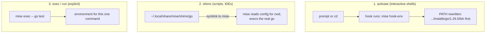

# mise

## Why care?

This repository's `mise.toml` used to say `go = "latest"`. CI ran the checks and they passed. On the author's laptop, in the same folder:

```text
$ go version
go version go1.27.4 linux/amd64
$ mise exec -- go version
go version go1.26.5 linux/amd64
```

Two Go versions, in the same folder, on the same machine, a second apart. Which one runs your tests depends on _how_ you call it. And CI, which installs fresh, gets a third answer that may differ from both. This page explains why, and how to make the result predictable again.

## The idea: tool versions per project

Homebrew installs one version of each tool, for everything on the machine. That's fine for `ripgrep`. It's not fine for Go, Python or Node, where project A needs one version and project B another.

**mise** gives every project its own list of tool versions. A `mise.toml` in the project says "here we use Go 1.26 and Python 3.13". When you work in that folder, `go` means that version. Outside, it means something else. mise manages three things:

1. **Tools**: install versions side by side under `~/.local/share/mise/installs/`, and put the right one on `PATH`.
2. **Environment variables**: an `[env]` section, per project (like direnv).
3. **Tasks**: named commands with dependencies (like `make`), in the same file.

This repository's file (with exact versions since the fix below):

```toml
[tools]
python = "3.13.18"
"pipx:zensical" = "0.1.3"
go = "1.27.4"
golangci-lint = "2.15.0"
actionlint = "1.7.12"
bun = "1.4.5"

[settings]
pipx.uvx = true

[tasks.check]
description = "Run all checks (CI entry point)"
depends = ["fmt:check", "lint", "build", "go:check"]
```

(Tasks shortened; all of them are shown below. Later chapters add more tools to `[tools]`, one at a time: see [Adding tools as you go](#adding-tools-as-you-go).)

## Under the hood: three ways to get the right `go`

The core problem: when you type `go`, the shell searches `PATH` (see [Terminal and shell](terminal-and-shell.md#path-how-a-name-becomes-a-program)). It knows nothing about projects. mise has three ways to influence that search.



### 1. `mise activate`: a hook before every prompt

`eval "$(mise activate zsh)"` in `.zshrc` prints a small zsh script and runs it. The important lines of that script, from a real run:

```sh
_mise_hook() {
  eval "$(/home/linuxbrew/.linuxbrew/bin/mise hook-env --shell-pid $$ -s zsh "$@")";
}
...
add-zsh-hook precmd _mise_hook_precmd
add-zsh-hook chpwd _mise_hook_chpwd

_mise_hook --force
```

zsh calls `precmd` hooks before each prompt and `chpwd` hooks after each `cd`. Each time, `mise hook-env` reads the config files for the current folder and prints `export PATH=...` and other variables, and the shell `eval`s them. mise remembers the original `PATH` (in `__MISE_ORIG_PATH`), so it can remove old entries when you leave a project. There is also a fast path: if nothing changed, the hook returns early, so the cost per prompt is small.

What it looks like, in a clean zsh (`zsh -f`, no start-up files) in this repository:

```text
$ zsh -fc 'eval "$(mise activate zsh)"; for d in ${path[1,4]}; do print -r -- "${d/#$HOME/~}"; done; go version'
~/.local/share/mise/installs/python/3.13/bin
~/.local/share/mise/installs/pipx-zensical/latest/bin
~/.local/share/mise/installs/go/1.26.5/bin
~/.local/share/mise/installs/golangci-lint/latest/golangci-lint-2.15.0-linux-amd64
go version go1.26.5 linux/amd64
```

The real install folders are put at the **front** of `PATH`. No wrapper, no extra process: `go` is the real binary. mise also sets tool variables; for Go, `mise env` shows `GOROOT` and `GOBIN` pointing into the 1.26.5 install, so `go install` puts binaries next to that Go version.

### 2. Shims: small stand-in programs

A hook only works in an interactive shell. Your IDE, a cron job or a `#!/bin/sh` script never runs `precmd`. For them, mise has **shims**: one file per tool name in `~/.local/share/mise/shims/`. Here they are:

```text
$ cd ~/.local/share/mise/shims && stat -c '%N' go gofmt
'go' -> '/home/linuxbrew/.linuxbrew/bin/mise'
'gofmt' -> '/home/linuxbrew/.linuxbrew/bin/mise'
```

Every shim is a **symlink to mise itself**. When you run `go`, mise starts, sees `argv[0]` is `go`, reads the config for the current folder, and runs the right real binary. (The same multi-call design as the `dot` CLI in [tmux](tmux.md#try-it-script-a-session-like-tmux-session-start).) The answer depends on the folder:

```text
$ cd ~ && ~/.local/share/mise/shims/go version
go version go1.27.4 linux/amd64
$ cd ~/.cache/agent/worktrees/software-engineering-tutor-toolbox-and-git && ~/.local/share/mise/shims/go version
go version go1.26.5 linux/amd64
```

In `$HOME` there is no config for Go, so the shim falls through to the next `go` on `PATH` (Homebrew's 1.27.4). In the project it picks 1.26.5. The cost: every call starts mise first, and, as `mise activate --help` warns, "shims do not support every feature of `mise activate`".

### 3. `mise exec` and `mise run`: explicit

`mise exec -- <command>` (short: `mise x`) runs one command with the project's tools and env, without touching your shell. `mise run <task>` does the same for tasks. There is nothing to activate and nothing to forget. That's why the help text of `mise activate` itself says:

> Use `mise exec -- command` for scripts and CI that do not need interactive hooks.

| Way          | Works in                    | Cost                | Use for                       |
| ------------ | --------------------------- | ------------------- | ----------------------------- |
| `activate`   | interactive shells          | a hook per prompt   | your terminal                 |
| shims        | everything that uses `PATH` | mise start per call | IDEs, scripts, GUI apps       |
| `exec`/`run` | anywhere                    | explicit command    | CI, Makefiles, one-off checks |

## Diagnose this setup: mise is not active

Back to the two Go versions. `mise doctor` shows the state:

```text
$ mise doctor
version: 2026.11.14 linux-x64 (2026-11-24)
activated: no
shims_on_path: no
self_update_available: no
...
config_files:
  ~/.cache/agent/worktrees/software-engineering-tutor-toolbox-and-git/mise.toml
...
toolset:
  aqua:golangci/golangci-lint@2.15.0
  aqua:rhysd/actionlint@1.7.12
  core:bun@1.4.5
  core:go@1.26.5
  core:python@3.13.18
  pipx:zensical@0.1.3
...
1 problem found:

1. mise is not activated, run mise help activate or
   read documentation at https://mise.jdx.dev for activation instructions.
   Alternatively, add the shims directory ~/.local/share/mise/shims to PATH.
   Using the shims directory is preferred for non-interactive setups.
```

`activated: no` and `shims_on_path: no`. mise is installed by Homebrew, but the dotfiles' `.zshrc` never activates it. So in a normal shell, `go` is Homebrew's `go`, and the project's `mise.toml` is ignored. Only `mise run` and `mise exec` use it. You can see this in what the shell finds:

```text
$ command -v go python3 bun actionlint
/home/linuxbrew/.linuxbrew/bin/go
/home/linuxbrew/.linuxbrew/bin/python3
/home/linuxbrew/.linuxbrew/bin/bun
/home/linuxbrew/.linuxbrew/bin/actionlint
$ mise which go | sed "s|^$HOME|~|"
~/.local/share/mise/installs/go/1.26.5/bin/go
```

The fix has two parts:

1. In `.zshrc`, after `brew shellenv` (so `mise` is on `PATH`):

   ```sh
   eval "$(mise activate zsh)"
   ```

2. For things that don't run `.zshrc` (editors started from a GUI, scripts), put the shims on `PATH` in `.zshenv` or the login environment: `export PATH="$XDG_DATA_HOME/mise/shims:$PATH"`. Activation in the interactive shell then puts the real folders in front of the shims.

The dotfiles now do part 1. The same check in the project folder, first with the old `.zshrc`, then with the fixed one (`zsh -i -c 'go version; command -v zensical'`):

```text
go version go1.27.4 linux/amd64
zensical: not on PATH
```

```text
go version go1.26.5 linux/amd64
~/.local/share/mise/installs/pipx-zensical/latest/bin/zensical
```

Same folder, same `mise.toml`. Only activation changed, and now the shell uses the project's tools.

### What "latest" means

The output above shows a second problem. `latest` gave Go **1.26.5**, but:

```text
$ mise latest go
1.27.4
$ mise outdated
go  latest  1.26.5  1.27.4 ~/.cache/agent/worktrees/software-engineering-tutor-toolbox-and-git/mise.toml
```

For `latest`, mise uses the newest version that is **already installed**, until you upgrade (`mise upgrade go`). On a fresh machine, like a CI runner, nothing is installed yet, so CI gets 1.27.4. Your laptop and CI run different Go versions from the same file, and neither is wrong.

The fix is to be explicit: pin a version (`go = "1.26"`) or use a **lock file**. `mise lock` writes `mise.lock` with the exact version, checksums and download URLs per platform. Commit it, and `--locked` (or the `locked` setting) makes installs use only the locked URLs. It's the same idea as `go.sum` and `lazy-lock.json`.

This repository now does both: exact versions in `mise.toml`, and a committed `mise.lock`. Look inside:

```text
actionlint 1.7.12 aqua:rhysd/actionlint linux-x64 url: True 7 platforms
bun 1.4.5 core:bun linux-x64 url: True 11 platforms
go 1.27.4 core:go linux-x64 url: True 7 platforms
golangci-lint 2.15.0 aqua:golangci/golangci-lint linux-x64 url: True 7 platforms
pipx:zensical 0.1.3 pipx:zensical linux-x64 url: None 0 platforms
python 3.13.18 core:python linux-x64 url: True 7 platforms
```

(A short Python summary of `mise.lock`.) Downloaded binaries get a checksum and URL per platform. `pipx:zensical` has no URL: pipx installs a Python package and its dependencies, not one file. For that, `mise lock` writes a second lock file, `.mise/locks/pipx-zensical/0.1.3/uv.lock`, with all 13 Python packages and their hashes. Commit that folder too.

With both in git, the repo sets `locked = true` in `[settings]`: installs may only use what the lock files record. To test this, run a fresh install into an empty data folder, as a CI runner would do:

```text
$ MISE_DATA_DIR=$PWD/empty-data MISE_CACHE_DIR=$PWD/empty-cache MISE_LOCKED=1 mise install
...
mise ✓ pipx:zensical@0.1.3   987ms
mise go@1.27.4 go version go1.27.4 linux/amd64
mise ✓ go@1.27.4             5.9s  go1.27.4.linux-amd64.tar.gz
mise ████████████████ 6/6 · installed 6 tools in 6.0s
```

The price: after you change a version in `mise.toml`, run `mise lock` and commit both files, or the next install fails.

## Adding tools as you go

Later chapters need more tools: `kubectl` and `kind` for Kubernetes, `cosign` and `syft` for signing and SBOMs, `zizmor` for workflow security, and so on. Each one goes into the same `mise.toml`, never into a global install. When a page needs a new tool, it shows one line:

```sh
mise use cosign@3.1.6
```

`mise use` does three things: it writes `cosign = "3.1.6"` to `[tools]` in the nearest `mise.toml`, installs that version, and (in a project with a lock file) records it in `mise.lock`. Always give an exact version. `mise use cosign` without one writes `latest`, with the problem from [What "latest" means](#what-latest-means).

This repository already lists every tool the course uses, so after a clone `mise install` gets them all. You don't even need that: with `mise activate`, the first time you type a tool's name mise installs the missing version (the `not_found_auto_install` setting, on by default), and `mise run` installs what is missing before a task starts. Use `mise use` in **your own** projects, and here when you want to try a newer version.

In a project with `locked = true`, a plain `mise use` of a new tool fails, because the lock file doesn't know it yet:

```text
$ mise use zizmor@1.33.1
mise ERROR Failed to install aqua:zizmorcore/zizmor@1.33.1: zizmor@1.33.1 is not in the lockfile
hint: Run `mise install` without --locked to update the lockfile
```

That's the lock doing its job: nothing gets installed that a reviewer hasn't seen in `mise.lock`. Adding a tool is the one moment you allow mise to resolve a new version, so switch the setting off for that one command:

```text
$ MISE_LOCKED=0 mise use zizmor@1.33.1
mise lock                              ✓ 94 targets checked
mise ~/.cache/agent/worktrees/software-engineering-tutor-secure-delivery/mise.toml tools: zizmor@1.33.1
```

It wrote the line to `mise.toml` and checksums for every platform to `mise.lock` (71 new lines). Commit both. Prefer tools from the `aqua` backend (see [Backends](#backends-where-tools-come-from)): mise checks their checksums and, where the project publishes them, their [signatures and attestations](../secure-delivery/artifact-signing.md). A tool that only exists as a Go module can use the `go` backend, for example `mise use go:github.com/securego/gosec/v2/cmd/gosec@2.30.0`. That one is built from source with `go install`.

Some tools don't belong in mise: the kernel's tools (`strace`, `tcpdump`, `uidmap`), Docker, and OpenSSL come from the operating system's package manager, because they depend on the kernel or system libraries. The pages say so where it matters.

## Config files and trust

mise reads config files from the current folder up to `/`, plus a global one. Closer files win. The common names:

| File                               | Who writes it | Committed?               |
| ---------------------------------- | ------------- | ------------------------ |
| `mise.toml` or `.config/mise.toml` | the project   | yes                      |
| `mise.local.toml`                  | you           | no (personal overrides)  |
| `~/.config/mise/config.toml`       | you           | in your dotfiles, if any |

`mise config ls` shows what is really loaded, lowest precedence first:

```text
$ mise config ls
~/.cache/agent/worktrees/software-engineering-tutor-toolbox-and-git/mise.toml  python, pipx:zensical, go, golangci-lint, actionlint, bun
```

(This setup has no global mise config: `~/.config/mise` does not exist.)

**Trust.** A `mise.toml` can set environment variables, run templates and define tasks. Loading it from a repository you just cloned is the same as running its code. So mise asks you to **trust** a config file before it loads the risky parts. From `mise trust --help` in this version:

- A file with only plain `[tools]` versions and simple `[tasks]` does not need trust.
- Commands that run project code anyway (`mise run`, `mise install`, `mise exec`) trust their active config automatically.
- Trusting a file in a repository's main checkout also trusts the same path in its git worktrees.

That last point is why this worktree was trusted without asking:

```text
$ mise trust --show
~/.cache/agent/worktrees/software-engineering-tutor-toolbox-and-git: trusted
```

## Backends: where tools come from

Each tool comes from a **backend**. `mise registry` shows which backend a short name maps to:

```text
$ mise registry go
core:go
$ mise registry golangci-lint
aqua:golangci/golangci-lint asdf:hypnoglow/asdf-golangci-lint
$ mise registry python
core:python
```

| Backend               | How it installs                                            | Example                                |
| --------------------- | ---------------------------------------------------------- | -------------------------------------- |
| `core`                | Built into mise, written for that language                 | `go`, `python`, `bun`                  |
| `aqua`                | The aqua registry: prebuilt binaries, with checksum checks | `golangci-lint`, `actionlint`          |
| `github` / `ubi`      | Download a release asset from a GitHub repository          | `github:owner/tool`                    |
| `go`                  | `go install` a module                                      | `go:golang.org/x/vuln/cmd/govulncheck` |
| `npm`, `cargo`, `gem` | The language's own package manager                         | `npm:prettier`                         |
| `pipx` / `pypi`       | A Python CLI in its own virtual env (here via `uvx`)       | `pipx:zensical`                        |
| `asdf`, `vfox`        | Plugins from those older ecosystems                        | fallback                               |

Note: this repository writes `pipx:zensical` and `pipx.uvx = true`, but in this mise version `mise doctor` lists the backend as `pypi` and reports the setting as `pypi.uvx`. The old name still works. Prefer `aqua` and `core` when you can: they download a prebuilt, verified binary instead of building anything.

## Tasks: this repository as the example

```text
$ mise tasks
build      Build the site into ./site
check      Run all checks (CI entry point)
clean      Remove build output
fmt        Format Markdown, YAML and Go code
fmt:check  Check formatting
go:check   Vet, lint and race-test the Go reference project
install    Install lint and format tools with bun
lint       Lint Markdown and workflows
serve      Serve the site with live reload
$ mise tasks deps check
check
├── go:check
├── build
├── lint
│   └── install
└── fmt:check
    └── install
```

- **`depends`** builds a graph. `check` needs four tasks; two of them need `install`. mise runs `install` **once**, and runs independent tasks **in parallel** (`--jobs`).
- **`run` as an array** runs the commands one after another, and stops at the first failure.
- **`dir`** sets the working folder:

```text
$ mise tasks info go:check
Task: go:check
Description: Vet, lint and race-test the Go reference project
Source: ~/.cache/agent/worktrees/software-engineering-tutor-toolbox-and-git/mise.toml
Directory: examples/orders

Run:
  test -z "$(gofmt -l .)"
  go vet ./...
  golangci-lint run ./...
  go test -race -count=1 ./...
```

Every task runs with the project's tools on `PATH`, activated or not. That's why `mise run check` gives the same answer in your shell and in CI.

Two more task features:

- **File tasks**: executable scripts in a `mise-tasks/` folder become tasks too. Good when a task is longer than one line.
- **`sources` and `outputs`**: "a task with `sources` and `outputs` is skipped while its outputs are up to date; `--force` runs it anyway" (from `mise run --help`). Like `make`, but with globs.

## mise in CI

The main job of this repository's CI is four steps (shown without the comments):

```yaml
steps:
  - uses: step-security/harden-runner@aebdcf6156ab6691adf63218240e476564a1ed4c # v2.23.0
    with:
      egress-policy: audit
  - uses: actions/checkout@3d3c42e5aac5ba805825da76410c181273ba90b1 # v7.0.1
    with:
      persist-credentials: false
      fetch-depth: 0
  - uses: jdx/mise-action@924e7c586e33d7d4bae9c14e26c5d22e2beb6e78 # v5.3.0
    with:
      version: 2026.11.14
      sha256: 6fa596291e9758106f761fea4f8e7fac6c3e7ff4714d5c0b9a76e16068db14f6
      install_args: python pipx:zensical go golangci-lint actionlint zizmor gitleaks bun uv
      cache_save: ${{ github.event_name == 'push' }}
  - run: mise run check
```

`jdx/mise-action` installs mise and the tools from `mise.toml`. Then CI runs **the same task you run locally**. Three inputs make the install itself trustworthy:

- **`version` and `sha256`** pin mise itself. Without them the action takes the newest release, so the program that installs all other tools would be the one unpinned tool.
- **`install_args`** limits the install to the tools that `check` needs. `mise.toml` also lists the course's other tools, and CI doesn't need `kubectl` or `cosign` to build this site. The workflow also sets `MISE_TASK_RUN_AUTO_INSTALL: "false"`, because otherwise `mise run` installs every missing tool before it starts the task.
- **`cache_save`** is true only on pushes to `main`, so a pull request can't write a cache that `main` later restores.

[CI pipelines](../delivery/ci-pipelines.md#this-repositorys-ci-line-by-line) and [GitHub Actions security](../secure-delivery/workflow-security.md) explain the other lines. No separate list of setup steps that drifts from the README. The only gap is the one above: without a pin or lock file, "latest" in CI is newer than "latest" on your laptop. With pins and `mise.lock`, both get the same versions.

## mise next to Homebrew, fnm, direnv and asdf

| Tool         | Scope                          | Overlap with mise                                        |
| ------------ | ------------------------------ | -------------------------------------------------------- |
| **Homebrew** | System-wide, one version       | Keep it for CLI tools (`rg`, `tmux`) and for mise itself |
| **fnm**      | Node only, per folder          | Full overlap: mise manages Node too                      |
| **direnv**   | Env vars per folder (`.envrc`) | mise's `[env]` covers the common cases                   |
| **asdf**     | Tools per folder, via shims    | mise started as a faster asdf; reads `.tool-versions`    |

This setup activates **fnm** and **direnv** in `.zshrc`, but not mise, even though mise has Node versions installed too (`mise ls` shows `node 24.18.0` and `26.13.1`). Two managers for one tool means two answers to "which `node`?". Pick one per tool. If mise is activated, fnm and most direnv uses can go.

## Traps

- **"latest" is not reproducible.** It means "newest installed" locally and "newest released" on a fresh machine. Pin, or `mise lock`.
- **Installed but not activated.** `mise doctor` says `activated: no`. Everything still _seems_ to work, because Homebrew has a `go` too. You only notice when the versions differ. Run `mise doctor` on every new machine.
- **Hook order.** `mise activate` must run after `mise` is on `PATH` (after `brew shellenv`). Other hooks that also rewrite `PATH` on each prompt (fnm with `--use-on-cd`) compete for the order.
- **Shims and `rehash`.** When you install a tool with a new name, a new shim file appears. zsh may have hashed the old location of that name (or "not found") and needs a `rehash`.
- **`mise use` without a version.** It writes `latest`. Give the exact version, as every page in this course does.
- **`MISE_LOCKED=0` as a habit.** It is for the one command that adds or changes a tool. If installs fail in locked mode for any other reason, find out why instead of switching the lock off.
- **Untrusted configs in CI.** `mise run` trusts its config automatically. For other commands, the help text says that without trust "mise prompts, skips the file, or fails with an untrusted-config error when it cannot prompt". In CI there is nobody to answer the prompt.

## Check yourself

??? question "1. Your IDE runs `go test` and gets a different Go version than your terminal. Why, and what are two fixes?"

    The IDE doesn't run `.zshrc`, so `mise activate`'s hook never runs. Put
    `~/.local/share/mise/shims` on the IDE's `PATH`, or configure the IDE to run `mise exec -- go test`.

??? question "2. How does a shim know which version to run?"

    The shim is a symlink to the `mise` binary. mise sees the name it was called with (`argv[0]`),
    reads the config files for the current folder, and execs that tool's real binary.

??? question "3. `go = "latest"`. Your laptop has Go 1.26.5 installed, the newest release is 1.27.4. Which version does each machine use?"

    The laptop uses 1.26.5 (newest installed) until `mise upgrade`. A fresh CI runner installs and uses 1.27.4.
    Pin a version or commit `mise.lock`.

??? question "4. Why does mise ask you to trust a `mise.toml`?"

    It can set environment variables, use templates and define tasks: running it is like running the
    repository's code. Trust is your decision to allow that for this file.

??? question "5. What does `mise run check` do that `make check` with Homebrew tools doesn't?"

    It runs with the exact tool versions from `mise.toml` on `PATH`, installs missing ones, and runs
    the dependency graph in parallel. The same command gives the same tools locally and in CI.

## Recap

- mise manages per-project tools, env vars and tasks from `mise.toml`.
- `activate` rewrites `PATH` in a `precmd`/`chpwd` hook; shims are symlinks to mise that pick the version per call; `exec`/`run` are explicit.
- This setup did **not activate** mise: `mise doctor` showed it. The fix is `eval "$(mise activate zsh)"` in `.zshrc`, plus shims for non-interactive programs.
- `latest` means "newest installed". Pin versions or use `mise lock` for reproducible builds.
- Config files merge from the folder upwards; trust protects you from running a stranger's config.
- New tools go into the project with `mise use tool@version` (with `MISE_LOCKED=0` when the project is locked), never into a global install.
- Tasks with `depends`, `dir` and `run` arrays make `mise run check` the single entry point, locally and in CI.

Next: [Dotfiles and everyday CLI tools](dotfiles.md), the repository that holds all of this config.
