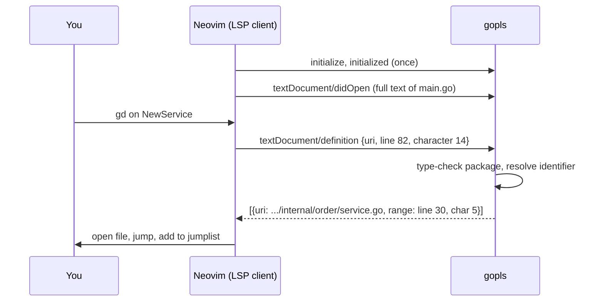

# Neovim

## Why care?

You already use Vim keys. You can move with `hjkl`, save with `:w`, maybe use `ciw`. And still, some days feel slow:

- You make the same edit on ten lines by hand, because a macro feels like too much work.
- "Go to definition" takes two seconds, or jumps to the wrong place, and you don't know which part is slow.
- After a plugin update, saving a Go file no longer removes unused imports. You find out when CI fails.

The fix is not more plugins. It is knowing how the parts work: the editing language, the registers, the plugin loader, the language server. Then you can fix problems yourself instead of searching for someone else's config.

## The idea: editing is a language

Vim's normal mode is not a list of shortcuts. It is a small language with **verbs**, **counts** and **nouns**:

| Part               | Examples                                                             |
| ------------------ | -------------------------------------------------------------------- |
| Verb (operator)    | `d` delete, `c` change, `y` yank, `>` indent, `gU` uppercase         |
| Count              | `3`, `10`                                                            |
| Noun (motion)      | `w` word, `}` paragraph, `f,` to the next comma, `G` end of file     |
| Noun (text object) | `iw` inner word, `i(` inside parentheses, `at` a tag, `ip` paragraph |

`d3w` = delete three words. `ci"` = change inside the quotes. `yap` = yank a paragraph. Once you learn a new verb, it works with every noun you know. That's why Vim users get faster for years, while users of other editors stop improving after a few months.

The best part of the language is **`.`**, repeat the last change. A "change" is one verb + noun, or everything you typed in one visit to insert mode. So design your edits to be repeatable. Here is a real headless run (`nvim --clean --headless`): change `user` to `acct` on one line, then repeat it on the next line with `.`:

```text
-- before
name := user.Name
id := user.ID
-- keys: fucwacct<Esc>   then   j0fu.
name := acct.Name
id := acct.ID
". register = acct
```

`fu` finds the next `u`, `cw` changes the word, and `.` replays the whole `cw` + typed text. The `.` register holds the text you last inserted.

## Under the hood: registers, macros, marks, lists

### Registers are named clipboards

Every yank, delete and change goes into a **register**. The important ones:

| Register    | Holds                                                        |
| ----------- | ------------------------------------------------------------ |
| `"`         | The unnamed register: the last yank or delete. `p` pastes it |
| `0`         | The last **yank** only. Deletes don't overwrite it           |
| `1` - `9`   | The last nine bigger deletes, as a history                   |
| `a` - `z`   | Yours. `"ayy` yanks into `a`, `"Ayy` **appends** to `a`      |
| `+`, `*`    | The system clipboard (through a clipboard provider)          |
| `.` `:` `/` | Last inserted text, last command line, last search           |

A classic surprise: you yank a word, delete a line, and `p` pastes the deleted line. The yank is still safe in `"0`, so `"0p` pastes it.

### Macros are just registers

`qa` starts recording keys into register `a`, `q` stops, and `@a` plays it. There is nothing special about a macro: it is **text in a register**. So you can set it directly, and even edit it like text. A real run:

```text
-- before: alpha / beta / gamma
-- setreg("a", 'I"<Esc>A",<Esc>j')   then   3@a
"alpha",
"beta",
"gamma",
```

`I"` inserts a quote at the start, `A",` appends a quote and a comma, `j` goes down. Ending a macro with a motion to the next line makes it chainable with a count. If a macro goes wrong, paste it (`"ap`), fix the text, and yank it back without the line break (`0"ay$`).

### Marks, the jumplist and the quickfix list

- **Marks**: `ma` sets mark `a` in this file, `` `a `` jumps back to it. Capital marks (`mA`) are global: they remember the file too.
- **Jumplist**: every "big" jump (search, `G`, go-to-definition) is recorded. `Ctrl+o` goes back, `Ctrl+i` forward. After `gd` into a library, `Ctrl+o` brings you home.
- **Changelist**: `g;` and `g,` walk through the places you edited.
- **Quickfix list**: a list of positions (file, line, message) for the whole editor. Search results, compiler errors and LSP references can all land there. `:cnext`/`:cprev` walk it, and `:cdo s/old/new/ | update` runs a command on every entry: a project-wide edit with full control.

### Buffers, windows and tabs

Three words people mix up:

- A **buffer** is a file loaded in memory. It exists even when you can't see it.
- A **window** is a view on a buffer. Two windows can show the same buffer.
- A **tab page** is a layout: a set of windows. It is _not_ "one tab per file" as in other editors.

This setup maps `Tab` / `Shift+Tab` to the next and previous **buffer**, and hides the native tab line (`showtabline = 0`). Buffers are the unit you switch between.

## Under the hood: how Neovim is built

### Two processes, one API

Neovim is a server with a UI attached. When you run `nvim` in a terminal, you actually get **two processes**:

```text
$ ps -o pid,ppid,tty,args --pid 132205 --ppid 132205
    PID    PPID TT       COMMAND
 132205  132204 pts/8    nvim --clean
 132210  132205 ?        nvim --embed --clean
```

The first is the terminal UI (TUI). It owns the PTY. The second, `nvim --embed`, is the editor itself, with no terminal at all. They talk with **msgpack-RPC**, the same API that GUIs and plugins use. Every Lua call `vim.api.nvim_buf_get_lines(...)` is a function of that API. That's why Neovim can run fully headless, as in every example on this page.

### Lua, `runtimepath` and `stdpath`

Neovim embeds **LuaJIT**, so config and plugins are Lua. When you `require("config.lazy")`, Lua searches a `lua/` folder in every directory of the **`runtimepath`**. Plugins are just folders added to it. With this setup:

```text
~/.config/nvim
~/.local/share/nvim/site
~/.local/share/nvim/lazy/lazy.nvim
~/.local/share/nvim/lazy/auto-save.nvim
~/.local/share/nvim/lazy/snacks.nvim
~/.local/share/nvim/lazy/cyberdream.nvim
~/.local/share/nvim/lazy/tokyonight.nvim
~/.local/share/nvim/lazy/LazyVim
/home/linuxbrew/.linuxbrew/Cellar/neovim/0.12.6/share/nvim/runtime
/home/linuxbrew/.linuxbrew/Cellar/neovim/0.12.6/lib/nvim
~/.local/state/nvim/lazy/readme
```

Only 11 entries at start-up, but this config has 61 plugins. The rest are added later, when needed. Where do things go? `stdpath()` follows XDG:

```text
config = ~/.config/nvim
data = ~/.local/share/nvim
state = ~/.local/state/nvim
cache = ~/.cache/nvim
```

Config is yours (and in the dotfiles repo). Plugins, Mason tools and parsers go to `data`. Undo files, shada (history, marks, registers) and logs go to `state`.

## LazyVim on lazy.nvim

Two different things with similar names:

- **lazy.nvim** is the plugin _manager_. It downloads plugins, pins them, and loads them at the right moment.
- **LazyVim** is a _distribution_: a big, well-tested set of plugin specs and defaults, built on lazy.nvim. You import it and then override pieces.

### Specs, imports and the boot path

`init.lua` is one line: `require("config.lazy")`. That file clones lazy.nvim if it's missing, adds it to the `runtimepath`, and calls `require("lazy").setup({ spec = ... })` with a list of **imports**:

1. `LazyVim/LazyVim` with `import = "lazyvim.plugins"`: the base.
2. **Extras** from LazyVim: `lang.go`, `dap.core`, `test.core`, `coding.blink`, `lang.docker`, `lang.terraform`, `lang.yaml`, and more.
3. `plugins` and `plugins.lang`: every file in `lua/plugins/` and `lua/plugins/lang/`. Each file returns specs that **add or change** plugins.

lazy.nvim collects all specs for the same plugin and **merges** them. Tables merge key by key. But **lists are replaced**, not appended. This is the most important rule for overriding LazyVim, and this setup shows it. LazyVim's Go extra sets:

```lua
formatters_by_ft = { go = { "goimports", "gofumpt" } }
```

and `lua/plugins/lang/go.lua` used to set:

```lua
formatters_by_ft = { ["go"] = { "gofumpt" } }
```

The result, checked headless in a Go buffer:

```text
$ nvim --headless -c 'edit cmd/ordersd/main.go' -c 'lua print(vim.inspect(require("conform").formatters_by_ft.go))' -c 'qa!'
{ "gofumpt" }
```

`goimports` is gone. More about what that means in [Traps](#traps). (The dotfiles have since dropped that override, so the Go extra's default applies again.)

If you need to _extend_ a list, use an `opts` function instead of a table: `opts = function(_, opts) table.insert(opts.x, "y") end`. The function gets the already-merged options and can change them in any way. This setup's `sql.lua` uses that form to change one formatter's arguments.

### Lazy loading

`defaults = { lazy = true }` means: don't load a plugin at start-up unless it says so. A plugin loads when one of its **triggers** fires: an event, a command, a key, or a file type. A real look at a few plugins right after start:

```text
auto-save.nvim       lazy=false loaded=true
cyberdream.nvim      lazy=false loaded=true
blink.cmp            lazy=true  loaded=false event=CmdlineEnter,InsertEnter
nvim-lspconfig       lazy=true  loaded=false event=BufNewFile,BufReadPre
gitsigns.nvim        lazy=true  loaded=false event=LazyFile
vim-tmux-navigator   lazy=true  loaded=false cmd=TmuxNavigateDown,TmuxNavigateLeft,TmuxNavigatePrevious,TmuxNavigateRight,TmuxNavigateUp
```

The completion engine (blink.cmp) loads when you first enter insert mode. The LSP config loads when you open a file. `vim-tmux-navigator` loads on its commands, and on its `Ctrl+h/j/k/l` keys (also set in the spec). The colour scheme must be there before the first screen is drawn, so it is `lazy = false` with `priority = 1000`. `LazyFile` is an event LazyVim adds for "a real file was opened".

The effect is visible in the start-up time:

```text
$ nvim --headless --startuptime st.log -c 'qa!'; tail -2 st.log
035.390  000.002: editing files in windows
035.396  000.006: --- NVIM STARTED ---
```

35 ms with 61 plugins installed. Inside Neovim, `:Lazy profile` shows the same per plugin.

### `lazy-lock.json`: reproducible plugins

Each plugin's exact commit is pinned in `lazy-lock.json`:

```text
{
  "LazyVim": { "branch": "main", "commit": "c10948c50b18fae7f256433afdef09e432410480" },
  "LuaSnip": { "branch": "master", "commit": "0abc8f390b278c3b4aabc4c004ac8a088b65cf24" },
  ...
```

The file is in the dotfiles repo, so every machine gets the same plugin versions. `:Lazy update` moves to newer commits and rewrites the file; commit it like any lock file. `:Lazy restore` goes back to the versions in the file. This setup also turns off the background update checker (`checker = { enabled = false }`): updates happen when you choose.

## LSP: what happens on "go to definition"

A **language server** is a separate program that understands one language. For Go, that's **gopls**. Neovim has a built-in LSP **client**. They talk **JSON-RPC** over stdin/stdout, with an HTTP-like header. You can talk to gopls yourself:

```text
$ body='{"jsonrpc":"2.0","id":1,"method":"initialize","params":{"processId":null,"rootUri":null,"capabilities":{}}}'
$ { printf 'Content-Length: %d\r\n\r\n%s' ${#body} "$body"; sleep 2; } | gopls | head -c 400
Content-Length: 5648

{"jsonrpc":"2.0","result":{"capabilities":{"textDocumentSync":{"openClose":true,"change":2,"save":{}},"completionProvider":{"triggerCharacters":["."]},"hoverProvider":true,"signatureHelpProvider":{"triggerCharacters":["(",","],"retriggerCharacters":[")"]},"definitionProvider":true,"typeDefinitionProvider":true,"implementationProvider":true,"referencesProvider":true,"documen
```

The answer lists the server's **capabilities**. `"change":2` means incremental sync: after each edit, Neovim sends only the changed range, not the whole file.

The full flow of `gd` on a function call:



This is a real run, headless, with this setup's config, on the `orders` example project from the [Go chapter](../go/index.md):

```text
attached: true gopls gopls
Linter command `golangci-lint` exited with code: 3
request: textDocument/definition {"character":14,"line":82}
result: internal/order/service.go {"character":5,"line":30}
semanticTokens: {
  semanticTokens = true
}
```

Positions are **0-based**: line 82 is line 83 in the editor (`svc := order.NewService(memory.New())`), and the result line 30 is line 31, `func NewService(...)`, character 5 is just after `func`. (The `golangci-lint` line is from nvim-lint, which runs the linter when a Go file opens; the exit code is the linter's own.)

When `gd` is slow, it is almost always gopls loading and type-checking the packages, not Neovim. `:LspInfo` (or `:checkhealth vim.lsp`) shows which servers are attached; gopls is `v0.22.0` here, installed by Mason into `~/.local/share/nvim/mason/bin`.

`semanticTokens = true` asks gopls for **semantic tokens**: highlighting based on type information. A variable, a parameter and a package name can get different colours, even though the grammar sees all of them as identifiers. LazyVim's Go extra also contains a small workaround that adds the semantic-tokens capability when gopls doesn't announce it.

## Treesitter: syntax as a tree

Old Vim highlighting uses regular expressions, line by line. It breaks on multi-line strings and can't tell a type from a variable. **Treesitter** is an incremental parser: it builds a real syntax tree of the whole file and updates it after each edit in microseconds. Here is the tree for one Go line, printed from Neovim's built-in Lua API:

```text
-- func add(a, b int) int { return a + b }
function_declaration
  identifier add
  parameter_list
    parameter_declaration
      identifier a
      identifier b
      type_identifier int
  type_identifier int
  block
    statement_list
      return_statement
        expression_list
          binary_expression
            identifier a
            identifier b
```

Highlighting, indentation, folding and text objects like "select this function" are all **queries** on this tree. LSP knows meaning (types, definitions). Treesitter knows structure (where a function starts and ends). You want both.

## Formatting, linting, debugging, testing

- **Formatting** goes through **conform.nvim**. On save it runs the formatters for the file type: here only `gofumpt`, a stricter `gofmt`. A real difference: `gofmt` is happy with empty lines at the start and end of a block; `gofumpt` removes them.

  ```text
  $ gofmt -d fmt.go
  $ gofumpt -d fmt.go
  diff fmt.go.orig fmt.go
  --- fmt.go.orig
  +++ fmt.go
  @@ -1,8 +1,6 @@
   package main

   func main() {
  -
   	x := 0755
   	_ = x
  -
   }
  ```

- **Linting** goes through **nvim-lint**, which runs `golangci-lint` and shows results as diagnostics.
- **Debugging** uses **nvim-dap**, a client for the _Debug Adapter Protocol_ (the same idea as LSP, for debuggers). For Go it talks to **Delve** (`dlv`, version 1.27.0 here) through `nvim-dap-go`. Set a breakpoint, start the test or program, step, and inspect variables inside the editor.
- **Testing** uses **neotest** with `neotest-golang`: run the nearest test or the whole file, see pass/fail signs next to each test, and debug a test with DAP.

## Pickers: snacks

A **picker** is a fuzzy finder in a floating window: files, grep results, buffers, symbols, diagnostics. This setup chooses snacks.nvim's picker (`vim.g.lazyvim_picker = "snacks"`) and shows hidden files in the file picker and explorer.

It also adds a custom picker on `<leader>fs`: **tmux sessions**. It runs `tmux list-sessions -F '#{session_name} #{session_path}'`, groups sessions of agent worktrees (under `~/.cache/agent/worktrees/`) below their parent repository, shows `git status -sb` of the selected one as a preview, and on Enter runs `tmux switch-client -t <name>`. Neovim, tmux and git, glued together with 150 lines of Lua. That's the power of an editor that is also a programming platform.

## This setup's own choices

| Setting                            | What and why                                                                                    |
| ---------------------------------- | ----------------------------------------------------------------------------------------------- |
| `U` → `<C-r>`                      | Redo on `U`, next to `u` for undo. (Vim's own `U`, "undo line", is rarely useful.)              |
| `Tab` / `S-Tab`                    | Next and previous buffer                                                                        |
| `+` / `-`                          | Increment / decrement the number under the cursor (`Ctrl+A` is the tmux prefix here!)           |
| auto-save on `InsertLeave`, 500 ms | The file is written when you leave insert mode. No more `:w`                                    |
| `BufWritePre` → `%s/\s\+$//e`      | Strip trailing whitespace on every save, in every file                                          |
| relative numbers toggle            | Relative numbers in normal mode (for `5j`), absolute in insert mode and in unfocused windows    |
| `spell = true`                     | Spell check everywhere (but off in terminal buffers); `<leader>!` adds a word to the dictionary |
| OSC 52 clipboard over SSH          | If `SSH_TTY` or `SSH_CONNECTION` is set, `y` copies through OSC 52 to your **local** clipboard  |
| `vim.lsp.log.set_level("error")`   | The LSP log grows without limit at higher levels                                                |

The OSC 52 block deserves a closer look. Copying uses `vim.ui.clipboard.osc52`. But **pasting** reads the unnamed register instead of asking the terminal, because an OSC 52 _read_ is a round trip through SSH and tmux, and (as the comment in `options.lua` says) can hang for up to 10 seconds.

The `+`/`-` mapping is a nice example of the whole toolbox as one system: tmux took `Ctrl+A` as its prefix, so the editor moves "increment" to another key.

## Try it: health checks

When something is wrong, ask Neovim first:

```text
$ nvim --headless -c 'checkhealth vim.lsp' -c 'w! health.txt' -c 'qa!'
$ grep -v 'Log path' health.txt | head -6
==============================================================================
vim.lsp:                                                                    ✅

- LSP log level : ERROR
- Log size: 5 KB
```

- `:checkhealth` checks everything: providers, LSP, Treesitter parsers, Mason, LazyVim.
- `:Lazy` shows plugins, load reasons and errors. `:Lazy profile` shows start-up cost.
- `:LspInfo`, `:ConformInfo` and `:Mason` show what runs for the current buffer.
- `nvim --clean` starts with no config. If a bug is gone there, it is your config.

!!! tip "Test your config headless"

    Every example on this page ran with `nvim --headless -c 'lua ...' -c 'qa!'`. You can check a
    setting without opening the UI, and even run such checks in CI for your dotfiles.

## Traps

- **Lists replace, they don't merge.** As shown above, this setup's `go.lua` drops `goimports` from LazyVim's formatter list. A real test: a file with an unused `"fmt"` import, formatted through conform with this config, **keeps** the import. `goimports -d` on the same file removes it:

  ```text
  $ goimports -d main.go
  ...
   import (
  -	"fmt"
   	"os"
   )
  ```

  So unused imports stay until the compiler complains. The fix in this setup was to delete the override, so LazyVim's `{ "goimports", "gofumpt" }` applies again. The same test afterwards lists both formatters for the buffer, and the `"fmt"` line is gone:

  ```text
  goimports,gofumpt
  ```

  The lesson: if you only want the default, don't restate a list. Every list you write replaces one.

- **The same happens to `directoryFilters`.** The setup's gopls `directoryFilters` list replaces LazyVim's list. Here it repeats LazyVim's entries and adds one (`-**/.terraform`), which is right. If you shorten such a list, you lose entries without a warning.
- **A typo is not an error in Lua.** `options.lua` used to set `g.gui_font_fize = 16` (typo) and then read `g.gui_font_size`, which is `nil`. LuaJIT formats `nil` as text, so there is no error, just a wrong value:

  ```text
  $ nvim --headless -c 'lua print(vim.o.guifont)' -c 'qa!'
  Iosevka NF:hnil
  ```

  After fixing the name, the same check prints `Iosevka NF:h16`. Harmless in a terminal (only GUIs use `guifont`), but a nice example: check your settings headless.

- **Auto-save runs your save hooks.** auto-save.nvim calls `silent! write`, so every `InsertLeave` also runs the `BufWritePre` hooks: conform formatting and the whitespace strip. Text can move under your cursor when you leave insert mode, and the file on disk changes much more often. Tools that watch files (test runners, `go run` with reload) will fire a lot.
- **`Ctrl+l` no longer clears the screen.** vim-tmux-navigator takes `Ctrl+h/j/k/l` in Neovim and in tmux. In a shell pane, `Ctrl+l` now moves to the right pane. Type `clear` instead.

## Check yourself

??? question "1. You need to delete everything inside a pair of parentheses and type something new. What do you press, and why can you repeat it with `.`?"

    `ci(` then the new text, then `Esc`. It is one change (verb `c` + text object `i(` + inserted text),
    so `.` replays all of it on the next pair of parentheses.

??? question "2. You yanked a word with `yiw`, then deleted a line with `dd`. How do you paste the word?"

    `"0p`. Register `0` holds the last yank, and `dd` only changed the unnamed register (and `1`).

??? question "3. A LazyVim extra sets `ensure_installed = { "a", "b" }` and your spec sets `ensure_installed = { "c" }`. What is installed?"

    Only `"c"`: lazy.nvim merges tables but replaces lists. Use an `opts` function and
    `table.insert` (or `vim.list_extend`) to add to the list instead.

??? question "4. `gd` takes three seconds on a big project. Is it Neovim or gopls? How do you find out?"

    Almost always gopls: it must load and type-check the packages. `:checkhealth vim.lsp` and
    `:LspInfo` show the client; the LSP log (raise the level for a moment) shows the request and
    response times. Neovim only sends one `textDocument/definition` request and jumps.

??? question "5. Why does `ps` on a tmux pane show `nvim`, while the editor itself has no terminal?"

    `nvim` starts a TUI process on the PTY and an `nvim --embed` server without a terminal. They talk
    msgpack-RPC. vim-tmux-navigator's `ps -t <tty>` check sees the TUI process.

## Recap

- Normal mode is a language: verb + count + noun. Make changes repeatable with `.`.
- Registers are named clipboards; macros are just registers; marks, the jumplist and the quickfix list move you around the project.
- Neovim is an RPC server with a separate TUI. Lua plugins live in folders on the `runtimepath`; `stdpath` follows XDG.
- lazy.nvim loads plugins on triggers and pins them in `lazy-lock.json`. LazyVim is a distribution you override with specs. Tables merge, lists replace.
- LSP is JSON-RPC between Neovim and gopls. Treesitter gives the syntax tree. conform formats, nvim-lint lints, DAP debugs with Delve.
- Check your editor headless and with `:checkhealth`. Real bugs hide in config, as this setup shows.

Next: [mise](mise.md), which decides which `go` and `gopls` you get in the first place.
