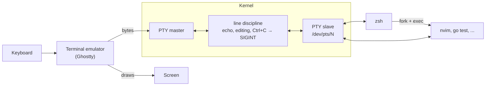

# Terminal and shell

## Why care?

Four small mysteries that every engineer meets:

- Colours look perfect on your laptop, but are ugly or broken after `ssh` into a server.
- You yank text in Neovim on a remote machine, and it does **not** arrive in your local clipboard.
- You install a new tool, type its name, and zsh says `command not found`. In a new tab it works.
- Opening a new shell takes a third of a second, and you have no idea where the time goes.

All four are about the layers between your keyboard and your program. Once you see the layers, each mystery has a simple answer.

## The idea: a TV, a phone line and a waiter

Three different things hide behind the word "terminal":

- The **terminal emulator** (Ghostty, WezTerm, iTerm2) is a TV with a keyboard. It draws a grid of characters and turns key presses into bytes. It knows nothing about commands.
- The **PTY** (pseudo terminal) is a phone line inside the kernel. One end belongs to the terminal emulator. The other end looks exactly like an old hardware terminal to the program on it. On the line sits an operator, the **line discipline**, that can edit what you type and turn `Ctrl+C` into a signal.
- The **shell** (zsh) is a waiter at the other end of the line. It reads your order (a command line), asks the kitchen (the kernel) to start programs, and gives them the phone line.



The program never talks to the screen. It writes bytes to `/dev/pts/N`. The terminal emulator reads them from the master side and decides what to draw. Everything in this page is about _which bytes_ travel on that line, and _who_ interprets them.

## Under the hood: the PTY and the line discipline

When you open a tab, the terminal emulator asks the kernel for a PTY pair, starts your shell, and makes the slave side the shell's stdin, stdout and stderr. You can see it from inside. Here is a plain `sh` in a fresh pane:

```text
$ tty
/dev/pts/13
$ stty -a | head -2
speed 38400 baud; rows 50; columns 200; line = 0;
intr = ^C; quit = ^\; erase = ^?; kill = ^U; eof = ^D; eol = <undef>;
$ stty -a | tr " " "\n" | grep -xE -- "-?(icanon|isig|echo|icrnl|opost)"
icrnl
opost
isig
icanon
echo
```

Read the flags:

- **`icanon`** (canonical mode): the line discipline collects a whole line before the program sees it. Backspace (`erase = ^?`) and `Ctrl+U` (`kill`) are handled by the **kernel**, not by the program.
- **`echo`**: the kernel sends your key presses back to the screen, so you see what you type.
- **`isig`**: special keys become signals. `intr = ^C` means `Ctrl+C` sends `SIGINT` to the foreground process group. Your program never sees the byte; it sees a signal. (See [Processes, threads and system calls](../fundamentals/processes-and-threads.md).)
- **`rows 50; columns 200`**: the PTY knows its size. When you resize the window, the terminal tells the kernel, and the kernel sends `SIGWINCH` to the program so it can redraw.

Full-screen programs like Neovim switch all of that off. They want every key, right away. Here is the PTY of a pane that runs Neovim, checked from outside:

```text
$ stty -a -F /dev/pts/10 | tr ' ' '\n' | grep -xE -- '-?(icanon|isig|echo|icrnl|opost)'
-icrnl
-opost
-isig
-icanon
-echo
```

All minus signs. This is **raw mode**. Now `Ctrl+C` is just byte `0x03`, and Neovim decides what it means. That's also why a crashed full-screen program can leave your terminal "broken" (no echo, strange line breaks): nobody switched the flags back. The fix is `reset` or `stty sane`.

## Escape sequences: the terminal's command language

How does a program make text red, or move the cursor? It writes special byte sequences that start with `ESC` (byte 27, `\033`). The terminal emulator reads them as commands instead of text:

```text
$ printf '\e[1;31mred\e[0m\n' | od -An -c
 033   [   1   ;   3   1   m   r   e   d 033   [   0   m  \n
```

`ESC [ 1;31 m` means "bold, red foreground". `ESC [ 0 m` means "reset". There are a few families:

| Family  | Starts with | Used for                                      | Example                            |
| ------- | ----------- | --------------------------------------------- | ---------------------------------- |
| **CSI** | `ESC [`     | Colours, cursor movement, clearing the screen | `ESC [ 6;11 H` = cursor to row 6   |
| **OSC** | `ESC ]`     | "Operating system" commands: title, clipboard | `ESC ] 0;title BEL` = window title |
| **DCS** | `ESC P`     | Device control, for example tmux passthrough  | `ESC P tmux; ... ESC \`            |

### `TERM` and terminfo: who speaks which dialect?

Terminals don't all speak the same dialect. Old ones supported 8 colours, new ones 16 million. A program must not send sequences the terminal doesn't understand. So the convention is:

1. The terminal emulator sets the environment variable **`TERM`** to its name.
2. A database called **terminfo** maps each name to its capabilities and their exact byte sequences.
3. Programs (through the ncurses library, or tools like `tput`) look up what they need.

```text
$ TERM=xterm-256color tput setaf 1 | od -An -c
 033   [   3   1   m
$ TERM=xterm-256color tput colors
256
$ TERM=dumb tput colors
-1
$ TERM=xterm-256color tput cup 5 10 | od -An -c
 033   [   6   ;   1   1   H
```

Note the last one: `tput cup 5 10` (row 5, column 10, counted from 0) became `ESC [ 6;11 H`, because the terminal counts from 1. terminfo hides those details from programs.

Ghostty sets `TERM=xterm-ghostty` and ships its own terminfo entry, because the standard `xterm-256color` entry doesn't announce all its features. Its entry has flags like `Tc` (true colour), `Ms` (set clipboard with OSC 52) and `Sync` (synchronised output). The problem: if the machine you SSH into has no `xterm-ghostty` entry, programs there don't know your terminal, and you get broken colours or `unknown terminal type` errors. That is mystery number one. The fixes are to copy the entry to the server (`infocmp -x xterm-ghostty | ssh server tic -x -`), or to set `TERM=xterm-256color` for SSH.

Inside tmux, `TERM` is different again. tmux is a terminal emulator itself (more on that in [tmux](tmux.md)), so programs in a pane see tmux's name:

```text
$ echo "TERM=$TERM"
TERM=tmux-256color
```

### True colour

`256` colours is a palette. **True colour** (24-bit) means the program sends the exact RGB value: `ESC [ 38;2;R;G;B m`. Themes like cyberdream need it to look right.

```text
$ printf '\e[38;2;94;241;255mcyan\e[0m\n' | od -An -c
 033   [   3   8   ;   2   ;   9   4   ;   2   4   1   ;   2   5
   5   m   c   y   a   n 033   [   0   m  \n
```

There is no single standard way for a terminal to say "I support true colour". terminfo entries use the `Tc` or `RGB` flags, and many programs also check `COLORTERM=truecolor`. tmux keeps its own list of features per attached terminal. On this machine, the running tmux client reports:

```text
$ tmux list-clients -F '#{client_termname} #{client_termtype} #{client_termfeatures}'
xterm-256color WezTerm 20240203-110809-5046fc22 256,bpaste,ccolour,clipboard,hyperlinks,cstyle,extkeys,focus,margins,mouse,rectfill,RGB,strikethrough,title,usstyle
```

So on this WSL2 machine the outer terminal is WezTerm with `TERM=xterm-256color`, and tmux still detected `RGB` (true colour), `clipboard` (OSC 52) and `extkeys` (extended keys). Modern tmux asks the terminal for its name and version, and turns on features it knows that terminal has.

### OSC 52: the clipboard over a wire

Now mystery number two. When you yank in Neovim on a remote server, the remote machine has no access to your laptop's clipboard. But it _does_ have the PTY line back to your terminal. **OSC 52** uses that line: the program sends the text, base64 encoded, inside an escape sequence, and the terminal emulator puts it in the local clipboard.

```text
$ printf 'hello' | base64
aGVsbG8=
$ printf '\e]52;c;%s\a' "$(printf hello | base64)" | od -An -c
 033   ]   5   2   ;   c   ;   a   G   V   s   b   G   8   =  \a
```

`52` is the command, `c` means "clipboard", then the data, then `BEL` (`\a`) ends it. It works through SSH and through tmux, as long as every layer passes it on. In this setup:

- Ghostty allows it: `clipboard-write = allow` (and `clipboard-read = allow`).
- tmux passes it on: `set -g set-clipboard on`.
- Neovim uses its built-in OSC 52 provider when it sees `SSH_TTY` or `SSH_CONNECTION` (see [Neovim](neovim.md)).

!!! warning "Clipboard read is a real permission"

    OSC 52 can also _read_ the clipboard. With `clipboard-read = allow`, any program that writes to your
    terminal can ask for your clipboard content, including a program on a server you SSH into.
    If you copy passwords, think about setting it to `ask`.

### Nerd Fonts

The status bar and window names in this setup show little icons: a Neovim logo, a git branch. These are not images. They are normal characters in a **Nerd Font** (here Iosevka NF): a programming font patched with thousands of icons in Unicode's _Private Use Area_, code points that Unicode leaves free. If your font has no glyph there, you see empty boxes. That's why the font must be installed on the machine that **draws** (your laptop), not on the server.

## zsh: what runs at start-up, and when

Now the shell. zsh reads up to four personal start-up files. Which ones depends on two questions: is this a **login** shell (the first shell of a session, or `zsh -l`)? Is it **interactive** (you type into it)? Here is a real run, with each file printing its own name:

```text
$ zsh -c true
  reading .zshenv
$ zsh -i -c true
  reading .zshenv
  reading .zshrc
$ zsh -l -i -c true
  reading .zshenv
  reading .zprofile
  reading .zshrc
  reading .zlogin
  reading .zlogout
```

| File        | Read by                      | Put here                                                       |
| ----------- | ---------------------------- | -------------------------------------------------------------- |
| `.zshenv`   | **every** zsh, even scripts  | Environment only: `XDG_*`, `GOPATH`, `EDITOR`. Fast. No output |
| `.zprofile` | login shells                 | Things to do once per login                                    |
| `.zshrc`    | interactive shells           | Prompt, plugins, completion, aliases, key bindings             |
| `.zlogin`   | login shells, after `.zshrc` | Rarely needed                                                  |
| `.zlogout`  | login shells, when they exit | Clean-up                                                       |

The key rule: **`.zshenv` runs for every zsh, including scripts and `zsh -c`**. Never print anything there and never do slow work there.

### `ZDOTDIR` and XDG: keeping `$HOME` clean

zsh looks for these files in `$ZDOTDIR`, or in `$HOME` if `ZDOTDIR` is not set. This setup uses a small trick to move everything to `~/.config/zsh`. The only zsh file in `$HOME` is `~/.zshenv`, a symlink into the dotfiles repository, and that file has two lines:

```sh
export ZDOTDIR="${XDG_CONFIG_HOME:-${HOME}/.config}/zsh"
. "${ZDOTDIR}/.zshenv"
```

zsh reads `~/.zshenv` first. That file changes `ZDOTDIR`, and from then on zsh reads `.zshrc` from `~/.config/zsh/`. Because `ZDOTDIR` is exported, every child zsh (for example, every tmux pane) goes straight to `~/.config/zsh/.zshenv`.

The real `.zshenv` then sets the **XDG base directories**, a freedesktop.org convention that tells programs where to put things:

| Variable          | This setup       | Holds                                |
| ----------------- | ---------------- | ------------------------------------ |
| `XDG_CONFIG_HOME` | `~/.config`      | Config you write and version         |
| `XDG_DATA_HOME`   | `~/.local/share` | Data programs create (plugins, etc.) |
| `XDG_STATE_HOME`  | `~/.local/state` | Logs, history, undo files            |
| `XDG_CACHE_HOME`  | `~/.cache`       | Anything safe to delete              |

and moves Go's folders there too: `GOPATH=$XDG_DATA_HOME/go`, `GOCACHE=$XDG_CACHE_HOME/go/build`, `GOMODCACHE=$XDG_CACHE_HOME/go/mod`. The benefit: config is in one place (easy to version), and caches are in one place (easy to delete).

## `PATH`: how a name becomes a program

When you type `go`, zsh must find a file. Builtins, functions and aliases come first. Then zsh looks at each directory in `$PATH`, left to right, and runs the first executable named `go`. `command -v go` (POSIX) or `whence -a go` (zsh) show you the answer.

But zsh doesn't walk the `PATH` every time. It remembers where it found each command in a **hash table**. Watch:

```text
$ zsh -f demo.zsh
I am second/hello
I am second/hello
/tmp/claude-1000/demo/second/hello
hello=/tmp/claude-1000/demo/second/hello
I am first/hello
```

The script puts `first/` before `second/` in `path`, but only `second/hello` exists. It runs `hello` (found in `second/`). Then it creates `first/hello`, which should now win. It runs `hello` again: **still `second/`**, because the hash table remembered. `hash` shows the cached entry. After `rehash`, zsh forgets and finds `first/hello`.

That is mystery number three. If a new tool appears in a directory that is _earlier_ in `PATH` than an old copy, run `rehash` (zsh) or `hash -r` (bash), or open a new shell.

!!! tip "zsh's `path` array"

    zsh ties the string `$PATH` to the array `$path`. You can write `path=(~/bin $path)`, and
    `typeset -U path` makes the array keep only the first copy of each directory.

## Plugins and completion: zinit, compinit, fzf-tab

The `.zshrc` in this setup loads three plugins with **zinit**, a plugin manager that clones git repositories and sources them:

```sh
zinit light Aloxaf/fzf-tab
zinit light zsh-users/zsh-autosuggestions
# ... everything else ...
zinit light zsh-users/zsh-syntax-highlighting   # at the very end of .zshrc
```

- **zsh-syntax-highlighting** colours your command line while you type (red for unknown commands).
- **zsh-autosuggestions** shows a grey suggestion from history; press `→` to accept.
- **fzf-tab** replaces zsh's completion menu with an fzf picker.

All three work by **wrapping ZLE widgets**. ZLE is the zsh line editor, and every key you press runs a widget (`self-insert`, `accept-line`, `expand-or-complete`). A plugin replaces a widget with its own function that does extra work and then calls the original. So **order matters**: whoever loads later wraps whoever loaded earlier.

**Completion** is a separate system. `compinit` scans every directory in `$fpath` for completion functions (files named `_git`, `_go`, ...), and writes a cache called `.zcompdump`. Before it does, it runs **`compaudit`**, a security check: it refuses completion files in directories that other users could write to, because a planted `_ls` would run code in your shell.

Then the history settings. `sharehistory` makes every open shell write each command to `~/.zsh_history` at once and read new lines from other shells. `hist_ignore_space` keeps commands that start with a space out of history (handy for a command with a token). The `hist_*dups` options remove duplicates.

## Try it: where does start-up time go?

First, measure. Three runs of an interactive shell that exits at once:

```text
$ for i in 1 2 3; do /usr/bin/time -f "%e s" zsh -i -c exit; done
0.33 s
0.33 s
0.33 s
```

A third of a second, every new pane and tab. This setup has a switch for a profile: `.zshrc` loads `zsh/zprof` if `ZSHPROFILE` is set and prints a report at the end.

```text
$ ZSHPROFILE=1 zsh -i -c exit
num  calls                time                       self            name
-----------------------------------------------------------------------------------
 1)    2         111.27    55.63   68.50%    111.27    55.63   68.50%  compaudit
 2)    1         118.28   118.28   72.82%      7.01     7.01    4.32%  compinit
 3)    4          35.24     8.81   21.70%      6.53     1.63    4.02%  .zinit-load-plugin
 4)    1           4.46     4.46    2.74%      4.07     4.07    2.51%  _zsh_highlight_load_highlighters
 ...
```

It looks clear: **`compaudit`**, the security check, takes 111 ms. `compinit -C` skips the check and trusts the existing `.zcompdump`, so the obvious fix is "run the full check once a day, `-C` otherwise". We tried exactly that. Wall-clock time, 10 runs each:

```text
old 348ms avg
new 342ms avg
```

Almost nothing. `compinit` itself dropped from about 120 ms to 7 ms, but the shell was not faster. The cost **moved**. Two lessons hide here:

1. `zprof` only measures **zsh functions**. Time spent in a builtin, an expansion or a child process is charged to whichever function happens to be running.
2. The real cost was something `compaudit` merely **touched first**.

To see where time goes line by line, trace with timestamps and sort the gaps:

```sh
zsh -c 'zmodload zsh/datetime; setopt promptsubst
        PS4="+\$EPOCHREALTIME %x:%I> "; setopt xtrace
        source ~/.config/zsh/.zshrc' 2> trace.log
```

The two biggest gaps (from a small script that sorts the trace):

```text
  107.9ms .../functions/compaudit:18 [[ -n /usr/bin/getent ]]
  100.9ms ~/.config/zsh/.zshrc:107 command -v gcloud
```

Line 18 of `compaudit` is `[[ -n $commands[getent] ]]`. `$commands` is zsh's hash table of every program in `PATH` (the same table `rehash` resets). The **first** time anything reads it, zsh fills it by listing every directory in `PATH`. And `command -v` for a program that is **not installed** must look in every directory too. So the question is: what is slow about this `PATH`? On WSL, Windows adds its own folders (`/mnt/c/...`). Here there are 28 of them, and every listing of them crosses from Linux to Windows. Proof, with the same kind of lookups in a clean zsh:

```text
54 dirs: first $commands lookup 109 ms, missing command 103 ms
26 dirs: first $commands lookup   5 ms, missing command   0 ms
```

Remove the `/mnt/` folders and both costs disappear. With `compinit -C`, the first `$commands` lookup simply happened later (inside zinit), which is why the total did not change. The root cause is the Windows `PATH`. On WSL you can turn it off in `/etc/wsl.conf`:

```ini
[interop]
appendWindowsPath = false
```

Then Windows programs like `code` or `explorer.exe` are no longer found by name; add the few you need to `PATH` by hand.

!!! tip "Measure before you optimise, and measure the right thing"

    People often blame "too many plugins" for a slow shell. Here, the plugins together cost about
    35 ms. But the profiler's top line was not the cause either. Confirm every "fix" with wall-clock
    time, and when a fix doesn't help, look for work that just moved.

## Traps

- **Output in `.zshenv`.** It runs for scripts and for `scp`/`rsync` over SSH too. Any `echo` there can break those tools. Keep it silent.
- **Growing `PATH`.** `.zshenv` in this setup _appends_ `~/.local/share/scripts`, and `.zshrc` appends `~/.local/bin`. Every nested shell (each tmux pane is one) appends again. Before the fix, three nested shells had `~/.local/share/scripts` in `PATH` 6 times (64 entries in total). `typeset -U path PATH` at the top of `.zshenv` fixes it: 1 copy, 47 entries.
- **Plugin order.** zsh-syntax-highlighting's own docs say it "must be the last plugin sourced", and fzf-tab's README says it must load after `compinit` but _before_ plugins that wrap widgets, such as zsh-autosuggestions. This setup used to load them in the opposite order (highlighting first, fzf-tab last). The safe order is: `compinit`, fzf-tab, autosuggestions, and syntax-highlighting at the very end of `.zshrc`.
- **The terminfo folder layout.** terminfo files live in a folder per first character. macOS uses the hex code (`78/xterm-ghostty`, since `x` is `0x78`); ncurses on Linux uses the letter (`x/xterm-ghostty`). This setup used to stow only `~/.terminfo/78/...`, which works on macOS but **not** on Linux:

  ```text
  $ cd ~/.terminfo && file 78/xterm-ghostty
  78/xterm-ghostty: Compiled terminfo entry "xterm-ghostty"
  $ infocmp -x xterm-ghostty
  infocmp: error: no match in terminfo database for terminal type "xterm-ghostty"
  ```

  The same file in an `x/` folder is found at once. The fix ships both layouts: `x` is a symlink to `78` (and `g` to `67`). Or install the entry with `tic -x`, which picks the right layout for the machine.

- **A dead terminal after a crash.** If a full-screen program dies in raw mode, type `reset` and press Enter, even if you can't see what you type.

## Check yourself

??? question "1. You press `Ctrl+C` while `go test` runs. Which component turns the key into a signal?"

    The line discipline in the kernel, because the PTY has `isig` on. The terminal emulator only
    sends byte `0x03`. The kernel sees it and sends `SIGINT` to the foreground process group.
    In raw mode (`-isig`), as in Neovim, the byte goes to the program instead.

??? question "2. Why does `TERM` inside tmux say `tmux-256color`, not `xterm-ghostty`?"

    Programs in a pane talk to tmux, not to Ghostty. tmux is a terminal emulator itself: it reads their
    escape sequences, updates its own screen model, and then redraws to the real terminal using the
    real terminal's capabilities.

??? question "3. You put `export GOPATH=...` in `.zshrc`. A cron job or an editor that runs `zsh -c` doesn't see it. Why?"

    `.zshrc` is only read by interactive shells. `zsh -c` is not interactive, so it only reads `.zshenv`.
    Environment variables that every program needs belong in `.zshenv`.

??? question "4. You install a newer `gh` into `~/.local/bin`, which is earlier in `PATH` than Homebrew. `gh --version` still prints the old version. What happened, and what's the fix?"

    zsh had already hashed `gh` to the Homebrew path. Run `rehash` (or `hash -r`), or start a new shell.
    `whence -a gh` shows every match in `PATH` order.

??? question "5. How does a yank in Neovim on a remote server reach your laptop's clipboard?"

    Neovim writes an OSC 52 escape sequence (`ESC ] 52 ; c ; <base64> BEL`) to its PTY. It travels
    through SSH and tmux (with `set-clipboard on`) to the local terminal emulator, which decodes it and
    sets the system clipboard, if it allows clipboard writes.

## Recap

- Terminal emulator, PTY and shell are three different things. The kernel's line discipline handles echo, line editing and `Ctrl+C` until a program switches to raw mode.
- Programs control the screen with escape sequences. `TERM` plus terminfo tell them which sequences the terminal understands.
- True colour, OSC 52 clipboard and extended keys are features each layer must support and pass on.
- zsh reads `.zshenv` always, `.zprofile`/`.zlogin` for login shells, `.zshrc` for interactive shells. `ZDOTDIR` and XDG keep `$HOME` clean.
- zsh hashes command locations: `rehash` after a new tool appears earlier in `PATH`.
- Measure start-up with `zprof`, then confirm with wall-clock time and a timestamped trace. In this setup `zprof` blamed `compaudit`, but the real cost was 28 slow Windows folders in `PATH`.

Next: [tmux](tmux.md), the server that keeps all of this alive.
