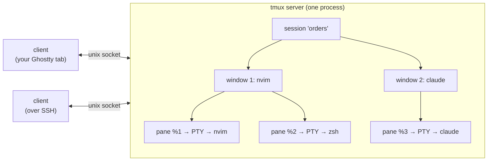

# tmux

## Why care?

You SSH into a build box and start a long migration. Twenty minutes later the connection drops, and the migration is killed with it. Or: you have six terminal tabs, and you can't remember which one has the logs.

tmux fixes both. It keeps programs running when the connection dies, and it gives you a layout you can name, script and reattach to from anywhere. But many people use only a few tmux keys and copy the rest of their config from the internet. This page explains how tmux really works, so each line of config makes sense.

## The idea: a server that keeps running

tmux has a few parts:

- The **server** is a background process. Your programs run inside it, and keep running even when no one is connected.
- A **client** is the view in your terminal. You can connect it (attach), disconnect it (detach), or connect two clients to the same session.
- A **session** is a named group of windows. A **window** fills the client's screen. A **pane** is one part of a window, with one program in it.



The key point: **the server owns the PTYs**. Your programs are attached to the server's PTYs, not to your terminal. When the SSH connection drops, only the client dies. The server and every program in it keep running. You SSH in again, run `tmux attach`, and you're back.

## Under the hood: one server, one socket

The first tmux command starts the server in the background. Clients talk to it through a **unix socket**. The default socket lives in `/tmp/tmux-<uid>/default`. With `-L name` you get a separate server with its own socket. That is the safest way to experiment: you can't break your real sessions.

```text
$ tmux -L sandbox -f /dev/null new-session -d -s demo -x 120 -y 30
$ tmux -L sandbox display -p '#{socket_path}'
/tmp/tmux-1000/sandbox
$ stat -c '%A %n' /tmp/tmux-1000
drwx------ /tmp/tmux-1000
$ ls -l /tmp/tmux-1000/ | awk '{print $1, $NF}'
total 0
srwxrwx--- default
srw-rw---- sandbox
```

`-f /dev/null` means "read no config", so you see tmux's defaults. `default` is the real server; `sandbox` is the new one. Note the folder mode `drwx------`: only you can reach your sockets. Anyone who can open the socket controls every shell in it.

Look at the processes. The server has no terminal (`?`). Each pane is a child with its own PTY:

```text
$ ps -o pid,ppid,tty,args -p 133789
    PID    PPID TT       COMMAND
 133789     588 ?        tmux -L sandbox -f /dev/null new-session -d -s demo -x 120 -y 30
$ ps -o pid,ppid,tty,args --ppid 133789
    PID    PPID TT       COMMAND
 133790  133789 pts/8    -zsh
 133811  133789 pts/10   nvim .
 133817  133789 pts/11   /home/linuxbrew/.linuxbrew/bin/zsh
 133822  133789 pts/12   /home/linuxbrew/.linuxbrew/bin/zsh
```

(This list is from after the session below was built: one pane for `demo`, three for `demo-repo`.)

Inside a pane, tmux sets `$TMUX`. It holds the socket path, the server PID and the session ID. Programs use it to know "I'm inside tmux" and to find the right server:

```text
$ echo "TMUX=$TMUX"
TMUX=/tmp/tmux-1000/sandbox,133789,1
```

`133789` is the server PID from `ps` above, and `1` is the session ID (`$1`, the second session; IDs count from `$0`).

### tmux is a terminal emulator

Many people miss this part. Programs in a pane write escape sequences to their PTY. **tmux reads them**, updates its own model of that pane's screen, and then redraws your real terminal, using the capabilities of your real terminal. That's why:

- Programs inside see `TERM=tmux-256color`: they talk to tmux, not to Ghostty.
- Features must be supported _twice_: by tmux toward the program, and by your terminal toward tmux. True colour, OSC 52 and extended keys all have tmux options for this reason.
- tmux can keep history (scrollback) and let you search it: it has the whole screen in memory.

## Keys: the prefix and key tables

tmux must share your keyboard with the programs inside. Its solution is a **prefix key**: press it, then one more key that tmux handles. Under the hood, every binding lives in a **key table**:

- `root`: keys tmux handles with no prefix. Almost empty by default, so keys go to the program.
- `prefix`: keys after the prefix (`c` new window, `d` detach, ...).
- `copy-mode` and `copy-mode-vi`: keys inside copy mode.

Pressing the prefix only switches the client to the `prefix` table for the next key. In a sandbox with no config:

```text
$ tmux -L sandbox list-keys | awk '{print $3}' | sort | uniq -c
     17 -T
     78 copy-mode
     88 copy-mode-vi
     19 move
     76 prefix
     30 root
```

(The 17 `-T` lines are bindings with the `-r` flag, which moves the table name one column to the right. All 17 are `prefix` keys, so the `prefix` table has 93 bindings.)

`bind -r` marks a key as **repeatable**: after the prefix, you can press it again and again within `repeat-time` (500 ms by default) without the prefix. This is useful for resizing panes.

## Options and their scopes

Every option has a **scope**:

| Scope   | Set with          | Example                                         |
| ------- | ----------------- | ----------------------------------------------- |
| server  | `set -s`          | `escape-time`, `extended-keys`, `set-clipboard` |
| session | `set` / `set -g`  | `prefix`, `base-index`, `status-position`       |
| window  | `setw` / `set -w` | `mode-keys`, `pane-base-index`                  |
| pane    | `set -p`          | `allow-passthrough`                             |

`-g` sets the **global** value, the default that every session (or window) inherits. Without `-g`, you set it on one target only. `show-options -A` shows inherited values with a `*`:

```text
$ tmux -L sandbox show-options -w -t demo-repo:3 mode-keys

$ tmux -L sandbox show-options -A -w -t demo-repo:3 mode-keys
mode-keys* vi
```

Nothing is set on the window itself, but it inherits `vi` from the global value.

!!! tip "Why `mode-keys` was already `vi`"

    The default is `emacs`, unless `VISUAL` or `EDITOR` contains `vi` (from the man page). This setup
    exports `EDITOR=nvim`, so even the sandbox with no config used vi keys in copy mode.

Options whose name starts with `@` are **user options**. tmux stores them and does nothing else. They are useful for state you want to show in the status bar. This setup uses `@agent_status` on a window to flag a coding agent that needs you.

## Formats: tmux's template language

`#{...}` is a **format**. tmux replaces it with a value: `#{session_name}`, `#{pane_current_path}`, `#{window_zoomed_flag}`. Formats can test and compare:

- `#{?cond,yes,no}`: if
- `#{==:a,b}`: equal
- `#{=/-32/...:host_short}`: cut to 32 characters, with `...`

Formats work everywhere: in the status bar, in `display -p`, in `list-* -F`, and in `-c "#{pane_current_path}"`. Here is a simplified version of this setup's agent indicator, run on a sandbox session with three windows:

```text
$ F='#{window_index}:#{window_name} #{?@agent_status,#{?#{==:#{@agent_status},attention},[needs you],[your move]},[idle]}'
$ tmux -L sandbox list-windows -t demo-repo -F "$F"
1:nvim [idle]
2:zsh [idle]
3:pty [idle]
$ tmux -L sandbox set-option -w -t demo-repo:2 @agent_status waiting
$ tmux -L sandbox set-option -w -t demo-repo:3 @agent_status attention
$ tmux -L sandbox list-windows -t demo-repo -F "$F"
1:nvim [idle]
2:zsh [your move]
3:pty [needs you]
```

In the real setup, the agents' hooks call a small `agent-tmux-status` command that runs `tmux set-window-option -t "$TMUX_PANE" @agent_status waiting` (or `-u` to clear it). The theme's `window-status-format` turns the value into a peach or red window tab. No polling: tmux redraws when the option changes.

## The settings that matter for an editor

### `escape-time`: the hidden delay

When you press `Esc`, your terminal sends byte `0x1b`. But `Alt+x` is sent as `0x1b` followed by `x`, and arrow keys start with `0x1b [`. So when tmux sees `0x1b`, it doesn't know yet whether it is a single `Esc` or the start of a longer sequence. It **waits** `escape-time` milliseconds for more bytes.

In Neovim you press `Esc` hundreds of times an hour to leave insert mode. Any wait feels like lag. The default in tmux 3.8 is 10 ms (it used to be 500). This setup sets `set -s escape-time 0`: no waiting at all. The small risk: over a very slow connection, `Alt+x` could arrive in two packets and be seen as `Esc` then `x`.

### Extended keys

The old terminal encoding can't express many key combinations. `Shift+Enter` sends the same byte as `Enter`. `Ctrl+i` is the same as `Tab`. **Extended keys** (xterm's _modifyOtherKeys_, or the CSI u format) send a longer sequence for those combinations. This setup turns them on:

```sh
set -g extended-keys on
set -g extended-keys-format xterm
set -as terminal-features ',xterm*:extkeys'
```

The man page shows the two formats: `Ctrl+Shift+a` becomes `^[[27;6;65~` in `xterm` format and `^[[65;6u` in `csi-u` format.

Claude Code uses `Shift+Enter` for "new line without sending". The setup adds a root-table binding that turns `Shift+Enter` into `Ctrl+J` (a line feed), which Claude Code also accepts:

```text
$ tmux -L sandbox list-keys -T root S-Enter
bind-key  -T root S-Enter send-keys C-j
```

### Clipboard and passthrough

`set-clipboard` has three values (from the man page):

- `on`: tmux accepts OSC 52 from programs (and makes a tmux buffer) **and** sends it on to your terminal.
- `external` (the default): tmux sets the terminal clipboard when _you_ copy in copy mode, but ignores programs that try.
- `off`: neither.

With `on`, Neovim on a remote server can set your local clipboard through two layers (see [Terminal and shell](terminal-and-shell.md#osc-52-the-clipboard-through-the-terminal)). `allow-passthrough on` lets programs wrap other escape sequences in `ESC P tmux; ... ESC \` to send them straight to the real terminal. Image previews (Snacks image in Neovim, yazi) use this.

## Try it: script a session like `tmux-session start`

Every tmux key is a command, so you can script tmux completely. This setup has a Go CLI, `dot`, with a `tmux-session` command (`sts` = `tmux-session start` in `.zshrc`). Its `createSession` function builds this layout:

- window 1: Neovim on top, a small shell below (10%),
- one window per installed coding agent (opencode, codex, claude),
- a last window with a plain zsh.

Here is the core of it, done by hand on the sandbox:

```text
$ tmux -L sandbox has-session -t demo-repo
can't find session: demo-repo
$ pane=$(tmux -L sandbox new-session -d -P -F '#{pane_id}' -s demo-repo -n nvim -c "$PWD" -x 200 -y 50 nvim .)
$ echo "editor pane: $pane"
editor pane: %1
$ win=$(tmux -L sandbox display-message -p -t "$pane" '#{window_id}')
$ echo "window: $win"
window: @1
$ tmux -L sandbox split-window -t "$pane" -v -l 10% -c "$PWD"
$ tmux -L sandbox select-pane -t "$pane"
$ tmux -L sandbox new-window -a -d -t "$win" -n zsh -c "$PWD"
$ tmux -L sandbox list-windows -t demo-repo -F '#{window_index} #{window_id} #{window_name} panes=#{window_panes} active=#{window_active}'
1 @1 nvim panes=2 active=1
2 @2 zsh panes=1 active=0
$ tmux -L sandbox list-panes -t demo-repo:nvim -F '#{pane_index} #{pane_id} #{pane_height}x#{pane_width} #{pane_current_command} active=#{pane_active}'
1 %1 44x200 nvim active=1
2 %2 5x200 zsh active=0
```

The flags that make scripting reliable:

- **`-d`**: create, but don't attach. A script can't attach in the middle of its work.
- **`-P -F '#{pane_id}'`**: print the new pane's ID. IDs (`%1`, `@1`, `$1`) never change, while indexes and names can. Always target by ID in scripts.
- **`-x - -y -`** (in the Go code): take the size from the current terminal, so the 10% split is correct before you attach.
- **`new-window -a -d -t @1`**: insert after window `@1`, in the background.
- **`has-session`**: exit code 0 or 1. The Go code only builds a session if it doesn't exist yet, then attaches. So `sts` twice on the same repo only reattaches.

You can also drive programs inside panes with `send-keys`, and read the screen with `capture-pane -p`:

```text
$ tmux -L sandbox send-keys -t demo-repo:zsh 'echo "TMUX=$TMUX"; echo "TERM=$TERM"' Enter
$ tmux -L sandbox capture-pane -p -t demo-repo:zsh | grep -E '^(TMUX|TERM)='
TMUX=/tmp/tmux-1000/sandbox,133789,1
TERM=tmux-256color
```

`dot` is one Go binary that serves many commands. `~/.local/share/scripts/tmux-session` is a symlink to `~/.local/bin/dot`, and the binary looks at `argv[0]` (the name it was started with) to pick the command. This is called a _multi-call binary_; BusyBox works the same way, and so do mise's shims (see [mise](mise.md)).

When you're done, stop only the sandbox server:

```text
$ tmux -L sandbox kill-server
$ tmux -L sandbox ls
no server running on /tmp/tmux-1000/sandbox
```

## vim-tmux-navigator: one set of keys for two programs

In this setup `Ctrl+h/j/k/l` moves between Neovim splits **and** tmux panes, as if they were one thing. How can one key do both? The plugin has two halves.

**The tmux half** binds the keys in the `root` table with a test:

```sh
is_vim="ps -o state= -o comm= -t '#{pane_tty}' | grep -iqE '^[^TXZ ]+ +(\S+/)?g?\.?(view|l?n?vim?x?|fzf)(diff)?(-wrapped)?$'"
tmux bind-key -n C-h if-shell "$is_vim" "send-keys C-h" "select-pane -L"
```

It lists the processes on the current pane's PTY and checks whether one of them is a running (not stopped: `T`, dead: `X`, zombie: `Z`) Vim. Here is that test on the sandbox:

```text
== %1 /dev/pts/10
S nvim
== %2 /dev/pts/11
S zsh
S oh-my-posh
%1 is vim
```

If Vim runs in the pane, tmux passes `Ctrl+h` to it. If not, tmux moves to the left pane itself.

**The Neovim half** maps `Ctrl+h` to `:TmuxNavigateLeft`. It runs `wincmd h`. If the window number didn't change (you're already at the left edge) and `$TMUX` is set, it runs `tmux select-pane -L` itself. So the key crosses the border in both directions.

## TPM: plugins are shell scripts

`plugins.conf` lists plugins with `set -g @plugin 'owner/repo'`. That is a normal user option. **TPM** (the Tmux Plugin Manager) reads those options, clones each repository into `TMUX_PLUGIN_MANAGER_PATH` (here `~/.local/share/tmux/plugins`), and runs each plugin's `*.tmux` file. Those files are shell scripts that call `tmux bind-key` and `tmux set`, like the navigator above. `tmux.conf` in this setup clones TPM itself on first start, so a new machine needs no manual step.

The plugins here:

| Plugin                          | Does                                                      |
| ------------------------------- | --------------------------------------------------------- |
| `tmux-sensible`                 | A set of defaults most people agree on                    |
| `tmux-fzf-url`                  | `prefix u`: pick a URL from the screen with fzf, open it  |
| `vim-tmux-navigator`            | `Ctrl+h/j/k/l` across Neovim and tmux                     |
| `tmux-nerd-font-window-name`    | Window names with Nerd Font icons for known programs      |
| catppuccin (cyberdream flavour) | The theme; loaded separately in `theme.conf`, not via TPM |

## This setup's keymaps, line by line

After loading `keymaps.conf` and `options.conf` into the sandbox:

```text
$ tmux -L sandbox show-options -g prefix
prefix C-a
$ tmux -L sandbox list-keys -T prefix C-a
bind-key    -T prefix C-a     send-prefix
```

| Key (after `C-a`) | Command                                           | Why                                                                                 |
| ----------------- | ------------------------------------------------- | ----------------------------------------------------------------------------------- |
| `C-a`             | `send-prefix`                                     | Press `C-a` twice to send a real `Ctrl+A` (start of line in zsh)                    |
| `\|`              | `split-window -h -c "#{pane_current_path}"`       | Side by side. The key looks like the split. New pane starts in the same folder      |
| `-`               | `split-window -v -c "#{pane_current_path}"`       | Top and bottom. Default `%` and `"` are unbound                                     |
| `C-p` / `C-n`     | `previous-window` / `next-window`                 | You can keep `Ctrl` held down after the prefix                                      |
| `C` / `O` / `X`   | `if-shell 'command -v claude' { new-window ... }` | New window with Claude Code / opencode / Codex, or a message if the tool is missing |
| `h` `j` `k` `l`   | `bind -r ... resize-pane -L/-D/-U/-R 5`           | Resize by 5 cells, repeatable                                                       |
| `m`               | `bind -r ... resize-pane -Z`                      | Zoom the pane to full window and back (same as default `z`)                         |
| `BSpace` / `f`    | `kill-session`                                    | End the whole session                                                               |

In copy mode (vi keys): `v` starts a selection, `y` copies it. `y` uses `copy-selection`, which **stays** in copy mode, and the setup also unbinds `MouseDragEnd1Pane`, so a mouse drag doesn't copy and leave at once. You can fix the selection after dragging.

The options file adds: `mouse on`, status bar on top, `base-index 1` and `pane-base-index 1` (the `1` key is on the left of the keyboard, `0` is on the right), `renumber-windows` (no gaps after closing a window), `history-limit 50000` (the default is 2000), and `focus-events on` (Neovim learns when you switch panes, so `autoread` and the relative-number toggle work).

## Traps

- **Overriding useful defaults.** The setup's bindings replace some default keys. In a sandbox with no config: `l` is `last-window`, `m` is `select-pane -m` (mark a pane), and `f` is `find-window`. After this config, `prefix l` resizes, so "jump to the last window" is gone. Know what you replace.
- **A wrong comment.** `keymaps.conf` says `# use control+space for prefix`, but the code sets `C-a`. Also, `unbind C-a` at the top does nothing (`C-a` is not bound by default); the old prefix's binding (`prefix C-b → send-prefix`) is still there. Comments drift. Trust `tmux show-options -g prefix`, not the comment.
- **Login shells or not.** With no `default-command`, tmux starts each pane as a **login** shell. You can see it above: the first pane (created before the config was loaded) is `-zsh`; the leading dash is how a login shell is marked. This setup sets `default-command $SHELL`, so later panes run a plain interactive `zsh`, which skips `.zprofile`. Fine here (there is no `.zprofile`), but a surprise if you add one later.
- **Killing the wrong server.** `kts` is an alias for `tmux kill-server`: it ends **every** session on the default socket, with all unsaved work in them. For experiments always use `-L <name>`.
- **Stale environment.** A pane inherits the environment of the _server_, from when the server started. If you change `SSH_AUTH_SOCK` or `DISPLAY` and reattach, old panes still have the old value. `update-environment` lists variables tmux copies from the client on attach (this setup adds `TERM` and `TERM_PROGRAM`), but only into _new_ panes.

## Check yourself

??? question "1. Your SSH connection drops. Which tmux process dies, and why do your programs survive?"

    Only the client dies (it gets `SIGHUP` with its terminal). The programs are attached to PTYs owned
    by the server, which is a separate process with no terminal. Reattach with `tmux attach`.

??? question "2. What is a key table, and what does pressing the prefix really do?"

    A key table is a named set of bindings (`root`, `prefix`, `copy-mode-vi`, ...). Pressing the
    prefix switches the client to the `prefix` table for the next key. `bind -n` (or `-T root`) binds
    keys with no prefix.

??? question "3. Why does `escape-time` matter for Neovim users?"

    tmux waits `escape-time` ms after `Esc` to see if it starts a longer sequence (Alt key, arrows).
    Neovim users press `Esc` constantly, so any wait feels like lag. `0` removes it.

??? question "4. In a tmux script, why target `%3` instead of `mysession:2.1`?"

    Pane IDs never change. Window indexes and pane indexes change when you move, close or renumber
    (and this setup has `renumber-windows` on). Print IDs with `-P -F '#{pane_id}'`.

??? question "5. How does vim-tmux-navigator know whether Neovim runs in the current pane?"

    The tmux binding runs `ps -o state= -o comm= -t '#{pane_tty}'` and matches the command names
    against a Vim pattern. If it matches, it sends the key to the pane; otherwise it runs `select-pane`.

## Recap

- tmux is a server with a unix socket. Clients attach and detach. The server owns the PTYs, so programs survive dropped connections.
- tmux is a terminal emulator inside your terminal: `TERM=tmux-256color`, and features like true colour, OSC 52 and extended keys need support on both sides.
- Keys live in key tables. The prefix switches to the `prefix` table. `bind -r` makes keys repeatable.
- Options have scopes (server, session, window, pane) and `-g` sets the inherited default. `@options` hold your own state.
- Formats `#{...}` work in the status bar and in scripts. Script with `-d`, `-P -F`, IDs and `has-session`.
- `escape-time 0`, `extended-keys` and `set-clipboard on` are the settings that make an editor feel right inside tmux.

Next: [Neovim](neovim.md), the editor inside the panes.
